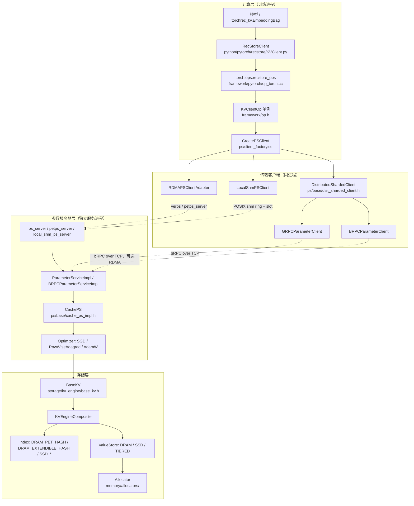

## 阅读地图

### 一句话

一个训练进程要读写 embedding，但表不归它所有：它手里只有 key 和一块结果缓冲，行放在另一个进程里。请求按 key 哈希切片，经一条可替换的传输通道送到服务进程；服务进程把"读某几行""按梯度更新某几行"翻译成对本地存储引擎的批量操作。本章拆这条链路：哪些目录承载它、跨了几个进程边界、读和写各自怎么走完、用什么选项和配置编出来。

范围：顶层目录与 `src/` 12 个一级模块的职责边界；三层架构在代码里的真实类型（不照抄 `docs/architecture/overview.md`）；一次 `EmbRead`、一次 `EmbUpdate` 的端到端主路径，止于"进入存储层"；构建选项、`third_party` 依赖、wheel 打包与产物；配置项 → 默认值 → 生效位置。不在本章：RDMA wire 协议与 lane 生命周期 → 第 04 章；`BaseKV` / index / value store / allocator 内部 → 第 05 章；`model_zoo/`、`src/test/`、`tools/benchmarks/` 的用法 → 第 06 章。

### 6 个部件

| 编号 | 短名 | 它负责回答的问题 |
| --- | --- | --- |
| 1 | 仓库地图 | 想改的东西在哪个目录、哪个模块，构建入口按什么顺序串起来 |
| 2 | 三层调用链 | 一次读写跨了哪几个进程，跨层之间传的是什么 |
| 3 | 读路径 | 一次前向查表从 Python 张量走到存储行，中间经过哪些步骤 |
| 4 | 写路径与两种更新语义 | 梯度提交到服务端有哪两套语义，写完的值什么时候对别人可见 |
| 5 | 构建与打包 | 这些代码怎么编出来，缺什么会直接失败 |
| 6 | 配置与开关 | 默认值从哪来，改哪个字段才真的生效 |

### 它们怎么串起来

第 1 块给静态结构：有哪些目录，`src/` 的 12 个模块各管什么，构建入口按什么顺序把它们加进来。第 2 块在这张地图上画动态走向：一次调用从训练进程的模型出发，穿过传输客户端，越过进程边界，落到服务进程的缓存与优化器，最后进入存储引擎。第 3、4 块各走一遍完整链路，一条读、一条写，写那条还要区分两种更新语义。第 5、6 块回答"怎么把它跑起来"：编译选项和运行时配置。

### 核心概念表

| 短名 | 一句话定义 | 别称 |
| --- | --- | --- |
| 计算层 | 训练进程内的一切：模型、Python 客户端、op 运行时、传输客户端 | 客户端侧、client side |
| 参数服务器 | 独立服务进程，持有表元数据与优化器，是跨进程读写的落点 | PS、服务端 |
| 存储层 | 服务进程内真正存放行的引擎：索引、值存储、分配器 | KV、后端 |
| 分片 | key 空间按哈希切出的等份，每份由一个服务进程独占 | shard |
| tag | 表在 key 高位上的 8 位前缀，让多张表共用一个 key 空间 | 表标签、键空间前缀 |
| 借用视图 | 只带指针和形状、不负责释放的张量视图，跨层靠它免拷贝 | `RecTensor` |
| 批 | 一次请求携带的 key 行数上限，超过就切块并发 | batch、chunk |

### 建议读法

- 目标是跑通一遍：第 1 块 → 第 5 块（构建）→ 第 6 块（配置）→ 回第 3 块对照读路径，确认命中哪个分支。
- 目标是改传输或后端：第 2 块 → 第 3 块 → 第 4 块，然后转第 03、04 章。
- 目标是查术语或定位代码：先看附录，再用第 1 块的模块表落到文件。

## 第 1 块：仓库地图

### 它是什么

一套三段式代码：训练进程、服务进程、存储。目录按语言和职责切，与这三段并不一一对应。C++ 主体在 `src/`，Python 包源码在 `src/python/pytorch/`，可运行样例在 `model_zoo/`，外围工具在 `tools/`，第三方依赖在 `third_party/`，文档站在 `docs/`，过程性材料（状态板、journal、本目录）在 `tmp/`。

### 它为什么存在

读这一章的人通常带着一个具体目的：改某个后端、加一个 op、或者只想把项目编出来。不知道哪一层归哪个目录，改动就会落在错误的位置——比如把"读路径的分支选择"当成 C++ 的事去找，会在 `src/framework` 里绕很久，而它其实在 Python 的策略层。

### 它和谁接

第 2 块的三层调用链画在这张地图上；第 3、4 块里每个步骤都能对应回这里的一个模块；第 5 块的构建入口就是下面那张 `add_subdirectory` 顺序表。

### 代码位置

顶层目录：

| 路径 | 是什么 / 给谁用 |
| --- | --- |
| `src/` | 全部 C++ 与 Python 包源码，见下节模块清单 |
| `model_zoo/`、`examples/` | 可运行样例（`criteo_kaggle/`、`rs_demo/`、`torchrec_dlrm/`、`tensorflow_dlrm/`，入口见各自 README）；`examples/` 只剩带硬编码绝对路径的遗留脚本 |
| `tools/` | Python 工具链：`benchmarks/`（PS/E2E/storage runner，含注册式性能套件 `perf/` + `perf_suite.py`）、`config/`（JSON schema 与路径解析）、`env/`、`ci/`、`format/`、`coverage/`、`test/`、`docs/`、`packaging/` |
| `dockerfiles/`、`cmake/` | 构建镜像与依赖装配（`Dockerfile.recstore`、`setup_centos7.sh` 把第三方库装到 `$RECSTORE_DEPS_PREFIX`）；CMake 查找模块 `FindGRPC.cmake`、`FindCityhash.cmake`、`common.cmake` |
| `third_party/` | 15 个 git submodule + 由脚本生成的安装前缀（后者不在仓库里） |
| `docs/`、`mkdocs.yml` | mkdocs 文档站源码与导航；`docs/config.md` 是配置字段参考 |
| `.agents/skills/`、`tmp/` | agent 操作指南（`rs-benchmark-*`、`rs-loss-aligned`）；过程区 `STATE.md`、`docs/index.md`、`journal/`、`remote/`、本目录 |
| 根文件 | `CMakeLists.txt`（构建入口）、`VERSION`（版本唯一来源，`0.1.0+cu126`，CMake 与 `pyproject.toml` 都读它）、`pyproject.toml`（scikit-build-core，只构建 `recstore_torch_ops`）、`recstore_config.json`（默认运行配置：GRPC、2 分片、PET_HASH + DRAM value） |

`src/` 下 12 个一级目录：

| 路径 | 职责 | 关键类型 / 函数 |
| --- | --- | --- |
| `src/base` | 与框架无关的基础设施：日志、JSON、Tensor 视图、工厂、hash、位图、线程/计时/绑核、jemalloc 兼容层 | `RecTensor`、`base::Factory<T>`、`GetHash`、`base::ResolveRecStoreConfigPath` |
| `src/benchmark` | C++ 基准二进制：`ps/`、`storage/`、`mixed/`、`dataset/` | `ps_transport_benchmark`、`backend_benchmark` |
| `src/executable` | 独立可执行/实验入口；仅 `executable/uvm` 有 CMake 入口（CUDA 时构建） | `executable/uvm/intercept.cpp`、`uvm_libtorch.cc` |
| `src/framework` | 框架无关 op 运行时 + PyTorch/TF/HugeCTR 绑定 + GPU cache 适配 + BagPipe 元数据 | `CommonOp`、`KVClientOp`、`CacheAwareOp`、`TORCH_LIBRARY(recstore_ops, m)` |
| `src/gpu_memory` | GDRCopy 与设备显存映射工具（未接入构建，见风险 7） | `memory_pool.cu.cc`、`gdrapi.h` |
| `src/memory` | 共享内存文件、epoch 回收、DRAM 分配器实现 | `epoch::EpochManager`、`CONCURRENT_SLAB_MEMORY_POOL`、`PERSIST_LOOP_SLAB` |
| `src/optimization` | 只有头文件 `bagpipe/cache_metadata.h`，无独立 CMakeLists，被 `framework/pytorch/cache/bagpipe_bindings.cc` 包含 | `optimization::bagpipe::CacheMetadata` |
| `src/optimizer` | 服务端稀疏优化器与 key tag 键空间 | `Optimizer`、`SGD`、`RowWiseAdaGrad`、`AdamW`、`MakeTensorTag` |
| `src/ps` | 参数服务器全部传输与协议：`base/`（抽象、`CachePS`、单分片监听端点解析 `shard_endpoint.h`）、`proto/`、`grpc/`、`brpc/`、`rdma/`、`local_shm/`、`python_client/`（遗留） | `BasePSClient`、`DistributedShardedClient`、`CreatePSClient`、`SelectSingleShardEndpoint`、`ps_server` |
| `src/python` | Python 包源码与 CMake 版本模板 | `RecStoreClient`、`_ensure_native_loaded`、`version_info.py.in` |
| `src/storage` | KV 引擎、索引、值存储（含 CLOCK 分层 `tiered_clock_value_store.h`）、分层读缓存 `cache/`、SSD/NVM、GPU cache kernel、SSD 布局 | `BaseKV`、`KVEngineComposite`、`base::ResolveEngine`、`TieredClockValueStore`、`TieredReadCache`、`ValueStore` |
| `src/test` | C++/Python 测试与配置样本（`configs/`、`framework/`、`ps/`、`server_mgr/`、`scripts/`） | `test_kvengine.cpp`、`test_shard_endpoint.cpp`、`scripts/check_test_registration.py` |

构建入口的真实关系（`add_subdirectory` 顺序）：`src/CMakeLists.txt` 依次加入 `base`、`ps`、`memory`、`storage`、`optimizer`、`benchmark`、`test`、`framework`，最后在 CUDA 可用时加入 `executable/uvm`。`src/gpu_memory` 与 `src/optimization` **不在**这条链上。最近地图层面的增删（细节归第 05、06 章）：`src/ps/base/shard_endpoint.h`、`src/storage/cache/tiered_read_cache.h`、`src/storage/value_store/tiered_clock_value_store.h`、`tools/benchmarks/perf/` 与 `perf_suite.py`、`tools/benchmarks/run_tiered_cache_sweep.py`、`src/test/scripts/check_test_registration.py`、`src/test/test_shard_endpoint.cpp`、`src/test/test_petkv_unsupported.cpp`、`src/test/test_report.cpp`（不再限 Debug）、`.github/workflows/doc-check.yml` 是新增入口；`src/test/test_ssd_extendible_hash.cpp` 已删除。

### 交付一句

第 1 块到此为止：你现在能回答"某个东西大概在哪"。下一块接三层调用链，把这张静态地图变成一次调用穿过的层。

## 第 2 块：三层调用链

### 它是什么

一次 embedding 读写穿过三层。计算层在训练进程里，内部还分两段：前面的模型与 Python 客户端，后面的 op 运行时与传输客户端。参数服务器层在独立的服务进程里，由服务实现接住请求、交给缓存编排。存储层就在同一个服务进程里，是真正存放行的引擎。

三段之间有两次交接，但只有一次跨进程：计算层内部是同进程的函数调用；传输客户端到服务实现是 RPC 或共享内存，这是本章唯一真正的"另一个进程"；服务实现到存储引擎又是同进程调用，只是类型上过了一层抽象。读代码的直觉按这个来：想看协议去传输客户端与服务实现，想看算法去缓存编排与存储引擎。



图里有一条容易忽略的关系：`CreatePSClient` 之后分叉出四类客户端，但同一时刻只有一个在生效，因为 op 运行时里只有一个进程级单例持有它。Python 侧可以创建多个客户端对象、多个模型模块，它们最后共用这一个连接。

### 它为什么存在

这层抽象存在的理由是后端可替换。同一个 `EmbRead` 调用，下面可能是 gRPC、bRPC、RDMA 或共享内存；没有 `CommonOp` 这层，每个调用点都要知道后端是谁。有了它，模型代码只认"按 key 取行"，后端选择推迟到配置解析的那一刻。

### 它和谁接

上游是第 3、4 块的两条路径，它们都从这张图的左上角出发；下游是第 03 章（传输实现细节）和第 05 章（存储引擎内部）。本块负责中间那段：谁持有谁，跨层传什么。

### 代码位置

跨层传递的数据结构，前五个"过边界"，后四个是运行时状态：

| 结构 | 位置 | 关键不变量 |
| --- | --- | --- |
| `RecTensor` | `src/base/tensor.h#RecTensor` | 纯借用视图，析构不释放 `data_ptr`；dtype 只有 `UINT64` / `FLOAT32` 等枚举，无 device 概念 |
| `EmbeddingTableConfig` | `src/ps/base/base_client.h#EmbeddingTableConfig` | `{num_embeddings, embedding_dim, table_id}`，`Serialize()` 成 JSON 走 RPC |
| `ParameterCompressItem` / `ParameterPack` | `src/ps/base/parameters.h` | `#pragma pack(1)` 的 `{key, dim, float embedding[0]}`，尾随变长行；RPC 上整块 flat 编码 |
| `KVEngineComposite` 配置 | `src/storage/kv_engine/base_kv.h` 顶部注释 + `engine_composite.h` | 必须嵌套 `index` / `value`；`index.type`、`value.type` 用 `j.at(...)` 强取，缺失即抛 |
| tag 键空间 | `src/optimizer/sparse_tensor.h#MakeTensorTag` | 高 8 位是 tag = `table_id * tensors_per_table + role`；超过 255 抛异常；Python 侧 `_KEY_TAG_SHIFT = 56` 与之对齐 |
| `SparseTensor` | `src/optimizer/sparse_tensor.h#SparseTensor` | 一个逻辑张量 = `(key, tag)` 拼接后的 key 空间；优化器只经它（`#ApplySgdUpdateFlat` 等）的 flat 批处理接口读写存储 |
| `CacheLookupActions` / `CacheUpdateActions` | `src/framework/cache/cache_aware_op.h` | cache 只通过回调与运行时交互；传输完成必须先于 cache 维护，失败一律清空 |
| `LocalShmSlotHeader` / `LocalShmControlBlock` | `src/ps/local_shm/local_shm_protocol.h` | slot 状态机 `kFree → kWriting → kReady → kRunning → kDone/kError`；`server_epoch` 不匹配返回 `kEpochMismatch` |
| `PSClientCreateOptions` | `src/ps/client_options.h` | `type ∈ {kGrpc, kBrpc, kRdma, kLocalShm}` + `transport_config` + `raw_config`，是 `CreatePSClient` 的唯一输入 |

跨层硬约束，都能在代码里直接验证：

- key 必须是 `int64` / `uint64` 一维连续；values/grads 必须是 `float32` 二维连续且行数等于 key 数（`CheckKeys` / `CheckRows`、`validate_keys` / `validate_embeddings`）。
- `pull_into` 额外要求目标是 CPU、`float32`、连续、`requires_grad == False`、形状完全匹配。
- 服务端建表是"注册 tag + 形状"，不写数据：`CachePS::InitTable` 只登记 `table_configs_` 并调 `optimizer_->Init`；真正写入由 Python 的 `init_data` 调 `emb_write` 完成。
- GPU cache 保留两个哨兵 key：`int64` 的 `max` 与 `max - 1`（`_reject_gpu_cache_reserved_ids`）；该检查对 CUDA 张量默认跳过，只有设 `RECSTORE_VALIDATE_GPU_CACHE_KEYS=1` 才生效。

### 交付一句

第 2 块到此为止：链路有哪几段、每段的持有关系、跨段传什么，都交代完了。下一块接读路径，看一条真实请求怎么从第一段走到最后一段。

## 第 3 块：读路径

### 它是什么

一次前向查表，从 Python 侧的张量开始，到"存储层刚刚被读了一行"结束。中间有两处关键分叉：一处决定走哪条读策略，一处决定发给哪个分片。所有分支选择都在 Python 侧做，C++ 只提供原语——这个事实决定了你调试时该在哪一层加日志。本块按发起、分流、扇出、回收四个阶段走。

### 它为什么存在

[推断] 读是训练循环里最频繁的操作，读路径围绕三件事设计：不要把 key 逐条发出去、不要把结果逐条拷回来、不要在没命中缓存时把主线程卡死。理解这些成本，才知道为什么某些"看起来该在 C++ 里"的逻辑其实在 Python。

### 它和谁接

上游是第 2 块的 `torch.ops.recstore_ops` 入口，下游是第 05 章的 `BaseKV::BatchGet`。本章只讲到"进入存储层"为止。

### 代码位置

**阶段一：发起。** 模型从 `DistTensor.__getitem__` 或 embedding 模块的 `forward` 出发，调用 `RecStoreClient.pull(name, ids)`。客户端先 `_normalize_ids`（转 `int64`、`contiguous()`、非 `preserve_device` 时搬到 CPU），再由 `_encode_ids` 把表 tag 或进 key 高位（`tag << 56`）。`RecStoreClient` 是单例（`__new__` + `_initialized`），构造时绑定 `self.ops = torch.ops.recstore_ops`。`emb_read` 由 `RegisterBaseOps` 绑定到 `emb_read_torch`，后者转给 `CachedReadTorch(keys, dim)`，并在这一层做 dtype/shape 校验。

**阶段二：分流。** `CachedReadTorch` 分配输出缓冲（CUDA 场景用 pinned CPU 缓冲），调 `g_cache_aware_op.Lookup(rows, io, no_evict)`。GPU cache 可用（编译开关打开且 `CanUseGpuCache(keys, dim)`）时走 query → read_missing → fill → scatter；否则走 `io.read_all`。低命中率连续出现会触发 bypass 并清空 cache。`read_all` 里，key 在 CUDA 上时先 `StageCudaTensorToPinnedCpu`，随后 `ToRecTensor` 生成借用视图，再调 `op->EmbRead(k, v)`。

`op` 是 `GetKVClientOp()` 用 `std::call_once` 造的进程内唯一 `KVClientOp`；`GetConcreteKVClientOp()` 再做 `dynamic_pointer_cast` 并断言后端确实是 `KVClientOp`。`EmbRead` 先处理 `hierkv` 短路，再校验 dtype/维度/行数，把输出清零，最后 `ps_client_->GetParameter(keys_array, values)`。

**阶段三：扇出。** 多态分派到 `DistributedShardedClient<ClientT>::GetParameter`：`PartitionKeys` 用 `GetShardId(key) = GetHash(key) % num_shards`（`simple_mod` 时 `key % num_shards`），为每个 shard 分配结果缓冲，按 `max_keys_per_request`（默认 500）分块，用 `std::async` 并发发出。单分片客户端在本进程的 async 线程里发起 RPC，这就是进程边界。gRPC 侧另有 `FLAGS_get_parameter_threads`（默认 4）个 stub 与 `MAX_PARAMETER_BATCH = 2000`。

**阶段四：服务端与回收。** `ps_server` 由工厂键选出 `GRPCParameterServer` / `BRPCParameterServer`，其 `ParameterServiceImpl::GetParameter` 调 `CachePS::GetParameterRun2Completion(keys, packs, 0)`；`CachePS` 走 `base_kv_->BatchGet`，每行包成 `ParameterPack`，用 `ParameterCompressor` 压成 flat block 放进 `reply->parameter_value()`。回到客户端后按 `key_index_mapping_` 用 `ScatterEmbeddingRows` 写回调用方缓冲的原始行位置，CUDA 时再 `values.to(device, non_blocking=true)`。

失败语义：gRPC 客户端检查传输完成与每条 RPC 的 `Status`，失败向上返回错误，不再把清零缓冲当成功交回（细节与 deadline、prefetch 归第 03 章）。形态与所有权不变：`ids` 上层 `[N] int64`、C++ 视图 `[N] uint64`；`values` 为 `[N, D] float32`；CPU 缓冲由 PyTorch 分配器持有，跨层只传借用指针。服务端 `ParameterPack` 指向 `BatchGet` 返回的行内存或该线程的 thread-local 读缓冲，只在本次请求内有效。

按阶段对照代码：

| 阶段 | 步骤 | 代码位置 |
| --- | --- | --- |
| 发起 | 表句柄取行、单例客户端、id 归一化与 tag 编码 | `src/python/pytorch/recstore/DistTensor.py#DistTensor.__getitem__`、`KVClient.py#RecStoreClient.__new__`、`#_normalize_ids`、`#_encode_ids` |
| 发起 | op 注册与绑定、dtype/shape 校验、pinned 缓冲 | `src/framework/pytorch/op_torch.cc#TORCH_LIBRARY(recstore_ops, m)`、`op_base.cc#emb_read_torch`、`cache/tensor_adapter.cc#CachedReadTorch`、`#CheckKeys` |
| 分流 | cache-aware 查表与 bypass | `src/framework/cache/cache_aware_op.h#CacheAwareOp::Lookup` |
| 分流 | CUDA→pinned staging、借用视图 | `src/framework/pytorch/op_internal.h#StageCudaTensorToPinnedCpu`、`#ToRecTensor` |
| 分流 | 单例获取、后端下转型、`EmbRead` 清零与转发 | `src/framework/op.cc#GetKVClientOp`、`#GetConcreteKVClientOp`、`#KVClientOp::EmbRead` |
| 扇出 | 分片路由与分块 | `src/ps/base/dist_sharded_client.h#GetShardId`、`#PartitionKeys`、`#GetParameter` |
| 扇出 | 单分片 RPC 发起 | `src/ps/grpc/grpc_ps_client.cpp#GRPCParameterClient::GetParameter`、`src/ps/brpc/brpc_ps_client.cpp#BRPCParameterClient::GetParameter` |
| 服务端 | 服务实现与缓存编排 | `src/ps/grpc/grpc_ps_server.cpp#ParameterServiceImpl::GetParameter`、`src/ps/base/cache_ps_impl.h#CachePS::GetParameterRun2Completion` |
| 回收 | 行位置回填与回设备 | `src/ps/base/dist_sharded_client.h#ScatterEmbeddingRows`、`src/framework/pytorch/cache/tensor_adapter.cc#CachedReadTorch` |

### 交付一句

第 3 块到此为止：读路径在"进入存储层"这一步收尾。下一块接写路径，形状与读对称，但多一个麻烦——写有两种语义。

## 第 4 块：写路径与两种更新语义

### 它是什么

一次稀疏梯度提交，从 `backward` 产生的 `(ids, grads)` 开始，到"服务端优化器对某几行做了读改写"结束。与读路径最大的差别在于：学习率由谁施加，在两套并存的实现里答案不同。

### 它为什么存在

写路径必须解决两个问题。第一，梯度是按 batch 产生的碎片，必须先聚合再发，否则同一个 key 在一次请求里出现多次。第二，更新之后客户端可能缓存了旧行，必须让缓存失效，否则下一步读到旧值。

### 它和谁接

上游是本块的两种计算层实现，下游是第 05 章的优化器与存储读改写。第 02 章会把同样两条语义放进 Python 侧的梯度归并与 BagPipe 上下文里再讲一遍。

### 代码位置

**两种更新语义并存。** 传统 `DistEmbedding` 路径：`backward` 只把 `(unique_ids, summed_grads)` 追加到 `mod._trace`，`SparseSGD.step()` 里的 `_process_dist_embedding_module` 做 pull-modify-push——`mod.weight[unique_ids]` 拉回、`current - lr * grads`、再 `mod.weight[unique_ids] = updated`（内部走 `emb_write`），学习率在 Python 生效。`torchrec_kv.EmbeddingBag` 与通用模块路径：`_process_generic_module_with_trace` 聚合梯度后调 `update_async(name, ids, grads)`，学习率由服务端优化器施加。两条路径对同 `(client, table)` 混用时，第一次用过的模式会被 `_record_table_update_mode` 记住，改用另一种直接 `RuntimeError`。

**提交的形态。** `RecStoreClient.update` = `update_async` + `wait`。`update_async` 先 `_normalize_ids`（含 tag 编码）、`_normalize_grads`（`float32`、连续、默认搬 CPU），生成自增 handle。若 `current_ps_backend() == "rdma"` 且 op 暴露 `emb_update_async`，直接调用并记下后端 handle；否则把 `ids.clone()` / `grads.clone()` 暂存，等 `wait()` 再提交（"staged" 路径）。`wait(handle)` 时 RDMA 走 `emb_update_wait`，staged 走 `emb_update_table`。

**进入 op 与缓存。** `emb_update_table_torch` 先 `CheckRows` 校验 `[N] int64` + `[N, D] float32`，`ToCpuTensor`，转 `RecTensor`，调 `GetConcreteKVClientOp()->EmbUpdateCached(table, keys, grads, CacheActions(keys, D))`。`EmbUpdateCached` 把真正更新包在 `g_cache_aware_op.Update(rows, cache, fn)` 里：先执行 `EmbUpdate`，成功后按 `CacheUpdateActions` 做 per-key 失效或整表清空；抛异常时也会清空 cache。`KVClientOp::EmbUpdate` 处理 `hierkv` 短路、校验后调 `ps_client_->UpdateParameter`。

**扇出。** `DistributedShardedClient::UpdateParameter` 同样 `PartitionKeys`，但要用 `GatherEmbeddingRows` 把梯度按 shard 的 `key_index_mapping_` **收集**成连续块（只发属于该 shard 的行），再按 `max_keys_per_request` 分块 `std::async` 扇出。任一 shard 返回非 0 即整体返回 -1。进程边界与读路径相同。

**服务端。** `ParameterServiceImpl::UpdateParameter` 把 `request->gradients()` 重新解释为 `ParameterCompressReader`，调 `cache_ps_->UpdateParameter(table_name, reader, 0)`；`CachePS` 调 `optimizer_->Update(...)`（flat 路径是 `UpdateFlat`），优化器内部按 `SparseTensor` 拼 key+tag 后对 `BaseKV` 做读改写，然后 `MarkCheckpointDirty()`。索引查找、值分配、缺失行补写、SSD 回写、checkpoint 语义从这一步起归第 05 章。

**一致性与可见性。** 更新成功后客户端按 `CacheUpdateActions` 失效对应 key 的 GPU cache；若更新抛异常，`CacheAwareOp::Update` 先清空整张 cache 再把异常抛出，避免读到旧行。`push`（`emb_write`）路径则无条件清空 GPU cache。`wait()` 返回的是"提交完成"，不是"值已可见于所有读者"；跨 step 的可见性由优化器 + 服务端 `SparseGradientCommit` 的 session/step 语义约束（见第 05 章）。

按步骤对照代码：

| 阶段 | 步骤 | 代码位置 |
| --- | --- | --- |
| 计算层 | pull-modify-push 与更新模式记录 | `src/python/pytorch/recstore/optimizer.py#_process_dist_embedding_module`、`#_record_table_update_mode`、`src/python/pytorch/recstore/DistEmb.py#_DistEmbFunction.backward` |
| 计算层 | 通用模块梯度聚合 | `src/python/pytorch/recstore/optimizer.py#_process_generic_module_with_trace` |
| 提交 | handle 生成与 staged 队列 | `src/python/pytorch/recstore/KVClient.py#update_async`、`#wait` |
| 提交 | op 层校验与转发 | `src/framework/pytorch/op_base.cc#emb_update_table_torch`、`#CheckRows` |
| 缓存 | 更新后失效/清空 | `src/framework/op.cc#KVClientOp::EmbUpdateCached`、`src/framework/cache/cache_aware_op.h#CacheAwareOp::Update` |
| 扇出 | 梯度收集与分块 | `src/ps/base/dist_sharded_client.h#UpdateParameter`、`#GatherEmbeddingRows` |
| 服务端 | 读取压缩梯度 | `src/ps/grpc/grpc_ps_server.cpp#ParameterServiceImpl::UpdateParameter`、`src/ps/base/cache_ps_impl.h#CachePS::UpdateParameter` |
| 服务端 | 优化器读改写 | `src/optimizer/optimizer.h#Optimizer::Update`、`src/optimizer/sparse_tensor.h#ApplySgdUpdateFlat` |

### 交付一句

第 4 块到此为止：读写两条链路都闭合到存储层入口。下一块接构建，把"这些代码从哪来"补上。

## 第 5 块：构建与打包

### 它是什么

一套 CMake 顶层选项、一批必须存在的第三方依赖、一份 scikit-build-core 的打包配置。三者串起来决定"能不能编出来"和"编出来是什么形状"。

### 它为什么存在

依赖面比一般 C++ 项目宽：CUDA、gRPC、bRPC、folly、libtorch 都要在 configure 阶段找到。缺一个就失败，而失败信息往往指向一个不在仓库里的目录。先把这条约束讲清，能省掉一轮盲试。

### 它和谁接

上游是第 1 块的模块清单（选项决定哪些模块进构建），下游是第 6 块的运行时配置（编出来的二进制读哪些字段）。

### 代码位置

**目标（顶层选项）**

| 选项 | 默认 | 影响 |
| --- | --- | --- |
| `ENABLE_CUDA` | `ON` | 决定 `project(... LANGUAGES ... CUDA)`、CUDA arch（`RECSTORE_CUDA_ARCHITECTURES` 默认 `80;86`）、`storage/gpu_cache`、`framework/cache`、`executable/uvm` 是否构建 |
| `RECSTORE_ENABLE_GPU_CACHE` | `ON` | 与 CUDA 同时满足才构建 `framework/cache`，并定义 `RECSTORE_ENABLE_GPU_CACHE` |
| `RECSTORE_ENABLE_THIRD_PARTY_ENGINES` | `OFF` | 打开 `storage/external/fasterkv` 与 `storage/external/hps`；强制要求 `ENABLE_CUDA=ON`、`third_party/faster` 与递归初始化的 `third_party/HugeCTR`，否则 `FATAL_ERROR` |
| 其余开关 | 均 `OFF` | `USE_PERF_REPORT`（任意构建类型；打开后编 `report_client`，sink 由运行时 `observability` / 环境变量选择）、`USE_BRPC_CPU_PROFILER`（需 `libtcmalloc_and_profiler`）、`RECSTORE_ENABLE_HDRHISTOGRAM_PROGRAMS`（只影响 ycsb 的 CTest 注册）、`USE_FAKE_KVCLIENT`（`common/op_mock.cc` 替掉真实客户端）、`RECSTORE_ENABLE_TENSORFLOW`、`ENABLE_RDMA_INTEGRATION_TESTS`、`RECSTORE_ENABLE_SPDK`/`USE_PMKV`/`USE_PIBENCH` |

**依赖（缺一即 configure 失败）**：`OpenMP`、`Protobuf CONFIG`、`gRPC CONFIG`、`Torch`（`third_party/libtorch/libtorch/share/cmake/Torch`）、`folly CONFIG`、`gflags`、`glog`、`TBB`、`pybind11`、`Python >= 3.10`、`ZLIB`、`Threads`、`ibverbs`（RDMA 无条件构建）、以及 `bRPC` + 自定义 `protobuf`（`src/ps/brpc/CMakeLists.txt` 缺失时直接 `FATAL_ERROR`）。`jemalloc` 通过 `ExternalProject_Add` 跑 `autoconf` + `--with-jemalloc-prefix=je` 现场编译。`third_party` 分两类：`.gitmodules` 声明的 15 个子模块（`fmt`、`folly`、`glog`、`googletest`、`gperftools`、`json`、`grpc`、`HugeCTR`、`cpptrace`、`jemalloc`、`liburing`、`spdk`、`brpc`、`cityhash`、`faster`），以及代码里引用的**生成前缀**——不在仓库内，由 `dockerfiles/setup_centos7.sh` 等脚本产出：`third_party/grpc-install`、`protobuf-install`、`brpc-install`、`libtorch`、`leveldb`、`ycsb`、`glog/glog-install-fPIC`、`folly/folly-install-fPIC`。当前 Windows 检出这 8 个路径全部不存在，所以"仅 clone + cmake"必定失败，必须先跑环境装配脚本。folly 不再只是"配置阶段要找到"：`src/storage/kv_engine/CMakeLists.txt` 显式链 `Folly::folly`，`engine_composite.h` 直接 `#include <folly/SharedMutex.h>`，所以存储引擎的单测目标也依赖它。

最小构建（仍可跑 CPU 训练/PS 单测）：

```bash
cmake -DCMAKE_BUILD_TYPE=Release -DCMAKE_POLICY_VERSION_MINIMUM=3.5 \
      -DENABLE_CUDA=OFF -DRECSTORE_ENABLE_GPU_CACHE=OFF \
      -DRECSTORE_ENABLE_THIRD_PARTY_ENGINES=OFF ..
cmake --build . -j
```

即使最小构建也仍需全部生成前缀（folly/gRPC/bRPC/leveldb/libtorch/protobuf）与 `recstore_deps`（fmt/gflags/boost/TBB/OpenSSL）；可跳过的只有 `third_party/faster`、`HugeCTR`、`spdk`。全功能构建在此基础上加 `-DENABLE_CUDA=ON`、`-DRECSTORE_ENABLE_GPU_CACHE=ON`、`-DRECSTORE_ENABLE_THIRD_PARTY_ENGINES=ON`、`-DUSE_PERF_REPORT=ON`，按需 `RECSTORE_ENABLE_SPDK` / `USE_PMKV` / `ENABLE_RDMA_INTEGRATION_TESTS`，并递归初始化 `third_party/faster`、`third_party/HugeCTR`。

**打包（产物）**

- C++ 产物：`build/lib`（`lib_recstore_ops.so`、`libbrpc_ps_client.so`、`libdist_brpc_ps_client.so`、`liblocal_shm_ps_client.so`、`libwq_ps_client.so` …）与 `build/bin`（`ps_server`、`petps_server`、`local_shm_ps_server`、各类 `*_test`、`grpc_ps_bench`）。
- wheel：scikit-build-core 复用 `build/` 目录，只构建 `recstore_torch_ops`，只安装 `COMPONENT python`；扩展落到 `recstore/lib/`，runtime rpath 为 `$ORIGIN:$ORIGIN/../native`，非 torch 运行库按 soname 列表 vendored 进 `recstore/native/`（`src/framework/pytorch/CMakeLists.txt#_recstore_wheel_sonames`）。`libtorch*` / `libc10*` 故意不打包，`torch==2.7.1` 是硬运行依赖。
- 版本与分发：`VERSION` 是唯一来源；`configure_file` 把 `src/python/version_info.py.in` 渲染到构建树**和源码树** `src/python/pytorch/recstore/version_info.py`（configure 会写源码树，属已知副作用）。二进制分发用 `tools/packaging/pack_artifact.sh <out.tar.gz> <artifact...>` 收集可执行/`.so` 及其 `ldd` 依赖到 `bin/`、`lib/`、`deps/lib/` 并写 `manifest.txt`。

**静态注册**：`src/storage/kv_engine/kv_engine_register.cc#RecStoreForceLinkKVEngineRegistrations` 是给静态链接构建用的显式入口。该编译单元只放工厂注册与一个静态初始化器，静态库会把它丢掉，随后所有 `BaseKV` / index / value-store / allocator 查找在运行时报 "no Factory instance"；共享库构建靠 `--no-as-needed` 保持加载，不需要它。`benchmark_kv_engine.cc` 已显式调用。

### 交付一句

第 5 块到此为止：能编出来，且知道产物落在哪。下一块接配置，讲编出来的二进制运行时读哪些字段。

## 第 6 块：配置与开关

### 它是什么

一套"配置文件 + 环境变量 + 少量 C++ gflags"的组合。没有统一的配置对象，服务端和客户端各自按自己的顺序解析同一份 JSON。

### 它为什么存在

默认值分散在三处：JSON schema 的缺省、C++ 里的短期缺省、gflags 的初值。三者不一致时，表现是"配置写了但没生效"。这一块把归属摊开，省掉对照源码猜的时间。

### 它和谁接

上游是第 5 块编出来的二进制，下游是第 3、4 块里那些"按配置选分支"的调用点。第 02 章会从计算层角度再列一遍它真正读取的字段。

### 代码位置

**查找顺序。** 服务端（`src/ps/ps_server.cpp#main`）只用三个来源：`--config_path`（文件不存在则忽略）→ `--brpc_config_path`（同样先探测存在性）→ `base::ResolveRecStoreConfigPath()`（从 CWD 逐级向上找 `recstore_config.json`，再退回仓库根同名文件，都没有则报错、退出码 1）。`RECSTORE_CONFIG` 不是服务端来源：它只影响客户端 `GetGlobalConfig()`（`RECSTORE_CONFIG` 指向的文件若不存在会抛，随后被吞成空配置，见风险 3）与 Python/测试启动脚本（脚本把它转成 `--config_path`）。客户端另一个入口 `GetGlobalConfig()` 与 `ResolveRecStoreConfigPath` 共用同一套目录搜索。

**按块归属**（只列真正生效的字段，默认值取自代码；完整字段见 `docs/config.md`）：

| 块 | 谁读 | 字段与默认 |
| --- | --- | --- |
| `cache_ps` | 服务端 + 客户端路由 | `ps_type` 缺省 `GRPC`（仅 `GRPC`/`BRPC`，其他值 `return 2`）；`num_threads` 无默认、缺失即抛；`num_shards` 缺省 1；`servers` 见下；`optimizer.type=SGD`、`learning_rate=0.01`；`max_batch_keys_size` 已废弃，出现只打 `WARNING` 并忽略 |
| `distributed_client` | 计算层客户端 | 缺失字段先从 `cache_ps` 复制；`num_shards` 缺省取 `servers.size()`；`hash_method=city_hash`（`simple_mod` 时用 `key % num_shards`）；`max_keys_per_request=500` |
| `client` | 单分片客户端 | `host=127.0.0.1`、`port=15000`、`shard=0`；只在 `cache_ps.servers` 与 `distributed_client.servers` 都缺失时生效 |
| `local_shm` | shm 客户端 | `region_name=recstore_local_ps`、`slot_count=64`、`slot_buffer_bytes=8 MiB`、`client_timeout_ms=30000` |
| `base_kv_config` | `CachePS` → `ResolveEngine` → `Factory<BaseKV>` | `engine_type` 缺省 `KVEngineComposite`；`capacity` 无默认；`index.type`/`value.type` 用 `.at` 强取 |
| `value` | `KVEngineComposite` | `type` 无默认；`default_value_size_hint` 代码缺省 0；`dram_allocator.type`/`ssd_allocator.type` 经 `NormalizeAllocatorType` 归类 |
| `value.tiering` | `TIERED_VALUE_STORE` | `cache_policy` 缺省 `none`，接受 `none`/空、`lru`、`clock`、`adaptive`；`cache_budget_ratio=0.05` ∈ (0,1]（仅 LRU）；`cache_shards=16` ∈ [1,4096]；`promote_min_misses=2` ≥ 1；`expected_dram_bytes=0`；`retain_backing_copies=true`；CLOCK 另有 `clock_{frequency_admission,cost_aware,async_exchange}` 与两个队列上限；`dram_keys_path` 与 CLOCK 互斥，`online_admission=false`，`async_admission=false`（后者要求前者，且要求名单非空、plain SSD 布局）；非法值抛 `std::invalid_argument` |
| `observability` | `report()` | `sinks` 列表（`remote`/`csv`/`jsonl`/`glog`/`none`，缺省只开 `glog`）；`remote.endpoint/timeout_ms/queue_max`、`csv.path/flush_every_n`、`jsonl.path/flush_every_n`；旧的 `report_API` 仍生效但被它覆盖；Python 侧经 `recstore.telemetry.emit()` 进同一批 sink |

**单分片监听地址**（`95616eef`）：服务端不再硬编码 `0.0.0.0:15000`。单分片分支优先取 `cache_ps.servers` 中 `shard == local_shard_id` 的那一项的 `host`/`port`；`local_shard_id` 来自 `--grpc_local_shard_id` / `--local_shard_id`（缺省 `-1`，此时按 shard 0 找）；`servers` 整个缺失时回退 gRPC 的 `0.0.0.0:15000` 或 bRPC 的 `0.0.0.0:<--brpc_server_port>` 并打 `WARNING`；有 `servers` 但缺该 shard、或 `host`/`port` 类型不对时抛异常并 `LOG(FATAL)`。gRPC 解析出的 shard id 还用于 checkpoint 元数据。客户端在同一份配置下也会优先用 `cache_ps.servers`（`ResolveFrameworkDistributedClientConfig` 把缺省字段复制过去），所以两端看到的是同一组端点。

容易被忽略的两个 C++ gflags：`FLAGS_value_size = 128`（`src/ps/base/config.cc`，RDMA 用它推 embedding_dim）与 `FLAGS_max_kv_num_per_request = 300`（RDMA 路径的单请求上限）。

环境变量按层归类：

| 变量 | 作用 | 读取位置 |
| --- | --- | --- |
| `RECSTORE_CONFIG` | 指定配置文件，优先级高于目录搜索；**仅客户端/脚本** | `op_runtime_support.cc`、`petps_client.cc`、Python 与测试启动脚本 |
| `RECSTORE_BRPC_USE_RDMA` / `_RDMA_DEVICE` / `_TIMEOUT_MS` | bRPC 可选 RDMA 数据面与超时 | `brpc_ps_client.cpp` / `brpc_ps_server.cpp` |
| `RECSTORE_RDMA_TRANSPORT_MODE` / `_GET_RESPONSE_MODE` / `_ADAPTER_PROFILE` / `_RC_NAMESPACE` / `_CONTROL_PLANE_HOST` / `_PORT` / `_TIMEOUT_MS` | RDMA 传输模式、剖析、控制面端点与命名空间 | `rdma_ps_client_adapter.cc` |
| `RECSTORE_LOCAL_SHM_STAGE_REPORT` / `_READY_QUEUE_INDEX` | shm 阶段指标、就绪队列选择（缺省按 `LOCAL_RANK`/`RANK`） | `local_shm_stage_report.h`、`local_shm_client.cpp` |
| `RECSTORE_BIND_CORE_DISABLE` / `_OFFSET`、`RECSTORE_REPORT_SINKS` / `_MODE` / `_LOCAL_SINK` / `_JSONL_PATH` / `_FLUSH_EVERY_N` / `_CSV_PATH` / `_CSV_FLUSH_EVERY_N`、`RECSTORE_RUN_ID` / `RANK` / `LOCAL_RANK` / `RECSTORE_SHARD_ID` | 关线程绑核 / 起始核偏移；上报 sink 与环境变量覆盖；写入 CSV 与 `MetricSink` 的维度字段 | `src/base/bind_core.cc`、`src/base/report/report_client.cpp` |
| `RECSTORE_SPARSE_COMMIT_PROFILE` / `RECSTORE_PS_OWNER_GPU` | 稀疏提交剖析 / GPU owner 合并梯度流水 | `src/ps/base/sparse_gradient_commit.h`、`src/python/pytorch/recstore/ps_pipeline/owner.py` |
| `RECSTORE_DEFER_OPS_LOAD` / `RECSTORE_DEBUG` / `RECSTORE_DEPS_PREFIX` / `CPUPROFILE` | 延迟加载扩展 / 打印加载路径 / 构建期依赖前缀 / `ps_server` CPU profile | `recstore/__init__.py`、顶层 `CMakeLists.txt`、`ps_server.cpp` |

### 交付一句

第 6 块到此为止：配置写到哪、从哪读、谁真正用了它，都在表里。术语定义见章末附录。

## 与相邻章节的接口

- 第 02 章（计算层）：本章停在 `torch.ops.recstore_ops` 的 op 边界。`read_mode`（`direct` / `prefetch` / `bagpipe`）、`torchrec_kv.EmbeddingBag`、`fused_preload`、`ps_pipeline/owner.py`、GPU cache 的 Python 镜像都在那边展开。
- 第 03 章（PS 与传输）：从 `CreatePSClient` 之后接手——路由/分块/合并、prefetch 句柄、`ShardClient` 契约、服务端 `ParameterServiceImpl`、gRPC 失败传播与 checkpoint fan-out。
- 第 04 章（RDMA）：`RDMAPSClientAdapter`、`petps_server`、`rdma_protocol.h` 的 lane/seq、`rdma_control_plane.proto`。
- 第 05 章（存储与内存）：从 `CachePS::GetParameterRun2Completion` / `UpdateParameter` 进入 `BaseKV` 之后的一切，含四种 tiering 策略、`SparseTensor` 读改写、缺失行补写、checkpoint 与 `server_epoch`。
- 第 06 章（model zoo / 测试 / 工具）：`model_zoo/*` 的运行方式、`src/test/*` 与 `tools/benchmarks/*`（含 `perf_suite.py` 注册式性能套件）的基准 lane 定义。

## 风险、坑与未确认点

### 近期已修复（5f92ba2a → 6d205e98）

| 问题 | 现在的行为 | commit |
| --- | --- | --- |
| 单分片服务端忽略 `cache_ps.servers`，只能听固定默认端口（gRPC `0.0.0.0:15000`，bRPC `--brpc_server_port`） | 单分片分支按 shard 解析 `servers` 的 `host`/`port`，缺失才回退默认地址 | `95616eef` |
| `cache_ps.max_batch_keys_size` 无 C++ 读者，改了没反应 | 字段标为 deprecated，`CachePS` 检测到打 `WARNING` 并忽略；schema 与 `docs/config.md`、`docs/usage/configuration.md` 已同步 | `5530c44a` |
| gRPC 读失败把清零结果当成功返回 | 客户端检查传输完成与每条 RPC `Status`，失败返回 `-1`；prefetch 失败终态化，不再返回半零行 | `e2efe502` |
| 同一张表混用两种更新语义会静默多乘/漏乘 `lr` | 首次使用的模式按 `(client, table)` 记录，改用另一种直接 `RuntimeError` | `f8dc8545` |

### 本轮已修复（6d205e98 → 7c44f83da）

| 问题 | 现在的行为 | commit |
| --- | --- | --- |
| `report()` 只有"远端 HTTP 或本地 JSONL"两条硬编码通道，口径与落盘位置不能配 | 顶层 `observability` 选 sink（`remote`/`csv`/`jsonl`/`glog`/`none`），环境变量可覆盖；`report_API` 作为兼容入口保留；`USE_PERF_REPORT` 不再限定 Debug | `0d4247de` |
| tiered 参数只认 `none`/`lru` | 新增 `clock` 与 `adaptive`，并对每个策略的旋钮逐项校验（预算、分片、队列上限、`expected_dram_bytes`） | `a8c8de32`、`c5155aaf` |
| 客户端与服务端的 `lr` 不可比对 | `UpdateParameterRequest` 与 local_shm 槽位头都带 `learning_rate`，服务端不一致即拒绝 | `606d86f5`、`8a63bfed` |
| 文档坏链只在部署时暴露 | PR 触及 `docs/**` 即跑 `mkdocs build --strict` | `4ccead0c` |

### 仍存在

1. **tag 只有 8 位。** `TAG_TYPE` 是 `uint8_t`，`MakeTensorTag` 在 `table_id * tensors_per_table + role > 255` 时抛异常；Python 侧把 tag 放在 bit 56-63，用户 key 实际只有 56 位可用。多个大 `table_id` 或 AdamW（`TensorsPerTable() == 4`）会更快撞上上限。
2. **两套更新语义仍并存。** 保护只在"同一张表混用"这一层：不同表各走一条仍是合法配置，但迁移时漏改一张表就会在建 `step()` 时抛 `RuntimeError`，且要整表切换而不能按 batch 逐步过渡。跨进程的第二道保护是服务端的 `CheckLearningRate`——只在客户端上报了 `lr` 且与服务端不同时生效；`lr` 为 0 的调用方仍靠自觉。`emb_update`（无 table 名）已在 C++ 侧直接抛 `deprecated`。
3. **配置读取失败被吞成默认值。** `GetGlobalConfig()` 捕获异常后 `return json::object()`，随后 `ResolveFrameworkPSClientType` 对空配置缺省 `GRPC`、transport 缺省 `127.0.0.1:15000`。配置文件写错路径时表现为"静默连本机默认端口"，启动照常成功。
4. **单分片 + 缺 shard 条目会直接退出。** `cache_ps.servers` 存在但没有当前 shard（默认 0）的条目、或字段类型不对时，服务端 `LOG(FATAL)` 而不是回退默认地址；旧配置只为多分片写了部分条目时，单分片启动会失败。
5. **离线加载与在线路由可能不一致。** `ShardManager::KeyPartition` 固定 `GetHash(key) % NumServers()`；在线路由在 `hash_method == "simple_mod"` 时用 `key % num_shards`。配了 `simple_mod` 后，`load_db` 写入的分片与训练读取的分片会错位。
6. **GPU cache 一致性靠清空兜底。** `CacheAwareOp::Update` 在更新抛异常时清整表；`push` / `emb_write` 无条件清表；`local_shm` 下 CPU ids 的 `local_update_flat` 也会清表。清表本身正确，但会造成命中率骤降，性能毛刺容易被误读为存储变慢。
7. **`src/gpu_memory` 是孤立模块。** 它有 `CMakeLists.txt`（`add_library(gpu_memory ...)`），但 `src/CMakeLists.txt` 从未 `add_subdirectory(gpu_memory)`，也没有任何 target 链接它，`memory_pool.cu.cc` 当前不参与构建。
8. **`src/ps/python_client/` 是遗留实现**（`client2.py` 里 `GetParameter` 返回桩数据），只被 `src/test/ps/python_client/*` 引用；真实客户端是 `src/python/pytorch/recstore`。
9. **未确认：Windows 支持与 `RECSTORE_ENABLE_THIRD_PARTY_ENGINES=ON` 的可构建性。** 前者：顶层 CMake 用 `autoconf` 构建 jemalloc、`-faligned-new`、`/tmp` 日志目录、`/dev/shm` 默认值，当前 Windows 检出无法本地验证，仓库构建文档全部以 CentOS 7 容器为前提。后者：要求 `third_party/faster` 与递归初始化的 `third_party/HugeCTR`，HPS 还依赖 CUDA cublas/curand/NVML 头；本轮未构建，只确认 CMake 前置校验会 `FATAL_ERROR`。

## 附录：术语与代码位置

| 概念 | 一句话定义 | 权威代码 |
| --- | --- | --- |
| table | 具名 embedding 表：服务端按 name 登记形状，物理上由 8-bit tag 前缀 + `num_embeddings × embedding_dim` 行组成 | `src/ps/base/cache_ps_impl.h#CachePS::InitTable`、`src/optimizer/sparse_tensor.h#MakeTensorTag` |
| shard | key 空间按 `hash(key) % num_shards` 切出的逻辑分片，每片由独立服务进程里的一个 `CachePS` 独占 | `src/ps/base/dist_sharded_client.h#GetShardId`、`src/ps/client_options.h#PSClientType` |
| owner | 对一组 key 的梯度聚合与写回负责的一方：Python 侧是建表的 `DistTensor._owner`，分布式训练里是 merged-gradient 的 `owner_rank`（服务端对应 `exact_owner_rank`） | `src/python/pytorch/recstore/DistTensor.py#DistTensor.__init__`、`ps_pipeline/owner.py`、`src/ps/base/cache_ps_impl.h#CachePS::SparseGradientCommit` |
| lane | RDMA 侧一条点对点 QP 通道（`qp_index` / `publisher_lane` / `receiver_lane` + `lane_generation`），lane 内请求带单调 `seq` | `src/ps/rdma/rdma_protocol.h#RequestDescriptor`、`src/ps/proto/rdma_control_plane.proto` |
| epoch | 基于 epoch 的内存回收安全点：`current_epoch` 与 `safe_to_reclaim_epoch` 判断一段内存能否释放 | `src/memory/epoch_manager.h#EpochManager` |
| slot | local_shm 环形队列中的一个请求槽（共 `slot_count` 个），状态机 `kFree → kWriting → kReady → kRunning → kDone/kError` | `src/ps/local_shm/local_shm_protocol.h#LocalShmSlotHeader` |
| index type | 索引组件实现，决定 key → value handle 的映射（`DRAM_PET_HASH` / `DRAM_EXTENDIBLE_HASH` / `DRAM_UNORDERED_MAP` / `SSD_*`） | `src/storage/kv_engine/engine_composite.h#KVEngineComposite`、`src/storage/index/` |
| value type | 值存储组件实现，决定行数据落在 DRAM / SSD / 分层（`DRAM_VALUE_STORE` / `SSD_VALUE_STORE` / `TIERED_VALUE_STORE`） | `src/storage/value_store/value_store.h`、`engine_composite.h` |
| allocator | 值存储内部的行级内存/块分配器（`CONCURRENT_SLAB_MEMORY_POOL` / `PERSIST_LOOP_SLAB` / SSD buddy），由 `dram_allocator` / `ssd_allocator` 选择 | `src/memory/allocators/allocator_factory.h`、`src/storage/allocator/ssd/` |

## 证据索引

| 结论 | 证据 |
| --- | --- |
| 四类客户端由 `PSClientType` 枚举分派 | `src/ps/client_factory.cc#CreatePSClient`、`src/ps/client_options.h#PSClientType` |
| 单分片 grpc/brpc 也被合成为一分的 `distributed_client` | `src/framework/common/ps_client_config_adapter.cc#ResolvePSClientOptionsFromFrameworkConfig` |
| 服务端由工厂键选择 GRPC/BRPC 实现 | `src/ps/ps_server.cpp#main`、`src/ps/grpc/grpc_ps_server.cpp#GRPCParameterServer`、`src/ps/brpc/brpc_ps_server.cpp#BRPCParameterServer` |
| gRPC/bRPC 读走压缩包路径，shm/RDMA 走 flat 路径 | `grpc_ps_server.cpp#ParameterServiceImpl::GetParameter`（`GetParameterRun2Completion`）；`local_shm_server.cpp` 的 `GetParameterFlat`；`petps_server.cc` 的 `GetParameterDirectFixedRows` |
| `CachePS` 用 `ResolveEngine` + 工厂造 `BaseKV`，并造 `Optimizer` | `src/ps/base/cache_ps_impl.h#CachePS::CachePS` |
| 建表只注册 tag/形状，不填数据 | `src/ps/base/cache_ps_impl.h#CachePS::InitTable`、`src/optimizer/optimizer.cpp#SGD::Init` |
| 单分片监听地址来自 `cache_ps.servers`，缺失回退、非法 `FATAL` | `src/ps/base/shard_endpoint.h#SelectSingleShardEndpoint`、`grpc_ps_server.cpp#GRPCParameterServer::Run`、`brpc_ps_server.cpp#BRPCParameterServer::Run` |
| gRPC 读失败向上返回错误，不再静默补零 | `src/ps/grpc/grpc_ps_client.cpp#GRPCParameterClient::GetParameter`（`return -1` 分支）、`#set_deadline` |
| `max_batch_keys_size` 已废弃，只打 `WARNING` | `src/ps/base/cache_ps_impl.h#CachePS::CachePS`、`tools/config/recstore_config.schema.json` |
| 配置搜索顺序（服务端三段，`RECSTORE_CONFIG` 仅客户端）与异常吞掉 | `src/ps/ps_server.cpp#main`、`src/base/config.h#ResolveRecStoreConfigPath`、`src/framework/common/op_runtime_support.cc#GetGlobalConfig`（`catch (const std::exception&) { return json::object(); }`） |
| `gpu_memory` 未接入构建；生成前缀不在仓库内 | `src/gpu_memory/CMakeLists.txt` 存在但 `src/CMakeLists.txt` 无 `add_subdirectory(gpu_memory)`；顶层 `CMakeLists.txt` 引用 `third_party/grpc-install`、`protobuf-install`、`brpc-install`、`libtorch`、`glog/glog-install-fPIC`、`folly/folly-install-fPIC`，本地检出均不存在 |
| wheel 只装 python component，torch 不 vendored | `pyproject.toml#[tool.scikit-build]`、`src/framework/pytorch/CMakeLists.txt#install(TARGETS recstore_torch_ops ...)` |
| `VERSION` 是版本唯一来源 | `CMakeLists.txt#file(READ ... VERSION)`、`pyproject.toml#[[tool.dynamic-metadata]]`、`src/python/version_info.py.in` |
| 静态链接需要显式保留工厂注册 | `src/storage/kv_engine/kv_engine_register.cc#RecStoreForceLinkKVEngineRegistrations`、`src/storage/kv_engine/benchmark_kv_engine.cc` 调用点 |
