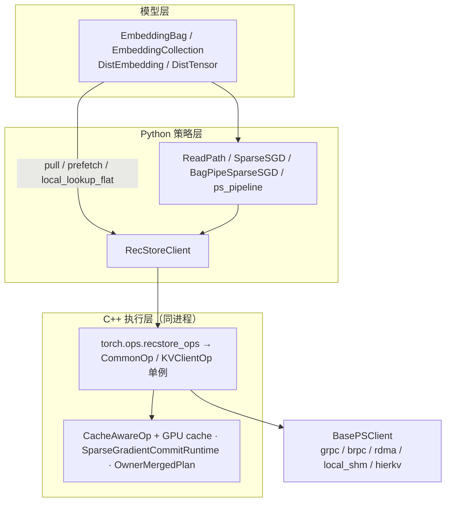
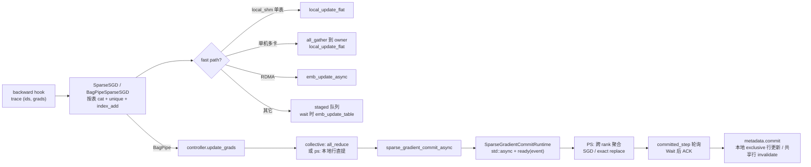
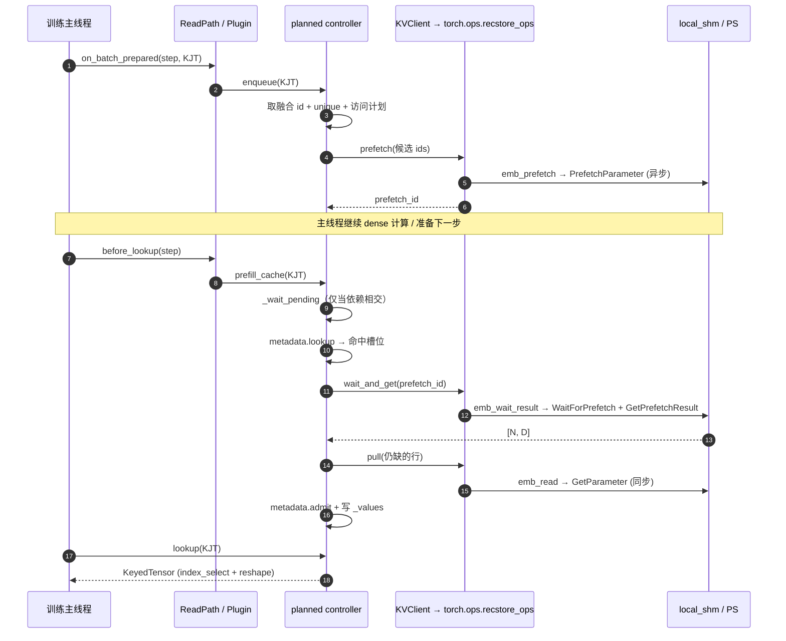
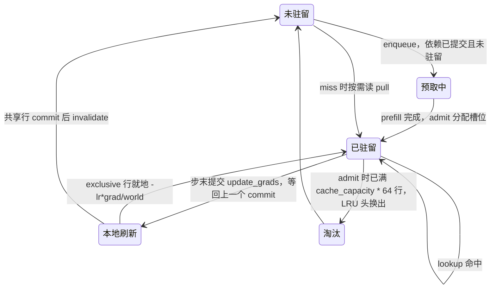

## 阅读地图

### 一句话

一次 forward 把稀疏 key 变成一批 `[N, D]` 行再交回 torchrec；一次 backward 只留下一条 `(ids, grads)` 记录。中间那层做三件事：编码 key、按设备与后端选读策略、把梯度归并后异步提交。BagPipe 在中间插一层有界行缓存，读变成"计划内命中 + 预取"，写变成会话式稀疏提交。本章回答的问题是：一次 forward/backward 如何变成对 PS 的批量读写。

**在范围**：C++ 计算层（`framework/op.*`、`framework/pytorch/*`、`framework/cache/*`）、Python 客户端、`torchrec_kv` 适配、BagPipe、`ps_pipeline`、计算层读到的配置项。**不在范围**：RPC 报文与传输 → 第 03 章；RDMA 控制面 → 第 04 章；`BaseKV` / 索引 / value store → 第 05 章；runner 与基准流程 → 第 06 章。

### 7 个部件

| 编号 | 短名 | 它负责回答的问题 |
| --- | --- | --- |
| 1 | op 入口 | 模型里的一次调用怎么变成一个注册过的 op，谁来校验参数与设备 |
| 2 | 客户端与分片 | key 怎么编码、单例怎么持有后端、多分片到底在哪一层完成 |
| 3 | 读路径 | 一次 forward 走哪条读策略，分支在谁手里 |
| 4 | 写路径与梯度提交 | 梯度从哪来、怎么归并、提交为什么是异步的 |
| 5 | BagPipe 驻留 | 客户端缓存怎么驻留、什么时候能预取、两套实现差在哪 |
| 6 | ps_pipeline | 单步流水线与 GPU owner 实验路径各自优化什么 |
| 7 | 配置与开关 | 计算层真正读取哪些字段、哪些是 build 期决定的 |

### 它们怎么串起来

第 1 块交代 Python 张量进 C++ 之后变成了什么；第 2 块把 key 编码与客户端持有关系讲清，后面每条路径都用这套 key；第 3、4 块是主干，一条读链、一条写链，都从 `EmbeddingBag` 出发，分别落到 PS 的读接口和稀疏提交接口；第 5 块单独讲 BagPipe——它在读写之间插了一层驻留，仓库里有两个同名控制器，是本章最容易读错的地方；第 6 块讲把前四块串成"下一步还没算完就开始取数"的流水线；第 7 块回到配置。

### 核心概念表

| 短名 | 一句话定义 | 别称 |
| --- | --- | --- |
| op 入口 | 唯一的 Torch 算子注册点，Python 只能通过它进 C++ | `torch.ops.recstore_ops` |
| 融合 id | 多张表共用 master 键空间后的行号，高若干位放表序号 | `fused_id` |
| 物理 key | 融合 id 再或上表 tag 得到的 64 位值，存储层只认它 | encoded id、`tag << 56` |
| trace | backward 留下的待提交记录：表名、key、梯度 | 梯度轨迹 |
| 提交 | 把 trace 归并后送上参数服务器的动作，可能异步 | commit、push |
| 驻留 | 客户端内存里保留的一份行副本，命中就不用发请求 | residency、缓存命中 |
| 读策略 | 决定"何时发起、何时消费"的调度方案 | `read_mode` |

### 建议读法

- 想搞懂一次 forward 到底发了几个请求：第 1 块 → 第 3 块，跳过 BagPipe。
- 想改缓存或预取：第 2 块（key 编码）→ 第 5 块，再回第 3 块确认分支。
- 想改梯度提交或对齐数值：第 4 块 → 第 6 块，重点看不变量那一节。

## 第 1 块：op 入口

### 它是什么

计算层是"Python 策略 + C++ 执行 + 可替换后端"的三段式。模型侧的每一次读、写、预取都收敛到一个算子命名空间：只有一处 `TORCH_LIBRARY(recstore_ops, m)` 注册点，按 op family 拆成多个 `Register*Ops`。C++ 侧再把算子分派到进程内唯一的运行时对象 `KVClientOp` 上。



`KVClientOp` 是进程内单例：多个 Python client 对象、多个模型模块最终共用同一个 PS 客户端。`ShardedRecstoreClient` 不在生产路径上（第 2 块说明）。

### 它为什么存在

Python 层负责策略（走哪条读路径、要不要压缩梯度、用哪个优化器），不改 C++ 就能换；C++ 层负责执行（张量校验、pinned staging、CUDA 事件、缓存编排），放在 Python 太慢；后端层负责传输，同一个 `KVClientOp` 下面可以是 gRPC、bRPC、RDMA 或共享内存。命名空间只有一个，是因为 Torch 自定义算子按命名空间聚合；按 family 拆注册函数只是为了让文件不至于失控。

### 它和谁接

上游是第 3、4 块的两条链路（都从这里进 C++），下游是第 03 章的传输实现。本章只讲到 `BasePSClient` 的接口边界。

### 代码位置

| 职责 | 入口 |
| --- | --- |
| 唯一算子注册点 | `src/framework/pytorch/op_torch.cc#TORCH_LIBRARY(recstore_ops, m)` |
| op 抽象与进程内单例 | `src/framework/op.h`、`src/framework/op.cc#GetKVClientOp` |
| 配置定位与后端解析 | `src/framework/common/op_runtime_support.cc#GetGlobalConfig`、`ps_client_config_adapter.cc#ResolveFrameworkPSClientType` |
| local_shm flat 读/更新与借出 lease | `src/framework/common/local_shm_kv_client_op.cc`、`src/framework/pytorch/op_flat.cc` |
| cache-aware 执行与 GPU cache | `src/framework/cache/cache_aware_op.h`、`gpu_embedding_cache.{h,cu}`、`src/framework/pytorch/cache/*` |
| 稀疏提交、owner 计划、profile | `src/framework/common/sparse_gradient_commit_runtime.h`、`owner_merged_plan.h`、`src/framework/pytorch/op_profile.cc` |

日常路径的调用形状只有三类：同步读（`emb_read` 及 `_into` 变体）、异步预取（`emb_prefetch` + `emb_wait_result` 一对句柄）、写（`emb_write` 整行覆盖、`emb_update_table` 按梯度更新）。local_shm 另有一组 flat 变体，语义相同但绕开压缩包编码；其余是控制类：稀疏提交 v1/v4、GPU cache 的 enable/clear/query/fill、BagPipe 元数据、profile 读取。逐文件清单见章末附录。

### 交付一句

入口只有一处注册点，下面挂着一个进程内单例。下一块接客户端与分片，讲清这个单例怎么被持有，以及 key 在进 C++ 之前被改成了什么。

## 第 2 块：客户端与分片

### 它是什么

Python 侧有一个大入口类，负责表元数据、id 编码、读写门面、checkpoint 和异步句柄；它不是薄封装。围绕它还有单机多卡交换、梯度归一化与 top-k、特征主序 ticket、分片路由等辅助模块。"分片"有两套实现：一套在 C++ 传输客户端内部完成，是生产路径；一套在 Python 侧按分片切换连接，只有测试在用。

### 它为什么存在

`RecStoreClient` 存在是因为模型代码不该知道 tag 编码规则、不该知道后端是 RDMA 还是 gRPC、也不该自己管理异步句柄。id 编码尤其重要：存储层只认 64 位物理 key，表身份必须藏在 key 里，这件事只能在一个地方做。分片存在是因为单进程存不下整张表，位置选择影响性能：放在 C++ 里，key 一次切完再按块并发发出；放在 Python 里，key 要逐条转成 Python 整数再分组，是 O(N) 主机循环。

### 它和谁接

上游是模型层（`EmbeddingBag` / `DistTensor`），下游是第 1 块的 op 入口。它同时被第 3、4、5 块复用：读路径调 `pull` / `prefetch`，优化器调 `update_async` / `local_update_flat` / `sparse_gradient_commit_async`。

### 代码位置

| 职责 | 入口 |
| --- | --- |
| 门面：元数据、编码、读写、异步句柄 | `src/python/pytorch/recstore/KVClient.py#RecStoreClient` |
| Python 侧多分片路由（仅测试） | `sharded_client.py#ShardedRecstoreClient` |
| 读策略协议：direct / prefetch / bagpipe | `embedding_read_path.py#build_embedding_read_path` |
| 稀疏优化器与 trace 归并 | `optimizer.py#SparseSGD`、`#BagPipeSparseSGD`（`bagpipe_cache/optimizer.py`） |
| 旧式模块与远端表句柄 | `DistEmb.py#DistEmbedding`、`DistTensor.py#DistTensor` |
| 单机多卡 ID/行/梯度交换 | `single_node_exchange.py#exchange_lookup_ids`、`#exchange_sparse_grads` |

**key 的编码。** 三层叠加：

```text
fused_id   = (table_idx << fusion_k) | feature_row_id      # torchrec_kv 融合
physical   = fused_id | (table_tag << 56)                  # KVClient._encode_ids
tag        = init_embedding_table() 返回的 backend tag     # 0 是合法 tag
```

三条约束。`_KEY_TAG_SHIFT = 56`，逻辑 id 只有低 56 位，`owner_merged_plan.h` 的 `kLogicalLimit = 1 << 56` 是同一约定。`_encode_ids` 幂等：全带目标 tag 直接返回，带别的非零 tag 抛错，全 0 时才 OR 上 `tag << 56`。GPU cache 保留两个哨兵 key：`int64.max`（empty）与 `int64.max - 1`（deleted），`_reject_gpu_cache_reserved_ids` 在 CUDA id 或 `RECSTORE_VALIDATE_GPU_CACHE_KEYS=1` 时检查。

**表元数据。** `_tensor_meta[name]` 保存 `shape / dtype / base_offset / tag / table_id / backend_initialized / part_policy`；`_next_table_id` 单调递增；`register_tensor_meta(backend_table_id=...)` 要求 `initialize_backend=True`，重复注册时 shape/dtype/base_offset/table_id 必须完全一致，否则 `ValueError`。

**分片与设备边界。** 三条：

- 生产 runner 不构造 `ShardedRecstoreClient`：多分片路由由 C++ `DistributedShardedClient` 在 `BasePSClient` 内部完成。Python 版本只在 `src/test/model_zoo/rs_demo/test_recstore_distributed.py` 出现，不能与 native 分片同时使用。
- `ShardedRecstoreClient.emb_read` 的 `keys.tolist()` 是逐 key 主机同步；`_activate_shard` 在非 native 且非 local_shm 时调 `set_ps_config` 重建 PS 客户端。这是它的性能/正确性边界。
- 返回设备：非 cache 路径先在 pinned CPU 读再 `to(device, non_blocking=True)`；`emb_wait_result` 返回 CPU 张量（`from_blob` 持有 `RecTensor` 的 shared_ptr），`wait_and_get` 再按需 `.to(device)`。

### 交付一句

key 的形状固定了，客户端只有一个，生产路径的分片在 C++ 里。下一块接读路径，看这些 key 怎么被取回来。

## 第 3 块：读路径

### 它是什么

一次 forward 的读可以拆成三个决策：什么时候发起、发起给谁、结果怎么拼回张量。三个决策都在 Python 侧做，C++ 只提供原语；读策略只负责调度，不负责存储。

### 它为什么存在

读是训练循环里最贵的一段。逐 key 发请求会让 RPC 次数随 batch 线性增长；每次同步等结果会让 dense 计算无法与取数重叠。预取、融合（多特征共用一次取数）、缓存各自省掉一种工作，分支多就是这三件事的组合。

### 它和谁接

上游是第 2 块的 key 编码，下游是第 1 块的 op 与原语。BagPipe 分支的执行细节在第 5 块，这里只说明它作为一个分支存在。

### 代码位置

以 `RecStoreEmbeddingBagCollection.forward` 为骨架，分支按优先级排列。"谁发起 / 谁等待 / 失败怎么表现"是每行最后一列：

| 优先级 | 分支 | 触发条件 | 谁发起 · 谁等待 · 失败表现 | 代码位置 |
| --- | --- | --- | --- | --- |
| 1 | local_shm 单表直连 | 后端是 local_shm 且只有一张表 | 调用线程借出共享内存 payload；非阻塞 H2D，lease 保留到 stream 完成；后端类型不符即抛错 | `torchrec_kv/EmbeddingBag.py#_lookup_fused_embeddings_shared_local_shm_single_table`、`op_flat.cc#local_lookup_flat_torch` |
| 2 | 单机多卡 owner 交换 | 每 rank 拥有自己的分片，需要跨卡取行 | `exchange_lookup_ids` 按 `fused_id % world` 发到 owner，owner 用 `local_lookup_flat` 读完回传；行数不匹配则重组错位，无重试 | `EmbeddingBag.py#_lookup_fused_embeddings_single_node_distributed`、`single_node_exchange.py#exchange_lookup_ids` |
| 3 | 融合预取 | 已发起 `emb_prefetch` 且句柄可用 | 发起在 `before_lookup` 之前，等待是 `wait_and_get(handle, dim, device)`；返回行数 != unique 数时按 id 合并，缺的退回 `pull` | `EmbeddingBag.py#_consume_fused_prefetch_embeddings`、`op_prefetch.cc#emb_wait_result_torch` |
| 4 | 逐特征预取 | 每个特征一个句柄 | 同上；逐句柄等待 | `embedding_read_path.py#PrefetchReadPath` |
| 5 | GPU cache 路径 | 开启 GPU cache 且 keys 在 CUDA | 调用线程；query 有主机同步；miss 回填、不淘汰 | `EmbeddingBag.py#_lookup_fused_embeddings_gpu_cache`、`pytorch/cache/cache_bindings.cc` |
| 6 | 普通 `pull` | 以上都不满足 | 调用线程同步；`emb_read` 返回时值已就绪；PS 读失败抛异常（第 03 章） | `KVClient.py#pull`、`op_base.cc#emb_read_torch` |

三条实现要记：

- 融合走 `enable_fusion`（默认 True）且本 batch 各特征 `embedding_dim` 一致；`fused_id = feature_value + (table_idx << fusion_k)`，所有特征共享 master 表（第一张表）的键空间。
- `emb_read` 的公共实现是 `CachedReadTorch`：`CacheAwareOp::Lookup` 先 query 命中数，有 miss 就 `read_missing`（staging 到 pinned CPU → `EmbRead` → 回 CUDA）→ `fill` → `scatter`，cache 不可用或整体失败就 `read_all`。`KVClient.pull` 的 id 始终在 CPU，所以**不会命中 C++ GPU cache**；只有 `pull_with_gpu_cache` / `gpu_cache_lookup_flat*` 保留 CUDA id 才走 cache。
- GPU cache 分支是 TTL/通用分支：若 `_bagpipe_current_prepared_ids` 已被 TTL prefill 设置就复用它，命中假设为真时用 `gpu_cache_lookup_flat_assuming_hits`。planned 生产路径不经过 `EBC.forward`，不会进入这里。

池化与返回：融合路径对拼接后的全部行做一次 `F.embedding_bag(..., mode="sum")` 再按特征切分，非融合路径逐特征池化后 `torch.cat`，返回 `KeyedTensor(keys=feature_keys, values=[B, sum(dim)], length_per_key=dims)`。

`torchrec_kv` 的三个适配模块决定这套骨架：

| 模块 | 与原生 torchrec 的关系 |
| --- | --- |
| `torchrec_kv/EmbeddingBag.py` | 替换 `EmbeddingBagCollection`：收 KJT、融合 ID、可选预取、拉行、本地池化；`record_pooled_grad` 提供不重放 autograd 的梯度记录路径。参数不在 `nn.Parameters` 里，表由 PS 持有，不能交给 DDP/分布式优化器 |
| `torchrec_kv/EmbeddingCollection.py` | 替换 `EmbeddingCollection`：逐特征 `pull` + 返回 `Dict[str, JaggedTensor]`，保留 unpooled 契约；可 `clamp_ids`；多表必须 `enable_fusion=True` |
| `torchrec_kv/fused_preload.py` | 不是 torchrec API：把第 i 张表的行预建到 master 表的 `(i << fusion_k) \| id` 键空间 |

`EmbeddingBag.py` 里的 `_RecStoreEBCFunction`（自定义 autograd Function）**没有被任何代码引用**，是遗留死代码；实际 forward 用 `register_hook`。

### 交付一句

读路径的六个分支、触发条件与失败表现都在表里。下一块接写路径，从同一次 forward 的反向开始。

## 第 4 块：写路径与梯度提交

### 它是什么

写路径分三段：backward 留下 trace，优化器把 trace 归并成"每张表一次请求"，提交运行时把请求异步送出去并按 step 对齐。三段之间的衔接点是一条记录：表名、key、梯度。

### 它为什么存在

梯度天然是碎的：一次 backward 会在多个 sample、多个特征、可能多个 rank 上分别产生同一 key 的贡献。直接发出去会导致请求数爆炸、同一 key 在一次请求里重复、跨 rank 的贡献无法合成。[推断] 归并就是把这三件事在客户端解决；代码里只有去重与求和，没有对应的设计说明。提交异步，是因为它必须等 D2H 拷贝完成、又要等对端确认 step，任何一步同步都会卡住训练主线程。

### 它和谁接

上游是第 3 块 forward（`register_hook` 挂在它产出的 `all_embeddings` 上），下游是第 03 章的 `SparseGradientCommit` 与第 05 章的服务端聚合。BagPipe 会整体替换这条路径，见第 5 块。

### 代码位置

#### 4.1 梯度怎么产生

- `DistEmbedding`：`_DistEmbFunction.backward` 把 `ids` 与 `grad_output` 转 CPU，`torch.unique` + `index_add_` 去重求和，追加 `(unique_ids, grad_sum)` 到 `_trace`。
- `RecStoreEmbeddingBagCollection`：forward 在 `all_embeddings` 上 `register_hook`；融合路径的 hook 接收整块 `[N, D]` 梯度，直接追加 `(fused_ids, grad)`。`record_pooled_grad` 是另一条快路径：用 prepared 的 `(unique_ids, inverse, raw_count)` 做 `index_add_`，避免重放 `embedding_bag` 的 autograd。
- `RecStoreEmbeddingCollection`：逐特征 `register_hook`，每个特征一条 trace，融合时 key 加 `table_idx << fusion_k`。

#### 4.2 两种更新语义与护栏

| lr 的责任方 | 模式 | 入口 |
| --- | --- |
| 客户端 | `client pull-modify-push` | `DistEmbedding` 走 `_process_dist_embedding_module`：`weight[ids] = weight[ids] - lr * grad`，一次 `pull` + 一次 `push` |
| 服务端优化器 | `server-side gradient update` | `update_async` / `local_update_flat`，客户端只交梯度 |

`_record_table_update_mode` 以 `(kv_client, table)` 为键记录首次使用的模式，遇到另一种直接 `RuntimeError`（"would apply the learning rate inconsistently"）。因此**进程内同一 client + table 的混用会在提交前失败**，不再静默地施加两次或零次 lr。这条护栏只在进程内、同一 client 对象上生效，跨进程由服务端补上第二道：`update_async` / `local_update_flat` / `emb_update_table` 现在都把客户端 `lr` 一并送到 PS，`CachePS::CheckLearningRate` 发现与优化器学习率不一致就拒绝整批更新（见第 03 章）。仍需调用方保证的是语义选择本身——`DistEmbedding` 在客户端乘 lr，服务端优化器路径不该再乘一次。`test_sparse_update_mode_guard.py` 覆盖同模式重复、两种顺序的冲突、不同表互不影响、无 trace 的 `DistEmbedding` 不占用表；`test_sharded_update_async_lr.py` 覆盖 lr 沿分片与异步路径的透传。

#### 4.3 优化器怎么提交

1. `SparseSGD.step` 收集每个模块的 `_trace` 按表名分组；同一表的多条 trace 先 `cat`，再 `torch.unique` + `index_add_` 得到 `(unique_ids, summed_grads)`。RDMA 例外：`direct_sgd = backend_name == "rdma"` 时不 local 去重，原样发送 `all_ids/all_grads` 由后端累加。
2. 若 `keep_ratio < 1`：要求 `_enable_fusion`，后端是 `grpc` / `distributed_grpc`（或 local_shm 快路径）；`select_topk_rows` 按行平方能量保留 `ceil(N * keep_ratio)` 行。`DistEmbedding` 不支持 Top-K。
3. 按模块能力选提交路径：`_can_use_shared_local_shm_direct_fast_path`（同机单表 local_shm）→ `kv_client.local_update_flat(name, ids, grads, lr)`，C++ 侧 staging 后 `LocalShmUpdateFlat`；`resolve_fast_path_backend()` 非空（单机多卡 + local_shm/hierkv）→ `single_node_exchange` 把梯度按 owner rank all_gather、owner 侧再聚合，然后 `local_update_flat`；否则 `update_async(name, ids, grads, lr)`——RDMA 且 ops 提供 `emb_update_async` 时走 `EmbUpdateAsync` → `SubmitUpdateParameterAsync`，返回原生 handle，`wait` 时 `emb_update_wait`，其它后端在 Python 侧"staged"队列保存 `(name, ids.clone(), grads.clone(), lr)`，`wait(handle)` 时才 `emb_update_table` 同步提交。三条路径都把 `lr` 带到服务端，`0` 表示不上报。
4. `emb_update_table` → `EmbUpdateCached` → `CacheAwareOp::Update`：先 `EmbUpdate`（`ps_client_->UpdateParameter`，带 lr），成功后按 cache 配置 `invalidate` 或 `clear`；`EmbUpdateWithLearningRate` 是给同步路径显式传 lr 的入口。
5. BagPipe planned 不走上面的 `update_async`：`BagPipeSparseSGD.step` 直接 `controller.update_grads(...)`（第 5 块）。

`BagPipeSparseSGD` 的两条聚合方式（`aggregation`）：`collective` 把本 rank 梯度散射到 `active_ids` 稠密缓冲、`dist.all_reduce`、除以 world，只让 `active_index % world == rank` 的 owner 行提交；`ps`（默认）所有本地 unique 行直接提交，`divisor=world`，由 PS 跨 rank 求和并除以 world。

#### 4.4 提交运行时

`SparseGradientCommitRuntime::Submit` 把已 staging 到 pinned CPU 的 `keys/grads` 移交给 `std::async` 工作线程：

1. 先执行 `ready()`。上层用 `RecordCudaCompletionForTensor` 生成回调，内部是 CUDA event 的 `synchronize()`，保证 D2H 拷贝完成后工作线程才读 buffer。
2. `exchange(header, keys, grads)` 调 `ps_client_->SparseGradientCommit`，返回 `committed_step`。
3. 若 `committed < header.step`，把 `kind` 改为 1（query）、传空 keys/grads，每 100µs 轮询，直到达到目标 step 或 60s 超时。
4. 异常路径把 `kind=3`（abort）发给对端，保留原始异常，**不重投梯度**。工作线程由 `Wait(id)`（`future.get()`）收割。

两个版本的语义要分清，判据是 header 里的 `version`：v1 提交梯度，服务端在已有行上按 `divisor` 求和、再乘 `lr` 施加一次更新；v4 提交候选整行，服务端直接替换，不做算术。同一份请求重投在两种语义下结果不同，所以失败只发 abort、不重投。

**稀疏提交头。** `SparseGradientCommitHeader` 固定 56 字节：`session / step / rank / world / dim / rows / chunk / chunks / kind / learning_rate / divisor / version`。`kind`：0 submit、1 query、2 close、3 abort；`version` 只接受 1 或 4。v4 额外要求 `world==2`、`dim==128`、`divisor==1`、`chunks<=64`、payload ≤ 1 MiB、key 严格递增且值全有限；`sparse_owner_replace_async` 只接受 `ids`（CPU `int64[N]`）、`candidates`（`FP32[N,128]`）、`status`（`int32[1]`），`status` 非 0 直接 `TORCH_CHECK` 失败。



#### 4.5 写者与顺序的不变量

1. **进程内单写者**：`GetKVClientOp()` 用 `std::call_once` 建唯一 `KVClientOp`；`ps_client_` 是静态指针，`SetPSBackend` / `SetPSConfig` 会 `reset` 后重建，所有 Python client 实例共享它。
2. **BagPipe planned 的写者**：ps 模式下只有 `counts == 1`（全局只在一个 rank 出现）的 exclusive key 允许在该 rank 本地做 `-lr * grad / world`；共享 key 由 PS 聚合后整行生效，客户端只 invalidate 再读。
3. **BagPipe TTL 的写者**：`_dirty_dev` 是"本地值 != PS 值"的唯一真相，只有 dirty 行在淘汰时回写；shutdown flush 用 `position % world` 给共享行指定唯一 rank。
4. **GPU cache generation**：任何外部 `clear/disable/reset` 都递增 generation；TTL controller 在 enqueue / prefill / update 前校验，不匹配即抛错。planned 不做这个校验，因为它不拥有 C++ cache。
5. **提交顺序**：`SparseGradientCommitCoordinator` 要求 `step == committed + 1`；客户端每 batch 至多一个 pending commit（planned 的 `_pending`、pipeline 的 `_commit`）。
6. **PSPipeline 批次顺序**：`_check_prepared_step` 只允许"当前 batch 已提交后再准备下一个"；`before_lookup` 要求 `step == _current_step + 1`；`submit_sparse_grad` 要求 `_current_step == _submitted`；dependency split 还要求 world=2 且 `total_steps` 显式给出。
7. **owner 流水线**：world=2、每 rank 一个 city_hash 分片、`embedding_dim=128`、CUDA、NCCL、显式 `total_steps`、表类型只允许 0/1；`metadata_lookahead=4`，`_record_compute_state` 强制 `native_depth` 与 `successor_depth` 都在 `[0,1]`。
8. **生命周期**：planned controller 没有后台线程，`shutdown(flush=True)` 等最后一次 PS commit 并 `close` 会话，`flush=False` 走 `kind=3` abort；TTL controller 有 daemon `bagpipe-cleanup` 线程（只 drain 旧队列），shutdown 还要 flush dirty 行、drain 旧队列/eviction stream。两者都清 prepared ids。`DistTensor.__del__` 对非持久表调 `delete_data`，后者在删完 Python 元数据后抛 `NotImplementedError`，异常被吞掉。

### 交付一句

梯度从 trace 走到 PS 接口，顺序由 step 对齐，写者由会话与聚合方式约束。下一块接 BagPipe，它把读和写都套进一个驻留会话里。

## 第 5 块：BagPipe 驻留

### 它是什么

BagPipe 在客户端内存里放一份有界行副本，把"每次 forward 都去 PS 取"变成"计划内命中 + 提前预取 + 缺了才同步取"，并同时接管梯度提交：每 batch 一次会话式提交，提交后按"哪些行只出现在本 rank"决定哪些行可以就地更新。仓库里有两个同名控制器，行为、缓存位置、写回策略都不同，混着读会得出错误结论。

### 它为什么存在

推荐模型的稀疏表很大，但一个 batch 真正用到的行很少：每步全量去 PS 取撑不住延迟；做本地缓存又要回答三个问题——什么时候可以预取（读到旧值的风险）、缓存满了淘汰谁（丢掉的行怎么办）、共享行谁来更新（多个 rank 都贡献了梯度）。planned 的答案是：只预取"上次更新已提交"的 key、淘汰时直接丢弃（PS 才是权威）、共享行交给 PS 聚合。TTL 的答案是另一套：本地 best-effort SGD、脏行淘汰时回写、回写按 rank 分片保证单一写者。

### 它和谁接

上游是第 3 块的读路径（`BagPipeReadPath` 替掉 `PrefetchReadPath`）与第 4 块的优化器（`BagPipeSparseSGD` 替掉 `SparseSGD`），下游是第 03 章的 `SparseGradientCommit` 与第 04 章的预取 slot 池。

### 代码位置

#### 5.1 两套实现的分界

| 项 | planned | TTL / mixin |
| --- | --- | --- |
| 文件 | `bagpipe_cache/planned.py` | `bagpipe_cache/controller.py` + `prefetch.py` / `eviction.py` / `grads.py` / `comm.py` |
| 使用者 | **生产**：`plugin.py` 显式 `from .planned import`，`__init__.py` 也只导出它 | 只有 `unittest/test_bagpipe_cache.py` 直接导入（`optimizer.py` 仅在 `TYPE_CHECKING` 下引用） |
| 缓存位置 | Python 张量 `_values`（`capacity_rows = cache_capacity * 64`）+ C++ `CacheMetadata` 槽表 | C++ `framework/cache/gpu_embedding_cache`（`query_gpu_cache` / `prefill_gpu_cache_no_evict` / `apply_sgd_update_gpu_cache_best_effort`） |
| 写回 | 不回写；PS 每步拥有 SGD（sparse commit） | dirty 标记 + 淘汰/关闭时 `emb_write_values` 回写 |
| 预取闸门 | `previous_update <= committed` 且不在缓存 | `_cached_dev & (_ttl_dev >= batch_num)`，未命中才发 |
| 淘汰 | `CacheMetadata` LRU 槽表，行直接丢弃 | TTL 过期 + 容量高水位，先回写 dirty |
| 一致性护栏 | 无（不拥有 C++ cache） | `_check_gpu_cache_generation` |

因此读 `docs/architecture/bagpipe_cache.md` 要注意它的边界：该文已重写为 planned 的"启用 / 每步流程 / 容量"，讲的是"PS 拥有参数、淘汰丢弃干净行"，**没有**把两套实现混写。生产 `read_mode=bagpipe` 也**不会**自动 `enable_gpu_cache`；runner 只把 `cache_capacity`（默认兜底 `160_000`）传给 planned controller。C++ GPU cache 的 generation / no-evict / best-effort SGD 只在 TTL 与显式 `KVClient.enable_gpu_cache()` 路径里生效。

#### 5.2 planned runtime 的读与驻留



四步读流程：

1. `BagPipeReadPath.on_batch_prepared` → `BagPipePlugin.on_prepare` → `controller.enqueue(sparse_features)`：用注入的 `_id_extractor` 取融合 ID（runner 用 `values.view(F, -1) + fused_id_prefixes[:, None]` 的广播加法，失败则回退 `convert_kjt_ids_to_fused_ids_device`），`torch.unique` 得 `(ids_dev, inverse_dev, raw_count)` 作为 ticket。
2. 访问计划：`_make_plan`（prescan 时在 `finalize_prescan` 一次性建好）给出 `active` = 各 rank 该 batch unique ID 并集、`counts` = 出现该 key 的 rank 数、`exclusive = counts[local_rows] == 1`，`metadata.previous(step, unique_ids, active)` 返回每个 key 上次被更新的 step。预取只发 `metadata.prefetch(...)` 认为"上次更新已提交且当前不在缓存"的 key，在飞数受 `max_inflight_prefetch = min(4, lookahead)` 限制。
3. `before_lookup` → `on_consume` → `prefill_cache`：上一步 PS commit 与当前 batch `previous_update` 有交集才 `_wait_pending()`，否则跳过（`bagpipe_dependency_wait_skipped`）；`metadata.lookup` 命中行 `index_copy_` 到 `rows`；预取结果 `wait_and_get` 后按 `searchsorted` 对齐缺失 key；仍缺的同步 `pull`；`metadata.admit(unique_ids[missing])` 分配槽位（LRU 淘汰）并写入 `_values`。
4. `lookup(sparse_features)`：`rows.index_select(0, inverse)` 展开成 `[B*F, D]`，按特征主序 reshape → `KeyedTensor`。**不走 `EBC.forward`**，是 runner 里 `plugin._controller.lookup(...)` 的直接调用。

驻留与淘汰的规则：

- **容量单位**：`cache_capacity` 以 64 行为单位，`_capacity_rows = cache_capacity * 64`（与 `CacheMetadata` 的 slot 数一致）。**驻留字节** = `cache_capacity × 64 × embedding_dim × 4`（`bagpipe_resident_bytes = _values.numel() * 4`），批次张量与 prescan 计划另占。C++ GPU cache 的 capacity 也是 set 数（`src/storage/gpu_cache/nv_gpu_cache.hpp#SET_ASSOCIATIVITY` × `SLAB_SIZE`，即每 set 64 个 entry），两者不是同一个对象，只在"64 行/单位"上刻意对齐。
- **槽表与准入**：`CacheMetadata` 维护 `entries_`（key → slot + LRU iterator）、`free_`、`lru_`、`last_update_`。`Lookup` 命中 `splice` 到 LRU 尾；`Admit` 优先 free slot，其次 `next_slot_`，最后淘汰 LRU 头；超大 batch 用 `destinations[slot] = i` 只保留每个 slot 的最后一个源行，保证下游 `index_copy_` 目标唯一。准入发生在读取（prefetch + demand pull）之后，被淘汰的行直接丢弃——没有 dirty 标记、没有回写，PS 才是权威。
- **会话**：`_session` 是随机 63 位整数并跨 rank 广播；`update_grads` 严格检查 `batch_num == _current_batch == _updated`，保证每 batch 恰好一次有序提交。`shutdown(flush=False)` 用 `kind=3` abort，`flush=True` 先等最后提交再 `sparse_gradient_commit_close`。



读图提示：离开"已驻留"只有三条路——命中留在原地、步末提交按 exclusive / 共享分叉、缓存满时淘汰 LRU 头；TTL 路径的差异只在 5.3 与对照表里，不在本图。

#### 5.3 TTL / mixin runtime 与 C++ cache 边界

TTL 版把"驻留"做成四张按 compact id 索引的 GPU 平铺张量：`_latest_dev`（最近被 enqueue 的 batch 号）、`_ttl_dev`（过期 batch，0 表示已过期/不在缓存）、`_cached_dev`（镜像认为"在 C++ GPU cache 中"）、`_dirty_dev`（本地 SGD 已应用但未回写 PS）。compact 映射是 `compact = ((fused >> fuse_k) << _bk_shift) + (fused & ((1<<fuse_k)-1))`，`_bk_shift` 取最大表容量的下一个 2 的幂，避免按原始 fused id 开数组导致 OOM。

- 预取：命中续期到 `_latest_dev + _ttl_margin`（默认 256）；`_max_inflight_prefetch = 4`，超出则跳过，交给同步 lookup 回填。
- 淘汰：`schedule_cleanup` 在 `cleanup_interval`（8）步、容量高水位（0.9）或插入失败时置 pending；真正的 `_run_cleanup` 在 `prefill_cache` 的安全点执行，先扫 TTL 过期再按容量/失败回收，单次上限 `_max_evict_per_cleanup=4096`，剩余留到下一次。
- 回写：`_evict_entries` 对 resident 且 dirty 的行先在 eviction stream 上 `gpu_cache_lookup_flat` 读值，`event.synchronize()` 后 `emb_write_values`（逐 key invalidate），成功才清 dirty；clean 行直接 `invalidate_gpu_cache_with_mask`。写回失败保留行和 dirty，下次重试。
- 单一写者：shutdown flush 时共享行按"在排序后的 shared set 中的位置 % world"分给唯一 rank 回写，本地行由各自 rank 回写，避免两个 rank 同时 `emb_write_values`（last-writer-wins 丢增量）。
- 一致性护栏：`_check_gpu_cache_generation` 比较 `get_gpu_cache_generation()` 与构造时快照，一旦别人 `clear/reset/disable` 了 C++ cache 就直接抛错。

C++ 侧 GPU cache 自己的边界，四条：

- `gpu_embedding_cache.cu` 是**进程级单例**，一把 `std::mutex`；`EnableGpuCache(capacity, dim, device)` 改变 capacity/dim/device 才重建，`ClearGpuCache` 重建但保留 capacity/dim，`ResetGpuCache` 额外重置调用线程的 bypass 状态。generation 在 enable/disable/clear 时递增。
- 每个操作通过 `g_last_op` 事件与上一个操作排序；`QueryGpuCache` 会 `cudaMemcpyAsync` miss count 并 `cudaStreamSynchronize`，因此 query 有主机同步；`LookupGpuCacheAssumingHits` 与 mutation 只入队。
- `CanUseGpuCache` 要求 keys 是 CUDA、contiguous、1-D int64，且设备与 `dim` 匹配——这就是 `KVClient.pull`（CPU ids）永远不命中该 cache 的原因。
- `cache_profile.h` 的 profile 计数器已被移除，`GetLastGpuCacheProfile()` 恒返回 0；`sharded_client.get_last_gpu_cache_profile()` 仍把它映射成 8 个 0 值字段，不要把这些 0 当作"没有 miss"。

### 交付一句

planned 是生产路径、TTL 是测试路径、C++ cache 只被后者与通用路径触碰。下一块接 ps_pipeline，看这套读写怎么被排成"下一步还没算完就开始取数"。

## 第 6 块：ps_pipeline

### 它是什么

两个实验性的组织方式：`PSPipeline` 把单步里的"准备 ticket、后台拉取、提交后读"排成流水；`GPUOwnerPipeline` 把分片直接按 owner 绑到卡上，用 NCCL 在两卡之间交换 merged 行，用 v4 整行替换把新行发布回去。

### 它为什么存在

默认读路径同步等结果。当 dense 计算不足以掩盖取数延迟时，唯一有效的办法是让取数提前一步发生；`PSPipeline` 就是这种重叠，并顺带解决一个正确性问题——上一步刚被改过的 key，这一读取到的必须是新值，于是有 dependency split。owner 路径的存在理由是省掉"读回 PS 再更新"的往返：一行只属于我一个 rank 时，完全可以本地算完再整行发布。

### 它和谁接

上游是第 3 块的读路径与第 4 块的优化器，下游是第 03 章的稀疏提交接口与第 04 章的 NCCL/预取资源。它不替换 BagPipe，两者是并列的实验方向。

### 代码位置

| 路径 | 职责 |
| --- | --- |
| `ps_pipeline/pipeline.py` | 单步流水线：CPU ID ticket、后台线程拉取、提交后读、可选 dependency split（按"上一步哪些 key 被改"分区干净/脏行） |
| `ps_pipeline/owner.py` | rank r 拥有 city_hash 分片 r；forward 做 merged-row 交换，backward 用 v4 exact replace 发布新行 |
| `ps_pipeline/owner_exchange.py` | world-2 NCCL owner 交换：CPU plan 上传、`forward_rows`、`run` 计算候选行与状态 |
| `ps_pipeline/owner_math.py` / `.cu` | JIT 编译的 merged-gradient 算术：`g = (r0 + r1) * 0.5`，`new = old - lr * g`，严格浮点选项 |

**owner 判定。** `owner = CityHash64(physical) % 2`，与存储层 `base/hash.h::GetHash` 的编码一致。`OwnerMergedPlan.meta` 每行 8 列 `[key, c0, c1, type, offset0, nvec0, offset1, nvec1]`；`permutation` 先按 destination 0 再 1 排列本地 merged 行，`forward_send_index` / `forward_reorder` 描述 forward 方向，`rows[source]` 是该 rank 观测到的每个 source 的行数。

**提交。** forward 用 NCCL 交换 merged 行并就地算出候选新行；backward 把候选行通过 `sparse_owner_replace_async` 以 `header.version=4` 发布，服务端直接替换整行。硬约束：world=2、`embedding_dim==128`、CUDA、NCCL、显式 `total_steps`、每 rank 一个 city_hash 分片、表类型 0/1，`owner_math` 还要求 SM80；任一不满足直接 `ValueError`，没有 CPU/其它维度回退，`sparse_owner_replace_close` 的 abort 是 sticky failed，后续不能重试。

**等待。** 流水线只有一个 pending 提交：`_check_prepared_step` 要求当前 batch 已提交才能准备下一个，`before_lookup` 要求 `step == _current_step + 1`，`submit_sparse_grad` 要求 `_current_step == _submitted`；dependency split 额外要求 world=2 且 `total_steps` 显式给出。`RECSTORE_PS_DEVICE_MERGE=1` 时才在 GPU 上合并 clean/dirty 行（要求 dependency split + CUDA + batch ≥ 4096）。

### 交付一句

流水线与 owner 是两个可选的重叠方案，约束都在第 4 块的不变量表里。下一块接配置，把这些方案真正读到的字段列出来。

## 第 7 块：配置与开关

### 它是什么

计算层的配置分四层：模型与优化器的构造参数、环境变量、构建宏、配置文件里真正被读的字段。生效时机不同：宏在编译期定死，参数在对象构造时定，环境变量在进程启动或首次调用时读，配置文件在 op 首次使用时解析。

### 它为什么存在

计算层不理解"服务器怎么配"，它只关心三件事：走哪个后端、分片怎么路由、缓存与流水的参数是多少。把这三件事和传输层配置混在一张表里，会让人误以为改一个字段就能换传输。

### 它和谁接

上游是第 01 章的配置解析顺序（服务端与客户端各一套），下游是第 3、4、5、6 块里读参数的地方。

### 代码位置

Python 参数（模型/优化层）：

| 位置 | 参数 | 作用 |
| --- | --- | --- |
| `RecStoreEmbeddingBagCollection.__init__` | `enable_fusion=True`、`fusion_k=30`、`fast_path_mode="auto"`、`fused_backend_table`、`backend_table_id`、`initialize_tables` | 融合键空间、local_shm 快路径、单表后端命名空间 |
| `RecStoreEmbeddingCollection.__init__` | `enable_fusion`、`fusion_k`、`clamp_ids`、`initialize_values`、`init_func` | 多表必须融合；clamp 越界 id |
| `SparseSGD.__init__` | `lr`、`keep_ratio` | Top-K 行压缩比例 |
| `SparseAdamW` / `SparseRowWiseAdagrad` | `lr`、`betas`、`eps`、`weight_decay` | 只校验 `RECSTORE_CONFIG` 里的服务端优化器配置与 Python 参数一致，不在客户端做数学 |
| `BagPipePlugin.create` | `lookahead`、`cleanup_proportion`、`cache_capacity`、`embedding_dim`、`fuse_k`、`table_offsets`、`table_sizes`、`prescan`、`aggregation`、`lr` | planned runtime 的全部策略参数 |
| `build_embedding_read_path` | `read_mode`、`prefetch_depth`、`feature_offsets` | `direct` / `prefetch` / `bagpipe` |
| `PSPipeline` / `GPUOwnerPipeline` | `dependency_split`、`total_steps`、`validation_state` / `owner_table_end`、`owner_table_types`、`metadata_lookahead` | 单步流水线与 owner 实验路径 |

环境变量：

| 变量 | 读取位置 | 效果 |
| --- | --- | --- |
| `RECSTORE_CONFIG` | `op_runtime_support.cc#GetGlobalConfig`、`optimizer.py#_server_sparse_optimizer_config` | 指定 `recstore_config.json`；C++ 找不到就抛错，Python 优化器读同一文件校验 lr/eps |
| `RECSTORE_DEFER_OPS_LOAD` / `RECSTORE_DEBUG` | `recstore/__init__.py` | 前者为 1 时不在 import 时加载原生扩展（测试用），后者打印扩展加载路径 |
| `RECSTORE_VALIDATE_GPU_CACHE_KEYS` | `KVClient.py#_reject_gpu_cache_reserved_ids` | 对 CUDA ids 也做保留 key 检查 |
| `RECSTORE_OUTPUT_CACHE` | `sharded_client.py` | 设为 0 关闭 `(rows, dim)` 输出缓冲复用 |
| `RECSTORE_BAGPIPE_DENSE_SHARED_MAX_ROWS` | `bagpipe_cache/controller.py` | shared 集合超过该行数时把 shared id 折进 sparse all_gather（默认 4096） |
| `RECSTORE_PS_DEVICE_MERGE` / `RECSTORE_PS_OWNER_GPU` | `ps_pipeline/pipeline.py`、`owner.py#owner_options_from_env` | 前者在 GPU 上合并 clean/dirty 行，后者启用 world-2 GPU owner 路径 |
| `RECSTORE_SPARSE_COMMIT_PROFILE` | `ps/base/sparse_gradient_commit.h` | 打印 `component=sparse_commit event=runtime_phase` 阶段耗时 |

构建宏：`RECSTORE_ENABLE_GPU_CACHE` 编译 `gpu_cache_adapter.cu` 与 cache bindings（未定义时 `enable_gpu_cache` 返回 false，查询类 op 直接 `TORCH_CHECK(false)`）；`USE_FAKE_KVCLIENT` 用 `common/op_mock.cc` 替换整份 `op.cc`，提供内存 KV；`ENABLE_PERF_REPORT` 打开 `op_latency` / `embread_stages` / `embupdate_stages` 上报与 flame graph。

配置文件里计算层真正读取的字段：

| 字段 | 默认 | 计算层效果 |
| --- | --- | --- |
| `cache_ps.ps_type` | `"GRPC"` | `ResolveFrameworkPSClientType` 决定构造哪个 `BasePSClient`；额外接受 `RDMA`、`LOCAL_SHM`、`hierkv` |
| `cache_ps.optimizer.{type,learning_rate,epsilon,beta1,beta2,weight_decay}` | SGD / 0.01 / 1e-10 | Python 优化器构造时校验；服务端真正执行 |
| `distributed_client.{servers,num_shards,hash_method,max_keys_per_request}` | 无 / 无 / `city_hash` / 500 | 分片客户端路由；`max_keys_per_request` 影响单次 RPC 行数 |
| `client.{host,port,shard}` | `127.0.0.1:15000` | `set_ps_config` 重建单点客户端 |
| `local_shm.{region_name,slot_count,slot_buffer_bytes,client_timeout_ms}` | `recstore_local_ps` / 64 / 8 MiB / 30000 | slot 池大小决定 batch 上限与 `local_update_flat` 的单次行数 |

**关于 `RecStoreConfig` / `client_options`**：代码里没有名为 `RecStoreConfig` 的 Python 类，也没有 `client_options` 对象；等价的 Python 配置是 `model_zoo/rs_demo/config.py#RunConfig`，等价的 C++ 配置是 `src/ps/client_options.h#PSClientCreateOptions`。

### 交付一句

七个部件闭合。后面三节是边界、风险和证据。

## 与相邻章节的接口

- **与第 03 章**：计算层只通过 `BasePSClient` 的 `GetParameter` / `PutParameter` / `UpdateParameter` / `PrefetchParameter` / `IsPrefetchDone` / `WaitForPrefetch` / `GetPrefetchResult` / `SparseGradientCommit` / `InitEmbeddingTable` / `SaveCheckpoint` 交互。`EmbUpdateAsync` 显式要求 `ps_backend_name_ == "rdma"`；其它后端的"异步 update"是 Python 侧 staged 队列，不是真正的传输异步。
- **与第 04 章**：`PrefetchParameter` + `GetPrefetchResult` 的句柄语义是 `emb_prefetch` / `emb_wait_result` 的基础；RDMA 的 slot 池容量直接限制 BagPipe 的 `max_inflight_prefetch`（注释里按 2 shard × 32 QP × 1 slot 估算）。`op_prefetch.cc` 对 RDMA 跳过显式 `WaitForPrefetch`，因为 `GetPrefetchResult` 会内部等待并借出 slot payload。
- **与第 05 章**：`SparseGradientCommit` 的 key 已经是"逻辑 id + tag<<56"的物理 key；存储层只按 key 查索引。GPU cache 的设备侧表由第 05 章的 `storage/gpu_cache/nv_gpu_cache.hpp` 提供，计算层只调用其 Query/Insert/GetAssumingHits/Contains。
- **与第 06 章**：runner 负责把 `read_mode`、`optimization.plugin`、`prescan`、`aggregation`、`ps_pipeline_*` 翻译成上面的构造参数；模型侧只要求"返回 `KeyedTensor` / `Dict[str, JaggedTensor]`"和"trace 里有 `(name, ids, grads)`"。

## 风险、坑与未确认点

### 近期已修复（5f92ba2a → 6d205e98）

| 问题 | 现在的行为 | commit |
| --- | --- | --- |
| 同一表混用两种更新模式，lr 静默施加两次或零次 | `_record_table_update_mode` 按 `(client, table)` 记录首次模式，冲突抛 `RuntimeError` | `f8dc8545` |
| 普通 `EmbeddingCollection` 适配器缺少融合属性时快路径探测报 `AttributeError` | `_uses_shared_local_shm_single_table` / `SparseSGD` 改用 `getattr` 默认值，只是不进快路径 | `281edb1a` |
| `torchrec_dlrm` 顶层 import 死路径 | 改为 `python.pytorch.torchrec_kv.EmbeddingBag`，`test_torchrec_dlrm_imports.py` 守护 | `4d134e6b` |
| `docs/architecture/bagpipe_cache.md` 把 planned 与 TTL 机制混写 | 重写为 planned 的"启用 / 每步流程 / 容量"，与代码一致 | `71081450`、`e5de2c22` |

### 本轮已修复（6d205e98 → 7c44f83da）

| 问题 | 现在的行为 | commit |
| --- | --- | --- |
| 客户端学习率在传输路径上丢失，服务端只能用自己的 lr | `update_async` / `local_update_flat` / `emb_update_table` / `EmbUpdateCached` 增加 `learning_rate` 参数并透传到 PS，`0` 表示不上报；`hierkv` 本地运行时也接受显式 lr，缺省仍用 0.01 | `606d86f5` |
| 分片客户端与服务端 lr 不一致时静默按服务端值更新 | 服务端 `CheckLearningRate` 拒绝整批更新，客户端收到失败；`test_sharded_update_async_lr.py` 覆盖透传 | `8a63bfed` |

1. **两套 BagPipe controller 同名导出会误导。** `bagpipe_cache/__init__.py` 导出 `planned.BagPipeCacheController`，`plugin.py` 也用它；`controller.py` 的 TTL 版本只有单测导入（`rg "from .controller"` 在非测试代码里只命中 `optimizer.py` 的 `TYPE_CHECKING` 分支）。读错文件会得出完全不同的"谁拥有参数"的结论。
2. **生产 BagPipe 不启用 C++ GPU cache。** runner 只把 `cache_capacity` 传给 planned controller，没有调用 `client.enable_gpu_cache(...)`；因此 `gpu_cache_lookup_flat*` / `invalidate_gpu_cache*` / generation 校验在生产 `read_mode=bagpipe` 下都不会被触碰。
3. **`EmbRead` 对不存在的 key 静默返回 0。** `KVClientOp::EmbRead` 在调后端前 `std::fill_n(values_data, total, 0.0f)`；`validate_keys` 只查 dtype 与维度，不校验 key 是否已初始化、也不校验 id 是否 `< num_embeddings`。越界 id 不报错，只得到 0 行。保留哨兵 key 的检查只在 GPU cache 相关路径触发，普通 `pull` 不经过它。
4. **`CommonOp` 的异步写/删除/存在性接口是死接口。** `EmbDelete`、`EmbExists`、`EmbWriteAsync`、`IsWriteDone`、`WaitForWrite`、`SaveToFile`、`LoadFromFile` 在 `op.cc` 里全部 `throw std::runtime_error("Not impl")`；`EmbInit(keys, InitStrategy)` 只校验 key，不写值。`KVClient.init_data` 的默认初始化是 Python 侧 `torch.zeros` + `emb_write`。
5. **`DistTensor.__del__` 的清理是半成品。** `delete_data` 先 `del` 本地元数据，再抛 `NotImplementedError`，`__del__` 捕获并打印 warning；结果是后端数据残留、Python 元数据已丢，重复创建同名 tensor 会走"已存在"分支并读不到正确元数据。
6. **`ShardedRecstoreClient` 的路由开销与连接重建。** `_group_indices` 对每个 key 调 `int(key)` 并 `keys.tolist()`，是 O(N) 主机循环 + 同步；非 native 后端每次切分片都 `set_ps_config` 重建 `BasePSClient`。它没有接入生产 runner，不要当作多分片训练的默认路径。
7. **Top-K 的能力限制是硬编码的。** `keep_ratio < 1` 要求 `_enable_fusion`，后端必须 `grpc` / `distributed_grpc`（或同机 local_shm 快路径）；`DistEmbedding` 与非融合 `EmbeddingCollection` 直接拒绝。`_validate_topk_module` 在第一次 `step()` 前做 fail-closed 校验，配置错误只在运行时暴露。
8. **BagPipe planned 的 prescan 对齐只校验 unique 数。** `enqueue` 用 `_prescan_batch_numels[batch_num % len]` 比较 `unique_ids.numel()`；两个 batch 若 unique 数相同但 ID 不同，tripwire 不会触发，后续按 prescan 尺寸分片的 all_gather 仍可能错位。代码注释声称"任何重排都会改变某个 batch 的 unique 数"，这并不严格成立。
9. **best-effort GPU cache SGD 会静默丢更新。** `ApplySgdUpdateBestEffortGpuCache` 只更新 resident 行，缺失行跳过、不报错、不同步；TTL controller 依赖 `_cached_dev` 镜像与 `prefill_no_evict` 的权威 mask 保证一致，但 `_prefill_gpu_cache_from_fused_prefetch` 在预取结果尺寸不匹配时会 warning 后 fallback，镜像与实际 cache 可能短暂分叉。
10. **GPU cache profile 已失效。** `cache_profile.h` 注明 collection 已被 external-release cleanup 移除，`GetLastGpuCacheProfile()` 返回全 0；`ShardedRecstoreClient.get_last_gpu_cache_profile()` 仍输出 8 个 0 字段。基准报告若依赖这些字段，会把"没有采集"误读成"没有 miss"。
11. **`RecStoreClient` 是单例，第二次构造会忽略 `role`。** `__new__` 只创建一次，`__init__` 用 `_initialized` 直接返回；`RecStoreClient(role="train")` 之后再 `RecStoreClient(role="eval")` 仍是同一对象、旧 role。测试里必须手动 `RecStoreClient._instance = None`。
12. **`EmbUpdateAsync` 只支持 RDMA。** `op.cc#KVClientOp::EmbUpdateAsync` 在 `ps_backend_name_ != "rdma"` 时抛错；`KVClient.update_async` 的 staged 分支只是延迟到 `wait()` 才同步提交，若调用方从不 `wait` / `flush`，内存按 clone 的 ids/grads 增长。`save_checkpoint` 会先 `flush_async_updates()`，普通训练循环不会自动清。
13. **owner v4 的硬约束没有回退。** 见第 6 块；`sparse_owner_replace_close` 的 abort 是 sticky failed。
14. **`recstore.cc` 是空文件。** `src/framework/common/recstore.cc` 只有 `namespace recstore {}`；按文件名找"框架主入口"会找错，真正入口是 `op.cc` / `op_torch.cc`。
15. **文档与代码不一致（`docs/api/python.md`）。** 该文写 `prefetch` / `wait_and_get` "也可用 `wait(handle)` 只等待完成"；但 `KVClient.wait(handle)` 只查 `_pending_async_ops`（update 句柄），未知 handle 直接 `RuntimeError`。prefetch 没有"只等待"的 Python API，只有 `emb_wait_result`（必须给 `embedding_dim`）。
16. **文档与代码不一致（`docs/dev/feature/add_operator.md`）。** 该文写 `KVClient.__init__` 调 `torch.ops.load_library("lib_recstore_ops.so")`、`EmbUpdate` 调 `UpdateParameter(table_name, keys_array, &grads_vector)`；实际加载在 `recstore/__init__.py#_ensure_native_loaded`（`torch.classes.load_library` + 多路径发现），`EmbUpdate` 的 C++ 签名是 `UpdateParameter(table_name, ConstArray<uint64_t>, const RecTensor&)`。该文的 `op_torch.cc` 示例也早于当前"按 op family 拆分注册"的结构。
17. **文档示例与 runner 的参数入口不完全一致。** `docs/architecture/bagpipe_cache.md` 的示例写 `--ps-type RDMA --read-mode bagpipe ...`，参数在 `model_zoo/rs_demo/config.py` 里都存在，但没有提到 `read_mode=bagpipe` 会自动把 `optimization.plugin` 设为 `bagpipe` 并把 `lookahead` 默认成 `prefetch_depth or 4`。
18. **未确认**：`RecStoreConfig` / `client_options` 在任务描述中被当作既有配置对象；全仓库无 Python 命中，只有 `src/ps/client_options.h#PSClientCreateOptions`。

## 证据索引

| 结论 | 代码证据 |
| --- | --- |
| 同一 `(client, table)` 两种更新模式冲突即失败 | `src/python/pytorch/recstore/optimizer.py#_record_table_update_mode`、`unittest/test_sparse_update_mode_guard.py` |
| `DistEmbedding` 是客户端 pull-modify-push，`update_async` 是服务端更新 | `optimizer.py#_process_dist_embedding_module`、`#_process_generic_module_with_trace` |
| 快路径探测用 `getattr`，无融合属性只是不命中 | `optimizer.py#_uses_shared_local_shm_single_table`、`#_can_use_shared_local_shm_direct_fast_path` |
| `KVClientOp` 是 `call_once` 单例，`ps_client_` 是静态指针 | `src/framework/op.cc#GetKVClientOp`、`#KVClientOp::ps_client_` |
| `EmbRead` 先清零再读；`validate_keys` 只查 dtype/维度 | `src/framework/op.cc#KVClientOp::EmbRead`、`#validate_keys` |
| 异步写/删除/存在性/文件接口未实现；`EmbUpdateAsync` 只允许 RDMA | `src/framework/op.cc#KVClientOp::EmbDelete`、`#EmbExists`、`#EmbWriteAsync`、`#WaitForWrite`、`#EmbUpdateAsync` |
| 稀疏提交工作线程、ready 回调、100µs 轮询、60s 超时、abort | `src/framework/common/sparse_gradient_commit_runtime.h#SparseGradientCommitRuntime::Submit` |
| v4 exact replace 的 key 严格递增/维度/大小约束 | `src/ps/base/sparse_gradient_commit.h#DecodeSparseGradientCommit` |
| owner 路由用 city_hash + `tag << 56`，meta 8 列布局 | `src/framework/common/owner_merged_plan.h#BuildOwnerMergedPlan`、`#OwnerMergedPlan::meta` |
| cache-aware 低命中 bypass 与更新后失效策略 | `src/framework/cache/cache_aware_op.h#CacheAwareOp::Lookup`、`#AfterUpdate` |
| GPU cache 只接受 CUDA keys；generation 在 enable/disable/clear 递增；profile 恒返回 0 | `src/framework/pytorch/cache/gpu_cache_adapter.cu#CanUseGpuCache`、`src/framework/cache/gpu_embedding_cache.cu#EnableGpuCache`、`cache_profile.h#GetLastGpuCacheProfile` |
| planned 是生产实现，TTL 只被单测导入 | `bagpipe_cache/__init__.py#BagPipeCacheController`、`plugin.py#BagPipePlugin.create`、`unittest/test_bagpipe_cache.py` |
| planned 的容量 `cache_capacity * 64`、预取闸门、依赖等待、commit 后的本地更新 | `bagpipe_cache/planned.py#__init__`、`#enqueue`、`#prefill_cache`、`#_wait_pending`、`#update_grads` |
| TTL 的四张平铺张量与 TTL margin / 淘汰上限 / dirty 回写 | `bagpipe_cache/controller.py#_alloc_bookkeeping`、`eviction.py#_evict_entries`、`#_flush_dirty_at_shutdown` |
| TTL 的 shared/local/unknown 梯度分流与 side-stream 顺序要求 | `bagpipe_cache/grads.py#update_grads`、`comm.py#_all_gather_sparse_async` |
| `_KEY_TAG_SHIFT = 56`、tag 幂等编码、保留 key 只在 GPU cache 路径检查 | `KVClient.py#_KEY_TAG_SHIFT`、`#_encode_ids`、`#_reject_gpu_cache_reserved_ids` |
| `wait(handle)` 只处理 update 句柄 | `KVClient.py#wait`、`#update_async`、`#flush_async_updates` |
| 融合 ID 生成与 EBC 分支顺序；`_RecStoreEBCFunction` 未被引用 | `torchrec_kv/EmbeddingBag.py#_forward_impl`、`#record_pooled_grad`、`#_RecStoreEBCFunction`（全仓仅此一处） |
| 稀疏优化器的 trace 归并、三种提交分支、Top-K 限制 | `optimizer.py#_process_generic_module_with_trace`、`#_process_generic_module_with_trace_single_node_distributed`、`#_process_generic_module_with_trace_shared_local_shm_single_table`、`#_validate_topk_module`、`gradient_compression.py#select_topk_rows` |
| read path 的三种模式与 bagpipe 委托 | `embedding_read_path.py#build_embedding_read_path`、`#BagPipeReadPath`、`#PrefetchReadPath` |
| PSPipeline 的线程池、dependency split、commit 顺序 | `ps_pipeline/pipeline.py#PSPipeline.__init__`、`#_check_prepared_step`、`#submit_sparse_grad` |
| owner 流水线硬约束与 forward/backward 交换 | `ps_pipeline/owner.py#GPUOwnerPipeline.__init__`、`owner_exchange.py#GPUOwnerExchange`、`owner_math.py#initialize_owner_merged_math` |
| `ShardedRecstoreClient` / `logical_shard_router` 只有测试使用 | `src/test/model_zoo/rs_demo/test_recstore_distributed.py`、`unittest/test_logical_shard_router.py` |
| runner 的 bagpipe 构造、`plugin._controller.lookup` 直调、未调 `enable_gpu_cache` | `model_zoo/rs_demo/runners/recstore_runner.py#_build_read_path`、`#run` |

### 附：本章文件索引

| 路径 | 职责 |
| --- | --- |
| `src/framework/op.h` / `op.cc` | 框架无关的 embedding op 抽象与 `KVClientOp` 实现；`ps_type` → grpc/distributed_grpc/brpc/distributed_brpc/rdma/local_shm/hierkv |
| `src/framework/common/op_runtime_support.{h,cc}`、`ps_client_config_adapter.{h,cc}` | 配置定位（`RECSTORE_CONFIG` 或默认路径）、glog 初始化、单分片 `distributed_client` 合成、local_shm 默认 transport |
| `src/framework/common/local_shm_op_component.{h,cc}`、`local_shm_kv_client_op.cc`、`hierkv_local_runtime.{h,cc}` | local_shm flat 读/更新、借出 payload 的 submit/wait/release、lease 绑定 shared_ptr 析构；`hierkv` 的进程内 `unordered_map` 后端（显式 lr 优先，缺省 0.01） |
| `src/framework/common/owner_merged_plan.h` / `sparse_gradient_commit_runtime.h` | 双 rank、city_hash 分片的 owner 路由计划；稀疏提交异步句柄（`std::async`、ready 回调、按 committed step 轮询、60s 超时、失败 abort） |
| `src/framework/common/op_mock.cc` / `recstore.cc` | `USE_FAKE_KVCLIENT` 的内存 KV；后者是**空翻译单元**（只有 `namespace recstore {}`） |
| `src/framework/pytorch/op_torch.cc` | 唯一 `TORCH_LIBRARY` 注册点：`RegisterBaseOps` / `FlatOps` / `PrefetchOps` / `GpuCacheOps` / `SparseGradientCommitOps` / `BagpipeMetadataOps` / `ProfileOps` |
| `src/framework/pytorch/op_internal.h`、`op_cuda_runtime.{h,cu}` | Tensor ↔ `RecTensor`、pinned staging、CUDA 事件、`RetainUntilCudaComplete` |
| `src/framework/pytorch/op_base.cc` / `op_flat.cc` / `op_prefetch.cc` | `emb_read(_into)` / `emb_write` / `emb_update_table` / checkpoint；local_shm flat 快路径；prefetch 句柄 |
| `src/framework/pytorch/op_sparse_gradient_commit.cc` / `op_profile.cc` | v1 稀疏提交、v4 owner 整行替换、close/wait；thread-local profile 暴露 |
| `src/framework/cache/cache_aware_op.h`、`gpu_embedding_cache.{h,cu}` | 缓存编排 Query → read_missing → fill → scatter、低命中 bypass；GPU cache 单例（capacity 以 set 计） |
| `src/framework/pytorch/cache/tensor_adapter.cc` | `CachedReadTorch`：cache lookup 接 Torch，借出 payload → pinned `from_blob` → H2D，stream 完成后释放 lease |
| `src/framework/pytorch/cache/bagpipe_bindings.cc` | `optimization::bagpipe::CacheMetadata` → Torch 自定义类 `BagPipeCacheMetadata` |
| `src/python/pytorch/recstore/canonical_ps.py` | 特征主序 ID → 排序 key/counts/positions/table_types 的 CPU ticket（`make_ticket`，26×1024 上限） |
| `src/python/pytorch/torchrec_kv/fused_preload.py` | 把第 i 张表的行预建到 master 键空间（`register_tensor_meta` + `init_embedding_table` + `push`） |
