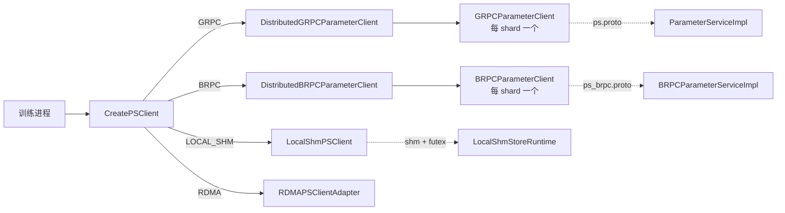
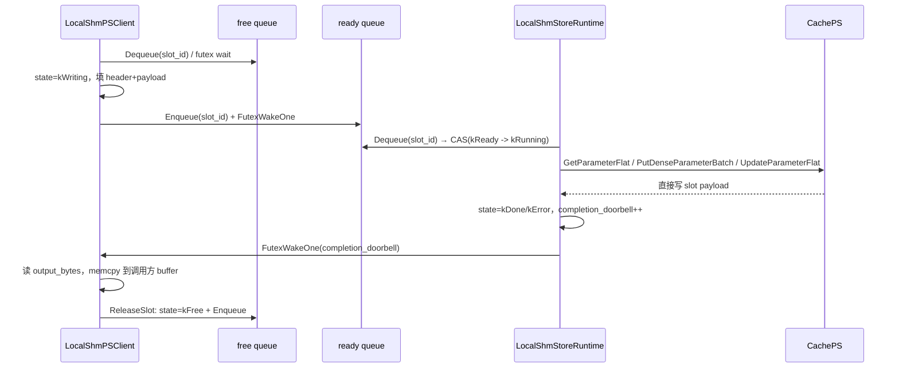

## 阅读地图

### 一句话

一个批量请求离开训练进程后，先按 key 落到某个 shard，再被切成不超过上限的小块，交给某条传输送到服务端，最后把各分片的返回按原始行序拼回一块张量。三条传输在这条路上的分工一致，差别在编码方式、并发模型、失败怎么暴露，以及能不能做 checkpoint。

### 本章覆盖什么

覆盖请求从客户端抽象进入 PS、再交给存储实现之前的那一层：

- PS 抽象与核心逻辑：`base_client.h`、`base_ps_server.h`、`cache_ps_impl.h`、`parameters.*`、`Postoffice.*`、`sparse_gradient_commit.h`、`config.*`。
- 客户端工厂与选型：`client_factory.*`、`client_options.h`、`framework/common/ps_client_config_adapter.cc`、`ps_server.cpp`。
- 协议：`proto/ps.proto`、`proto/ps_brpc.proto` 的命令与载荷位置。
- 三条传输与横切面：gRPC、bRPC、local_shm，以及分片路由、批拆分/合并、checkpoint、失败与降级。

不在范围：RDMA 传输内部（`ps/rdma/*`）见第 04 章；`BaseKV` 引擎与 checkpoint 文件格式见第 05 章；Python 侧 `DistEmb`/`EmbBag` 与训练循环见第 02 章。

### 6 个部件

| 编号 | 短名 | 它负责回答的问题 |
| --- | --- | --- |
| 1 | 请求形状 | 一个请求里装了什么，两端对它的格式有哪些硬约定 |
| 2 | 客户端栈与选型 | 训练进程拿到哪个客户端，为什么单机部署也要经过分片层 |
| 3 | 协议与命令 | 两份协议文件各自能表达什么，哪些能力在其中一份里根本不存在 |
| 4 | 分片与路由 | key 怎么落到 shard，请求怎么部署成进程 |
| 5 | 三条传输 | gRPC、bRPC、local_shm 的共同骨架与各自的差异 |
| 6 | 一致性与 checkpoint | 写入顺序、去重、checkpoint 能力与失败边界 |

正文按读者要解决的问题切成 10 块。第 5 个部件占四块：先讲共同骨架，再分别讲三条路径；配置单独作为最末一块。

### 它们怎么串起来

按编号走一遍。调用方交来表名、key 与值或梯度（1）；选型结果决定用哪个客户端、是否套上分片层（2）；客户端把请求编码成两份协议之一里的命令（3）；分片层按 hash 把 key 分到 shard，并在 shard 内二次切块（4）；单分片客户端用 gRPC、bRPC 或共享内存把块送出去、把结果收回来（5）；写路径最后由去重与 checkpoint 规则收口（6）。反向也成立：任何一条线上现象，都能落回这条链上的某一段。

### 核心概念表

| 概念 | 一句话 |
| --- | --- |
| shard | 一份独立持有的表数据，路由的最小单位（也叫分片） |
| 分片客户端 | 只连一个 shard 的传输实现，只有 gRPC/bRPC 有这一层 |
| 分片层 | 负责路由、切块、并发扇出与结果回填的外壳 |
| 压缩块 | wire 上的定长头加 float 行，Get/Put 的载荷单位 |
| 命令 | 协议里的 RPC 或命令枚举，PS 的控制入口 |
| 槽位 | local_shm 里一块定长的请求/响应缓冲区 |
| 提交步 | 稀疏更新的 (session, step, chunk) 三元组，去重的依据 |

### 建议读法

- 想知道一次 Get 从头到尾发生了什么：1 → 3 → 4 → 5（先读共同骨架），再接自己用的那条路径（6、7 或 8）。
- 想确认某个配置到底生不生效：2 → 第 10 块配置表 → 风险条目的降级边界；线上排查则从风险标题定位现象，再回到对应块读机制。

## 第 1 块：请求形状

### 它是什么

一个批量请求只有三样东西：表名、key 数组、以及可选的值或梯度。表名只在建表和更新时出现，key 是 `uint64`，值和梯度是二维 float。Get 的输出允许以 `{0, dim}` 的形式占位，由后端就地把形状补全。key 数组三条传输都当原始字节传，不走 protobuf 的 `repeated` 编码。

值在 wire 上不是裸 float 行，而是一种压缩块：定长头带上 key 与维度，后面紧跟该行的 float 数据。Put、Update、稀疏提交三个写入口都用这个形状，接收端因此只需要一套解释逻辑。

Update 在压缩块之外还带一个客户端学习率（`UpdateParameterRequest.learning_rate`，`0` 表示不上报）。服务端拿它和本地优化器的学习率比对，不一致就拒绝这批更新，所以"客户端乘一次、服务端再乘一次"这类混用会在服务端显式失败，而不是静默算错。

稀疏更新的载荷在压缩块之上又多一层：56 字节定长头描述会话、步号、rank 与分块信息，后面才是行。这个头是唯一做完整范围校验的载荷头，字段越界在解码阶段就抛错。

### 它为什么存在

三种载荷形状对应三种写入语义：整行覆盖、按批更新、按 step 聚合。统一成压缩块，让三条传输共用同一套打包与校验代码。稀疏更新必须把语义放进头里，因为它要跨 rank 去重、按 step 排序，这些信息无法从行数据本身推出来。

表配置单独走一次建表请求，是因为行数和维度决定服务端怎么分配存储，也决定客户端后续能否按 `{0, dim}` 占位。同名表重复建表时服务端比对配置，一致才复用，不一致直接拒绝。

### 它和谁接

上游是计算层交来的张量与表配置（第 02 章）。下游是第 3 块的命令编码：压缩块要么进 proto 字段，要么进 bRPC 的 attachment；56 字节头则进 `payload` 字段。张量形状的合法性在这里就被拒掉，不会拖到服务端。

### 代码位置

| 结构 | 位置与要点 |
| --- | --- |
| 压缩块与打包 | `src/ps/base/parameters.h#ParameterCompressItem`：`#pragma pack(1)` 的 `{uint64_t key; int dim; float embedding[0];}`，wire 上就是定长头加紧随其后的 `dim * 4` 字节 float 行，缺失行用 `dim == 0` 的 item 占位；`src/ps/base/parameters.cpp#Pack<ParameterCompressItem>::CompressAppend` 生成 block，接收端用 `reinterpret_cast<const ParameterCompressReader*>` 直接解释，读取前必须 `Valid(payload_size)` |
| 表配置 | `src/ps/base/base_client.h#EmbeddingTableConfig`：`{num_embeddings, embedding_dim, table_id}`，`Serialize()` 为 JSON；`CachePS::InitTable` 对同名表比对配置，完全一致则复用，不一致返回 -1 |
| 稀疏头 | `src/ps/base/sparse_gradient_commit.h#SparseGradientCommitHeader`：56 字节，静态断言保证；`kind` 为 0 submit / 1 query / 2 close / 3 abort；`version` 只接受 1 或 4；payload 总长必须严格等于 `sizeof(h) + rows * (8 + dim*4)` |
| 形状校验 | `src/ps/base/base_client.h#IsFloatEmbeddingValues`：value/grad 必须是 `FLOAT32` 二维 `[num_keys, dim]` 且 `dim > 0`；gRPC/bRPC 客户端在入口直接拒绝，local_shm 的 `GetParameterFlat` 校验 `keys.Size() == num_rows` |

### 交付一句

请求的形状到此交代完毕：三样入参、两种载荷头、一套形状校验。下一块讲这个请求由谁发出，也就是客户端栈的层次与选型规则。

## 第 2 块：客户端栈与选型

### 它是什么

训练进程只认一个客户端接口，接口后面叠着两层实现。外层是分片层，负责把一次调用摊成多个 shard 的调用再收回来；内层是单分片客户端，只跟一个 shard 说话。local_shm 没有内层，它自己就是接口实现，也没有分片层。选型发生在构造阶段：读 `cache_ps.ps_type`，四种取值对应四条实现。

选型判据：

| 判据 | 结果 | 配置键 / 机制 |
| --- | --- | --- |
| 什么都没配 | gRPC | `cache_ps.ps_type` 缺省为 `GRPC` |
| 要能做 checkpoint 存取 | 只能 gRPC | bRPC 协议缺枚举，local_shm 无控制面 |
| 单机同主机、小批量、不要控制面 | local_shm | `ps_type=LOCAL_SHM`，读 `local_shm.*` |
| 跨主机、要通用 RPC | gRPC 或 bRPC | `distributed_client.servers` |
| 大载荷、想省一次拷贝、批量上限大 | bRPC | attachment + 65536 key |
| 要内核旁路、会话式传输 | RDMA | `ps_type=RDMA`，见第 04 章 |
| 想用异步更新 | 三条都不支持 | `SubmitUpdateParameterAsync` 默认抛异常 |
| 单机部署是否也要分片层 | 要，gRPC/bRPC 自动合成 `num_shards=1` | `ResolvePSClientOptionsFromFrameworkConfig` |
| 服务端进程入口 | 只接受 `GRPC` / `BRPC` | `ps_server.cpp`，其它值 `return 2` |

### 它为什么存在

没有分片层，路由、切块、并发扇出与结果回填就得在每个调用点重写一遍；没有单分片客户端，分片层就得同时懂三种传输的细节。把两者拆开，第 4 块的路由逻辑才能只写一次。单机部署也合成一个单 shard 的分片层，是为了让单机和多机走同一条代码路径，避免只在多机才暴露的拼接错误。

### 它和谁接

上游是框架侧的配置读取：环境里的嵌套配置先被拍平成类型与选项，再交给工厂。下游是第 3 块的命令编码与第 4 块的分片逻辑。服务端一侧，统一入口只接受 gRPC 与 bRPC；local_shm 有独立的可执行文件，不走这个入口。

### 代码位置

1. `framework/common/ps_client_config_adapter.cc#ResolveFrameworkPSClientType` 读 `cache_ps.ps_type`，大小写不敏感映射到 `PSClientType::{kGrpc,kBrpc,kRdma,kLocalShm}`，未知值抛 `std::invalid_argument`；`ResolveFrameworkDistributedClientConfig` 从 `distributed_client` 取 `servers`、`num_shards`、`hash_method`、`max_keys_per_request`，缺失时回退到 `cache_ps` 同名键，仍无 `num_shards` 时用 `servers.size()`。
2. `CreatePSClient` 按类型构造；local_shm 用 `transport_config`（即 `config["local_shm"]`），其余用整份 `raw_config`。单机且无 `servers` 时，gRPC/bRPC 合成一个单 shard 的 `distributed_client`，地址取 `client.host/port/shard`（默认 `127.0.0.1:15000`、shard 0）。
3. 服务端入口 `ps_server.cpp#main` 把 `cache_ps.ps_type` 映射到工厂键 `GRPCParameterServer` / `BRPCParameterServer`；local_shm 由独立可执行文件 `local_shm_ps_server` 启动。

### 交付一句

客户端栈与选型到此交代完毕：接口一层、分片一层、单分片一层，local_shm 跳过中间层。下一块讲这些层之间传的消息长什么样。

## 第 3 块：协议与命令

### 它是什么

两份协议文件的消息体几乎逐字相同：同样的 Get/Put/Update/InitTable/SparseGradientCommit 五个数据通道，同样的 Command 控制通道。差别在命名空间、生成方式，以及命令枚举少两个值。gRPC 一侧用 `service` 声明生成 stub；bRPC 一侧额外声明 `option cc_generic_services = true`，以生成 `ParameterService_Stub`。

Get 与 Put 的载荷在 bRPC 上不走 protobuf 的 `bytes` 字段，而走 attachment：请求 attachment 装 key，响应 attachment 装压缩块。大消息因此绕过一次 protobuf 拷贝，代价是两边读写代码都要先试 attachment、再退回字段。

### 它为什么存在

协议是能力边界的物理位置：客户端能不能做某件事，先看枚举里有没有那个值。两份协议各自独立演化，就必然出现能力不对齐，这类缺失必须写在文档里才可见。

### 它和谁接

上游是第 2 块选定的单分片客户端，它按协议编码；下游是两个服务端实现，它们解码后统一交给 PS 核心。Command 通道不经过分片层，由接口直接下发。

### 代码位置

| 命令 / RPC | 语义 | gRPC | bRPC |
| --- | --- | --- | --- |
| `GetParameter` | 按 key 取行，返回压缩块；缺失行以 `dim == 0` 占位 | 支持 | 支持（attachment 优先） |
| `PutParameter` | 整行覆盖；响应里的 `sucess`（proto 拼写如此）两个服务端都不设置，客户端只看 RPC 状态 | 支持 | 支持 |
| `UpdateParameter` | 按表更新梯度；结果由 `CachePS::UpdateParameter` 决定：优化器没初始化、学习率与客户端上报值不一致、按步更新越界都会让它返回 false | 支持 | 支持（梯度走 attachment） |
| `InitEmbeddingTable` | 建表，返回非负 tag；`config_payload` 是 JSON | 支持 | 支持 |
| `SparseGradientCommit` | 提交 56B 头 + 行；失败原因放 `response.error` | 支持 | 支持 |
| `Command(CLEAR_PS / RELOAD_PS / LOAD_FAKE_DATA / DUMP_FAKE_DATA)` | 清空、重载、灌/取假数据 | 支持 | 支持 |
| `Command(SAVE_CHECKPOINT / LOAD_CHECKPOINT)` | `arg1` 路径、`arg2` metadata JSON | 支持 | **协议无此枚举** |

五条语义差异值得单独记住：

- bRPC 的命令枚举只有 `CLEAR_PS=0, RELOAD_PS=1, LOAD_FAKE_DATA=2, DUMP_FAKE_DATA=3`（`src/ps/proto/ps_brpc.proto#PSCommand`）。这是协议级能力缺失，不是客户端忘了调用。
- 两个服务端的 `Command` 都以 `else { LOG(FATAL) << "invalid command"; }` 收尾，枚举外的值会让服务端进程终止。
- gRPC 的 `SparseGradientCommit` 即使业务失败也返回 `Status::OK`，原因在 `response.error`；客户端检查后抛异常。
- `GetParameterRequest.perf` 只用于打点；`model_name`、`GetParameterResponse.keys` 在生产路径没有消费者。
- 协议本身没有批量上限，上限在客户端常量与配置里：gRPC 2000 key（`MAX_PARAMETER_BATCH`）、bRPC 65536（`MAX_PARAMETER_BATCH_BRPC`）、分片层按 `distributed_client.max_keys_per_request`（默认 500）二次切块；旧的 `cache_ps.max_batch_keys_size` 已被服务端 WARNING 后忽略。
- 学习率是"客户端声明、服务端裁决"：`CachePS::CheckLearningRate` 在客户端上报值或服务端学习率任一 ≤ 0 时放行，否则要求两者差值在 `1e-6 * |server_lr|` 内；不匹配打 `ERROR` 并让整批 `UpdateParameter` 失败。

### 交付一句

协议与命令到此交代完毕：五个数据通道、一套控制枚举、以及一处协议级的能力缺失。下一块讲命令发出之前，请求怎么被分到各 shard。

## 第 4 块：分片与路由

### 它是什么

路由回答一个问题：这个 key 归谁。答案是 `hash(key) % num_shards`：`city_hash` 时 hash 为 CityHash64，`simple_mod` 时直接取 `key % num_shards`。分片层先用它把一批 key 分组，每组再按单次 RPC 的 key 上限切块，发给对应的单分片客户端。返回时顺序已乱，要靠事先记下的原始下标把行搬回原位。

### 它为什么存在

一次批量请求的 key 可能横跨所有 shard，而单次 RPC 又有 key 上限，两个约束叠在一起，就必须两级切分：先按 shard 切，再按上限切。没有第一级，请求会发错地方；没有第二级，单个 RPC 会超限。返回时必须回填原始行序，否则调用方拿到的张量行序和请求对不上，梯度会写到错误的行上。

### 它和谁接

上游是第 2 块的分片层外壳与第 1 块的 key 数组。下游是第 5–8 块的传输。它不关心载荷是读还是写，但读写两条路对失败的要求不同：读要求每块都与请求对得上，写不接受部分成功。

### 代码位置

在线路由：

- `dist_sharded_client.h#GetShardId`：`city_hash` 用 `GetHash(key) % num_shards_`（`src/base/hash.h#GetHash` 即 CityHash64），`simple_mod` 用 `key % num_shards_`；未知方法打日志后回退 `city_hash`。`shard_to_client_index_` 来自配置 `servers[].shard`，请求按逻辑 shard 选对应的单分片客户端。
- `shard_manager.h#ShardManager::KeyPartition` 用的是 `XPostoffice::NumServers()`，但只被 `storage/kv_engine/load_db.h` 的离线加载路径使用；在线客户端不走它。

服务端按 shard 部署：

- 判定条件是 `cache_ps.num_shards > 1`。多分片要求 `servers` 数量等于 `num_shards`，gRPC 在进程内为每个 `servers[]` 起一个线程，bRPC 为每个起一个 `brpc::Server`。
- 单分片时监听地址由 `src/ps/base/shard_endpoint.h#SelectSingleShardEndpoint` 解析：`cache_ps.servers` 存在则取其中对应 shard（默认 shard 0）的 `host`/`port`；`servers` 缺失时回退 gRPC 的 `0.0.0.0:15000`、bRPC 的 `0.0.0.0:<brpc_server_port>`；`servers` 存在但缺该 shard 或字段非法则抛异常，服务端 `LOG(FATAL)`。gRPC 的 `ParameterServiceImpl` 用解析出的 shard id（写进 checkpoint metadata），不再是常量 0。
- `-grpc_local_shard_id` / `-local_shard_id` 让一个进程只起指定 shard；该值不在 `servers` 里时 `LOG(FATAL)`。

跨 shard 的批拆分与结果合并：

- Get：按 shard 分区并记录原下标（`key_index_mapping_`），每个 shard 一次 `std::async`，shard 内按 `max_keys_per_request` 串行分块；全部完成后 `ScatterEmbeddingRows` 把「按 shard 顺序」的结果写回原行序；任一分片返回非 0 则整体返回 -1。
- Put / Update：先用 `GatherEmbeddingRows` 按原下标抽出每个 shard 的行，再按同样的 shard→chunk 顺序发送；任一分片失败即整体 -1，已发送的分片不回滚。
- SparseGradientCommit：按 `shard_to_client_index_.at(GetShardId(key))` 分桶，串行调用每个分片；即使某分片没有行也发一个结束标记（`dist_sharded_client.h#SparseGradientCommit` 注释明确「Every shard receives an end marker」）；返回值取所有分片的 `min(committed)`。
- Prefetch：分片层为每个 shard 的每个 chunk 生成子 prefetch id 并保存 `original_indices`；`GetPrefetchResult` 逐块读回并按下标散射。

### 交付一句

路由与两级切分到此交代完毕：一段哈希决定归属，两级切分决定单次 RPC 的大小，回填保证行序。下一块讲这些块送出去时共用的那套骨架。

## 第 5 块：三条传输的共同骨架

### 它是什么

三条传输的外部行为收敛成同一套骨架：一次调用对应一次响应；分片层在传输之前就完成路由；每个 RPC 有 key 上限，超出就串行切块；服务端最终都调用同一个 PS 核心。

有一条前提贯穿三条路径：value 与 grad 的形状在客户端入口就被校验，服务端不再重复校验二维形状。结果张量允许以 `{0, dim}` 占位，由 `EnsureEmbeddingOutput` 就地扩容；Get 之前会把输出 `memset` 为 0，服务端对缺失 key 回一个 `dim == 0` 的 item，客户端因此把它保留成 0 行。

### 它为什么存在

三个服务端实现共享同一个 PS 核心，所以 Get/Put/Update/InitTable/SparseGradientCommit 的语义在传输间必须一致。立起骨架后，后面三块只需要讲差异：编码放在哪、并发靠什么、失败之后报错还是重建。否则三条路径会看起来像三个互不相干的系统。

### 它和谁接

上接第 4 块产出的 shard 分组与块列表，下接三条具体路径。还有第四条路是 RDMA，它同样实现客户端接口，内部是另一套会话式协议，见第 04 章，本章不展开。

### 代码位置

| 角色 | 位置 |
| --- | --- |
| 服务端抽象与三个实现 | `src/ps/base/base_ps_server.h#BaseParameterServer::Init/Run`；`grpc_ps_server.cpp#ParameterServiceImpl`、`brpc_ps_server.cpp#BRPCParameterServiceImpl`、`local_shm_server.cpp#LocalShmStoreRuntime` |
| 传输无关核心 | `src/ps/base/cache_ps_impl.h#CachePS`（表、优化器、checkpoint 状态） |

存储侧的线程号三者不一致：gRPC/bRPC 恒传 0，local_shm 传 worker 的 `ready_queue_id`。这条差异留到风险条目收口。

### 交付一句

共同骨架到此交代完毕：一次调用一次响应、先路由后传输、入口校验形状。下一块讲第一条路径 gRPC。

## 第 6 块：gRPC 路径

### 它是什么

gRPC 路径把请求塞进 protobuf 消息，走 HTTP/2 上的 RPC。单分片客户端把 key 原始字节写进请求字段，每 2000 个 key 发一个请求，全部挂在第一个 stub 上，用同一个完成队列收事件。服务端用异步接口接请求，取到 PS 核心返回的行后打包成压缩块写回。多 shard 时各 shard 的这条链路并行，最后由分片层 `ScatterEmbeddingRows` 统一回填。

### 它为什么存在

gRPC 是默认路径，也是唯一完整支持 checkpoint 的路径。它用 protobuf 承载大载荷，实现简单、跨语言，代价是多一次拷贝，批量上限只能取 2000。Put 走整批交给 PS 核心的批量入口；checkpoint 的 fan-out、元数据校验、身份约束也都只在这条路径上实现。

### 它和谁接

上游是第 4 块的分片层，下游是 gRPC 服务端，再往下是共享的 PS 核心。它的失败语义与 bRPC 基本一致：任一 RPC 失败就整块失败；差异只在空 payload 的处理。

### 代码位置

- 单分片客户端把 key 原始字节写入 `GetParameterRequest.keys`，每 2000 key 一个请求，全部挂在 `stubs_[0]` 上，用同一个 `cq_` 收完成事件（`grpc_ps_client.cpp#GRPCParameterClient::GetParameter`）。
- 服务端 `ParameterServiceImpl::GetParameter` 用 `base::ConstArray<uint64_t>(request->keys())` 直接解释字节，经 `CachePS::GetParameterRun2Completion` 取 `ParameterPack`，再用 `ParameterCompressor` 打包进 `parameter_value`；Put 则整批交给 `CachePS::PutParameter`（内部 `BatchPut`），与 bRPC 的逐 key 写入不同。
- 超时按 RPC 分别设置：普通 RPC 15 s，checkpoint 600 s，`LoadCkpt` 30 s，建表请求没有设置（`SetRpcDeadline`）。
- 失败不再静默：每个 `ClientContext` 都带 15 s deadline；完成循环把 `ok == false`（传输未完成）与「完成但 `status.ok() == false`」分开记录，任一失败返回 -1；非空请求收到空 payload、payload 长度或行数对不上，同样返回 -1。分片层把非 0 视为该分片失败，整批返回 -1。缺失 key 仍返回 0 行，这是数据语义，不是错误。
- 预取：`PrefetchBatch` 自带独立完成队列；`ConsumePrefetchCompletion` 把传输失败与非 OK 状态交给 `MarkPrefetchFailed`，只记首个原因；`IsPrefetchDone` 把失败批次当作已完成，避免调用方空转；`WaitForPrefetch` 以 200 ms 轮询、最多 150 轮（30 s）无事件即判超时；`GetPrefetchResult` 遇到失败批次返回 `false`。

### 交付一句

gRPC 路径到此交代完毕：protobuf 编码、2000 key 一批、单个完成队列，以及一条「任一 RPC 失败就整批 -1」的失败路径。下一块讲把大载荷挪到 attachment 上的 bRPC。

## 第 7 块：bRPC 路径

### 它是什么

bRPC 路径与 gRPC 的外部形状几乎一样，差别在载荷怎么放。请求构造时先在本地下一个 Arena，按批创建请求与响应对象；key 与梯度写进 attachment，不走 protobuf 字段；服务端优先从 attachment 取，取不到才退回字段。发出是异步的，完成回调是空的，随后逐个等待调用 id。

### 它为什么存在

把大载荷从 protobuf 消息里挪出去，可以省掉一次拷贝，也让 65536 这个更大的批量上限可行。代价是两端都多了一层「先看 attachment」的判断，并且这份协议独立演化，因此缺了 checkpoint 命令。

### 它和谁接

上游同样是第 4 块的分片层，下游是 bRPC 服务端。它的超时与重试交给 `brpc::ChannelOptions{timeout_ms, max_retry}`（默认 5000 ms / 3 次）。

### 代码位置

1. 客户端构造 `google::protobuf::Arena` 按批创建请求/响应；key 写入 `controllers[i].request_attachment()`。
2. 对每批调用 `stub.GetParameter(..., done)` 异步发出，`done` 是空回调；随后逐个 `brpc::Join(call_id)` 等待，任一 `controllers[i].Failed()` 直接返回 -1。
3. 服务端 `ExtractPayloadBytes` 优先取 `request_attachment`，把 key 交给 `CachePS`；结果 `compressor.AppendToIOBuf(&cntl->response_attachment())`。客户端 `ExtractGetResponseReader` 同样优先读 attachment，再用 `ParameterCompressReader::Valid` 校验长度后拷贝。
4. 其余差别：Put 在服务端逐 key 调用 `PutSingleParameter`，而 gRPC 是整批；客户端支持 `options.use_rdma`（编译期 `BRPC_WITH_RDMA`，配置 `brpc_ps_use_rdma`），这是 bRPC 自身的传输选项，不是第 04 章的 raw-verbs 路径。
5. 空 payload 的处理比 gRPC 宽松：正常与预取路径都把它当作「该块无行」跳过，保持 0，不返回错误。

### 交付一句

bRPC 路径到此交代完毕：attachment 承载大载荷、Arena 复用对象、更大的批量上限，以及协议里缺失的 checkpoint。下一块讲完全不走 socket 的共享内存路径。

## 第 8 块：local_shm 路径

### 它是什么

local_shm 把请求放进一块进程间共享内存：客户端从空闲队列取一个槽位，把请求头和载荷写进去，再把槽位号放进就绪队列并敲一下门铃；服务端 worker 从就绪队列取槽位，直接调用 PS 核心，把结果写回同一块槽位的载荷区，再敲完成门铃；客户端醒来后把结果拷进调用方 buffer，最后把槽位还回空闲队列。

### 它为什么存在

同主机场景里，TCP 加序列化是纯开销。共享内存路径把这两样都去掉，只剩一次跨进程拷贝。代价是硬性的：只支持 Linux 同主机，且没有控制通道。

### 它和谁接

它没有分片层，客户端本身就是接口实现；服务端是独立可执行文件里的 worker。下游同样落到共享的 PS 核心，Put 走稠密批量入口。它不实现 Command，也没有 clear、reload、checkpoint。

### 代码位置

布局与同步：

- 布局固定为「控制块 → free 队列 → ready 队列 → 槽位头 → 槽位 payload」，全部按 64B 对齐，控制块的 `magic/version` 是挂接校验的一部分（`local_shm_layout.h#TotalRegionBytes`、`local_shm_region.cpp#LocalShmRegion::Attach`）。
- 队列是带序号的有界 MPMC 队列，`enqueue_pos`/`dequeue_pos` 加每格 `sequence` 做无锁发布；槽位状态机为 `kFree → kWriting → kReady → kRunning → kDone|kError → kFree`，服务端用 CAS 把 `kReady` 抢成 `kRunning`，避免重复消费。
- 同步原语是 Linux futex：客户端入队后 `FutexWakeOne(&ready_header->enqueue_pos)`；服务端空转时等待 `enqueue_pos`；客户端以 `client_timeout_ms`（默认 30000）等待 `slot.completion_doorbell`，超时把 `status_code` 置为 `kTimeout`。
- 服务端 worker 数等于 `ready_queue_count`，每个 worker 独占一个 ready queue，并把 `ready_queue_id` 作为 PS 核心的 `tid`；`cache_ps.num_threads` 会被抬到至少 `ready_queue_count`。

拷贝边界与平台限制：

- 「零拷贝」只发生在服务端这一侧：`GetParameterFlat` 直接写进槽位 payload，客户端可通过 `LocalShmFlatGetHandle::values` 拿到槽位内指针；但 `GetParameter` 仍会 `memcpy` 到调用方张量。因此它是「无 socket、无序列化的单次共享内存拷贝」，不是端到端零拷贝。
- 单机限制是硬性的：`shm_open`/`mmap`/`linux/futex.h`/`unistd.h`，只支持 Linux 同主机；CMake 没有为非 Linux 提供替代实现。

控制结构与不变量：

| 结构 | 关键字段 | 不变量 |
| --- | --- | --- |
| `LocalShmControlBlock` | `magic`, `version`, `server_epoch`, `slot_count`, `slot_buffer_bytes`, `ready_queue_count`, `next_request_id`, `fatal_status` | `magic == "RECSTORE"`, `version == 2`，挂接时校验 |
| `LocalShmQueueHeader` / `Cell` | `enqueue_pos`, `dequeue_pos`, `capacity` / `sequence`, `value` | 有界队列，满时 enqueue 返回 false；`sequence` 兼作发布/回收标志 |
| `LocalShmSlotHeader` | `state`, `opcode`, `status_code`, `client_id`, `request_id`, `key_count`, `embedding_dim`, `learning_rate`, `input_bytes`, `output_bytes`, 时间戳, `completion_doorbell` | `request_id` 与客户端 handle 匹配才接受完成；`learning_rate` 由原来的 `reserved0` 位置承载，`0` 表示不上报 |

### 交付一句

local_shm 路径到此交代完毕：槽位加队列加 futex，服务端侧单次拷贝，只支持 Linux 同主机。下一块讲三条路径共享的写序、去重与 checkpoint 边界。

## 第 9 块：一致性与 checkpoint

### 它是什么

一致性在这一层只回答三件事：写入按什么顺序生效、重复提交会不会被应用两次、进程重启后能恢复到哪个点。三条传输对前两件答案相近，对第三件只有 gRPC 有答案。

顺序方面，gRPC/bRPC 没有 epoch 或租约概念，依赖「单 shard 单写者 + 请求内顺序」。local_shm 定义了 `server_epoch` 与槽位上的 `server_seen_epoch`，客户端每次提交都写入当前 epoch，但服务端从不读，`kEpochMismatch` 只出现在枚举里。也就是说 epoch 只是记录，不是屏障。

### 它为什么存在

训练侧的重试不可避免：连接会断，进程会重启。没有 step 级去重，一次重试就可能把同一批梯度应用两次；没有 checkpoint 身份约束，一次误操作就可能用旧存档覆盖新状态。这一块是所有上层逻辑的隐式前提。

### 它和谁接

上游是三条传输的写路径，下游是第 05 章的存储格式与 checkpoint 记录数。它同时约束第 02 章训练循环的行为：分片写没有原子性，整批重试必须由调用方判断。

### 代码位置

checkpoint 全链路与各处失败表现：

- `DistributedShardedClient::SaveCheckpoint/LoadCheckpoint` 并发 fan-out 到每个配置 shard，路径为 `<path>/recstore-shard-<shard>.bin`（`ShardCheckpointPath`）；逐分片收集结果，失败时打印 shard 号与文件路径，并汇总 `failed/total`；任一失败返回 `false`。
- gRPC 服务端校验 `arg1/arg2` 各一个且非空，解析 metadata JSON，要求含 `identity` 对象与非空 `checkpoint_id`，注入本 shard 的 `shard_id` 后调用 `CachePS`；参数不合法返回 `INVALID_ARGUMENT`，保存/加载失败返回 `FAILED_PRECONDITION`。
- `CachePS` 的约束：save 成功后记录 `active_checkpoint_identity_` 并清除 dirty；load 在「有未保存更新（dirty）」「已有不同 active identity」「存储里已有 checkpoint 记录（非 fresh）」三种情况下抛异常；失败或异常时按 `CheckpointRecordCount()` 回填 dirty。
- bRPC 客户端 `SaveCheckpoint`/`LoadCheckpoint` 重写为打 `ERROR` 并返回 `false`，`Command(SAVE/LOAD_CHECKPOINT)` 同样显式报 unsupported；协议里仍没有对应枚举。local_shm 没有 override，走 `BasePSClient` 默认实现，也是打 `ERROR` 返回 `false`。

读写顺序与幂等性：

- `SparseGradientCommitCoordinator` 为每张表维护一个 in-flight step：要求 `step == committed + 1`；按 `(rank, chunk)` 缓存分片；固定 rank/chunk 顺序聚合，网络到达顺序不影响结果；重复提交旧 step 时，payload 与已缓存一致则幂等返回 `committed`，不一致则抛错。
- v4「exact owner replacement」额外要求 `world == 2`、`dim == 128`、key 严格递增、值全部有限、payload ≤ 1 MiB、chunks ≤ 64，并且要求 key 的高 8 位已带目标表的 tag（`TAG_TYPE` 为 `uint8_t`，`KeyTagShift() == 56`；tag 由 `MakeTensorTag(table_id, role, tensors_per_table)` 生成）；失败后会话置为 sticky failed，不重试、不回退。
- 普通 `UpdateParameter` / `PutParameter` 没有请求级去重；bRPC 的 `max_retry` 是传输层重试，对非幂等更新存在重复应用风险。

写路径的落地方式与切块：

- 服务端聚合对同一 key 做累加（v1）或整行替换（v4）；`divisor != 1` 时对聚合结果整体除以 `divisor`。稀疏提交客户端默认 payload 上限 256 KiB，大 step 按 `(limit - sizeof(h)) / (8 + dim*4)` 自动分 chunk；local_shm 覆盖为 `slot_buffer_bytes - 4096`。
- 三条路径的 Put 落地方式不同：bRPC 服务端逐 key 调用 `PutSingleParameter`，gRPC 服务端整批交给 `CachePS::PutParameter`（内部 `BatchPut`），local_shm 走 `PutDenseParameterBatch`。

### 交付一句

一致性与 checkpoint 到此交代完毕：一条路径能存档、一套 step 级去重、一批没有原子性的分片写。下一块讲这些行为由哪些配置键决定。

## 第 10 块：配置与开关

### 它是什么

一条配置要生效，链路上必须有一个真正的读取者。这一块把选型、分片、槽位与两条网络传输会读的键集中列出，并标出那些看起来像开关、实际没有读取者的键。

### 它为什么存在

读配置时最常见的误判是把「写进 JSON 的键」当成「运行时生效的开关」。把默认值与作用放在一起，是为了让「改了没反应」在阅读阶段就能排除，而不是等跑一次基准才发现键根本没人读。

### 它和谁接

上接第 2 块的选型链与第 8 块的槽位参数；下游是第 04 章的 RDMA flag 表与第 05 章的存储引擎配置。表里存储引擎那两项只影响 PS 核心之下，不在本章展开。

### 代码位置

| 配置 / flag | 默认值 | 作用 |
| --- | --- | --- |
| `cache_ps.ps_type` | 客户端与服务端入口默认 `GRPC` | 选择传输 |
| `cache_ps.num_shards` | 1 | 分片数；>1 时服务端要求 `servers` 齐全且数量相等 |
| `cache_ps.servers[]` | — | `{host, port, shard}`；单分片时也决定监听地址 |
| `cache_ps.num_threads` | schema 必填 | KV 引擎线程数；local_shm 缺失时按 1 处理并抬到 ≥ `ready_queue_count` |
| `cache_ps.max_batch_keys_size` | 已废弃 | 服务端检测到只打 `WARNING` 并忽略；批量上限由 `distributed_client.max_keys_per_request` 控制 |
| `cache_ps.base_kv_config` | — | 存储引擎配置，见第 05 章 |
| `distributed_client.num_shards` | 由 `servers.size()` 推导 | 客户端路由模数 |
| `distributed_client.hash_method` | `city_hash` | `city_hash` / `simple_mod` |
| `distributed_client.max_keys_per_request` | 500 | 单 shard 单 RPC 的 key 上限 |
| `client.host/port/shard` | `127.0.0.1:15000`, shard 0 | 合成单分片配置时的地址 |
| `local_shm.region_name` | `recstore_local_ps` | POSIX shm 名称 |
| `local_shm.slot_count` / `slot_buffer_bytes` | 64 / 8 MiB | 槽位数（并发上限）/ 单请求最大载荷，后者同时决定 GET/PUT 的自动切块 |
| `local_shm.ready_queue_count` / `ready_queue_burst_limit` | 1 / 8 | ready 队列与 worker 数 / 单次 drain 的最大槽位数 |
| `local_shm.client_timeout_ms` | 30000 | 客户端等待槽位/完成超时（含建表请求） |
| `local_shm.thread_ready_queue_sharding` | false | 按线程分散 ready queue |
| `local_shm.ready_queue_index` / `client_rank` / `rank` / `local_rank` | — | 选择 ready queue；依次回退，也读 `RECSTORE_LOCAL_SHM_READY_QUEUE_INDEX`、`LOCAL_RANK`、`RANK` |
| `-get_parameter_threads` | 4 | 构造 `stubs_` 数量；实际调用总用 `stubs_[0]` |
| `-brpc_timeout_ms` / `RECSTORE_BRPC_TIMEOUT_MS` | 5000 | bRPC 请求超时 |
| `-brpc_max_retry` | 3 | bRPC 传输层重试次数 |
| `-brpc_ps_use_rdma` / `RECSTORE_BRPC_USE_RDMA` | false | bRPC 走 RDMA（需编译期支持）；`RECSTORE_BRPC_RDMA_DEVICE` 选 HCA（映射 `-rdma_device`） |
| `-grpc_local_shard_id` / `-local_shard_id` | -1 | 一进程只起指定 shard |
| `-brpc_server_port` / `-brpc_server_num_threads` | 15000 / 0（auto） | bRPC 单分片监听端口（`servers` 缺失时的回退值）/ 线程池大小 |
| `-value_size` / `-max_kv_num_per_request` | 128 B / 300 | PS 级缓冲估算，主要用于基准和 RDMA 适配层 |

### 交付一句

配置与开关到此交代完毕：三层来源、一张默认值表、一处已废弃但仍被 schema 接受的键。接下来是与相邻章节的接口、风险清单与证据索引。

## 与相邻章节的接口

- **第 02 章（计算层）**：`BasePSClient` 是唯一入口；`PrefetchParameter/IsPrefetchDone/WaitForPrefetch/GetPrefetchResult` 构成预取句柄协议，`SubmitUpdateParameterAsync/WaitUpdateParameter` 默认抛异常表示后端不支持异步更新。张量只能是 `FLOAT32` 二维，`{0, dim}` 表示「由后端分配」。
- **第 04 章（RDMA）**：`RDMAPSClientAdapter` 实现同一个 `BasePSClient`，但有自己的部署校验和 `rdma_control_plane.proto`；本章只把它当作工厂的一个分支。bRPC 的 `use_rdma` 是 bRPC Channel 内部选项，与会话式 raw-verbs 路径不同。
- **第 05 章（存储）**：`CachePS` 通过 `BaseKV` 的 `BatchGet/BatchGetFlat/BatchGetDirectFixedRows/BatchPut/BatchGetIndexOnly` 访问存储，并把 `tid` 原样传下去；gRPC/bRPC 恒传 0，local_shm 传 worker 的 `ready_queue_id`。checkpoint 的落盘格式与 `CheckpointRecordCount` 语义由存储层定义。
- **第 06 章（测试与工具）**：`grpc_ps_bench.cpp` 只测 `LoadFakeData/DumpFakeData` 的上下行带宽；`ps_transport_benchmark` 与 `mixed` 基准通过 `CreatePSClient` 复用同一套选型逻辑。

## 风险、坑与未确认点

1. **[源码事实] bRPC 没有 checkpoint，只有显式失败，没有回退路径。** 协议缺两个枚举，客户端 override 打 `ERROR` 返回 `false`，`Command` 也显式报 unsupported。调用方现在能拿到失败，但仍只能改用 gRPC；若把 `false` 当作可重试失败，会一直重试一条永不可能成功的路径。
2. **[源码事实] gRPC 单分片客户端并发不安全。** 所有 RPC 都用 `stubs_[0]` 且共享同一个 `cq_`；`get_parameter_threads` 创建的其余 stub 从未使用，`get_param_*` 成员也是共享可变状态，多个线程同时对同一分片调用 `GetParameter` 会互相取走完成事件。预取有自己的 CQ 与 `prefetch_mu_`，不受影响；bRPC 客户端的预取表则连互斥都没有。
3. **[源码事实] 普通 Update 的传输层重试可能重复应用。** bRPC `max_retry=3` 对连接类失败自动重试；`UpdateParameter`/`PutParameter` 没有请求 id 或幂等键，重试可能把同一批梯度应用两次。`SparseGradientCommit` 有 `(step, chunk)` 去重，是唯一被显式保护的写路径。
4. **[源码事实] 未知命令会杀死服务端进程。** 两个服务端的 `Command` 末尾都是 `LOG(FATAL)`；新旧客户端/服务端混部或手工发错枚举值时，故障是进程级而不是请求级。
5. **[源码事实] bRPC 把空 payload 当成「无行」。** 正常与预取路径都跳到下一块并保持 0，不返回错误；gRPC 在同样情形已返回 -1。对端截断响应或连到非预期 PS 时，bRPC 侧仍会静默产出全 0 的行。
6. **[源码事实] local_shm 的 epoch 没有真正生效。** 客户端写入 `server_seen_epoch`，服务端从不比较；`server_epoch` 在 `Create` 时恒置 1，`kEpochMismatch` 从未使用。服务端重启并重建同名 region 后，仍挂着旧映射的客户端不会被拒绝。
7. **[源码事实] local_shm 的槽位释放队列与获取队列不一致。** `AcquireSlot` 从 `free_queue_header(CurrentReadyQueueId())` 取槽，`ReleaseSlot` 却把槽还到 `free_queue_header(slot_id % ready_queue_count())`。当 `ready_queue_count > 1` 且多个客户端/队列并存时，某个队列可能长期拿不到槽位而饥饿；是否会在真实负载下形成死锁未确认。
8. **[源码事实] local_shm 只适用于 Linux 单机，且没有控制面。** `Command()` 是空实现，没有 CLEAR/RELOAD/checkpoint；`shm_open`/`futex` 决定它无法跨主机，也无法在 Windows 或非 Linux 容器外运行。
9. **[待验证] `tid` 语义在传输间不一致。** gRPC/bRPC 处理器固定 `tid=0`，与 gRPC 线程池的实际并发无关；local_shm 每个 worker 用不同 `tid`。存储引擎是否要求 `tid` 唯一、`tid=0` 在并发下是否安全，需第 05 章确认。
10. **[源码事实] 建表 RPC 在 gRPC 客户端没有 deadline。** 其余 RPC 通过 `SetRpcDeadline` 设置 15 s（checkpoint 600 s、`LoadCkpt` 30 s），唯独 `InitEmbeddingTable` 没有；服务端卡住时该调用会无限等待。local_shm 的建表请求由 `client_timeout_ms` 约束，不受此影响。
11. **[源码事实] 分片写没有原子性。** 跨 shard 的 Put/Update/SparseGradientCommit 都是「逐 shard 串行/并行发送」，中途失败不会回滚已成功的分片；训练侧若直接重试整批，可能造成部分 shard 重复更新。
12. **[源码事实] 稀疏提交依赖所有 rank 齐全。** v1 的聚合顺序不依赖到达顺序，但依赖所有 rank 都提交齐全；缺失一个 rank 会永久停在 in-flight（直到会话被 abort 或 close）。会话没有超时清理机制。
13. **[源码事实] 文档与配置 schema 仍与代码不一致。** `docs/parameter_server/grpc.md` 称 `GRPCParameterClient` 继承 `BasePSClient` 且只有单个 `stub_`，实际继承 `ShardClient`、持有 `stubs_` 向量；`docs/parameter_server/proto.md` 称两份协议结构类似，未提 bRPC 少两个 checkpoint 枚举；`docs/parameter_server/base.md` 把 `shard_manager.h` 笼统写作「分片管理」，实际只服务离线加载；`tools/config/recstore_config.schema.json` 的 `ps_type` enum 只列 `GRPC`/`BRPC`，而 C++ 适配层还接受 `RDMA`/`LOCAL_SHM`。以代码为准。

### 近期已修复（5f92ba2a → 6d205e98）

| 问题 | 现在的行为 | commit |
| --- | --- | --- |
| gRPC GetParameter 失败静默补零 | 15 s deadline；传输未完成、完成但 status 非 OK、空 payload、行数不符都返回 -1，分片层整批失败 | `e2efe502` |
| gRPC 预取失败无感知 | `MarkPrefetchFailed`/`ConsumePrefetchCompletion` 记录首个失败原因，失败批次视为已完成；200 ms × 150 轮（30 s）空闲判超时 | `e2efe502` |
| bRPC checkpoint 静默返回 false | 客户端显式打 `ERROR`，`Command` 显式报 unsupported；协议仍无枚举 | `c77f5461` |
| 单分片监听地址硬编码 `0.0.0.0:15000` | `SelectSingleShardEndpoint` 优先取 `cache_ps.servers`，缺失才回退默认；gRPC 用真实 shard id 注入 checkpoint metadata | `95616eef` |
| `max_batch_keys_size` 被当作运行时开关 | 服务端 `WARNING` 并忽略，批量由 `distributed_client.max_keys_per_request` 控制 | `5530c44a` |
| checkpoint 失败定位不到分片 | 逐分片收集结果，打印 shard 号与文件路径，并汇总 `failed/total` | `e2efe502` |

### 本轮已修复（6d205e98 → 7c44f83da）

| 问题 | 现在的行为 | commit |
|--------|------------|--------|
| 客户端学习率跨进程完全不可见，两侧 lr 不一致时无人察觉 | 两份 proto 的 `UpdateParameterRequest` 加 `optional float learning_rate = 3`，local_shm 复用槽位头里的 `reserved0`，RDMA 适配层一并透传 | `606d86f5` |
| 客户端与服务端 lr 不一致时静默按服务端 lr 更新 | `CachePS::CheckLearningRate` 校验后拒绝，打 `ERROR` 并让整批更新失败 | `8a63bfed` |
| 分片与 HierKV 路径丢掉了 lr | `update_async` / `local_update_flat` / `emb_update_table` 一路带到 PS，含分片与单机分布式路径 | `606d86f5` |

## 证据索引

| 结论 | 证据 |
| --- | --- |
| 工厂四种类型、`ps_type` 映射、单 shard 合成、服务端入口只接受 GRPC/BRPC | `src/ps/client_factory.cc#CreatePSClient`、`src/ps/client_options.h#PSClientType`、`src/framework/common/ps_client_config_adapter.cc#ResolveFrameworkPSClientType`、`#ResolvePSClientOptionsFromFrameworkConfig`、`src/ps/ps_server.cpp#main` |
| 单分片客户端契约与监听地址解析 | `src/ps/base/shard_client.h#ShardClient`、`src/ps/grpc/grpc_ps_client.h#GRPCParameterClient`、`src/ps/base/shard_endpoint.h#SelectSingleShardEndpoint`、`grpc_ps_server.cpp`、`brpc_ps_server.cpp` |
| 分片、切块、并发 fan-out、结果散射；`city_hash` 即 CityHash64 | `src/ps/base/dist_sharded_client.h#DistributedShardedClient::GetParameter`、`#PartitionKeys`、`#GetShardId`、`src/base/hash.h#GetHash` |
| gRPC 批大小 2000、共享 CQ、只用 stubs_[0]、deadline/状态/空 payload 判错 | `src/ps/grpc/grpc_ps_client.h#MAX_PARAMETER_BATCH`、`src/ps/grpc/grpc_ps_client.cpp#kDefaultRpcDeadlineMs`、`#GRPCParameterClient::GetParameter` |
| gRPC 预取失败记录与 30 s 空闲上限 | `src/ps/grpc/grpc_ps_client.cpp#MarkPrefetchFailed`、`#ConsumePrefetchCompletion`、`#WaitForPrefetch` |
| bRPC 批大小 65536、Arena、attachment、超时与重试默认值 | `src/ps/brpc/brpc_ps_client.h#MAX_PARAMETER_BATCH_BRPC`、`src/ps/brpc/brpc_ps_client.cpp#BRPCParameterClient::GetParameter`、`#FLAGS_brpc_timeout_ms`、`#FLAGS_brpc_max_retry` |
| bRPC checkpoint 显式 unsupported；proto 缺枚举 | `src/ps/brpc/brpc_ps_client.cpp#BRPCParameterClient::SaveCheckpoint`、`#LoadCheckpoint`、`#BRPCParameterClient::Command`、`src/ps/proto/ps_brpc.proto#PSCommand` |
| 服务端 Command 的 LOG(FATAL) 兜底与 gRPC checkpoint 校验 | `grpc_ps_server.cpp#ParameterServiceImpl::Command`、`brpc_ps_server.cpp#BRPCParameterServiceImpl::Command` |
| CachePS 的 checkpoint 身份/dirty 约束、每 shard 文件与失败汇总 | `src/ps/base/cache_ps_impl.h#CachePS::LoadCheckpoint`、`#CachePS::SaveCheckpoint`、`src/ps/base/dist_sharded_client.h#ShardCheckpointPath`、`#FanOutCheckpoint` |
| `max_batch_keys_size` 废弃告警 | `src/ps/base/cache_ps_impl.h#CachePS::CachePS` |
| 更新携带学习率、服务端校验不匹配即拒绝 | `src/ps/proto/ps.proto#UpdateParameterRequest`、`src/ps/local_shm/local_shm_protocol.h#LocalShmSlotHeader`、`src/ps/base/cache_ps_impl.h#CachePS::CheckLearningRate`、`#CachePS::UpdateParameter` |
| 稀疏提交的 step 顺序、去重、v4 约束、默认 256 KiB 切块 | `src/ps/base/sparse_gradient_commit.h#SparseGradientCommitCoordinator::Exchange`、`#DecodeSparseGradientCommit`、`#ExchangeExact`、`#SparseGradientCommitClient::SparseGradientCommit` |
| key 高 8 位 tag 与 v4 校验 | `src/optimizer/sparse_tensor.h#KeyTagShift`、`#ExtractKeyTag`、`#MakeTensorTag`、`src/ps/base/cache_ps_impl.h#CachePS::SparseGradientCommit` |
| local_shm 布局、控制块与槽位状态 | `src/ps/local_shm/local_shm_layout.h#TotalRegionBytes`、`#SlotPayloadOffset`、`local_shm_protocol.h#LocalShmControlBlock`、`#LocalSlotState`、`#LocalOpcode` |
| 无锁 MPMC 队列、futex、region 校验 | `local_shm_queue.cpp#LocalShmQueueEnqueue`、`local_shm_futex.cpp#FutexWaitUntilValueChange`、`local_shm_region.cpp#LocalShmRegion::Attach` |
| 客户端槽位获取/等待/释放与服务端 drain/CAS/worker tid | `src/ps/local_shm/local_shm_client.cpp#LocalShmPSClient::AcquireSlot`、`#WaitForSlot`、`#ReleaseSlot`、`src/ps/local_shm/local_shm_server.cpp#LocalShmStoreRuntime::DrainReadyQueue`、`#ProcessSlot`、`#FinishWithStatus` |
| epoch 只写不读、无 Command/checkpoint、独立入口 | `local_shm_client.cpp#LocalShmPSClient::SubmitGetParameterFlat`（写 `server_seen_epoch`）、`#LocalShmPSClient::Command`、`local_shm_server.cpp#LocalShmStoreRuntime::ProcessSlot`、`local_shm_server_main.cpp#main`、`src/ps/base/base_client.h#BasePSClient::SaveCheckpoint` |
| 共享 CachePS 的 server 实现 | `grpc_ps_server.cpp#ParameterServiceImpl`、`brpc_ps_server.cpp#BRPCParameterServiceImpl`、`local_shm_server.cpp#LocalShmStoreRuntime` |
| 压缩 wire 格式与 PS 级 gflag 默认值 | `src/ps/base/parameters.h#ParameterCompressItem`、`src/ps/base/parameters.cpp#Pack<ParameterCompressItem>::CompressAppend`、`src/ps/base/config.cc#FLAGS_value_size`、`#FLAGS_max_kv_num_per_request` |
| 遗留 `ShardManager` 只服务离线加载；文档漂移 | `src/ps/base/shard_manager.h#ShardManager::KeyPartition`、`src/storage/kv_engine/load_db.h`、`docs/parameter_server/grpc.md`、`proto.md`、`base.md` |

### 附：本章文件索引

| 路径 | 角色 | 关键符号 |
| --- | --- | --- |
| `src/ps/base/base_client.h` | 客户端抽象、table 配置、行 gather/scatter | `BasePSClient`、`EmbeddingTableConfig`、`IsFloatEmbeddingValues` |
| `src/ps/base/base_ps_server.h` | 服务端抽象 | `BaseParameterServer::Init/Run` |
| `src/ps/base/shard_client.h` | 单分片客户端契约 | `ShardClient`、prefetch 四件套 |
| `src/ps/base/shard_endpoint.h` | 单分片监听地址解析 | `SelectSingleShardEndpoint` |
| `src/ps/base/dist_sharded_client.h` | 路由、拆分、并发 fan-out、合并、prefetch 状态机 | `DistributedShardedClient<ClientT>` |
| `src/ps/base/cache_ps_impl.h` | 传输无关的 PS 核心：表、优化器、checkpoint 状态 | `CachePS`、`SparseGradientCommit`、`GetParameterFlat` |
| `src/ps/base/parameters.h/.cpp` | wire 格式 | `ParameterCompressItem`、`ParameterPack`、`ParameterCompressor` |
| `src/ps/base/sparse_gradient_commit.h` | 稀疏提交协议与去重 | `SparseGradientCommitHeader`、`SparseGradientCommitCoordinator` |
| `src/ps/base/shard_manager.h` | 遗留 key→server 划分（仅加载路径使用） | `ShardManager::KeyPartition` |
| `src/ps/base/Postoffice.*` | 进程角色/编号（server/client） | `XPostoffice` |
| `src/ps/base/config.*` | PS 级 gflag | `value_size`、`max_kv_num_per_request` |
| `src/ps/client_factory.*`、`client_options.h` | 传输选型 | `PSClientType`、`CreatePSClient` |
| `src/ps/proto/ps.proto` | gRPC 协议 | `ParameterService`、`PSCommand` |
| `src/ps/proto/ps_brpc.proto` | bRPC 协议（`cc_generic_services`） | `recstoreps_brpc::PSCommand` |
| `src/ps/grpc/grpc_ps_client.*` | 单分片 gRPC 客户端 | `GRPCParameterClient`、`PrefetchBatch` |
| `src/ps/grpc/dist_grpc_ps_client.*` | gRPC 分片客户端 | `DistributedGRPCParameterClient` |
| `src/ps/grpc/grpc_ps_server.*` | gRPC 服务与进程入口 | `ParameterServiceImpl`、`GRPCParameterServer` |
| `src/ps/grpc/grpc_ps_bench.cpp` | Load/Dump 假数据带宽基准 | `RunBench` |
| `src/ps/brpc/brpc_ps_client.*` | 单分片 bRPC 客户端 | `BRPCParameterClient`、`MAX_PARAMETER_BATCH_BRPC` |
| `src/ps/brpc/dist_brpc_ps_client.*` | bRPC 分片客户端 | `DistributedBRPCParameterClient` |
| `src/ps/brpc/brpc_ps_server.*` | bRPC 服务与进程入口 | `BRPCParameterServiceImpl` |
| `src/ps/local_shm/local_shm_layout.h` | 共享内存区布局 | `TotalRegionBytes`、`SlotPayloadOffset` |
| `src/ps/local_shm/local_shm_protocol.h` | 控制块/槽位/状态码 | `LocalShmSlotHeader`、`LocalOpcode` |
| `src/ps/local_shm/local_shm_queue.*` | 有界 MPMC 队列 | `LocalShmQueueEnqueue/Dequeue` |
| `src/ps/local_shm/local_shm_futex.*` | Linux futex 等待/唤醒 | `FutexWaitUntilValueChange` |
| `src/ps/local_shm/local_shm_region.*` | shm 创建/挂接/校验 | `LocalShmRegion` |
| `src/ps/local_shm/local_shm_client.*` | 共享内存客户端 | `LocalShmPSClient`、`LocalShmFlatGetHandle` |
| `src/ps/local_shm/local_shm_server.*` | 共享内存服务端 worker | `LocalShmStoreRuntime`、`LocalShmParameterServer` |
| `src/ps/base/cache_ps_impl.h#CachePS::ExtraResultFields`、`src/ps/local_shm/local_shm_server.h#LocalShmParameterServer::ExtraResultFields` | 把引擎统计透给进程内调用方 | 取数前先 `DrainBackgroundWork()`；服务端这层目前没有调用方 |
| `src/ps/local_shm/local_shm_stage_report.h` | 分阶段指标上报 | `ReportLocalShmStageMetric` |
| `src/ps/ps_server.cpp` | 统一服务端入口（仅 GRPC/BRPC） | `ps_type` → factory key |
