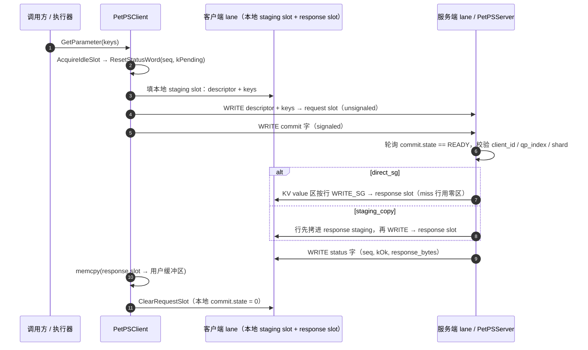
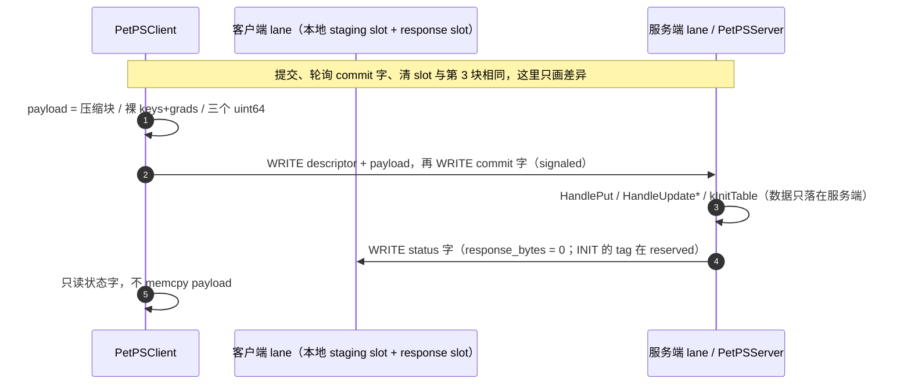
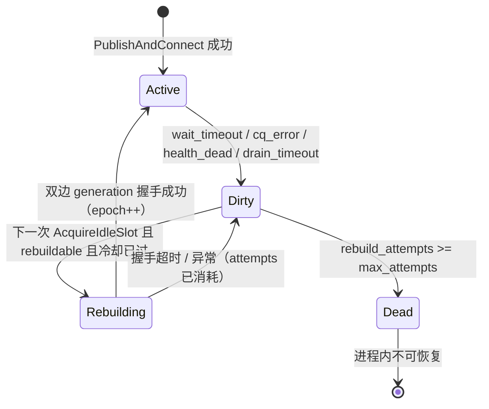

## 阅读地图

### 一句话

一条 lane 的一生只做三件事：把请求写进对端预注册的 slot、让对端看见「就绪」、把结果写回本端 slot。数据面不经过内核、不经过 RPC 框架，是一套自建的 RC-write slot 协议。控制面是 shard 0 上的一个 gRPC 服务（默认 `127.0.0.1:25100`），只交换 QP 元数据、READY 与健康状态，从不进入读写热路径。

### 本章覆盖什么

覆盖：slot 协议与全局地址、verbs/lane 资源、客户端批量栈、服务端扫描与响应、控制面与部署契约、两种响应模式的真实差异。不在本章：其它三种传输与客户端工厂、存储引擎、Python 计算层、benchmark 工具，见「与相邻章节的接口」。

### 7 个部件

| 编号 | 短名 | 它负责回答的问题 | 块 |
| --- | --- | --- | --- |
| 1 | slot 协议 | 两端对一块注册内存的约定形状是什么，什么算「就绪」 | 1 |
| 2 | 连接与内存注册 | 这条 lane 的内存怎么分配、怎么按全局偏移寻址 | 2 |
| 3 | 一次读写 | GET 与 PUT/UPDATE/INIT 各自走哪几步 | 3、4 |
| 4 | 响应模式 | direct_sg 与 staging_copy 差在哪，auto 为什么在运行时不存在 | 5 |
| 5 | 控制面与部署 | 两端怎么确认「同一次部署」，启动顺序与参数是什么 | 6 |
| 6 | 错误分层 | 哪一层检测、谁标记 lane 脏、哪些错误不该重试 | 7 |
| 7 | lane 生命周期 | lane 什么时候重建、怎么对齐、为什么有人不能重建 | 8 |

第 9 块把散落的前提条件收成一张不变量表。

### 它们怎么串起来

先看控制面：两端各自发布 QP 元数据，客户端等到目标 shard 的 READY 之后才建立 slot 视图（6）。数据面按 slot 协议工作：客户端把描述符与载荷写进对端的请求 slot，最后单独写一个 commit 字表示就绪（1）；服务端轮询到就绪后取出请求，读请求按响应模式决定直接 scatter 真实行还是先拷进本地 staging（5），写请求按载荷类型落到更新或建表（4）；结果连同状态字写回客户端 slot（3）。任何一步出错都进错误分层：谁能检测、是否置脏、能不能靠重建治好都在那里判定（7）；重建本身是双边握手，靠世代号把旧连接的迟到完成挡掉（8）。

### 核心概念表

| 概念 | 一句话 |
| --- | --- |
| slot | 一块按固定偏移切好的注册内存，请求与响应各占一半 |
| lane | 一条独立的 RC 连接及其独占的 verbs 资源（设备、PD、CQ、MR 视图） |
| 控制字 | 64 字节的 commit 或 status，唯一表示「就绪」的信号 |
| 世代 | 一次重建的编号，用来拦住旧连接的迟到完成 |
| 脏 | lane 暂时不可用，等待者立即失败而不是阻塞 |
| 回退 | 就绪行无法直接寻址时，整批改走拷贝路径 |

### 建议读法

- 只关心一次读怎么完成：1 → 2 → 3 → 5。
- 关心自愈与故障：7 → 8，顺序不要颠倒，否则「谁标记脏、谁去重建」会失去上下文；参数与部署看第 6 块的 flag 表和第 9 块的不变量表。

## 第 1 块：请求 slot 协议

### 它是什么

两端对一块内存的约定只有四件事：描述符放在哪、载荷从哪开始、就绪怎么写、完成怎么表示。请求侧是一段 192 字节的描述符加紧随其后的载荷，最后 64 字节是 commit 字；响应侧是一段载荷，最后 64 字节是 status 字。描述符与载荷都用普通 RDMA WRITE 写过去，只有 commit 字那一次写是 signaled，也就是它要等一个完成事件。

```text
lane_base + slot_in_qp * (resp + req)
├── response slot  [0 .. resp)
│   ├── payload            @ 0
│   └── StatusWord         @ resp - 64     (kRcSlotDone 表示 payload 已可读)
└── request staging slot
    ├── RequestDescriptor  @ 0             (192 字节, alignas(64))
    ├── payload            @ Align64(192)  (固定 192)
    └── CommitWord         @ req - 64
```

「就绪」不靠消息，靠顺序：commit 字是独立的一次写，跑在同一个 RC 连接上，而 RC 连接保序，所以服务端看到 commit 状态是就绪时，描述符与载荷一定已经落地。响应方向同理，先写载荷再写状态字，客户端看到完成状态就等于载荷完整。

### 它为什么存在

RDMA 的写操作没有「消息边界」，只有字节落点。要给一串字节赋予「这是一整个请求」的含义，最省的办法是在末尾补一个控制字，用连接保序当作隐式屏障。这样两端都不需要额外的 fence，也不需要应用层握手。slot 固定长度则让寻址退化成一次乘加，服务端可以预先把每个 slot 的偏移算好，轮询时只比一个整数。

### 它和谁接

上游是客户端的 slot 分配器：它先挑一个空闲 slot，再按固定偏移填描述符与载荷。下游是服务端的扫描循环：它按 slot 偏移轮询 commit 字，取出请求后交给处理分支。第 2 块讲这块内存怎么被注册与寻址，第 3、4 块讲两个方向的处理分支。

### 代码位置

- `RequestDescriptor` 固定 192 字节、64 字节对齐（`static_assert`）。载荷永远从 `Align64(sizeof(RequestDescriptor)) == 192` 开始；`payload_offset` 只被 `ValidateRequestDescriptor` 做区间检查，服务端读取时用的是固定 192，不读这个字段。
- 每个 slot 两端各有一个 64 字节控制字：请求端 `CommitWord{seq,state}`，响应端 `StatusWord{seq,state,status,response_bytes}`。两者 `seq` 必须相等、`state == kRcSlotDone`（`StatusWordDone`）才算完成。
- 提交顺序即协议：`SubmitRequest` 先把描述符与载荷拷进本地 staging slot，再用一次 unsignaled WRITE 送到对端请求 slot，最后单独写 commit（signaled）。提交前 `ResetStatusWord` 把响应状态重置为 `kPending`，避免上一轮的 `kDone` 被误认。
- `seq` 是 lane 本地单调序号，`SlotContext::next_seq` 从 1 开始。服务端同时看 `commit.seq != last_seq_[slot]` 与 `commit.state == READY`；重复 seq、seq==0、仍在 `inflight_seq_` 的 slot 都跳过。跨 lane 不保证顺序。
- slot 释放是写 commit 字（`ClearRequestSlot` → `commit.state = 0`）。服务端不依赖释放信号推进状态，它靠 seq 变化识别新请求。

### 交付一句

slot 协议到此交代完毕：192 字节描述符、两个 64 字节控制字、靠保序实现的就绪语义。下一块接第 2 块，讲这些偏移落在哪块已注册内存上。

## 第 2 块：连接与内存注册

### 它是什么

地址不是本机虚拟地址，而是「节点编号加节点内全局偏移」的 64 位打包。每条 lane 只注册自己需要的那一片，对外仍用全局偏移寻址，靠一个原点偏移把「全局窗口」换算成「本地那一段」；这样客户端不需要注册整块服务端内存，服务端也不需要知道客户端的虚拟地址。服务端一条 lane 上有两块自用内存（所有客户端的请求 slot 与响应 staging），此外还额外注册两类来源：KV 值区（`direct_sg` 的 SGE 源）和一块只读零区（缺失行用它填 0）。

### 它为什么存在

如果每条 lane 都注册整个进程的地址空间，MR 数量与页表压力会随 lane 数线性放大，而实际访问只落在自己那一片。切片注册加原点换算，让「只注册本 lane」和「按全局偏移寻址」两个目标同时成立。每条 lane 独占设备、PD、CQ，则是为了重建：QP reset 后要把该 CQ 彻底 drain，前提是这条 CQ 上只有本 lane 的 QP 在投递。

### 它和谁接

上游是部署配置里的节点编号与设备选择，下游是第 3、4 块的读写路径：所有偏移都从这套换算里来。请求 slot 的数量决定同一时刻能有多少在途请求，响应 slot 的大小决定单次读能返回多少行。

### 代码位置

地址模型：`GlobalAddress` 是 64 位打包的 `{nodeID:16, offset:48}`（`global_address.h`，有 `sizeof == 8` 静态断言）。`LocalAddress()` 输出 `region_origin_offset + (ptr - local_base)`，`LocalPointer()` 反向减去 origin，`LocalMeta()` 发布 `base_addr = local_base - region_origin_offset`，于是对端算出的 `base_addr + offset` 正好落进本端切片；对端 `Write/Read` 用 `remotes[n].base_addr + remote.offset` 与 `rkey`。

客户端 lane 布局：每个 client、每 shard、每 lane 的注册长度是 `ClientLaneBytes = slots_per_qp * (response_slot_bytes + request_slot_bytes)`，起点是 `ClientShardLaneOffset = (shard_id * raw_lanes_per_os_client + raw_lane) * lane_bytes`。`RcShardClientTransport::OpenSlot` 是唯一构造 `RcClientQpView` 的地方；`SubmitRequest` 把 descriptor 与 payload 拷进本地 staging slot，再分两次 WRITE 到服务端的请求 slot。本地 staging 从不被对端读取，它只是 WRITE 的源缓冲区。

服务端 lane 布局：`RcShardServerTransport` 每条 raw lane 一次性 bump 分配两块，`ServerLaneBytes = num_clients * slots_per_qp * request_slot_bytes` 的请求区，以及 `num_clients * slots_per_qp` 个 `response_slot_bytes` 的 response staging 区，两者之和就是该 lane 的 `local_region_bytes`。请求 slot 的全局编号是 `client_id * total_slots_per_shard + qp_index * slots_per_qp + slot_in_qp`，`DecodeSlotIndex` 是它的逆运算，也是服务端 `last_seq_` / `inflight_seq_` 数组的下标。服务端另外把两类本地内存注册进每一条 lane（`RegisterLocalMemoryRegion` 内部遍历所有 lane）：`CachePS::GetRDMABackingRegion()` 返回的 KV value 区，作为 `direct_sg` 的 SGE 源；启动时 `posix_memalign` + `memset(0)` 的只读零区，长度等于一个 `response_slot_bytes`，用于 miss 行。

资源粒度：`raw_verbs_transport.cc` 的构造函数每条 lane 都 `ibv_open_device` 一次，然后各自 `ibv_alloc_pd`、`ibv_create_cq(depth=4096)`、`ibv_reg_mr`、每对端一个 `ibv_create_qp`（`IBV_QPT_RC`，`max_send_wr=1024`、`max_recv_wr=1024`、`max_send_sge=32`、`max_recv_sge=1`）。这不是浪费而是必要：lane 重建要在 reset 后把该 CQ 彻底 drain，前提是这条 CQ 只有本 lane 的 QP 在投递。控制面通道也按同一粒度分配：`RawVerbsTransport::ControlPlane()` 每个 transport 实例一份，所以 16 lane 的客户端进程会惰性开出 16 条 gRPC channel（外加 `PetPSClient` 自己那条）。

注册尺寸以 lane 切片为准：`RawVerbsConfig::local_region_bytes` 的结构体默认值是 128 MiB，但 `MakeRawConfig` 的实参是 `ClientLaneBytes(config_)`（客户端）或 `ServerLaneBytes + response_slots * response_slot_bytes`（服务端），默认配置下客户端每条 lane 是 1 × (1 MiB + 1 MiB) = 2 MiB。`RcTransportConfig` 头文件里 `qps_per_client_per_shard = 32` 也只是默认值，实际由 flag（默认 16）覆盖。

本章涉及的文件与关键符号，按事实逐条列在章末「证据索引」，这里不重复。

### 交付一句

连接与内存注册到此交代完毕：全局偏移加原点换算、按 lane 切片注册、每条 lane 独占一套 verbs 资源。下一块接第 3 块，讲一次读请求怎么走完这条 lane。

## 第 3 块：一次 GET

### 它是什么

一次读请求分四段：挑一个空闲 slot 并填入描述符与 key（形状见第 1 块）、服务端轮询到就绪后按响应模式取行、写回载荷与状态字、客户端拷进调用方张量并把 slot 清空。响应模式只影响第二段，其余三段是共用的；读图时只需看中间那段 `alt`。



两条边界决定了它能走多远：

1. 客户端用户缓冲区从不注册。服务端只能写进客户端 lane 的响应 slot，客户端再 `memcpy` 到调用方张量（`--rdma_rc_skip_client_copy` 只给 benchmark 用）。唯一的零拷贝旁路是 `BorrowGetResultPayload`：直接返回响应 slot 里的指针，只在「单 chunk 且位置恒等」时由 executor 采用。
2. 失败不能靠重发掩盖：slot 的簿记在失败时怎么收尾，见第 7 块。

### 它为什么存在

读是所有训练步骤里最频繁的操作，它的延迟直接决定预取能不能跟上计算。把「挑 slot、写请求、收状态」做成一条固定流水，让在途请求数等于 slot 数，从而使背压变成一个可计算的容量问题，而不是超时问题。

### 它和谁接

上游是执行器的批量提交：它按 key 上限切 chunk，每个 chunk 一个 RPC。下游是第 5 块的响应模式分支与第 05 章的存储接口。多 chunk 的装配由执行器负责，包括决定是否采用零拷贝旁路。

### 代码位置

- 客户端入口 `petps_client.cc#PetPSClient::AcquireIdleSlot`、`#WaitForStatusWord`；提交与清空在 `rc_transport.cc#RcShardClientTransport::SubmitRequest`、`#ClearRequestSlot`。
- 服务端 `petps_server.cc#PetPSServer::ProcessSlot`、`#ScanAssignedSlots`；校验在 `rdma_protocol.h#ValidateRequestDescriptor`。
- 批量与背压：`MaxGetKeysPerRpc` 在客户端把三个上限取最小值，即 `max_kv_num_per_request`、响应预算（`rdma_rc_mtu_bytes * rdma_rc_target_response_mtu / value_size`）、请求 slot 的键预算；`MaxInFlightGetRpcs = qps * slots_per_qp`，也是 `HasGetSlotCapacity` 的窗口宽度。`PrefetchParameter` 在容量不足时先 `DrainBatchSlots` 再提交。
- 分片与合并：`shard_routing.h#PartitionKey`、`#BuildChunks`、`#MergeBatchRows`、`#DecodeBatchStatus`。

### 交付一句

一次 GET 到此交代完毕：四段流水、两条边界、一套容量计算。下一块接第 4 块，讲写方向为什么只有一次同步提交。

## 第 4 块：一次 PUT / UPDATE / INIT

### 它是什么

写方向复用第 3 块的流水，只有载荷与响应不同：载荷是压缩块而不是裸 float 行，响应只有一个状态字，`response_bytes = 0`。更新还分两种：带表名的一种在描述符里塞 64 字节定长表名，另一种是裸的「key 拼梯度」布局，长度由服务端严格校验。建表的载荷是三个整数，返回值放在状态字的保留字段里。



### 它为什么存在

写没有回退空间：一旦服务端开始应用，客户端无法知道应用到了哪一行，所以写方向刻意做成一次同步提交加一次等待，不做并发扇出。这也是背压的来源：大 batch 在客户端内部按单次 key 上限循环「提交一次、等一次」，天然是串行小批。

### 它和谁接

上游是调用方的 Put/Update 调用与稀疏提交；下游是 PS 核心的三种落地方式与存储引擎的原地更新。第 7 块会说明为什么写请求不适合在传输层重试。

### 代码位置

- PUT / UPDATE 的 payload 是压缩块（`ParameterCompressor`），不是裸 float 行。`kUpdate` 额外在 descriptor 的 `table_name`（64 字节定长）里带表名，服务端用 `DescriptorTableName` 还原；descriptor 的 `learning_rate`（原 `reserved0` 位置）承载客户端优化器学习率，`0` 表示不上报，服务端与本地优化器不一致时拒绝这批更新。`kUpdateFlat` 是裸 `keys || grads` 布局，`HandleUpdateFlat` 用 `FlatUpdatePayloadBytes` 严格校验长度。
- `kInitTable` 的 payload 是三个 `uint64`（num_embeddings、embedding_dim、table_id），返回值（tag）放在 `StatusWord::reserved`。
- 大 batch 在 `PetPSClient` 内部按 `FLAGS_max_kv_num_per_request` 循环「一次同步提交 + 等待」，所以 PUT/UPDATE 天然是串行小批；GET 才有真正的批量并发。

### 交付一句

写方向到此交代完毕：压缩块载荷、单个状态字、串行小批、没有回退。下一块接第 5 块，讲读路径里那个决定「直接 scatter 还是先拷贝」的开关。

## 第 5 块：响应模式

### 它是什么

读请求在服务端有两个出口，由描述符里的一组 flag 决定，不是两套协议。第一个出口把 KV 值区里的真实行地址直接填进 SGE，用一次 scatter 写把多行发回客户端，缺失行用零区补；第二个出口先把行拷进服务端本地 staging，再一次性写回。前者省一次拷贝，但对行的可寻址性有硬要求。

| 维度 | `direct_sg` | `staging_copy` |
| --- | --- | --- |
| 客户端置位 | `kRcFlagGetDirectSg \| kRcFlagGetAllowFallbackCopy` | 无 flag |
| 服务端入口 | `HandleGetDirectSg` → `CachePS::GetParameterDirectFixedRows` | `CachePS::GetParameterFlat` |
| payload 来源 | KV value 区里的原始行指针 + 只读零区（miss 行） | 先拷进服务端 response staging slot |
| 传输形态 | 多条 `WriteSg`，每条最多 32 个 SGE（`kMaxDirectSgesPerWr`） | 单次 `Write`，长度 `response_bytes` |
| 完成 | `CompleteResponseStatusOnly`（只写 StatusWord） | `CompleteResponse`（payload + StatusWord） |
| 失败语义 | 任何一行不可直接寻址 → 整批 abort | 不会 abort |
| 额外注册 | 服务端需要 KV value 区 MR + 零区 MR | 不需要 |

`HandleGetDirectSg` 的硬前置条件（都在代码里检查）：

1. `descriptor.response_bytes == key_count * embedding_dim * 4`，且 `embedding_dim != 0`；
2. `GetParameterDirectFixedRows` 返回 true 且行数吻合；
3. 每一行要么 `missing`（用零区），要么 `data != nullptr && size == row_bytes`；SSD 行或容量不匹配的行会返回 false，整批回退，绝不零填一个存在的 key；
4. 存储侧还要求 `default_value_size_hint == row_bytes`（`KVEngineComposite::BatchGetDirectFixedRows`），且 value store 实现了 `GetDirectFixedRows`（只有 `DRAM_VALUE_STORE` 实现；`hybrid_value_store.h` 只转发了 `RDMABackingData`，默认实现返回 false）。

### 它为什么存在

训练侧读的是连续的行，绝大多数情况下这些行就在同一块值区里，可以直接按地址发走。为此付出的代价是上面四条前置条件与一个整批回退语义：只要有一行不能直接寻址，就整批改走拷贝，绝不把存在的 key 填成 0。

### 它和谁接

上游是第 3 块的读路径分支，下游是第 05 章的存储接口。会话式协议里没有「关掉回退」的开关：`FillGetDescriptor` 在 `direct_sg` 模式下总是同时置两个 flag，全仓没有只置前者的调用点。因此允许回退这一位恒为真，只在服务端逻辑上有意义。

### 代码位置

`auto` 只活在工具层：旧文档曾把它写成运行时可选项，现在 `docs/parameter_server/rdma.md` 已澄清，只剩配置表一栏仍列着它。

- 二进制里的 flag 是 `DEFINE_string(rdma_get_response_mode, "direct_sg")`（`petps_client.cc`），取值只允许 `direct_sg` 或 `staging_copy`，其他值 `LOG(FATAL)`（`FillGetDescriptor`）。
- 环境变量入口 `RECSTORE_RDMA_GET_RESPONSE_MODE` 也明确拒绝其他值：`ApplyRdmaFlagsFromEnv` 抛 `RECSTORE_RDMA_GET_RESPONSE_MODE must be direct_sg or staging_copy`。
- `auto` 只出现在 `tools/benchmarks/run_benchmark_ps.py#resolve_rdma_get_response_mode`：它在构造命令行之前把 `auto` 解析成 `staging_copy`（当 `index_type == "DRAM_PET_HASH"`）或 `direct_sg`（其他），再以 `--rdma_get_response_mode=...` 传给二进制。
- `model_zoo/rs_demo/cli.py` 走另一条路：直接设 `RECSTORE_RDMA_GET_RESPONSE_MODE = staging_copy if index_type == DRAM_PET_HASH else direct_sg`，同样没有 `auto`。

工具层为什么把 `DRAM_PET_HASH` 映射到 `staging_copy`：代码里没有注释解释。一种与现状自洽的解读是，`DRAM_PET_HASH` 是唯一会被 `SSD_VALUE_STORE` / `TIERED_VALUE_STORE` 复用的 index type（见 `tools/benchmarks/batch_test/storage_runner.py`、`run_kvengine_compare.py` 的矩阵），而这两种 value store 不支持直接行寻址，选 `direct_sg` 会让每批都 abort 再回退。此解释未确认，需要 benchmark 或作者说明。

### 交付一句

响应模式到此交代完毕：同一个分支的两个出口、四条前置条件、一个只在工具层存在的 `auto`。下一块接第 6 块，讲让两端相信「处在同一次部署」的那套控制面。

## 第 6 块：控制面与部署

### 它是什么

控制面是一个 gRPC 服务，只跑在编号为 0 的服务端进程里，走 TCP，默认监听 `127.0.0.1:25100`——这是与数据面 RC QP 完全分离的另一条连接。它保存三张表：元数据表、就绪表、健康快照。元数据按「部署 id + epoch + 发布方/接收方节点与 lane」索引，就绪表按「部署 id + epoch + 服务端编号」索引，健康快照按心跳时间裁决 stale 与 dead。任意 server 或 client 进程都持有一个控制面客户端，每条连接一个 channel 并复用。

### 它为什么存在

数据面没有「连接建立」这一步，谁都可以往对端的 rkey 上写。要让这种自由安全，必须在带外确认三件事：对端和我属于同一次部署、对端的 QP 元数据是最新的、对端还活着。控制面就是这三件事的唯一入口；它一旦被绕过，数据面会把请求写进错误的世代或错误的进程。

### 它和谁接

上游是进程启动时的部署配置，下游是第 8 块的重建握手（世代号通过元数据交换）与健康探测（dead 判定会把 lane 置脏）。它不参与任何读写请求，因此控制面的抖动只影响恢复速度，不影响稳态吞吐。

### 代码位置

拓扑与编号：

- `ParseResolvedRdmaDeploymentConfig` 要求 `distributed_client` 与 `rdma_deployment` 同时存在，少一个字段就抛 `invalid_argument`。`distributed_client` 显式 `num_shards`、`hash_method`（`city_hash` / `simple_mod`）、`max_keys_per_request`、`servers[]`（每个 shard 一条，含 host/port/shard，必须覆盖全部 shard、不能重复）。
- `rdma_deployment`：`deployment_id`（非空）、`epoch`（>0）、`protocol_version`（必须等于 `kRdmaDeploymentProtocolVersion == 1`）、`num_clients`（>0）、`nodes[]`。`nodes[]` 必须覆盖 `num_shards + num_clients` 个节点，每个要有 `node_id`、`role`、`device`、`port`、`gid_index`；`role` 必须与 node_id 区间一致（server `[0, num_shards)`，client `>= num_shards`）；RoCE v2 还强制要求 `hop_limit` / `traffic_class` / `flow_label` 且在范围内。
- `configuration_digest` 是规范化（按 shard / node_id 排序）后的整份配置的 FNV-1a 十六进制摘要；`fabric_digest` 只对 `nodes[]` 做同样摘要。两个 digest 都进入 meta 与 READY 校验。
- 节点编号是稠密的：`global_id < num_servers` 是 server，否则是 client，客户端 `logical_id = global_id - num_servers`。

启动顺序：

1. `global_id == 0` 的服务端先 `RdmaControlPlaneServer::Start()`（gRPC，默认 `127.0.0.1:25100`）。
2. 每个服务端构造 `RcShardServerTransport`：每 lane 建资源 → `PublishAndConnect()`（发布本端 QPN/generation，拉取所有已连接对端 meta，做 `ValidateRawVerbsPeerMeta`）→ 挂 receive WR。
3. 服务端轮询线程全部起来后，`MaybePublishServerReady` 只由最后一个线程触发一次 `PublishServerReady`。心跳线程与 READY 独立：它只刷新已存在的 READY 记录，不会创建记录（`RecordHeartbeat` 直接 return）。
4. 客户端 `PetPSClient::InitializeTransport`：解析同一份配置 → 建 `RcShardClientTransport`（同样逐 lane 建连）→ `WaitServer(shard)` 阻塞到该 shard READY → 再 `OpenSlot` 建立 slot 视图。
5. `InitEmbeddingTable` 走正常 `kInitTable` 请求，把表建出来后才开始 GET/PUT。

`ValidateRawVerbsPeerMeta` 逐字段比对 node_id、logical_id、node_role、protocol_version、deployment_id、deployment_epoch、两个 digest、link_layer、fabric_mode、port、gid_index、active_mtu。任何不一致都在建连阶段快速失败，这是「同一次部署」的硬边界。

关键 flag（`rc_options.cc` 是权威默认值）：

| flag | 默认 | 影响 |
| --- | --- | --- |
| `--rdma_rc_qps_per_client_per_shard` | 16 | 每 client 每 shard 的 lane 数（结构体默认 32，被该 flag 覆盖） |
| `--rdma_rc_slots_per_qp` | 1 | 每条 QP 的逻辑 slot 数；在途上限 = 两者乘积 |
| `--rdma_rc_request_slot_bytes` / `--rdma_rc_response_slot_bytes` | 1 MiB / 1 MiB | slot 尺寸 |
| `--rdma_rc_mtu_bytes` / `--rdma_rc_target_response_mtu` | 4096 / 200 | GET 单 RPC key 上限 = `(4096*200)/value_size` |
| `--rdma_rc_inline_bytes` | 64 | 申请 `max_inline_data`；≤ 该值的 WRITE 加 `IBV_SEND_INLINE` |
| `--rdma_wait_timeout_ms` | 60000 | 状态字等待预算 |
| `--rdma_cq_harvest_interval_ms` | 50 | 等待期收割 CQE 的间隔（0 关闭） |
| `--rdma_health_probe_after_ms` / `_interval_ms` / `_timeout_ms` | 1000 / 1000 / 1000 | 慢路径健康探测 |
| `--rdma_heartbeat_interval_ms` / `--rdma_health_stale_ms` / `--rdma_health_dead_ms` | 1000 / 3000 / 9000 | 心跳与健康阈值 |
| `--rdma_lane_rebuild_enabled` | false | 是否允许 QP 重建自愈（两端须同时开启） |
| `--rdma_lane_rebuild_max_attempts` / `_cooldown_ms` / `_wait_ms` | 3 / 1000 / 2000 | 重建预算、冷却、握手期限 |
| `--rdma_lane_rebuild_poll_ms` / `_poll_max_ms` / `_poll_timeout_ms` | 50 / 500 / 100 | 服务端世代轮询与退避 |
| `--rdma_rc_server_get_workers` | 0 | GET payload 卸载线程数，0 = poller 内联 |
| `--rdma_rc_server_coroutines_per_thread` | 1 | 每 poll 线程的协作式 scanner 数 |
| `--rdma_rc_profile_interval_ms` | 0 | 周期性 profile 输出 |

### 交付一句

控制面与部署到此交代完毕：三张表、一份严格契约、一条五步启动顺序。下一块接第 7 块，讲谁在检测故障、谁把 lane 标记成脏。

## 第 7 块：错误分层与恢复

### 它是什么

错误按检测点分成七层，每层对应一种异常类型，并明确两件事：要不要把 lane 置脏、能不能靠重建治好。verbs 完成状态又单独分成五类，只有两类值得重建。重试本身也分层：硬件层、传输层、lane 层是真的在做重试，请求层根本没有重试。

| 层 | 检测点 | 抛出的类型 | 是否置脏 lane | 能否靠重建恢复 |
| --- | --- | --- | --- | --- |
| 参数 / 容量 | slot 装不下、batch 超预算 | `std::runtime_error` / `std::invalid_argument` | 否 | 改参数 |
| verbs post | `ibv_post_send` 返回非 0 | `std::runtime_error`（`Write`/`WriteSg`） | **否** | 通常不能 |
| 设备层 | CQE `status != SUCCESS` | `RawVerbsCompletionException` / `ShardUnreachableError` | 是 | 仅 peer 侧 |
| tracked WR 超时 | signaled WR 等不到 CQE | `RcTrackedCompletionTimeout` | 是（`drain_timeout`） | 是 |
| 状态字等待超时 | 超过 `--rdma_wait_timeout_ms` | `std::runtime_error` | 是（`wait_timeout`） | 是 |
| 节点层 | `GetServerHealth` 判 `dead` | `ShardUnreachableError` | 是（`health_dead`） | 是 |
| 服务端业务 | `StatusWord::status` | 正常响应，`RpcStatus` | 否 | 由调用方决定 |

置脏的唯一入口是 `PetPSClient::MarkLaneDirty(qp_index, reason, snapshot, waited_ms, rebuildable)`：调用点分别报 `wait_timeout`、`health_dead`、`drain_timeout`（三者 `rebuildable=true`）与 `cq_harvest_exception`（`rebuildable=false`）；`FailLaneOnCompletionError` 按完成状态分类后再决定。多次置脏时 `rebuildable` 取或，一个可重建的原因不会被先前不可重建的原因掩盖。

完成事件的分类：

| 类 | 触发状态 | 含义 | `IsRawVerbsUnreachableError` |
| --- | --- | --- | --- |
| `kPeerUnreachable` | `IBV_WC_RETRY_EXC_ERR`、`IBV_WC_RNR_RETRY_EXC_ERR` | 对端不再 ACK | true |
| `kPeerRejected` | `IBV_WC_REM_INV_REQ_ERR`、`REM_ACCESS_ERR`、`REM_OP_ERR` | 对端应答但拒绝 | false |
| `kLocalError` | `LOC_LEN_QP_OP_PROT_ACCESS_RDD_VIOL` | 本地长度/权限/QP 用法错 | false |
| `kFlushed` | `IBV_WC_WR_FLUSH_ERR` | QP 已死，WR 被冲掉 | true |
| `kOther` | 其余 | 未知 | false |

只有 `kPeerUnreachable` 与 `kFlushed` 值得重建；`kPeerRejected` / `kLocalError` / `kOther` 重建治不了，`FailLaneOnCompletionError` 会保留原始 `RawVerbsCompletionException` 而不是包装成「shard unreachable」。

四层重试，只有一层是真重试：

| 层 | 机制 | 重试对象 | 默认 |
| --- | --- | --- | --- |
| 硬件 | verbs RC：`timeout=14`（≈67 ms）、`retry_cnt=7`、`rnr_retry=7`、`min_rnr_timer=12` | 单个 WQE | 恒开 |
| 传输 | 复用 slot 前先 reap 上一个 commit WR 的 CQE | 完成事件 | 恒开 |
| lane | QP 重建 + 双边 generation 握手 | 整条 lane | `--rdma_lane_rebuild_enabled`，默认关 |
| 请求 | **不存在** | — | — |

### 它为什么存在

请求层不重试是有意的：重建后无法确定服务端是否已经执行过该请求，而更新会真的改梯度。异常只带拼好的文本，没有结构化 shard/lane 字段，所以上层还做不到「只重试失败的那一片」。把这条边界写清楚，比补一个看似智能的重试更有价值。

### 它和谁接

上游是第 1 块的提交等待与第 8 块的重建判定（本节只回答「谁检测、谁标记」，「标记之后谁来重建」在下一块）；下游是调用方的整批重试策略。slot 的簿记在这里收尾，因为失败时的释放语义直接决定调用方会不会读到一份从没到达的结果。

### 代码位置

slot 状态回滚：`SlotContext::busy` 与 `pending_rpcs_` 是两套簿记，失败时的处理不对称。

- 重建后 `slot.busy = false`（QP reset 后 slot 物理上可用），但 `PendingRpc::failed = true` 且条目保留。原因写在 `TryRebuildLaneLocked`：删掉条目会让 `QueryRPCFinished` 返回 true、`WaitRPCFinish` 静默返回，调用方会去解一个从没到达的响应（零填缓冲区恰好解成 `RpcStatus::kOk`）。
- `RevokeRPCResource` 对 `failed` 条目跳过 `ClearRequestSlot`，因为该 slot 可能已经被新请求复用，清零会破坏新请求的 commit 字。
- 脏 lane 上的 slot 一律不归还（`revoke_skipped_dirty_lane`）：服务端可能仍在读请求 payload，或 CQE 还会晚到。

其余符号：`ClassifyRawVerbsCompletionStatus` 与 `IsRawVerbsUnreachableError` 在 `raw_verbs_transport.h`；等待循环里的健康探测与 CQE 收割在 `petps_client.cc#PetPSClient::WaitForStatusWord`；慢路径探测的节流与缓存在 `control_plane.h#RdmaSlowPathProbeGate`、`petps_client.cc#MaybeProbeShardHealth`。

### 交付一句

错误分层与恢复到此交代完毕：七层错误、两类值得重建的完成状态、四层重试里唯一缺失的那层。下一块接第 8 块，讲被标记为脏且可重建的 lane 怎么恢复。

## 第 8 块：lane 生命周期与重建

### 它是什么

一条 lane 只有四个状态量：脏（当前不可用，等待者快速失败）、可重建（这个原因能否靠重建治好）、死（终态）、世代（每次成功重建加一）。重建的触发点只有一个：下一次 `AcquireIdleSlot` 时，如果 lane 脏、`--rdma_lane_rebuild_enabled` 为真、可重建、冷却已过，就地重建。没有后台打扫线程，没有流量就不会恢复。重建预算 `--rdma_lane_rebuild_max_attempts`（3）按 lane 终身累计，成功后也不复位，耗尽即转 `dead`。



有四个不同的「世代」容易被混为一谈：

| 名字 | 归属 | 何时 +1 | 作用 |
| --- | --- | --- | --- |
| `deployment_epoch` | 配置 / 控制面 | 运维换部署 | 控制面拒绝跨 epoch 的 meta、READY、心跳 |
| `lane_generation` | 每条 lane 的 `RawVerbsTransport` | 本端重建后 `AdvanceLaneGeneration` 并重新 `Publish` | 对端据此判断「你重建了，我也要重建」 |
| `QpContext::epoch` | 客户端 lane | 重建成功 | 让旧请求的 `WaitForStatusWord` 立刻抛 `ShardUnreachableError`，而不是等一个已被复用的 slot |
| `Lane::response_epoch` | 服务端 lane | 服务端重建 | 拦住「请求已被接受、payload 还没发」的 worker，避免把旧世代的行写进新世代的 slot |

### 它为什么存在

RC 连接一旦进入错误态就无法原地恢复，只能 reset 重建。重建期间对端可能还在往里写，旧请求的完成事件也可能晚到；如果只 reset 而不区分世代，这些迟到的写会落进新连接复用的同一个 slot，被当成新请求的结果。世代号加双边握手，就是为了让「旧世代的一切」在逻辑上失效。

### 它和谁接

上游是第 7 块：只有被判定为可重建的错误才会把 lane 置脏。下游是第 2 块的资源分配：重建要求该 CQ 上只有本 lane 的 QP。控制面提供元数据交换通道，让两端能看见对方的世代变化。

### 代码位置

重建握手（`RcShardClientTransport::RebuildLane`，全程持 `impl_->cq_mutex`）：

1. `RefreshPeerMeta` 先读对端当前 meta，记下 `server_baseline` 的 `lane_generation`；如果对端进程重启过，顺带拿到新的 QPN/rkey/base。
2. `RebuildQp`：`RESET`（flushes 所有在飞 WR）→ drain CQ → `INIT → RTR → RTS` → 重新挂满 1024 个 receive WR。
3. 清空 `submit_completion_pending/ready`，`memset(lane_base, 0, lane_bytes)`（旧世代的 status 不能让新请求看成完成）。
4. `AdvanceLaneGeneration` 自增并 `Publish`，让服务端看到变化。
5. 在 `--rdma_lane_rebuild_wait_ms`（默认 2000）内轮询 `RefreshPeerMeta`，只要对端 `lane_generation > server_baseline` 就算 ACK；每次 RPC 的超时用剩余预算，避免 30 s 的控制面 deadline 把数据面拖死。
6. 成功后 `TryRebuildLaneLocked` 释放该 lane 所有 slot、把该 lane 上 `pending_rpcs_` 全部标 `failed`、`epoch++`、清 `dirty/rebuildable`、`InvalidateVerdict()`。

服务端的对称路径是 `PollClientRebuildRequests` → `RebuildClientLaneIfStale`：轮询线程按 `qp_index` 归属扫描，读客户端 meta，发现 `lane_generation` 变化就 `response_epoch++`、`RebuildQp`、清响应完成标记、再自增并发布自己的 generation 作为 ACK。空闲时轮询间隔从 50 ms 指数退避到 500 ms（`MaybePollClientRebuilds`），重建成功即复位。

`num_os_clients != 1` 时两端都直接拒绝重建：服务端一条 lane 的 CQ 上挂着多个客户端进程的 QP，reset 后无法只 drain 自己的完成，drain 会丢掉别人的 CQE。这是显式设计取舍，不是遗漏。

### 交付一句

lane 生命周期到此交代完毕：四个状态量、四个世代、一次六步握手，以及一条「多客户端进程不重建」的硬限制。下一块接第 9 块，把前面所有机制依赖的前提收成一张表。

## 第 9 块：不变量

### 它是什么

这一块把前面散落的前提条件集中成一张表。它们属于「一旦不成立就会静默出错」的假设，与可以随手调整的参数不同；读代码时发现某条被打破，通常意味着真实的 bug。

### 它为什么存在

RDMA 数据面没有校验和，也没有重传兜底。协议的正确性建立在一组内存布局与线程归属的约定上，这些约定不写在类型里，只写在注释与静态断言里。

### 它和谁接

上接第 1 块的 slot 形状、第 2 块的地址换算、第 8 块的世代围栏。下游是任何想改 slot 布局、改响应模式或改线程模型的改动。

### 代码位置

| # | 不变量 | 证据 |
| --- | --- | --- |
| 1 | 描述符 192 字节、载荷从 192 开始；两端控制字的 `seq` 必须匹配、`state == kRcSlotDone`；`payload_offset` 只被校验不做寻址 | `rdma_protocol.h#RequestDescriptor`、`#StatusWordDone`、`#ValidateRequestDescriptor` |
| 2 | commit/status 是唯一「就绪」信号，都在 payload 之后发布，依赖 RC 保序而非 fence | `rc_transport.cc#SubmitRequest`、`#CompleteResponse` |
| 3 | 一条 lane 只有一个 owner 线程：客户端由 `PetPSClient::mu_` 串行化 submit/harvest/rebuild；服务端由 `qp_index % thread_count` 决定 slot 扫描、响应完成与重建检查在同一 poll 线程 | `petps_client.cc#SubmitRpcLocked`、`petps_server.cc#PollingThread` |
| 4 | 服务端 GET payload worker 是唯一由非 poll 线程发起响应写入的路径，由 `Lane::rebuild_mu` + `response_epoch` 双重保护：`WriteResponsePayloadSg` 持锁比对 `expected_epoch` 再 post，`DrainGetPayloadCompletions` 在 `CompleteResponseStatusOnly` 前再比对一次 | `rc_transport.cc#WriteResponsePayloadSg`、`#RebuildClientLaneIfStale`、`petps_server.cc#DrainGetPayloadCompletions` |
| 5 | slot `seq` 在同一 lane 上单调递增，服务端用 `last_seq_` 去重；跨 lane 不保证顺序 | `petps_client.cc#SlotContext::next_seq`、`petps_server.cc#ProcessSlot` |
| 6 | `GlobalAddress.offset` 是 48 位；跨出本 lane 切片的指针被 `LocalAddress` / `LocalPointer` 直接抛错 | `global_address.h` |
| 7 | MR 权限一律 `LOCAL_WRITE \| REMOTE_READ \| REMOTE_WRITE \| REMOTE_ATOMIC`，没有只读 MR，包括那块只读零区 | `raw_verbs_transport.cc#RegisterMemoryRegion` |

### 交付一句

不变量到此交代完毕：七条前提覆盖布局、控制字、线程归属与权限。接下来是跨章节接口、风险清单与证据索引。

## 与相邻章节的接口

- **第 03 章（参数服务器与传输）**：`PetPSClient` 实现 `recstore::ShardClient`；`RDMAPSClientAdapter` 实现 `BasePSClient`，由 `CreatePSClient` 按 `ps_type == "RDMA"` 构造。gRPC/bRPC/local_shm 的分片与请求形态在第 03 章，本章只讲 RDMA lane。
- **第 05 章（存储与内存）**：`HandleGet` / `HandleGetDirectSg` / `HandlePut` / `HandleUpdate*` 调用的 `CachePS` → `BaseKV` 接口；`direct_sg` 的可行性最终由 `KVEngineComposite::BatchGetDirectFixedRows` 与 value store 的 `GetDirectFixedRows` / `RDMABackingData` 决定。
- **第 02 章（Python 计算层）／第 06 章（model zoo / 测试 / 工具）**：`PrefetchParameter` / `GetPrefetchResult` 的语义（异步 GET + 延迟取结果）是 Python 侧 `emb_read` 的实现基础；`resolve_rdma_get_response_mode`、`RECSTORE_RDMA_*` 注入、`run_rdma_rc_transport_benchmark.py` 的 profile 解读都在第 06 章。本章只覆盖 RPC 侧句柄，并只声明「`auto` 属于工具层」这一事实。

## 风险、坑与未确认点

2026-11-09 的基线（`5f92ba2a` → `6d205e98`）没有改动 RDMA 路径；2026-11-11 合并的 `7c44f83da` 只做两件事：descriptor 的 `reserved0` 改为 `learning_rate`（UPDATE 三类入口都填），以及上游修 `docs/parameter_server/rdma.md` 的 `auto` 段落。下面 12 条结论都未因此改变，第 5 块的不一致项已按上游文档改后状态更新。

1. **[源码事实] `direct_sg` 的 payload 与并发 UPDATE 无同步。** `HandleGetDirectSg` 把 KV value 区里的行地址填进 SGE 并 post WRITE 后立刻返回，NIC 之后才异步读取这些字节；同一 shard 的另一个 poll 线程可以同时对同一 key 执行 `ApplySgdUpdateFlat`，而它对 `row.data` 是原地 `value[c] -= learning_rate * grad[c]`（`engine_composite.h#ApplySgdUpdateFlat`），不是写时复制。协议层不会损坏内存，但一次响应可能读到半新半旧的行。代码里没有任何按行的锁或版本号，影响面取决于训练负载是否并发读写同一 key，未实测。
2. **[源码事实] 服务端 MR 数量随 lane 线性放大。** `RegisterLocalMemoryRegion` 对每条 lane 各注册一次整块 KV value 区，加上零区与 lane 自身的 slot 区，稳态约为 `lanes × 3` 个 MR。默认 16 lane 时，一块多 GB 的 value slab 会被注册 16 次，注册耗时与 NIC 页表压力都随 `qps_per_client_per_shard` 增长。改小 QP 数或共享 PD 是可行方向，当前实现没有共享。
3. **[源码事实] `ibv_post_send` 失败不会置脏 lane。** `RawVerbsTransport::Write` 失败抛普通 `runtime_error`；`SubmitRpcLocked` 只捕获 `RawVerbsCompletionException` 与 `RcTrackedCompletionTimeout`，所以 post 失败既不置脏 lane，也不复位该 slot 的 `busy`（`GetParameter` 只在容量校验失败时手动复位），这条 lane 的容量会被永久吞掉一块。仓库文档 `docs/parameter_server/rdma.md` 把它标为「已知缺口」，与代码一致。
4. **[源码事实] `payload_offset` 是残留字段。** 协议允许任意 `>= 192` 且不越界的值通过校验，但服务端始终从 192 读 payload。第三方客户端按该字段布局时会静默错位。
5. **[源码事实] `direct_sg` 的静默性能悬崖。** `default_value_size_hint != embedding_dim*4`、或 value store 不是 DRAM 时，每一批都会在 `HandleGetDirectSg` 里 abort 再整批回退，只留下 `get_direct_sg_fallback` 计数。功能正确，但基准数字会变成 staging_copy 的开销，客户端毫不知情。
6. **[源码事实] `HasAvailableSlots` 的语义偏保守。** 任一 lane 处于 `dead` 或 `dirty` 就返回 false，即使其余 15 条健康。它只被 `PrefetchParameter` 用来决定是否 `DrainBatchSlots`，不会直接报错，但会让一次预取把全部在途 batch 收干。
7. **[源码事实] NUMA flag 在 C++ 侧未接线。** `--rdma_rc_client_numa_id` / `--rdma_rc_server_numa_id` 只在 `rc_options.cc` 定义、被 Python runner 读取来决定 `RECSTORE_BIND_CORE_OFFSET` 与 CPU 亲和；`RawVerbsTransport` 从不读它们，也没有 `ibv` NUMA 相关调用。真正的亲和来自 `base::bind_core_with_env_offset`。
8. **[源码事实] 没有 GPU Direct / DMABUF。** `src/ps/rdma/` 内没有 cuda / dmabuf / peer-memory 调用；所有 RDMA 只发生在主机内存的 slot 与 value 区之间，GPU tensor 必须先经 `memcpy` 落到用户缓冲区。
9. **[源码事实] `SendDoorbell` 是死代码。** `RawVerbsTransport::SendDoorbell`（`IBV_WR_SEND_WITH_IMM`）在仓内没有调用点；`TryPoll` 对 `RECV` 完成的重挂逻辑目前只是防御性代码。
10. **[源码事实] draining 流程未上线。** `PublishServerDraining` 只在单测里被调用；`PetPSServer::Stop` 明确注释「不发 draining」，因为当前没有消费者，而 draining 记录会永久拒绝同 epoch 的 READY。`WaitServerReady` 同样只出现在测试里，生产客户端用的是 `WaitServer(shard)`。
11. **[待验证] 重建恢复包线未复测。** `docs/parameter_server/rdma.md` 给出实测「设备层发现对端不回 ACK 4.2–4.4 s」「默认恢复包线 ≈13.3 s，之后终态 `dead`」；本轮只核对了参数（`timeout=14`、`retry_cnt=7`、3 次重建、2 s 握手、1 s 冷却）与「预算按 lane 终身累计、成功后不复位」这一实现细节，没有在真实 RDMA 环境复现这两个数字，差距原因也未定位。需要一次带 `--rdma_rc_profile_interval_ms` 与 `--rdma_rc_server_fence_stats_interval_ms` 的实测才能确认。
12. **[源码事实] `RECSTORE_RDMA_GET_RESPONSE_MODE` 与 flag 双入口的优先级。** `ApplyRdmaFlagsFromEnv` 在适配器初始化时覆盖 flag；直接跑 C++ benchmark 时以命令行 `--rdma_get_response_mode` 为准。两条入口没有冲突检测，同时设置时环境变量赢。

### 文档与代码不一致

| 条目 | 现状 |
| --- | --- |
| 每 lane 注册内存尺寸 | `docs/parameter_server/rdma.md` 第 94 行仍是「注册内存（默认 128 MiB）」，与第 2 块的 `ClientLaneBytes` / `ServerLaneBytes(+staging)` 不符：结构体默认值确实 128 MiB，但实际注册长度按 lane 切片（默认客户端每 lane 2 MiB）。 |
| `--rdma-get-response-mode` 取值 | 该文第 205 行已改对（"`auto` 只是解析层"），但第 238 行的配置表仍把 `auto` 列入取值；二进制只接受 `direct_sg` / `staging_copy`（见第 5 块）。 |

## 证据索引

| 事实 | 证据 |
| --- | --- |
| 描述符 192 字节、commit/status 64 字节对齐 | `src/ps/rdma/rdma_protocol.h#RequestDescriptor` / `#CommitWord` / `#StatusWord` 的 `static_assert` |
| opcode 与 flags、descriptor 校验只做区间检查 | `src/ps/rdma/rdma_protocol.h#RcOp`、`#kRcFlagGetDirectSg`、`#kRcFlagGetAllowFallbackCopy`、`#ValidateRequestDescriptor` |
| 全局地址 64 位打包 | `src/ps/rdma/global_address.h#GlobalAddress` |
| 设备/PD/CQ 每 lane 一份、CQ 深度 4096、send WR 1024 | `src/ps/rdma/raw_verbs_transport.cc#RawVerbsTransport::RawVerbsTransport`、`#kRawVerbsCqDepth` |
| QP 参数（PSN 3185、timeout 14、retry 7） | `src/ps/rdma/raw_verbs_transport.cc#ModifyQpToRts` |
| CQE 分类与「可重建」判定 | `src/ps/rdma/raw_verbs_transport.h#ClassifyRawVerbsCompletionStatus`、`#IsRawVerbsUnreachableError` |
| QP 重建顺序与 CQ drain | `src/ps/rdma/raw_verbs_transport.cc#RawVerbsTransport::RebuildQp` |
| 客户端/服务端 lane 切片与注册长度 | `src/ps/rdma/rc_transport.cc#ClientLaneBytes`、`#ClientShardLaneOffset`、`#ServerLaneBytes`、`RcShardClientTransport::RcShardClientTransport`、`RcShardServerTransport::RcShardServerTransport` |
| slot 内部偏移 | `src/ps/rdma/rc_transport.cc#RcShardClientTransport::OpenSlot`、`#RequestCommitOffset`、`#ResponseStatusOffset` |
| 提交分两次 WRITE、commit 是唯一 signaled 写；响应先 payload 后 status | `src/ps/rdma/rc_transport.cc#RcShardClientTransport::SubmitRequest`、`#RcShardServerTransport::CompleteResponse`、`#CompleteResponseStatusOnly` |
| 响应 epoch 围栏 | `src/ps/rdma/rc_transport.cc#RcShardServerTransport::WriteResponsePayloadSg`、`#RebuildClientLaneIfStale` |
| `num_os_clients != 1` 拒绝重建 | `src/ps/rdma/rc_transport.cc#RcShardClientTransport::RebuildLane`、`#RebuildClientLaneIfStale` |
| 服务端 slot 扫描与 seq 去重 | `src/ps/rdma/petps_server.cc#PetPSServer::ProcessSlot`、`#ScanAssignedSlots` |
| direct_sg 行级条件、整批回退与存储侧前置条件 | `src/ps/rdma/petps_server.cc#HandleGetDirectSg`、`#HandleGet`、`src/storage/kv_engine/engine_composite.h#BatchGetDirectFixedRows`、`src/storage/value_store/dram_value_store.h#GetDirectFixedRows` |
| 零区注册、GET worker 与 stale 丢弃 | `src/ps/rdma/petps_server.cc#PetPSServer::PetPSServer`（`direct_sg_zero_region_`）、`#GetPayloadWorkerLoop`、`#DrainGetPayloadCompletions` |
| 客户端 slot 获取、脏/死 lane 语义、重建触发点与终身预算 | `src/ps/rdma/petps_client.cc#PetPSClient::AcquireIdleSlot`、`#MarkLaneDirty`、`#TryRebuildLaneLocked` |
| 重建后 pending 标 failed 而非删除 | `src/ps/rdma/petps_client.cc#PetPSClient::TryRebuildLaneLocked`、`#RevokeRPCResource` |
| 等待循环里的健康探测与 CQ 收割 | `src/ps/rdma/petps_client.cc#PetPSClient::WaitForStatusWord` |
| direct_sg 客户端置位与模式校验 | `src/ps/rdma/petps_client.cc#PetPSClient::FillGetDescriptor` |
| env 只接受两个值 | `src/ps/rdma/rdma_ps_client_adapter.cc#ApplyRdmaFlagsFromEnv` |
| `auto` 只在工具层 | `tools/benchmarks/run_benchmark_ps.py#resolve_rdma_get_response_mode`、`model_zoo/rs_demo/cli.py`（`RECSTORE_RDMA_GET_RESPONSE_MODE` 赋值） |
| 原地 SGD 更新（无同步） | `src/storage/kv_engine/engine_composite.h#ApplySgdUpdateFlat` |
| UPDATE 携带学习率 | `src/ps/rdma/rdma_protocol.h#RequestDescriptor`（`learning_rate`）、`src/ps/rdma/petps_server.cc` 的 `HandleUpdate*` → `CachePS::UpdateParameter` |
| 控制面 RPC 全集与 meta 编解码/校验 | `src/ps/proto/rdma_control_plane.proto#RdmaControlPlane`、`src/ps/rdma/control_plane.cc#EncodeRawVerbsNodeMeta`、`#DecodeRawVerbsNodeMeta`、`#ValidateRawVerbsPeerMeta` |
| 心跳不创建 READY、READY 唯一入口 | `src/ps/rdma/control_plane.cc#RdmaControlPlaneServer::RecordHeartbeat`、`#RdmaControlPlaneService::PublishServerReady` |
| 健康阈值计算、快照与慢路径探测节流 | `src/ps/rdma/control_plane.h#EvaluateServerHealth`、`#RdmaSlowPathProbeGate`、`src/ps/rdma/control_plane.cc#RdmaControlPlaneServer::ServerHealthSnapshot`、`src/ps/rdma/petps_client.cc#MaybeProbeShardHealth` |
| 拓扑与 digest 契约 | `src/ps/rdma/rdma_deployment.cc#ParseResolvedRdmaDeploymentConfig`、`#StableDigest` |
| flag 默认值 | `src/ps/rdma/rc_options.cc` |
| 分片、批量装配与在途上限 | `src/ps/rdma/shard_routing.h#BuildChunks`、`#MergeBatchRows`、`src/ps/rdma/rdma_distributed_executor.cc#SubmitGetParameter`、`#DrainBatchSlots`、`src/ps/rdma/rdma_ps_client_adapter.cc#MaxInFlightGetRpcs`、`#RDMAPSClientAdapter::PrefetchParameter` |
| `RpcStatus` 取值与文本 | `src/ps/rdma/rdma_status.h#RpcStatus` |
