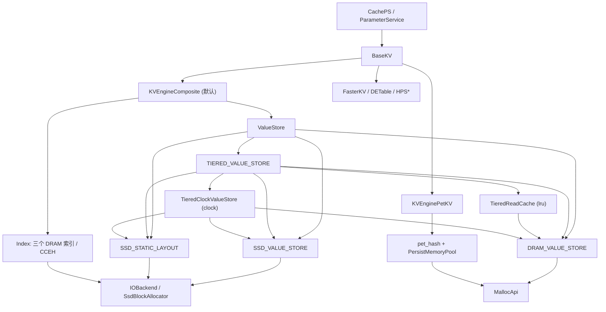
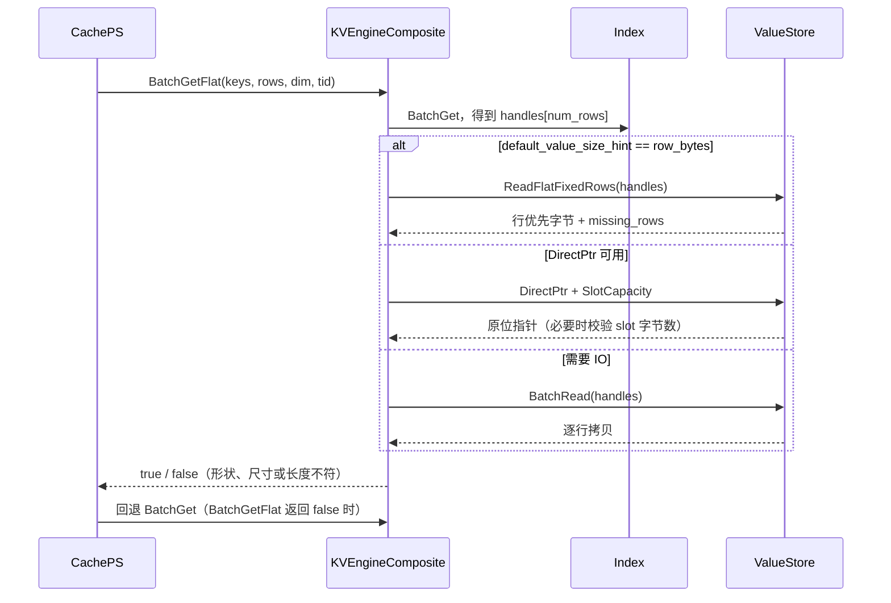
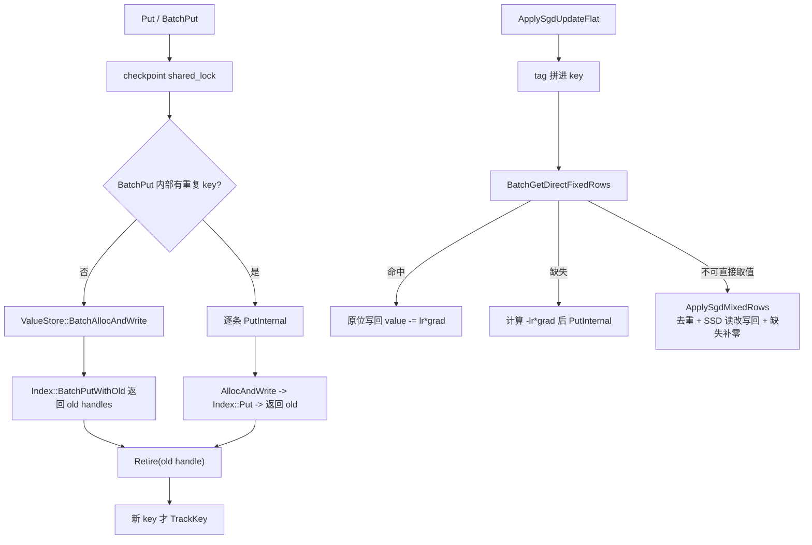

## 阅读地图

### 一句话

本章回答：一个 embedding 行从 key 到字节，最终放在哪、怎么找回来。中间有两次翻译——索引把 key 换成句柄，值存储把句柄换成字节；RecStore 把这两次翻译做成可替换的两层，默认两层都在 DRAM，换介质时替换其中一层，或整体换掉引擎，之上的参数服务器与传输层不感知。

### 7 个部件

| 编号 | 短名 | 它负责回答的问题 | 落在 |
|------|------|------------------|------|
| 1 | 组合矩阵 | 索引和值存储能怎么拼，默认拼成什么，之外还有哪些整体替换的引擎 | 第 1 块 |
| 2 | 索引 | key 怎么变成句柄；扩容、冲突、删除各自怎么做 | 第 2 块 |
| 3 | 值存储 | 句柄背后的字节放在哪种介质，句柄怎么解释，长度从哪来 | 第 3 块 |
| 4 | 分配器 | 值存储的字节从哪来，池怎么切，所谓共享内存究竟是什么 | 第 4 块 |
| 5 | 读写路径 | 一次查询或写入怎么串起索引与值存储；未命中、长度、退役各归谁 | 第 5、6 块 |
| 6 | 分层策略 | tiered 的四种策略：按水位安放、LRU 读缓存、CLOCK 冷热交换、按工作集自选 | 第 7 块 |
| 7 | SSD / NVM / GPU | 页和共享内存上的读写约定；显存里的表由谁维护 | 第 8、9 块 |

### 它们怎么串起来

请求先由部件 1 决定用哪套拼装；拼装定下来，后面所有路径就固定了。写入时，写路径先向部件 3 要一个槽，写入字节，再让部件 2 把 key 指到新句柄，旧句柄交给退役。读取时顺序反过来：部件 2 用 key 找回句柄，部件 3 按句柄找到字节，部件 5 决定拷一份还是直接给指针；tiered 的 `lru` 让 SSD 句柄先在部件 6 里找副本，`clock` 则把 DRAM 槽与 SSD 行按热度交换，两者未命中都落到部件 7 的页路径。部件 4 是部件 3 的字节来源。

### 核心概念表

| 概念 | 一句话 |
|------|--------|
| 句柄 | 索引给出的定位值，值存储据此找字节；特殊值表示未命中 |
| 值存储与分配器 | 前者把句柄翻成字节，后者提供字节；DRAM 侧都建在匿名 mmap 上 |
| 页 | SSD 侧唯一的 IO 单位，读写都是整页 |
| 退役 | 旧句柄交还分配器的动作，全仓唯一的回收入口 |
| 分层策略 | tiered 的 `cache_policy`：`none` / `lru`（读缓存）/ `clock`（冷热交换）/ `adaptive` |
| 恢复 | 从共享内存镜像或检查点重建索引与占用位图的过程 |

### 建议读法

- 只想知道数据放哪：第 1 块 → 第 3 块 → 第 4 块的介质表；排查"读到的行长度不对"：第 1 块 → 第 5 块 → 第 3 块的长度列。
- 评估 tiered：第 3 块 → 第 6 块 → 第 7 块（四种策略与各自代价）；持久化、SSD 或 GPU：第 8、9 块加风险节。

### 范围与不在范围

在范围内：引擎抽象、引擎选择与工厂注册，默认拼装引擎的编排逻辑；索引家族（DRAM 的 `extendible_hash` / `pet_hash` / `unordered_map`，SSD 的 CCEH）；值存储家族（DRAM、SSD plain、SSD 静态布局、tiered 的四层安放策略）；DRAM 分配器（`MallocApi`）、`ShmFile` 后端、epoch 回收；SSD 路径的 `IOBackend`、SSD block allocator、`ssd_layout` artifact；PetKV 的共享内存布局与恢复；GPU 侧 `storage/gpu_cache` 与 `gpu_memory`。不在范围：RPC、分片、压缩、传输（第 03/04 章）；计算层与训练语义（第 02 章）；测试与基准运行方式（第 06 章）。

## 第 1 块：组合矩阵

### 它是什么

引擎对外只有一套接口，内部有两种形态：拼装式把 key 到字节切成两次翻译、各自查表；整体式把一个第三方 KV 库整套接进来，自己管索引也自己管值。默认是拼装式，两次翻译都落在 DRAM。

顶层只有一个引擎名决定用哪套形态，缺省是拼装式；名字走白名单，必须与代码里的注册名逐字一致。

| `engine_type` | 实现 | 配置形态 | 注册位置 |
|---------------|------|----------|----------|
| `KVEngineComposite`（默认） | `KVEngineComposite` | 嵌套 `index` + `value` | `engine_composite.h` |
| `KVEnginePetKV` | `KVEnginePetKV` | 顶层 `path`/`capacity`/`value_size`/`value_capacity` | `engine_petkv.h` |
| `KVEngineFasterKV` | `KVEngineFasterKV` | 顶层 `capacity`/`value_size` + 可选 `fasterkv` | `external/fasterkv/fasterkv_engine.cc` |
| `KVEngineHPSHashMap` | `KVEngineHPSHashMap` | 顶层 `value_size`，无 `path` | `external/hps/hps_engine.cc` |
| `KVEngineHPSRocksDB` | `KVEngineHPSRocksDB` | 同上 + 必填 `path` | `external/hps/hps_engine.cc` |
| `KVEngineDETable` | `KVEngineDETable` | 顶层 `value_size` + `detable.library_path` | `external/detable/detable_engine.cc` |

整体替换的引擎编译期命运不同：FasterKV 与 HPS 的整个子目录受 CMake 开关（`RECSTORE_ENABLE_THIRD_PARTY_ENGINES` 及对应测试宏）控制；DETable 源码总会被编译，但要靠 `kv_engine_register.cc#IOBackendLinkGuard` 里的 `RECSTORE_ENABLE_DETABLE_ENGINE` force-link 才把静态注册带进二进制。没有注册时 `ResolveEngine` 仍会放行名字，`NewInstance` 则创建失败。静态库构建还会整单元丢弃只含注册的 `kv_engine_register.cc`，所以新增了 `RecStoreForceLinkKVEngineRegistrations()` 供可执行文件显式引用（`benchmark_kv_engine` 在工厂查表前调用）。

拼装的两次翻译各自查表：索引四种、值存储四种，具体类型与必填字段见第 2、3 块。下表只回答"能怎么拼"——"支持"指构造期不会必然失败、且仓库内有对应用法：

| index.type \ value.type | `DRAM_VALUE_STORE` | `SSD_VALUE_STORE` | `SSD_STATIC_LAYOUT` | `TIERED_VALUE_STORE` |
|--------------------------|:------------------:|:-----------------:|:-------------------:|:--------------------:|
| 三个 DRAM 索引 | 支持（默认路径） | 支持 | 需要固定行宽 + artifact | 支持 |
| `SSD` / `SSD_EXTENDIBLE_HASH` | 代码可行，测试跳过 | 测试覆盖 | 未确认 | 代码可行，测试跳过 |

约束来自各层构造函数，矩阵本身不做校验：`capacity` 是顶层必填，`DramPetHashIndex` 直接用它算表大小，漏配会在 `.at("capacity")` 抛异常；SSD 索引 + 非 SSD value 在 `test_kvengine` 里被显式跳过（注释 "invalid SSD index combo"），生产代码没有这条检查；`SSD_STATIC_LAYOUT_VALUE_STORE` 与 `TIERED_VALUE_STORE` 的 SSD 子层由 `value.ssd_layout.strategy` 选择，缺省或 `plain` → `SSD_VALUE_STORE`，`bandana`/`maxembed` → 静态布局，其他值抛异常。

默认组合（根目录 `recstore_config.json`）：`capacity=1000000`、`DRAM_PET_HASH`、`DRAM_VALUE_STORE`、`CONCURRENT_SLAB_MEMORY_POOL`、`default_value_size_hint=512`、`capacity_bytes=512000000`。

### 它为什么存在

替换需求分两种粒度：想换介质但保留哈希索引语义，只换值存储那一层；想整体换成成熟 KV 库，则连索引一起换。两级拼装让第一种需求不必碰上层，整体替换让第二种不必迁就两级的接口。代价是拼装式内部没有跨层校验，组合是否成立要靠各层构造函数自己兜。

### 它和谁接

向上的接口只有一套，参数服务器用同一组调用面对所有引擎。向下的边界是介质：拼装式的下半层要么落在进程地址空间，要么落到块设备，要么两者兼有。读路径在第 5 块，写路径在第 6 块，介质细节在第 3、4 块和第 8 块。

### 代码位置

- `src/storage/kv_engine/engine_selector.h#ResolveEngine` — 顶层引擎名解析与白名单。
- `src/storage/kv_engine/engine_composite.h#KVEngineComposite::KVEngineComposite` — 两次 `at(...).at("type")` 查表。
- `src/storage/kv_engine/kv_engine_register.cc#IOBackendLinkGuard`、`#RecStoreForceLinkKVEngineRegistrations` — force-link 入口。
- `recstore_config.json`（`cache_ps.base_kv_config`）— 默认组合与参数。

### 交付一句

第 1 块到此为止，读者应当知道"默认是 DRAM 哈希索引 + DRAM 值存储的两级拼装，其它引擎是整体替换"。第 2 块接索引层，回答 key 怎么变成句柄。

## 第 2 块：索引

### 它是什么

索引承担的是一次定址：给定 key，返回一个句柄，或返回表示未命中的特殊值。四种结构差别集中在冲突处理、扩容、删除语义和并发粒度上；句柄的含义由值存储解释。

| 结构（额外配置） | 冲突处理 | 扩容 | 删除 | 并发 |
|------------------|----------|------|------|------|
| `DRAM_UNORDERED_MAP` | 标准库链地址 | 自动 rehash | `map_.erase` | 每操作 `shared_mutex` |
| `DRAM_EXTENDIBLE_HASH`（别名 `DRAM`） | 每 Block 槽位 + 分裂 | 局部/全局深度翻倍，目录扩容 | 槽位清空，不缩容 | Block CAS 锁 + 目录 CAS 锁 |
| `DRAM_PET_HASH`（必填 `capacity`） | 每 chunk 14 槽 + overflow 链 | 无运行时扩容（固定 `capacity`） | tag 置 0、key 置 -1、回退 overflow 计数 | 每 chunk 锁 + value CAS |
| `SSD_EXTENDIBLE_HASH`（别名 `SSD`，需 `index.path`、`index.io`） | 桶内线性 + cuckoo（阈值 16） | 段分裂 + 两级目录扩容 | 槽位清空 | 目录 `shared_mutex` + 每 segment `shared_mutex` |

四条实现细节决定了它们的实际脾气：

- `PetHash` 是 F14 风格 chunk 表：`F14Chunk::MatchTag` 用 SSE 比较 14 个 tag，命中后再比 key；`overflow_count_` 记录探测链长度，删除时沿链回退计数。表满且 `force_insert=false` 直接 `LOG(FATAL) << "dict OOM"`，所以 `capacity` 配小是崩溃而不是降级；`capacity_ = chunk_num * 14`，90% 触发 OOM。`BatchGet` 用固定距离 16 的 `HintPrefetch`，这是它相对其它索引的主要批量优势。
- `PetHash::Reload` 只在 `Persistence=true` 时可用，恢复时并行扫描 chunk 重建 size 与探测链，并回调 `mallocSetValid` 让分配器重建占用位图；`PetKV` 构造时用它。
- `ExtendibleHash` 的 `kBlockSize = 256` 字节、`kNumSlot = 256 / sizeof(Pair)`（`Pair` 为 key+value 两个 8 字节），所以每块只有 16 槽；`Directory` 默认 1024 项；分裂失败（别的线程在 split）走 `RETRY`。
- CCEH 是两级目录（`DirectoryHeader` → `DirectoryPage` → `Segment`），目录页数上限 `kMaxDirectoryPages`。`CCEH.cpp` 里原本有两个未使用的全局 `thread_local`（`pending`、`coros`），与 `io_uring_backend.cpp` 同名符号在静态构建下冲突，已删除；该索引没有生产构建目标，`test_cceh` 直接把 `CCEH.cpp` 编进测试可执行文件并注册进 ctest。

### 它为什么存在

索引与值存储是两套独立选择，索引侧需要自己的定址结构；默认实现选了固定容量哈希，把容量风险前移到配置阶段。

### 它和谁接

向上接收读路径交来的 key 列表，向下交出句柄列表。索引内部的同步是各自的实现细节，拼装式引擎不在读路径上加锁（见第 5 块）。

### 代码位置

- `src/storage/index/index.h#Index` — `Get`、`BatchGet`、`Put`、`Delete` 的公共形状。
- `src/storage/nvm/pet_kv/pet_hash.h#F14Chunk`、`#PetHash::GetInternal`、`#PetHash::Delete`、`#PetHash::Reload` — 默认结构的核心。
- `src/storage/index/dram/extendible_hash.cpp#ExtendibleHash::Insert`、`src/storage/index/dram/extendible_hash.h#Block` — 分裂与块内槽位。
- `src/storage/index/ssd/CCEH.h#DirectoryHeader`、`#Segment`、`#kCuckooThreshold` — 两级目录与段；`src/test/CMakeLists.txt` 的 `test_cceh` 直接编译 `CCEH.cpp`（标签 `storage;slow`、600 s、`RUN_SERIAL`）。

### 交付一句

第 2 块到此为止，索引只负责"key 对句柄"，句柄到字节的换算留给第 3 块。第 3 块先看值存储，第 4 块再看它背后的分配器。

## 第 3 块：值存储

### 它是什么

值存储把句柄翻成字节。四种基础实现共用一套接口，差别只有三处：字节在哪种介质、句柄怎么解释、长度从哪里读；第五种是 tiered 在 `clock` 策略下换上的整体替身。

| 实现（必填字段） | 句柄解释 | 长度来源 | 写语义 |
|------------------|----------|----------|--------|
| `DramValueStore`（`value.path`、`dram_allocator`） | 分配器 offset 编码 | `SlotCapacity`（分配器给的块大小） | 每次 `Alloc` 新槽 |
| `SsdValueStore`（`value.path`、`ssd_allocator` 含 `io`） | 块号 + 块内槽号 | slot 头 4 字节 | 整页读改写 |
| `SsdStaticLayoutValueStore`（`ssd_layout.mapping_path`、`default_value_size_hint`） | `key + 1`（`0` 表示缺失） | artifact 的 `row_size` | 只改已有页槽 |
| `HybridValueStore`（`dram_allocator` + `ssd_allocator`） | 最高位标记介质，低 63 位是子层句柄 | 转交子层 | 按 `Alloc` 时的介质决定 |
| `TieredClockValueStore`（由 `HybridValueStore` 在 `cache_policy=clock` 时构造） | 元数据槽号 + 世代，交换期间不变 | 元数据里的 `size` | 命中 DRAM 原地写，SSD 行改后回写 |

`HybridValueStore`（配置名 `TIERED_VALUE_STORE`）在 `Alloc` 时一次性决定介质：`(dram_bytes_reserved_ + size) / dram_placement_bytes_` 不超过 `high_watermark_ratio`（默认 0.85）就放 DRAM，否则放 SSD。`dram_placement_bytes_` 平时等于 DRAM 的 `capacity_bytes`；打开 LRU 读缓存时它会被减去预算（见第 7 块）。SSD 句柄打上 `kSsdFlag = 1 << 63`，其余位原样保存子层句柄；`DirectPtr` 对 SSD 句柄一律返回 `nullptr`，即使该值正被读缓存持有。

`cache_policy=clock` 时 `HybridValueStore` 不再按句柄最高位分流，而是把全部调用交给 `TieredClockValueStore`：后者自己持有 DRAM 槽与 SSD 行，用"槽号 + 世代"作为逻辑句柄，冷热交换不改变句柄。因此 CLOCK 模式下没有可按介质判定的句柄位，也不提供 `DirectPtr` 与 RDMA backing region，读一律走复制路径。

### 它为什么存在

介质是配置项，不是代码分支。让四种实现共用"分配 / 写入 / 读取 / 取容量 / 释放"这组动作，上层就不必知道自己连的是 DRAM 还是块设备；tiered 再把两种介质放进同一份配置里。默认（`none`）和 LRU 模式下介质一旦选定就不再搬动；CLOCK 把"放错介质"变成可在线纠正：按访问热度交换，代价是每次读都要经过元数据而不是裸指针。

### 它和谁接

向上被引擎的读、写、检查点路径调用；向下要求分配器提供"分配 / 释放 / 取大小 / 取底层区域"。`RDMABackingData()` 只透出 DRAM 子层的连续区域，SSD 子层没有 backing region；CLOCK 模式下 `RDMABackingSize()` 直接返回 0。平铺快路要求 `GetLayoutId().plain()`（见第 5 块）；CLOCK 自己实现 `ReadFlatFixedRows` 与 `BatchRead`，所以平铺读在 CLOCK 下仍然可用，只是要按行拷贝。

### 代码位置

- `src/storage/value_store/value_store.h#ValueStore` — `Alloc`/`Write`/`Read`/`Retire`/`DirectPtr` 的公共形状。
- `src/storage/value_store/dram_value_store.h#DramValueStore::Read`、`#DramValueStore::SlotCapacity` — 槽容量即返回长度。
- `src/storage/value_store/ssd_value_store.h#SsdValueStore`、`src/storage/value_store/ssd_static_layout_value_store.h#SsdStaticLayoutValueStore` — 块号+槽号与长度头、定长布局与页锁。
- `src/storage/value_store/hybrid_value_store.h#HybridValueStore::Alloc`、`#HybridValueStore::ShouldUseDram`、`#HybridValueStore::kSsdFlag` — 介质选择与 handle 最高位。
- `src/storage/value_store/tiered_clock_value_store.h#TieredClockValueStore`、`#TieredClockValueStore::Promote`、`#TieredClockValueStore::FreeLocked` — CLOCK 模式下的句柄、晋升与槽回收。

### 交付一句

第 3 块到此为止，读者应当知道句柄怎么解释、长度谁说了算、tiered 在哪一步定下介质，以及 `clock` 为什么会换掉整个值存储。第 4 块接这些字节的来源。

## 第 4 块：分配器

### 它是什么

分配器是值存储背后的字节来源，DRAM 侧只有一套下沉接口 `MallocApi`；四个实现都经 `ShmFile` 落到 mmap，介质只有匿名私有映射与 `FS_DAX` 文件两种。它们的取舍在回收方式上：

| 分配器 | 结构 | 回收 | 备注 |
|--------|------|------|------|
| `CONCURRENT_SLAB_MEMORY_POOL`（默认） | 1 MiB chunk，8 字节头 + bitmap，按 slab class 绑定 | 每 slab 的 partial/active 队列 + 线程热块；空闲块可重绑 class | 全局空闲块耗尽直接 `LOG(FATAL)`；`size_classes` 只有带 sized 工厂的注册接受 |
| `PERSIST_LOOP_SLAB` | 8 字节 block 位图 + 每次分配 8 字节长度头 | 循环首次适应，从 `last_malloc_block_` 绕圈；fast free list（32 类 × 1M 项） | 单把 `base::Lock`；`FLAGS_shm_malloc_healthy_rate` 默认 0.95 |
| `PERSIST_MEMORY_POOL` | 2 MiB chunk，chunk 头 + bitmap | 按 chunk 归还；恢复时从 chunk 头重建占用 | 构造要求 `nr_chunks >= slab 类数` |
| `R2_SLAB` / `R2ShmMalloc` | r2 的 master + 每线程 arena | `alloc/dealloc` 交给 r2 | `GetMallocSize` 用 `je_malloc_usable_size`，长度带 padding |

介质由 `ShmFile` 决定，"共享内存"这个说法要拆开看：

| `medium` 参数 | 实际后端 | 语义 |
|---------------|----------|------|
| `"DRAM"` | `ANONY_DRAM` | `mmap(MAP_PRIVATE | MAP_ANONYMOUS)`；`filename` 只用于日志 |
| `"SSD"` | `FS_DAX` | 真正 `open + posix_fallocate + mmap(MAP_SHARED)` 的文件 |
| 其他 | `LOG(FATAL)` | 没有 `"PM"` / `"NVM"` 分支 |

`DEV_DAX` 虽然注册了工厂，但 `ConfigForMedium` 里对应分支被注释掉，正常构造选不到它；只有直接调 `PMMmapRegisterCenter::Register` 才会走 dev-dax。另外，`ConcurrentSlabMemoryPool` 构造时会先 `PathExists` 再 `Delete` 同路径文件，`value.path` 指向真实文件会被静默清理。

对齐与 epoch 是两个附带的硬约束。默认索引和可扩展哈希的块都用 `posix_memalign(..., 64, ...)`，slab chunk 页对齐，循环分配器的 offset 必须 8 字节对齐（取 offset 时断言）。epoch 回收解决"读者还握着旧指针"：进程单例表有 128 个 64 字节对齐的槽，线程首次使用时按 `pthread_self()` 哈希占位；共享内存复刻版在回收时记录当前 epoch，每 1000 次回收推进一次，再按安全判定批量释放。表槽的回收函数是空实现，超过 128 个线程同时进入 epoch 路径会在占位时等 2 秒后终止进程。

### 它为什么存在

DRAM 那层自己管字节，是因为值存储要提供两样东西：接近零拷贝的批读取，和可被 RDMA 注册的连续区域。[推断] 通用 malloc 满足不了第二点。分层值存储又需要在同一份配置里表达两段介质，所以分配器必须能在构造期固定容量、运行期不搬动已有块。

### 它和谁接

向上给值存储提供"分配 / 释放 / 取大小 / 取底层区域"四类能力，向下落到 mmap。介质映射同时决定这块内存在进程退出后是否还在，以及 `filename` 是真实文件还是纯日志标签；SSD 侧的 slab / buddy 与页级分配是另一套接口，见第 8 块。

### 代码位置

- `src/memory/malloc.h#MallocApi`、`src/memory/allocators/concurrent_slab_memory_pool.h#ConcurrentSlabMemoryPool` — 下沉接口、默认分配器、构造删同路径文件、耗尽 FATAL。
- `src/memory/allocators/persist_loop_slab_allocator.cc#PersistLoopShmMalloc::New` — 循环首次适应。
- `src/memory/shm_file.cc#ShmFile::ConfigForMedium`、`#AnonyDramShmFile::Initialize`、`#FsDaxShmFile::Initialize` — 介质映射。
- `src/memory/epoch_manager.h#EpochManager`、`src/memory/malloc.h#ShmEpochRecycle` — epoch 与延迟回收。

### 交付一句

第 4 块到此为止，读者应当知道字节来自 mmap、配置里的"DRAM"其实是进程私有映射、退役带一个延迟窗口。第 5 块接读路径，把这些层串成一次查询。

## 第 5 块：读路径

### 它是什么

读路径是一次查询的组装：索引给句柄，值存储给字节，中间决定拷贝与否。入口是 `CachePS::GetParameterFlat`，先试 `BatchGetFlat`，失败再退回 `BatchGet` 并逐行校验长度等于 embedding 维度。命中后按能否直接给出指针分三种情形：

| 情形 | 返回什么 |
|------|----------|
| 能直接给指针（DRAM 系列） | 批量读返回指向池内的视图，不拷贝；单条读按槽容量拷进字符串 |
| 不能给指针（SSD、静态布局、tiered 的 SSD 句柄、CLOCK 全部句柄） | 拷贝到调用方缓冲或 `ReadResult` |
| 未命中 | 单条读清空结果；批量读给空视图；平铺读显式填 0 并计 `missing_rows` |

`online_admission` 打开后读路径整体降级为"拷贝"：`Get` / `BatchGet` / `BatchGetFlat` 先取 `online_mu_` 共享锁，`DirectPtr` 命中也 `memcpy` 到调用方缓冲，而不是交出池内指针——一次交换可能把这行换到另一个介质并换掉句柄。四个"按句柄直接定位行"的接口直接返回 `false` 让上层回退：`BatchGetDirectFixedRows`、`BatchLoadIndexedFloatRange`、`BatchGetFlatRangeImpl`（`BatchGetFlatRangeWithMissing` 的实现）与带 `update_offset` / `update_dim` 的 flat 更新。`BatchGetFlat` 也因此不再走 `ReadFlatFixedRows` 平铺快路。

带区间的平铺读还有一条变体：`BatchGetFlatRangeWithMissing` 在返回平铺结果的同时，把未命中的输入行号写进调用方缓冲。`MissingPositionsOutput` 的语义是：`positions` 由调用方提供，`capacity` 按 `uint64_t` 元素计、且必须 `>= num_rows`；写入的行号从 0 起、按输入升序，重复 key 的每次出现都记；成功时 `count` 是写入个数，`positions[0, count)` 之外不保证被改写。基类默认返回 `false`，`KVEngineComposite` 是当前唯一实现（要求 `default_value_size_hint` 恰好等于行字节数），目前只有 `test_kvengine` 调用。

### 它为什么存在

[推断] 训练侧一次要几千行 embedding，逐行拷贝会成为瓶颈，所以 DRAM 路径故意把池内指针交出去。平铺快路径更进一步：配置里的默认行大小恰好等于实际行字节数、且值存储布局是 `plain`（`GetLayoutId().plain()`）时，整批可以按连续字节读出，省掉逐行拼装；非 plain 布局（静态页布局）即使行宽匹配也要逐行校验槽容量，因为页槽里可能内嵌页头。两条快路径都以"长度可信"为前提，这也解释了长度语义为什么危险。

### 它和谁接

向上被参数服务器的取参调用，向下调用索引与值存储。它不加检查点互斥锁，索引内部自己同步；这一点决定了"删除与读"之间没有互斥。

锁的边界：`Get` / `BatchGet` / `BatchGetFlat` / `BatchGetFlatRange*` 完全不加 `checkpoint_mu_`；`Put` / `BatchPut` / `ApplySgdUpdateFlat` / `BulkLoad` 持共享锁；`BatchDelete` / `SaveCheckpoint` / `LoadCheckpoint` / `clear` 持独占锁。所以"检查点 / 删除"与"读"之间没有互斥，删除把 handle 交给 `Retire` 后，仍持旧 handle 的读者可能读到已回收 slot（延迟回收只是缩短窗口，见风险节）。

长度语义：DRAM 值存储不存原始长度，读取时用槽容量决定这一行返回多长，而槽容量来自"这块有多大"。`CONCURRENT_SLAB_MEMORY_POOL` 在请求前 8 字节写入原始长度，`SlotCapacity` 等于请求长度，行为正确；`R2_SLAB` 的 `GetMallocSize` 用 `je_malloc_usable_size`，返回可用大小（可能大于请求），非 flat 的 `BatchGet` 可能给出比 `embedding_dim` 长的行；`SSD_VALUE_STORE` 在 slot 头写 4 字节实际长度，返回精确长度；`SSD_STATIC_LAYOUT_VALUE_STORE` 永远返回 `row_size`。

### 代码位置

- `src/storage/kv_engine/engine_composite.h#KVEngineComposite::BatchGetFlat` — 平铺快路径、`memset` 与 `missing_rows`。
- `src/storage/kv_engine/engine_composite.h#KVEngineComposite::BatchGetFlatRangeWithMissing`、`#BatchGetFlatRangeImpl` — 缺失行号写入。
- `src/storage/kv_engine/base_kv.h#MissingPositionsOutput` — 调用方缓冲的容量与计数契约。
- `src/storage/kv_engine/engine_composite.h#KVEngineComposite::Get`、`src/storage/value_store/value_store.h#ValueStore::ReadValue` — 单条读的指针/拷贝合并。
- `src/storage/value_store/dram_value_store.h#DramValueStore::Read` — 槽容量作为返回长度。
- `src/ps/base/cache_ps_impl.h#CachePS::GetParameterFlat` — 回退与逐行长度校验。

### 交付一句

第 5 块到此为止，读路径的核心是"能不能不拷贝"和"长度谁说了算"。第 6 块接写路径与退役，回答新字节写在哪、旧槽何时归还。

## 第 6 块：写路径与退役

### 它是什么

写入不是原地覆盖。普通写先向值存储要一个新槽，写入字节，再让索引把 key 指向新句柄，最后把旧句柄交出去。这条顺序的含义是：任何已读到旧句柄的读者，在旧槽被回收前都能读到一致的旧值。

五种写法的差别：`Put` 走 `AllocAndWrite` → `Index::Put` 返回旧 handle → 旧 handle `Retire` → 新 key 才 `TrackKey`；`BatchPut` 先扫重复 key，有重复就逐条 `PutInternal`（避免同批顺序不确定），无重复则 `BatchAllocAndWrite` + `Index::BatchPutWithOld` 一次性替换，再统一 `Retire`；`BulkLoad` 要求 `default_value_size_hint` 非 0，按固定步长切分传入 buffer，批量分配后 `Index::BatchPut`；`BatchDelete` 在独占锁下 `Index::Get` → `Index::Delete` → `Retire`，并从每线程检查点 key 列表里删除。

`online_admission` 打开时写入还多两道手续：先拿 `online_mu_` 独占锁（锁序是 `online_mu_` → `checkpoint_mu_`），再自增 `online_generation_`，让正在准备的交换整批失效。`BatchPut` 顺带改了校验顺序：先逐行校验行宽并收集全部重复 key，检查完才决定"逐条 `PutInternal`"还是批量替换，不再遇到第一个重复就 `break` 掉后面的校验。

`ApplySgdUpdateFlat` 是唯一的原地更新：把 `tag` 放到 key 高 8 位（`(tag << 56) | (key & 0x00FF_FFFF_FFFF_FFFF)`），先试 `BatchGetDirectFixedRows` 拿原位指针，命中行直接在池内 `value[c] -= lr * grad[c]`；未命中行按 `-lr * grad` 生成初值再 `PutInternal`。命中路径不走写时复制。

拿不到原位指针时（非 plain 布局、SSD 行、CLOCK 句柄）走 `ApplySgdMixedRows`：先按 key 去重并记录每个输入行的目标位置，重复 key 按输入顺序累加；DRAM 命中行仍是原地更新，SSD 行经 `BatchRead` 拷出、改完再用 `BatchWrite` 写回，最后给缺失 key 写零初值。拷贝出来的行不会被就地当成存储，所以写回之前后续读看不到这步更新。

### 它为什么存在

写时复制让读路径可以不阻塞：读者拿到的指针只指向一个不会再被改写内容的槽。优化器更新是例外，它把梯度直接减到池内，省掉一次分配和一次拷贝，代价是绕开写时复制带来的隔离。

### 它和谁接

向上承接参数服务器的写入与优化器更新，向下调用值存储的分配与释放、索引的替换与删除。写路径持共享检查点锁，因此与检查点互斥；它不阻止读。tiered 的写路径按策略维护分层：`lru` 同步写穿透缓存、`clock` 命中 DRAM 时原地写、落到 SSD 的行写后标记为脏以便后续回写（见第 7 块）。

退役与迁移：`Retire` 是唯一的回收入口——`DramValueStore` 用 `ThreadSafeDelayedRecycle`（`kRecycleDelayUs = 1000`，每线程一份延迟队列）；`ValueStore` 基类默认 `Retire → Free`；`SsdStaticLayoutValueStore::Free` 是空实现；`SsdSlabAllocator::Free` 只归还槽位，块在 `used_count == 0` 时变成块级 tombstone 并回到全局空闲块表。tiered 在 `none` / `lru` 下没有覆写 `Retire`，SSD 旧槽立即释放、DRAM 旧槽立即 `Free`；CLOCK 覆写为把槽位放进分片 `free_slots`，下次复用前把世代加一（世代替换到 `UINT32_MAX` 后该槽不再复用，防 ABA）。主放置是否迁移取决于策略：`none` / `lru` 只在 `Alloc` 时按水位决定介质，块写满就永远留在原介质；`clock` 按访问热度在线交换，见第 7 块。`src/storage/cache/` 里那套 `CachePolicy` / `LRUCachePolicy` 仍只被 `test_storage_cache_lru` 使用，`lru` 读缓存没有建在它上面。

检查点：保存时遍历每线程的检查点 key 列表，排序去重后逐 key 读值，写固定 magic、版本 3、metadata、布局标识、记录与校验和，最后用重命名发布。加载要求引擎为空、metadata 完全一致、布局标识一致（v2 文件只允许恢复到 plain 引擎），否则拒绝。整条路径在独占锁下运行，会阻塞所有写。

### 代码位置

- `src/storage/kv_engine/engine_composite.h#KVEngineComposite::PutInternal` — 分配、替换、退役的顺序。
- `src/storage/kv_engine/engine_composite.h#KVEngineComposite::BatchPut` — 重复 key 退化逐条。
- `src/storage/kv_engine/engine_composite.h#KVEngineComposite::ApplySgdUpdateFlat` — tag 拼 key 与原地更新。
- `src/storage/kv_engine/engine_composite.h#KVEngineComposite::SaveCheckpoint`、`#KVEngineComposite::LoadCheckpoint` — 检查点格式与空引擎约束。
- `src/storage/value_store/value_store.h#ValueStore::Retire`、`src/storage/value_store/hybrid_value_store.h#HybridValueStore` — 默认退役与分层丢弃延迟回收。
- `src/storage/cache/cache_factory.h#CreateCachePolicy` — 只被测试使用的策略工厂。

### 交付一句

第 6 块到此为止，读者应当知道"写是换槽、退役是唯一回收、`none` / `lru` 的主放置不迁移"。第 7 块接 tiered 的四种分层策略。

## 第 7 块：分层策略（none / lru / clock / adaptive）

### 它是什么

`value.tiering.cache_policy` 在构造期决定 tiered 用哪种安放策略，默认 `none`；`HybridValueStore` 校验参数后可能整体换成一个 `TieredClockValueStore`，非法值抛 `std::invalid_argument`。

| 策略 | 实现 | DRAM 预算 | 会不会搬动已有行 |
|------|------|-----------|------------------|
| `none` | `HybridValueStore` 按水位一次性安放 | 全长 `capacity` | 不会 |
| `lru` | `HybridValueStore` + `TieredReadCache` | 预扣 `cache_budget_ratio`，主安放上限降到 `high_watermark * (capacity - budget)` | 只把读过的 SSD 行提升进缓存 |
| `clock` | 整体换成 `TieredClockValueStore` | 共享 `high_watermark * capacity` 全长 | DRAM 与 SSD 按热度双向交换，脏行先回写 |
| `adaptive` | 构造期在以上三者中选一个 | 由 `expected_dram_bytes` 估算 | 同被选中的策略 |

`lru` 的机制分两半。结构与淘汰：按 SSD 子层 handle 分片，每分片一把 `mutex`、一条 LRU 链、一个字节上限；命中时在同一把锁下 `memcpy` 拷出，淘汰同一槽也要这把锁。每分片上限 = 生效预算 / 分片数；分片满时先淘汰 LRU 再分配，单个 value 大于分片上限时放弃提升。一致性与准入：读 SSD 前取 per-key token，`Promote` 校验 token 仍是该 key 的当前值；写、`BatchWrite`、`Free` 都会 bump token，`WriteThrough` 先 bump 再更新副本（值变短时不会暴露旧尾巴），`Invalidate` 在 `Free` 时清掉准入计数。准入计数与 token 都是每分片 1024 项直映射表，冲突只漏一次提升（保守），不会留下陈旧副本。

`clock` 把安放本身变成可纠正的：句柄是"元数据槽号 + 世代"，交换期间不变；SSD 行达到 `promote_min_misses` 次成功读后尝试复用同分片中较冷 DRAM 行的槽位，每次最多检查 64 个候选（分片内 CLOCK 环，`try_lock` 抢不到的跳过）。候选被淘汰时，需要回写的才写：初始安放在 DRAM 或已被修改的行先写 SSD 再复用槽位，已有有效 SSD 副本的直接复用；回写失败保留原安放。三个可选开关改变选谁：

- `retain_backing_copies`（默认 `true`）：晋升后保留 SSD 副本，之后淘汰不必重写；设为 `false` 时晋升即释放 SSD 槽，只有 plain SSD 布局允许（静态布局下构造直接抛错），以后每次淘汰都要再写一遍。
- `clock_cost_aware`（默认 `false`）：热度相同时优先淘汰"已有有效 SSD 副本、不必回写"的行——不会为省一次写而牺牲更热的数据。
- `clock_frequency_admission`（默认 `false`）：两层的访问频率按同一衰减周期比较，候选要有明确频率优势（至少高出 1/4）才交换；开启后 SSD 行也累计热度，否则只比较 DRAM 侧的二次机会位与局部热度。

`clock_async_exchange`（默认 `false`）把候选放进有界队列交给后台线程执行交换与回写，前台只做入队；队列按条目数（`clock_exchange_queue_entries`，默认 256）和字节数（`clock_exchange_queue_bytes`，默认 4 MiB）双上限，队列满、锁忙或 handle 版本已变时放弃本次晋升，后续访问可重试。缓冲区不计入驻留预算，但确实多占内存。

读保护在 CLOCK 下换了形态：读者先发布一个 hazard 再检查 `readable`，写、释放、淘汰先撤销 `readable` 再等待相关读者退出，所以热路径上没有共享读锁；批量读每 64 行发布一次快照，`ReadFlatFixedRows` 与 `BatchRead` 都按这个节奏拷贝。代价是 CLOCK 模式不提供 `DirectPtr` 行地址，也不提供 RDMA backing region。

`adaptive` 只看一个输入：`expected_dram_bytes` 是完整工作集经分配器档位取整后的 value 字节数，`0` 表示未知。工作集不超过 `high_watermark * capacity` 时连缓存都不开（走 `none`，读仍可直接给指针）；溢出量不超过估计工作集的 0.1% 时用 `lru`，保留量按溢出量折算成比例后预扣；其余情况（包括未知）用 `clock`。

`tiering.dram_keys_path` 是另一条与策略正交的入口：读一个排序去重、原生字节序的二进制 `uint64` 数组作为初始 DRAM 名单，用于"按历史热度先摆对位置"。名单只在带 key 的分配里生效（`AllocAndWrite(key, ...)` 与 `BatchAllocAndWrite(keys, ...)`），不带 key 的 `Alloc` 一律落 SSD；它和 CLOCK 互斥（构造抛错）。

`tiering.online_admission=true` 让这份名单在运行期可改写，代价是一整套前置条件与一层全局读写门禁：

| 条件 | 不满足时 |
|------|----------|
| `dram_keys_path` 非空，且 `cache_policy` 不是 `clock` | `HybridValueStore` 构造抛 `invalid_argument` |
| SSD 子层是 `plain` 布局（静态布局不支持） | 同上 |
| `default_value_size_hint` 非 0 且是 `sizeof(float)` 的整数倍 | `KVEngineComposite` 构造抛错 |
| 优化器是 `SGD` | `CachePS` 构造抛错：在线交换只对定长 float 行的 SGD 成立 |
| `async_admission` 只在 `online_admission` 之上打开 | `KVEngineComposite` 构造抛错 |

准入判据是"二次未命中"：某 key 第一次以冷行身份被读到时只进 ghost 集（FIFO，容量 `max(名单行数 / 20, 1)`），第二次命中才把值拷成快照去换一个 DRAM 位。每批最多准入 `min(256, 16 × ceil(请求行数 / 500))` 行，所以 LOCAL_SHM 把多个 500 行窗口合成一次大请求时不会退化成 16 行上限。交换是双向的：沿 `online_residents_` 游标找仍驻 DRAM 的受害者，受害者写 SSD、热点写 DRAM，两侧新句柄都备好后一次 `Index::BatchPutWithOld` 发布，再 `Retire` 旧句柄、让名单槽位指向新热点。

一致性靠一把 `generation` 计数器：任何前台写（`Put` / `BatchPut` / `BatchDelete` / `ApplySgdUpdateFlat` / `BulkLoad` / 检查点加载 / `clear`）先取 `online_mu_` 独占锁再自增它，正在准备的交换发现世代变了就整批放弃（计 `online_stale_jobs`）。同步路径在发布前逐个复核源句柄未被替换；异步路径下前台只把值快照拷走，后台线程做 `PrepareExchange`（私有目的槽）再发布，失败时释放刚分配的句柄并原样抛错。

`async_admission` 只有**一个**待处理批次和一个工作线程：新快照并进待处理批次（同 key 去重，满 256 行计 `online_queue_drops`），后台失败会存下异常并置停止位，之后任一前台调用或 `DrainBackgroundWork()` 重新抛出。`SaveCheckpoint` / `LoadCheckpoint` / `clear` / `ResetStats` 与基准收尾都先排空后台，保证检查点和统计看到的是静止状态。

### 它为什么存在

`none` 和 `lru` 下介质由写入顺序决定，DRAM 层留下的是"先写进来的"行，与访问热度无关——训练里初始化写序和真实访问分布几乎不相关。`lru` 只补读侧热度且不动初始安放；`clock` 连已经放错的行也换回来，代价是每次命中都要查元数据、拿到的是拷贝而不是裸指针。`adaptive` 存在的理由是"少估一点就别付迁移成本"：工作集能装下时 CLOCK 的元数据纯属浪费。

### 它和谁接

`lru` 只挂在 `HybridValueStore` 的 `Read` / `BatchRead` 上，`Write` / `BatchWrite` 同步写穿透，`Free` 让该 key 失效；`DirectPtr` 对 SSD 句柄仍返回 `nullptr`。`clock` 替换了整个值存储：引擎的 `Get` / `BatchGetFlat` / `ApplySgdUpdateFlat` / 检查点仍走同一套 `ValueStore` 接口，但 `RDMABackingSize() == 0`，RDMA 的零拷贝读路径在 CLOCK 下不可用。三种模式的统计都出现在 `ExtraResultFields()`：`tiered_cache_*` 一组，CLOCK 另有 `tiered_clock_*`（晋升、降级、回写、拒绝、交换队列的水位与峰值），online admission 另有 `online_*`（晋升行数、交换批数、容量拒绝、提交/过期/丢弃的作业、ghost 规模）。引擎自己在更外层再加 `tier_{sgd_read,sgd_write,migration_read,migration_prepare,migration_publish}_{ns,max_ns,calls}` 五组计时；`CachePS::ExtraResultFields()` 与 `LocalShmParameterServer::ExtraResultFields()` 会先 `DrainBackgroundWork()` 再取数，后者目前还没有调用方。

### 代码位置

- `src/storage/value_store/hybrid_value_store.h#HybridValueStore::HybridValueStore` — 策略解析、参数校验、`adaptive` 选择、CLOCK 构造。
- `src/storage/cache/tiered_read_cache.h#TieredReadCache`、`#WriteBarrier`、`#Promote`、`#WriteThrough`、`#Invalidate`、`#EffectiveBudgetBytes` — `lru` 的结构、一致性与生效预算。
- `src/storage/value_store/tiered_clock_value_store.h#TieredClockValueStore`、`#TieredClockValueStore::Promote`、`#TieredClockValueStore::ReadFlatFixedRows` — CLOCK 的句柄、候选扫描、回写与按批读保护。
- `src/storage/value_store/hybrid_value_store.h#HybridValueStore::PrepareExchange`、`#HybridValueStore::ExchangeDramKeys`、`#HybridValueStore::KeyUsesDram` — `online_admission` 下的名单改写与准入判定。
- `src/storage/kv_engine/engine_composite.h#KVEngineComposite::MaybeAdmit`、`#KVEngineComposite::RunBackgroundJob`、`#KVEngineComposite::BackgroundLoop`、`#KVEngineComposite::DrainBackgroundWork` — ghost 准入、同步/异步交换、后台失败传播。
- `tools/benchmarks/build_tiered_dram_profile.py#build_profile` — 从历史稀疏窗口生成 `dram_keys.bin`（frequency / density，contiguous / fused）。

### 交付一句

第 7 块到此为止，读者应当知道四种策略各自的预算来源与迁移代价，以及打开 `clock` 会失去零拷贝读。第 8 块接它下面的页与共享内存。

## 第 8 块：SSD 与 NVM

### 它是什么

块设备侧以页为唯一读写单位，句柄编码块号与槽号；共享内存侧是一组分片的 KV，索引、值区、有效标记各存一个文件。

### 它为什么存在

DRAM 放不下全部 embedding 时只有两条路：把冷数据放到块设备，或者把整个索引和值区放进可映射的内存镜像。前者要处理随机小写的写放大，后者要在重启后重建索引。

### 它和谁接

向上被值存储调用，向下落到页级异步 IO 或共享内存文件。页分配由同一个 IO 抽象负责，所以 SSD 索引和 SSD 值存储共享一套页号空间。

页级 IO：分配页号单调递增；单页读写一次一页；批量读写按"连续页段"合并提交，在途窗口取 `max(queue_depth / 2, 1)`，一个提交项可覆盖 `page_count` 页；缓冲区按页对齐，文件以 `O_DIRECT` 打开，因此 SSD 值路径的所有读写都是整页读改写。`IoUringBackend` 每线程一个 ring（`io_uring_queue_init(queue_cnt)`），`init()` 用文件大小推导 `next_page_id`（存在则 `size/PAGE_SIZE`，否则 1）；完成收割先自旋 `completion_poll_spins`（默认 8192，∈ [0, 1e6]），为 0 时直接阻塞等待、不忙轮询。`SpdkBackend` 是同接口的 SPDK 实现，是否可用取决于构建。`page_id_offset` 只在 `IOBackend::AllocatePage` 里作为起始页号使用；`SsdValueStore` 从不调用 `AllocatePage`，所以该字段在 plain 路径上基本无效，真正的基址偏移被 `SsdSlabAllocator` 烘进块地址。

批量路径做了三件事，代价与边界都在这一层：读先去重页——同一批里多行落在同一页只读一次，跨批次的同页请求共享仍在飞行中的那次 IO，但完成后的页不会被留下当缓存；写先把同一页上的补丁合并，长度头与载荷一起提交，且提交期间补丁缓冲必须存活；分配后写失败会把刚拿到的槽位释放回去，避免容量只出不进。跨槽的行读取会按槽边界分段，坏的 4 字节长度头不能让它越界读到相邻槽。

SSD 值存储与静态布局：`SsdSlabAllocator` 默认块大小 64 MiB（`1 << 26`），`kHeaderSize = 4`（存实际长度），默认 class `{128,256,512,1024,4096}`，每 class 一把 `mutex`，全局空闲块表一把 `mutex`，另有 2048 条页锁 stripe；写一个小 value 的代价是一次整页读 + 两次 patch（长度头 + 载荷）+ 一次整页写，同页多槽合并成一次读改写。`SsdBuddyAllocator` 用 8 字节头（`data_size` + `level`）和每层空闲集合，`SlotCapacity` 由 level 反推。`SsdValueStore::BatchRead` 一次最多 32768 条（`kMaxBatchIoEntries`），写入按 1024 条分批；单条 `Read` 也是一次批量页读。静态布局把 key 排到固定页槽，运行时只查 artifact：`Artifact` 含 `strategy`、`page_size`、`row_size`、`keys`、`copies` 与 checksum；handle 是 `key + 1`，`Alloc` 与批量分配直接抛异常、`Free` 空实现——布局固定，不能新增 key。单条读只读 primary；批量读每轮选"覆盖未完成 key 最多"的页，一页可同时满足多个 key（MaxEmbed 还能命中副本页）。写必须 `size == row_size`，并对该 key 的每个副本所在页各做一次读改写；页锁只有 64 条 stripe。

写侧现在可计量：`IOBackend` 除读计数外还维护 `page_writes` 与 `bytes_written`，各后端在自己的页写路径里记一次（批量写记整批，单页写记一页），`ResetStats` 同时清读写两侧；`SsdValueStore` 与静态布局另记 payload 字节，于是 `layout_page_writes` / `layout_bytes_written` 与 `layout_payload_bytes_{read,written}` 能直接读出写放大。静态布局的批量写也合并成"每页一次读改写"：每行（以及 MaxEmbed 的每个副本）拆成 `RowPatch`，按页号排序后逐页 `memcpy` 补丁、按页锁 stripe 锁一次、写回一页；原来是同页多行各自读改写整页。

共享内存 KV：`KVEnginePetKV` 把索引和值区都放进共享内存镜像，容量平均分给若干分片（默认 16），每片一个目录，目录下三个文件。

| 文件 | 内容 | 结构 |
|------|------|------|
| `dict` | key → `PetKVData` | `PetHash<uint64, PetKVData, true>`，大小由 `MemorySize(capacity)` 算出 |
| `value` | embedding 字节 | `PersistMemoryPool<true>`，固定 slab 等于 `value_size` |
| `valid` | 4 字节有效标记 | 仅用于判定是否需要 `Initialize` |

`PetKVData` 是 8 字节打包值：低位存过期时间，高位存 8 字节对齐后的 value offset；`DoFlush()` 对这一个 8 字节做 `clflushopt_range`。`Update` 顺序是：`PersistMemoryPool::New` → `memcpy` → `clflushopt_range` → 写 dict entry → `DoFlush` → 旧槽交给 `ShmEpochRecycle`，整条更新在 `modify_lock_` 下串行。删除现在也按 chunk 加锁：沿探测链每进入一个 chunk 取它的 `lock_`，命中后由 `DeleteLocked` 在持锁状态下递减沿途 `OverflowCount` 再删条目；遇到正在迁移的 chunk 重试整条探测。恢复时 `dict_->Valid(file_size)` 校验 `capacity_`、`chunk_num_ * 14 == capacity_`、`MemorySize` 与遍历计数一致；通过则 `Reload` 并行重建 size/overflow 链，并对每个 value 调 `shm_malloc_->AddMallocs4Recovery`（该方法只打日志 "not implement"，占用位图实际靠 chunk 头里的 bitmap 恢复）。`BatchGet` 受 gflag `prefetch_method` 控制：`0` 逐 key `Get`，`1` 走 `PetMultiKV::BatchGet`（预取下一个 key 的 shard）。刷新仍是空操作：`persistence.h#clflushopt` 首行 `return;`，`clflushopt_range` 只做 `sfence`，`PetMultiKV` 没有任何 flush/checkpoint 接口；`KVEnginePetKV` 因此显式重写 `SaveCheckpoint` / `LoadCheckpoint` / `clear()`，打 `ERROR` 说明共享内存不持久，前两者返回 `false`，`clear()` 直接不改动存储。

### 代码位置

- `src/storage/io_backend/io_backend.h#IOBackend`、`src/storage/io_backend/iouring/io_uring_backend.cpp#IoUringBackend::BatchIO`、`#IoUringBackend::BatchReadPages` — 页语义、连续页段提交、完成收割与 `completion_poll_spins`。
- `src/storage/allocator/ssd/ssd_slab_allocator.h#SsdSlabAllocator::BatchRead`、`#SsdSlabAllocator::ReadSharedPages`、`#SsdSlabAllocator::BatchWrite`、`#Free`、`#kPageLockStripes`、`src/storage/value_store/ssd_static_layout_value_store.h#SsdStaticLayoutValueStore::BatchRead`、`#LockPages`、`src/storage/ssd_layout/ssd_layout.h#Artifact` — 页去重、补丁合并、块级 tombstone、静态布局读与页锁。
- `src/storage/nvm/pet_kv/pet_kv.cc#PetKV::Update`、`#PetMultiKV`、`src/storage/nvm/pet_kv/pet_hash.h#PetHash::Delete`、`#PetHash::DeleteLocked`、`src/storage/nvm/pet_kv/persistence.h#clflushopt`、`src/storage/kv_engine/engine_petkv.h#KVEnginePetKV::SaveCheckpoint`、`#KVEnginePetKV::clear` — 共享内存写入、按 chunk 串行删除、空 flush 与显式 unsupported。

### 交付一句

第 8 块到此为止，SSD 侧的代价集中在整页读改写，PetKV 侧既不能 checkpoint 也不能 clear。第 9 块接显存侧的表。

## 第 9 块：GPU 侧存储

### 它是什么

显存侧有两套代码：设备侧数据结构与 kernel，和显存分配与主机映射。前者只提供表的读写，淘汰策略不在其中。

| 组件 | 结构 | 用途/限制 |
|------|------|-----------|
| `gpu_cache_api` | 纯虚接口 | `Query`/`Replace`/`Update`/`Remove` + 只读扩展 `GetAssumingHits`/`Contains` + 调用方自管淘汰的 `TryInsertNoEvict`/`RemoveWithMask` |
| `gpu_cache`（`nv_gpu_cache`） | 组相联：`SET_ASSOCIATIVITY=2`、`SLAB_SIZE=32`、每组一把 mutex、`MurmurHash3_32` | 每 set 64 行，容量按 `capacity_in_set × 64` 行；`Query` 会等 miss 计数，`GetAssumingHits` 不加锁不 touch |
| `StaticHashTable` / `static_table` | 静态链地址：key 表 + slot 索引 + value 表 | `insert` 要求无重复且不超容量；`static_table` 只支持 `Query`/`Init`/`Clear` |
| `UvmTable` | 设备表 + 主机表两级 `HashBlock`，双缓冲 H2H 拷贝线程 | 设备 miss 时查主机表并批量拷贝；显存与主机内存各存一份 |
| `GPUCacheWithNoHash` | 一块连续 `cudaMalloc` 数组，构造要求 `end - start == capacity` | `UVAQuery` 按 `key * emb_dim` gather，隐含要求 key 从 0 起；无淘汰、无 miss |
| `PoolMemoryResource` / `FixedLengthMemoryResource` / `MappingDeviceMemory` | rmm 池/定长资源；GDRCopy `gdr_pin_buffer` + `gdr_map` | 定长资源明确"not thread safe"；映射预分配 `1024 * GPU_PAGE_SIZE`（GPU 页 64 KiB） |

`src/gpu_memory/` 没有接入构建：`src/CMakeLists.txt` 的 `add_subdirectory` 列表里没有它；`src/gpu_memory/gdrcopy/` 是 vendored 的 NVIDIA GDRCopy（含 `LICENSE`、`src/`、预编译 `libgdrapi.so.2.3`）。与第 02 章的边界：驻留决策、LRU 元数据、admission/invalidation、跨流顺序在 `src/framework/cache/gpu_embedding_cache.{h,cu}` 与 `src/python/pytorch/recstore/bagpipe_cache/` 里，本章的 `gpu_cache` 只提供设备侧表与 kernel。

### 它为什么存在

显存里的 embedding 访问是训练热路径，一次 kernel 内要按 key 直接寻址，所以表必须常驻设备并且不持锁。[推断] 设备侧不适合做淘汰判定，接口因此把"插入但不淘汰"和"带掩码删除"单独暴露出来，让上层的缓存控制器统一决策。

### 它和谁接

向上被计算层的缓存控制器调用，向下使用显存分配资源与主机映射。它不参与前八块的 key→字节路径，所以本章的读写路径结论不适用于它。

### 代码位置

- `src/storage/gpu_cache/gpu_cache_api.hpp#gpu_cache_api`、`src/storage/gpu_cache/nv_gpu_cache.hpp#gpu_cache` — 接口与组相联表。
- `src/storage/gpu_cache/static_hash_table.hpp#StaticHashTable`、`#static_table.hpp#static_table`、`#uvm_table.hpp#UvmTable`、`#gpu_cache_nohash.h#GPUCacheWithNoHash` — 表族。
- `src/gpu_memory/mapping_device_memory.cuh#MappingDeviceMemory`、`src/gpu_memory/gdrcopy/LICENSE`、`src/framework/cache/gpu_embedding_cache.cu`、`docs/architecture/bagpipe_cache.md` — 映射、vendored 来源与 BagPipe 分界。

### 交付一句

第 9 块到此为止，显存侧只提供表，不提供策略。九块走完，剩下的配置总表、章节接口与风险清单可以按需查阅。

## 附：配置与开关总表

| 配置项 | 默认值 | 生效位置 | 说明 |
|--------|--------|----------|------|
| `engine_type` | `KVEngineComposite` | `engine_selector.h#ResolveEngine` | 白名单校验；出现 `external_engine_type` 直接抛错 |
| `capacity` | 无（必填） | `DramPetHashIndex` 构造、Python 侧算容量 | PetHash 的 90% 装载上限据此推导 |
| `index.type` / `value.type` | 无（必填） | `engine_composite.h` 工厂查表 | 见第 2、3 块两张表 |
| `value.default_value_size_hint` | `0`（`BulkLoad` 为 0 时 FATAL） | `KVEngineComposite` 构造 + 平铺快路径判定 | 必须等于行字节数才能走 flat 快路径 |
| `value.path` | 无 | DRAM / SSD / 静态布局 | DRAM 时只作标签（匿名 mmap）；SSD 时是真实文件 |
| `value.dram_allocator.type` / `capacity_bytes` | `R2_SLAB` / 无（必填） | `DramValueStore` 构造 | `allocator_factory.h#NormalizeAllocatorConfig` 的另一套默认是 `PERSIST_LOOP_SLAB`；池耗尽行为随实现不同 |
| `value.dram_allocator.size_classes` | `{40,72,88,136,280,520,1032}`（8 字节头 + 池默认档） | `ConcurrentSlabMemoryPoolSized` | 只有 sized 工厂接受，其他分配器配它会抛异常 |
| `value.ssd_allocator.type` / `capacity_bytes` | `SSD_SLAB` / 无（必填） | `SsdValueStore` 构造 | 另一选项 `SSD_BUDDY`；slab 按 64 MiB 切块 |
| `value.ssd_allocator.size_classes` | `{128,256,512,1024,4096}` | `SsdSlabAllocator` | 超出最大 class 抛异常 |
| `value.ssd_allocator.min_block_size` / `max_block_size` | `128` / `4096` | `SsdBuddyAllocator` | buddy 层数由两者推导 |
| `value.ssd_allocator.base_offset_bytes` | `0` | slab/buddy 块起始地址；静态布局另加页号 | 静态布局要求页对齐 |
| `*.io.type` / `*.io.queue_depth` / `*.io.base_offset_bytes` | `IOURING` / `512` / `0` | `SsdValueStore`、静态布局、SSD 索引 | 另一选项 `SPDK`；深度决定在途窗口；`base_offset_bytes` 映射为 `page_id_offset`，静态布局显式加页号，plain 值路径基本无效 |
| `*.io.completion_poll_spins` | `8192` | `IoUringBackend` 构造 | 完成收割的自旋次数，∈ [0, 1e6]；`0` 表示不忙轮询、直接阻塞等待 |
| `value.tiering.high_watermark_ratio` | `0.85` | `HybridValueStore::ShouldUseDram`、CLOCK 的 DRAM 上限 | `none` / `lru` 只影响分配时的介质选择；`clock` 用它算可驻留总量 |
| `value.tiering.cache_policy` | `none` | `HybridValueStore` 构造 | `lru` / `clock` / `adaptive`（大小写不敏感），其他值抛异常 |
| `value.tiering.cache_budget_ratio` | `0.05` | LRU 预算预扣（`adaptive` 会改写） | 仅 `lru` 使用，∈ (0, 1]；`clock` 不预扣 |
| `value.tiering.cache_shards` / `promote_min_misses` | `16` / `2` | 缓存与 CLOCK 分片、晋升门槛 | 分片数 ∈ [1, 4096]；成功读次数达到门槛才尝试晋升，≥ 1 |
| `value.tiering.expected_dram_bytes` | `0` | `adaptive` 策略选择 | 完整工作集的 value 字节数，`0` 为未知；≤ 水位时不开缓存 |
| `value.tiering.retain_backing_copies` | `true` | CLOCK 晋升后是否保留 SSD 副本 | `false` 仅允许 plain SSD 布局，之后每次淘汰都要重写 |
| `value.tiering.clock_frequency_admission` / `clock_cost_aware` / `clock_async_exchange` | `false` / `false` / `false` | CLOCK 的准入、淘汰与交换方式 | 频率准入要求明确优势；成本感知优先淘汰无需回写的行；异步交换走有界队列 |
| `value.tiering.clock_exchange_queue_entries` / `clock_exchange_queue_bytes` | `256` / `4194304` | 异步交换队列上限 | 两个都必须为正，包含在执行中的候选 |
| `value.tiering.dram_keys_path` | 无 | `HybridValueStore` 构造 | 排序去重、原生字节序的二进制 `uint64` 名单；与 `clock` 互斥；只在带 key 的分配里生效 |
| `value.tiering.online_admission` | `false` | 引擎准入与交换（`MaybeAdmit`） | 要求 `dram_keys_path` 非空、plain SSD 布局、定长 float 行、SGD 优化器；打开后读路径全拷贝 |
| `value.tiering.async_admission` | `false` | 后台交换线程 | 只在 `online_admission` 之上生效；单批次 + 单工作线程，失败延迟到前台抛出 |
| `value.ssd_layout.strategy` | `plain`（tiered 选子层时）/ 必填（直接构造静态 store 时） | `HybridValueStore::SsdStoreType` | `bandana` / `maxembed` / `plain` |
| `value.ssd_layout.mapping_path` | 无（必填） | `SsdStaticLayoutValueStore` | artifact 路径 |
| PetKV `shard_num` / `value_size` / `value_capacity` | `16` / 必填 / 必填 | `KVEnginePetKV` 构造 | 每 shard 至少 2 MiB value 区；`value_size` 决定 slab 与 `pre_known_value_size` |
| `FLAGS_shm_malloc_healthy_rate` | `0.95` | `PersistLoopShmMalloc::Healthy` | `fast_malloc` 可关 |
| `FLAGS_prefetch_method` | `0` | `KVEnginePetKV::BatchGet` | `0` 逐 key，`1` 批量预取 |
| `cache_policy` | `LRU` | `storage::cache::CreateCachePolicy` | 只被 `test_storage_cache_lru` 调用，与读缓存无关 |

## 与相邻章节的接口

- 第 02 章（计算层 / BagPipe）：Python 侧只通过 `KVClient` 的 `BatchGet`/`BatchPut`/`ApplySgdUpdateFlat`/`SaveCheckpoint` 与 PS 交互；GPU 缓存的驻留与淘汰由第 02 章的 controller 负责，本章只提供 `storage/gpu_cache` 的设备侧表和 `gpu_memory` 的分配器/映射（后者未接入构建）。`tag` 由 `SparseTensor` 拼在 key 高 8 位，存储层只负责还原。
- 第 03 章（PS 与传输）：`CachePS` 从 `cache_ps.base_kv_config` 构造 `BaseKV`，并把 `num_threads` 传入；`GetRDMABackingRegion` 依赖 `ValueStore::RDMABackingData/Size`，因此 RDMA 可直接注册 DRAM 池；`HybridValueStore` 只透出 DRAM 子层的 region，读缓存占用的槽也在这块 region 里，而 `clock` 模式下该 region 为空。
- 第 04 章（RDMA）：对端内存注册与 slot 协议不在本章；本章只保证 `BackingData()` 是连续的 mmap 区域，注册粒度由传输层决定。tiered 的 `clock` 策略会关闭这条零拷贝路径。
- 第 06 章（测试与基准）：`test_kvengine` 用 `AllCombos` 覆盖 3 个 DRAM 索引 × 3 种 value × 3 个分配器，对 SSD 索引组合与重型场景 skip；`test_ssd_static_layout_value_store` 覆盖读缓存提升、写穿透、失效、预算上限、并发读写、CLOCK 交换与四种策略的选择；`test_io_backend` 与 `test_ssd_allocators` 覆盖批 IO 与失败回滚。PS/e2e 基准与 `benchmark/server.py` 的配置模板默认把 `tiering.cache_policy` 设为 `none` 以保持与旧数字可比，`rs_demo` 的 tiered 配置默认 `clock`（主放置交换），所以它的端到端数字默认不具可比性，复现 cache-off 基线要显式传 `none`。

## 风险、坑与未确认点

1. [源码事实] "共享内存/持久内存"名不副实。`ShmFile::ConfigForMedium("DRAM")` 返回 `ANONY_DRAM`，实现是 `MAP_PRIVATE | MAP_ANONYMOUS`，`filename` 只用于日志；`DramValueStore` 又把 medium 写死成 `"DRAM"`。根配置里的 `/dev/shm/recstore_kv/value` 不会创建文件，进程退出即丢，跨进程也不共享。更危险的是 `ConcurrentSlabMemoryPool` 构造时会先 `PathExists` 再 `Delete` 同路径文件，把 `value.path` 指向真实文件（例如 checkpoint）会被静默清理。证据：`src/memory/shm_file.cc#ShmFile::ConfigForMedium`、`#AnonyDramShmFile::Initialize`、`src/storage/value_store/dram_value_store.h#DramValueStore::DramValueStore`、`src/memory/allocators/concurrent_slab_memory_pool.h#ConcurrentSlabMemoryPool::ConcurrentSlabMemoryPool`。
2. [源码事实] PetKV 不能 checkpoint、不能 clear，flush 仍是空操作。`clflushopt()` 首行 `return;`，`clflushopt_range` 只做 `sfence`，`PetMultiKV` 没有 flush 接口；`ConfigForMedium` 永不返回 `DEV_DAX`；`PersistMemoryPool::AddMallocs4Recovery` 只打 "not implement"。因此"从停机恢复"只在手工走 `PMMmapRegisterCenter` 时可能成立，而 `SaveCheckpoint`/`LoadCheckpoint`/`clear()` 现在会明确报 unsupported 并保持存储不变。证据：`src/storage/nvm/pet_kv/persistence.h#clflushopt`、`src/memory/allocators/persist_loop_slab_allocator.h#PersistMemoryPool::AddMallocs4Recovery`、`src/storage/kv_engine/engine_petkv.h#KVEnginePetKV::SaveCheckpoint`。
3. [源码事实] `none` / `lru` 下 tiered 仍是立即释放，没有延迟队列。`HybridValueStore` 在这两种模式下没有覆写 `Retire`，旧 handle 立即 `Free`，而 `DramValueStore::Retire` 是 1 ms 延迟队列；`clock` 覆写为把槽位放进分片 `free_slots`，复用前把世代加一，拿着旧 handle 的读者会匹配失败而不是读到复用槽。残留风险在 SGD 原地更新：`ApplySgdUpdateFlat` 的 DRAM 命中路径直接改池内字节，若另一线程仍持有 `DirectPtr` 视图，`BatchDelete` 后可能读到已回收槽。证据：`src/storage/value_store/value_store.h#ValueStore::Retire`、`src/storage/value_store/hybrid_value_store.h#HybridValueStore`、`src/storage/value_store/tiered_clock_value_store.h#TieredClockValueStore::FreeLocked`、`src/storage/value_store/dram_value_store.h#DramValueStore::Retire`。
4. [源码事实] DRAM 的"变长"在非 flat 路径上不可靠。`SlotCapacity` 对 `R2_SLAB` 返回 jemalloc 可用大小（带 padding），`Get`/`BatchGet` 会返回比写入更长的行；`CachePS::GetParameter` 会因 `slice.Size() != embedding_dim` 直接失败。证据：`src/storage/value_store/dram_value_store.h#DramValueStore::Read`、`src/memory/allocators/r2_slab_allocator.h#R2alloc::GetMallocSize`、`src/ps/base/cache_ps_impl.h#CachePS::GetParameterFlat`。
5. [源码事实] `Util()` 在默认引擎上会 FATAL。`KVEngineComposite::Util` 调 `index_->Utilization()`，而基类 `Index::Utilization` 是 `LOG(FATAL) << "not implemented"`；`DramPetHashIndex` 与 `DramUnorderedMapIndex` 都没有覆盖，只有 `DRAM_EXTENDIBLE_HASH` 能安全调用。证据：`src/storage/index/index.h#Index::Utilization`、`src/storage/kv_engine/engine_composite.h#KVEngineComposite::Util`。
6. [源码事实] `tid` 越界会直接 abort。`checkpoint_keys_by_thread_` 按 `config.num_threads_` 分配，`TrackKey` 在 `tid >= size` 时 `LOG(FATAL)`；`CachePS` 用 `cache_ps.num_threads` 传入，任何外部线程用更大 tid 调 `Put`/`BulkLoad` 都会崩。证据：`src/storage/kv_engine/engine_composite.h#KVEngineComposite::CheckpointKeysForThread`。
7. [源码事实] 8 位 tag 压缩了 key 空间。`ApplySgdUpdateFlat` 用 `(tag << 56) | (key & 0x00FF_FFFF_FFFF_FFFF)` 还原被标记的 key，隐含 key < 2^56；`MakeTensorTag` 只检查 tag 是否 > 255，不检查 key 宽度。证据：`src/storage/kv_engine/engine_composite.h#KVEngineComposite::ApplySgdUpdateFlat`、`src/optimizer/sparse_tensor.h#MakeTensorTag`。
8. [源码事实] DRAM 水位的预留是原子的，但"满了落 SSD"仍取决于分配器行为。`TryAllocDram` 先分配、再按实际槽容量做 compare-exchange 预留，超水位就 `Free` 回退并返回 `kValueHandleNone`；CLOCK 的 `TryDram` 用同一水位判定，超限直接不进 DRAM。可默认分配器 `ConcurrentSlabMemoryPool` 在池耗尽时 `LOG(FATAL)` 而不是返回 nullptr，所以"DRAM 满了落 SSD"在默认分配器下仍不能兜底。证据：`src/storage/value_store/hybrid_value_store.h#HybridValueStore::TryAllocDram`、`src/storage/value_store/tiered_clock_value_store.h#TieredClockValueStore::TryDram`、`src/memory/allocators/concurrent_slab_memory_pool.h#ConcurrentSlabMemoryPool::AcquireChunk`。
9. [源码事实] `page_id_offset` 在两条 SSD 路径语义不同。plain 值路径从不调 `AllocatePage`，且 `IoUringBackend::init` 会用文件大小覆盖 `next_page_id`；静态布局路径则显式把 `base_offset_bytes/PAGE_SIZE` 加到页号。同一字段一边近乎无效、一边生效，容易配错。两条路径的并发度也不同：静态布局只有 64 条页锁 stripe，写一次要更新所有副本（MaxEmbed）；plain SSD 有 2048 条 stripe，但每个小写都要整页读改写。两者都不做 compaction，删除只释放槽位（静态布局甚至 `Free` 空实现）。证据：`src/storage/io_backend/io_backend.h#IOBackend::AllocatePage`、`src/storage/io_backend/iouring/io_uring_backend.cpp#IoUringBackend::init`、`src/storage/value_store/ssd_static_layout_value_store.h#SsdStaticLayoutValueStore::ReadRawPage`。
10. [源码事实] PetKV 要求 `Put` 长度精确等于 `value_size`，但没有运行时校验。`PersistMemoryPool<true>` 只注册了一个 slab，`New(log_size)` 把请求长度当 slab key 去查 `size_to_chunks_`；长度不一致时查到/插入的是空指针，实际是崩溃而不是报错（Debug 构建才有 `CHECK` 拦一下）。对比 `KVEngineFasterKV::Put` / HPS 都会显式抛 `invalid_argument`。证据：`src/storage/nvm/pet_kv/pet_kv.cc#PetKV::Update`、`src/memory/allocators/persist_loop_slab_allocator.h#PersistMemoryPool::New`。
11. [源码事实] `MinEpochTable` 的线程槽永不回收。`ReclaimOldEntries()` 是空函数，`ReserveEntry` 在 128 个槽全占后 2 秒 `LOG(FATAL)`；任何线程频繁创建/销毁并触碰 `ShmEpochRecycle` 都会耗尽。证据：`src/memory/epoch_manager.h#MinEpochTable::ReclaimOldEntries`。
12. [源码事实] tiered 的 `dram_allocator.path` 实际必填。`HybridValueStore` 用 `BuildDramConfig` 构造 DRAM 子 store：只有 `dram_allocator.path` 存在时才把它复制到 `value.path`；文档称该字段"可选"，但 `DramValueStore` 会因 `value.path` 为空直接抛异常，所以不写就构造失败。证据：`src/storage/value_store/hybrid_value_store.h#HybridValueStore::BuildDramConfig`、`src/storage/value_store/dram_value_store.h#DramValueStore::DramValueStore`。
13. [源码事实] 文档、注释与代码不一致。`base_kv.h` 顶部注释称 `KVEngineComposite` 会拒绝遗留的顶层 `path`/`index_type`/`value_type` 和嵌套 `file_path`，但构造函数只读 `index.type` 与 `value.type`，全仓也没有这段校验；`src/ps/grpc/ps_server.md` 仍在描述按 `index_type`/`value_type` 解析引擎；`docs/storage/composite_kvengine.md` 已写明四种 tiering 策略，组合表却仍把 SSD 索引 × DRAM value 标为"不推荐"、SSD 索引 × tiered 标为"需自行验证"，而代码层没有这些检查、测试是直接 skip。证据：`src/storage/kv_engine/engine_composite.h#KVEngineComposite::KVEngineComposite`、`src/storage/kv_engine/base_kv.h`（顶部配置注释）。
14. [源码事实] CLOCK 的默认参数会放大 SSD 占用与读延迟。`retain_backing_copies=true` 时晋升行在 SSD 上保留副本，SSD 容量要按"全量数据"而不是"冷却部分"规划；`clock` 模式下 `RDMABackingSize() == 0`、不提供 `DirectPtr`，RDMA 零拷贝读与依赖裸指针的调用方不可用；`clock_async_exchange` 的队列缓冲与在执行的候选占额外内存，不计入 resident 预算。证据：`src/storage/value_store/tiered_clock_value_store.h#TieredClockValueStore`（构造函数与 `ReleasePromotedBacking`）、`src/storage/value_store/hybrid_value_store.h#HybridValueStore::RDMABackingSize`。
15. [源码事实] CLOCK 的淘汰是分片内单锁的，没有跨分片平衡。晋升扫描持有分片 `mutex`，对手用 `try_lock` 抢候选；代码注释明确只做到"shard-local CLOCK"，可用受害者集中在别的分片时晋升会反复失败。证据：`src/storage/value_store/tiered_clock_value_store.h#TieredClockValueStore::Promote`。
16. [待验证] SPDK 后端在目标机器上的实际可用性与 `queue_cnt` 语义未验证（未构建、未运行）；`GPUCacheWithNoHash` 的 `start != 0` 场景未确认（kernel 直接按 key 索引，构造只检查 `end - start == capacity`）；`PAGE_SIZE` 没有在仓库内定义，来自 Linux 系统头（`<sys/user.h>`），移植性未验证；`completion_poll_spins` 的最优值与 CLOCK 的晋升/回写开销都只有上游单机基准，未在本机复现。
17. [源码事实] `online_admission` 把读路径换成全拷贝，一批快路接口直接失效。`BatchGetDirectFixedRows`、`BatchLoadIndexedFloatRange`、`BatchGetFlatRangeImpl`、带 `update_offset`/`update_dim` 的 flat 更新都返回 `false`；`BatchGetFlat` 不再走 `ReadFlatFixedRows`，`DirectPtr` 命中也 `memcpy`。收益对比时不能把这些接口的吞吐当成"开了 profile 之后仍然成立"。证据：`src/storage/kv_engine/engine_composite.h#KVEngineComposite::BatchGetFlat`、`#BatchGetDirectFixedRows`、`#BatchGetFlatRangeImpl`、`#ApplySgdMixedRows`。
18. [源码事实] 交换以整批世代替换为粒度，前台写一多就换不动。任一次 `Put` / `BatchPut` / `BatchDelete` / SGD / `BulkLoad` 都会使在准备的交换作废（`online_stale_jobs`），异步队列只有一个待处理批次、满 256 行后新快照被丢弃（`online_queue_drops`）；失败全部静默，只能从 `ExtraResultFields()` 的计数看出来。证据：`src/storage/kv_engine/engine_composite.h#KVEngineComposite::MaybeAdmit`、`#RunBackgroundJob`。
19. [源码事实] `dram_keys_path` 是信任输入，引擎只校验"尺寸是 8 的倍数、排序、唯一"。key 是否在容量内、是否与 `fusion_k`/`tensor_tag`/分片命名空间一致，全靠生成端（`build_tiered_dram_profile.py`）；名单行数 × 行宽超过 DRAM 水位时，第一次交换起就持续计 `online_capacity_rejects`，而名单本身不会被裁剪。证据：`src/storage/value_store/hybrid_value_store.h#HybridValueStore::HybridValueStore`、`src/storage/kv_engine/engine_composite.h#KVEngineComposite::RunBackgroundJob`、`tools/benchmarks/build_tiered_dram_profile.py#build_profile`。
20. [源码事实] 新开关没进 schema，也没进上游文档。`tools/config/recstore_config.schema.json` 的 `tiering` 是 `additionalProperties: true`，`dram_keys_path` / `online_admission` / `async_admission` 既无约束也无说明；`docs/storage/tiered_storage_foundation.md` 只有一句 "Online admission remains disabled by default"。`LocalShmParameterServer::ExtraResultFields()` 目前没有调用方，服务端统计拿不到。证据：`tools/config/recstore_config.schema.json`（`value.tiering`）、`docs/storage/tiered_storage_foundation.md`、`src/ps/local_shm/local_shm_server.h#LocalShmParameterServer::ExtraResultFields`。
21. [源码事实] `DrainBackgroundWork()` 是阻塞等待。`SaveCheckpoint` / `LoadCheckpoint` / `clear` / `ResetStats` 与 `CachePS::ExtraResultFields()` 都会等后台批次跑完；SSD 写慢或卡住时这些调用一起卡住，检查点延迟不再只取决于检查点本身。证据：`src/storage/kv_engine/engine_composite.h#KVEngineComposite::DrainBackgroundWork`、`src/ps/base/cache_ps_impl.h#CachePS::ExtraResultFields`。

### 近期已修复（5f92ba2a → 6d205e98）

| 问题 | 现在的行为 | commit |
|------|------------|--------|
| `tiering.cache_policy` 是无人读取的惰性字段，DRAM/SSD 层没有 LRU 淘汰 | 打开后是按读访问提升的 DRAM 读缓存，带 LRU 淘汰、写穿透、`Free` 失效与写屏障；默认仍关闭 | `71da4896`、`67f79aac`、`bd3faef2` |
| 读缓存参数只做强制转换，负数会变成巨值 | 四个旋钮全部校验，非法值抛 `invalid_argument` | `bd3faef2` |
| PetKV 的 checkpoint/clear 静默失败 | 显式重写，打 `ERROR` 并返回 `false`，`clear()` 不改动存储 | `2af03910` |
| CCEH 全局 `thread_local` 与 io_uring 同名符号在静态构建下冲突，测试从未编译 | 删除死变量；`test_cceh` 编入 `CCEH.cpp` 并注册 ctest，旧 `test_ssd_extendible_hash.cpp` 删除 | `6f07e3bd`、`942468d9` |
| 平铺区间读无法报告哪些行缺失 | 新增 `BatchGetFlatRangeWithMissing` 与 `MissingPositionsOutput` | `c8890dd4` |
| 静态库下工厂注册整单元被链接器丢弃 | `RecStoreForceLinkKVEngineRegistrations()` 显式保留 | `6509a273` |
| `docs/storage/` 未写明介质真实后端与读缓存参数 | 已补：匿名 mmap 的语义、读缓存参数与预算预扣 | `6e3b5734`、`3f80e5b8` |

### 本轮已修复（6d205e98 → 7c44f83da）

| 问题 | 现在的行为 | commit |
|------|------------|--------|
| tiered 只有 LRU 读缓存，DRAM/SSD 之间没有冷热交换 | 新增 `clock` 策略：按热度交换、脏行回写、可选频率准入/成本感知/后台交换，句柄在交换期间不变 | `a8c8de32`、`2af143e0`、`d7f9cd9d`、`1fac6b56` |
| SSD 批量读写按单页提交，同页重复读不合并 | 连续页段合并提交、批内与跨批页去重（只共享在飞读）、同页写补丁合并 | `01e5176f`、`c5155aaf` |
| 混合层 SGD 在 SSD 行的临时拷贝上原地改，改动丢失 | `ApplySgdMixedRows` 聚合重复 key、改完显式 `BatchWrite` 写回 | `c5155aaf` |
| DRAM 水位判断在多线程下可同时通过 | `TryAllocDram` 按实际槽容量 CAS 预留，超出即回退释放 | `c5155aaf` |
| PetHash 删除不持 chunk 锁，与迁移/探测竞争 | 删除沿探测链逐 chunk 加锁，`DeleteLocked` 在持锁下更新溢出计数 | `01af2ef7` |
| 静态布局批量读的条数上限偏小 | 单次最多 32768 条，写入按 1024 条分批 | `c5155aaf` |

### 本轮已修复（7c44f83da → f8fde5af4）

| 问题 | 现在的行为 | commit |
|------|------------|--------|
| SSD 只有读计数，写放大不可见 | `IOBackend::GetWriteStats/ResetWriteStats` 记页写与写字节，两个 SSD 值存储补 payload 字节，输出 `layout_page_writes` 等字段 | `8edd10be` |
| 静态布局批量写按行、按副本各做一次整页读改写 | 补丁按页合并后一页一次 RMW（6 行 Bandana 2 页、MaxEmbed 3 页） | `2c107b30` |
| `tiering.online_admission` 只有名单与 `PrepareExchange`，引擎从不调用 | 引擎接入二次未命中准入、同步/异步交换、世代失效、后台失败传播与 `DrainBackgroundWork` | `cb296098`、`f9d98eef` |
| 没有生成 DRAM 名单的工具，基准也不能回放文本 query log | `tools/benchmarks/build_tiered_dram_profile.py`（含 ctest 单测）、`benchmark_kv_engine --read_trace_path`、`--load_batch_keys` | `cb296098` |
| `BatchPut` 遇到第一个重复 key 就停，后面的行不校验 | 整批先校验行宽与重复 key，非法批次抛 `invalid_argument` 且不写任何一行 | `cb296098` |

## 证据索引

| 结论 | 代码证据（相对路径#符号） |
|------|---------------------------|
| 默认引擎、嵌套 `index.type`/`value.type` 查表、工厂注册名与静态链接保留 | `src/storage/kv_engine/engine_selector.h#ResolveEngine`、`src/storage/kv_engine/engine_composite.h#KVEngineComposite::KVEngineComposite`、`src/storage/value_store/hybrid_value_store.h#FACTORY_REGISTER`、`src/storage/kv_engine/kv_engine_register.cc#RecStoreForceLinkKVEngineRegistrations` |
| 默认组合与参数 | `recstore_config.json`（`cache_ps.base_kv_config`） |
| GET 快路径、未命中零填充、缺失行号契约 | `src/storage/kv_engine/engine_composite.h#KVEngineComposite::BatchGetFlat`、`#BatchGetFlatRangeImpl`、`src/storage/kv_engine/base_kv.h#MissingPositionsOutput` |
| PUT 是 COW；SGD 命中原地更新；检查点格式 | `src/storage/kv_engine/engine_composite.h#KVEngineComposite::PutInternal`、`#BatchPut`、`#ApplySgdUpdateFlat`、`#SaveCheckpoint` |
| PetHash / ExtendibleHash / CCEH 结构 | `src/storage/nvm/pet_kv/pet_hash.h#F14Chunk`、`#PetHash::Reload`、`src/storage/index/dram/extendible_hash.cpp#ExtendibleHash::Insert`、`src/storage/index/ssd/CCEH.h#DirectoryHeader`、`#kCuckooThreshold` |
| tiered 介质选择与 handle 最高位 | `src/storage/value_store/hybrid_value_store.h#HybridValueStore::TryAllocDram`、`#HybridValueStore::kSsdFlag` |
| 四种分层策略、名单放置、在线准入与参数校验 | `src/storage/value_store/hybrid_value_store.h#HybridValueStore::HybridValueStore`、`#HybridValueStore::PrepareExchange`、`#HybridValueStore::KeyUsesDram`、`src/storage/value_store/tiered_clock_value_store.h#TieredClockValueStore`、`src/storage/kv_engine/engine_composite.h#KVEngineComposite::MaybeAdmit`、`#RunBackgroundJob`、`#DrainBackgroundWork`、`tools/benchmarks/build_tiered_dram_profile.py#build_profile` |
| 读缓存结构、一致性协议、生效预算与参数校验 | `src/storage/cache/tiered_read_cache.h#TieredReadCache`、`#WriteBarrier`、`#Promote`、`#WriteThrough`、`#Invalidate`、`#EffectiveBudgetBytes`、`src/storage/value_store/hybrid_value_store.h#HybridValueStore::Read` |
| 静态布局映射、读写与页锁 | `src/storage/value_store/ssd_static_layout_value_store.h#SsdStaticLayoutValueStore::BatchRead`、`#LockPages`、`src/storage/ssd_layout/ssd_layout.h#Artifact` |
| SSD slab 整页 RMW、页锁 stripe、块级 tombstone；IOBackend 页语义、批量窗口与写计数 | `src/storage/allocator/ssd/ssd_slab_allocator.h#SsdSlabAllocator::BatchRead`、`#Free`、`#kPageLockStripes`、`src/storage/io_backend/io_backend.h#IOBackend::GetWriteStats`、`#RecordWrite`、`src/storage/io_backend/iouring/io_uring_backend.cpp#IoUringBackend::BatchIO`、`src/storage/value_store/ssd_static_layout_value_store.h#SsdStaticLayoutValueStore::ApplyPatches` |
| 混合层 SGD、平铺读与长度校验 | `src/storage/kv_engine/engine_composite.h#KVEngineComposite::ApplySgdUpdateFlat`、`#ApplySgdMixedRows`、`#BatchGetFlat`、`src/storage/value_store/value_store.h#ValueStore::ReadValue` |
| 匿名 DRAM / FS_DAX 映射（`DEV_DAX` 分支被注释）；epoch 回收与槽不回收 | `src/memory/shm_file.cc#ShmFile::ConfigForMedium`、`#AnonyDramShmFile::Initialize`、`#FsDaxShmFile::Initialize`、`src/memory/epoch_manager.h#EpochManager`、`#MinEpochTable::ReclaimOldEntries` |
| 分配器家族、OOM 行为、构造删同路径文件 | `src/memory/malloc.h#MallocApi`、`src/memory/allocators/concurrent_slab_memory_pool.h#ConcurrentSlabMemoryPool`、`src/memory/allocators/persist_loop_slab_allocator.cc#PersistLoopShmMalloc::New`、`src/memory/malloc.h#ShmEpochRecycle` |
| PetKV 写入、空 flush、unsupported 的 checkpoint/clear | `src/storage/nvm/pet_kv/pet_kv.cc#PetKV::Update`、`src/storage/nvm/pet_kv/persistence.h#clflushopt`、`src/storage/kv_engine/engine_petkv.h#KVEnginePetKV::SaveCheckpoint` |
| GPU 表族、映射与 BagPipe 边界 | `src/storage/gpu_cache/nv_gpu_cache.hpp#gpu_cache`、`#gpu_cache_api.hpp#gpu_cache_api`、`#uvm_table.hpp#UvmTable`、`#gpu_cache_nohash.h#GPUCacheWithNoHash`、`src/gpu_memory/mapping_device_memory.cuh#MappingDeviceMemory`、`src/framework/cache/gpu_embedding_cache.cu` |
| 组合测试矩阵、skip 规则、读缓存与在线准入用例 | `src/test/test_kvengine.cpp#KVEngineCartesianTest`、`#AllCombos`、`src/test/test_ssd_static_layout_value_store.cpp`（`OnlineAdmission*` / `AsyncAdmission*`）、`src/test/scripts/test_build_tiered_dram_profile.py` |
| `Util()` FATAL、tag 位宽、`LRUCachePolicy` 仅测试使用 | `src/storage/index/index.h#Index::Utilization`、`src/optimizer/sparse_tensor.h#MakeTensorTag`、`src/storage/cache/cache_factory.h#CreateCachePolicy` |
