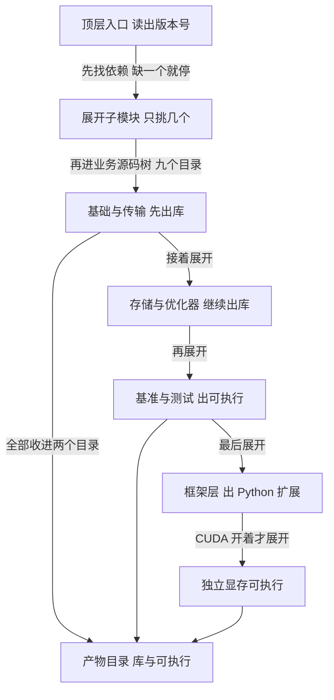
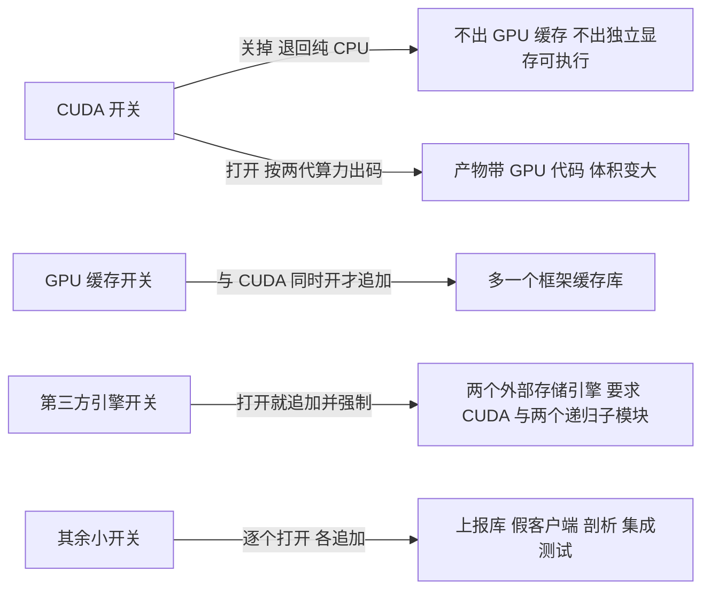

从源码检出到可执行文件，中间有三道闸门：找齐依赖、开关决定哪些模块进构建、最后打包。这一页画它们的顺序与产物差别。

## 它是什么

顶层入口读版本号，再按固定顺序展开子目录。仓库声明 15 个第三方子模块，顶层只直接展开少数几个，其余靠脚本生成的安装前缀；业务源码树 9 个目录按序展开：先出库，再出可执行，最后出扩展。



从上往下读。第一个箭头把依赖扫一遍，缺一个就停。中间那四步的顺序有意义：先有库的编译规则，可执行目标才能链接；框架层最后展开，因为它要把前面所有库收进一个扩展。前面都在 configure 阶段，最下面那个才在编译链接阶段落盘。

开关只改变哪一段被展开：



左边开关，右边产物差别，每根箭头独立成立。判断全在 configure 阶段做完，产物里不再有分支；唯一留到运行时的是上报数据的去处。

## 它为什么存在

依赖面比一般 C++ 项目宽：CUDA、gRPC、bRPC、folly、libtorch 都要在 configure 阶段找到，缺一个就失败，报错却指向一个不在仓库里的目录。这些目录不是 clone 出来的：当前检出里 8 个生成前缀全不存在，仅 clone 再 configure 必定失败。

## 它和谁接

上游是第 1 块的模块清单，下游是第 6 块的运行时配置，两端读同一份 JSON。另有一处只在运行时暴露：静态链接会丢掉只放工厂注册的编译单元，之后查找都报找不到工厂。

## 代码位置

要改代码时再看这里。

### 目标（顶层选项）

| 选项 | 默认 | 影响 |
| --- | --- | --- |
| `ENABLE_CUDA` | `ON` | 决定 `project(... LANGUAGES ... CUDA)`、CUDA arch（`RECSTORE_CUDA_ARCHITECTURES` 默认 `80;86`）、`storage/gpu_cache`、`framework/cache`、`executable/uvm` 是否构建 |
| `RECSTORE_ENABLE_GPU_CACHE` | `ON` | 与 CUDA 同时满足才构建 `framework/cache`，并定义 `RECSTORE_ENABLE_GPU_CACHE` |
| `RECSTORE_ENABLE_THIRD_PARTY_ENGINES` | `OFF` | 打开 `storage/external/fasterkv` 与 `storage/external/hps`；强制要求 `ENABLE_CUDA=ON`、`third_party/faster` 与递归初始化的 `third_party/HugeCTR`，否则 `FATAL_ERROR` |
| 其余开关 | 均 `OFF` | `USE_PERF_REPORT`（任意构建类型；打开后编 `report_client`，sink 由运行时 `observability` / 环境变量选择）、`USE_BRPC_CPU_PROFILER`（需 `libtcmalloc_and_profiler`）、`RECSTORE_ENABLE_HDRHISTOGRAM_PROGRAMS`（只影响 ycsb 的 CTest 注册）、`USE_FAKE_KVCLIENT`（`common/op_mock.cc` 替掉真实客户端）、`RECSTORE_ENABLE_TENSORFLOW`、`ENABLE_RDMA_INTEGRATION_TESTS`、`RECSTORE_ENABLE_SPDK`/`USE_PMKV`/`USE_PIBENCH` |

### 依赖（缺一即 configure 失败）

| 类别 | 内容 |
| --- | --- |
| configure 必须找到 | `OpenMP`、`Protobuf CONFIG`、`gRPC CONFIG`、`Torch`（`third_party/libtorch/libtorch/share/cmake/Torch`）、`folly CONFIG`、`gflags`、`glog`、`TBB`、`pybind11`、`Python >= 3.10`、`ZLIB`、`Threads`、`ibverbs`（RDMA 无条件构建） |
| bRPC 另算 | `bRPC` + 自定义 `protobuf`（`src/ps/brpc/CMakeLists.txt` 缺失时直接 `FATAL_ERROR`） |
| 现场编译 | `jemalloc` 通过 `ExternalProject_Add` 跑 `autoconf` + `--with-jemalloc-prefix=je` |
| 仓库内子模块（`.gitmodules` 声明 15 个） | `fmt`、`folly`、`glog`、`googletest`、`gperftools`、`json`、`grpc`、`HugeCTR`、`cpptrace`、`jemalloc`、`liburing`、`spdk`、`brpc`、`cityhash`、`faster` |
| 生成前缀（不在仓库内，由 `dockerfiles/setup_centos7.sh` 等脚本产出） | `third_party/grpc-install`、`protobuf-install`、`brpc-install`、`libtorch`、`leveldb`、`ycsb`、`glog/glog-install-fPIC`、`folly/folly-install-fPIC`。当前 Windows 检出这 8 个路径全部不存在，所以"仅 clone + cmake"必定失败，必须先跑环境装配脚本 |
| folly 的另一层依赖 | `src/storage/kv_engine/CMakeLists.txt` 显式链 `Folly::folly`，`engine_composite.h` 直接 `#include <folly/SharedMutex.h>`，所以存储引擎的单测目标也依赖它 |

### 两档构建

| 档位 | 打开什么 | 仍要准备 |
| --- | --- | --- |
| 最小构建（仍可跑 CPU 训练/PS 单测） | `-DENABLE_CUDA=OFF`、`-DRECSTORE_ENABLE_GPU_CACHE=OFF`、`-DRECSTORE_ENABLE_THIRD_PARTY_ENGINES=OFF` | 即使最小构建也仍需全部生成前缀（folly/gRPC/bRPC/leveldb/libtorch/protobuf）与 `recstore_deps`（fmt/gflags/boost/TBB/OpenSSL）；可跳过的只有 `third_party/faster`、`HugeCTR`、`spdk` |
| 全功能构建 | 在此基础上加 `-DENABLE_CUDA=ON`、`-DRECSTORE_ENABLE_GPU_CACHE=ON`、`-DRECSTORE_ENABLE_THIRD_PARTY_ENGINES=ON`、`-DUSE_PERF_REPORT=ON`，按需 `RECSTORE_ENABLE_SPDK` / `USE_PMKV` / `ENABLE_RDMA_INTEGRATION_TESTS` | 并递归初始化 `third_party/faster`、`third_party/HugeCTR` |

最小构建的两条命令：

```bash
cmake -DCMAKE_BUILD_TYPE=Release -DCMAKE_POLICY_VERSION_MINIMUM=3.5 \
      -DENABLE_CUDA=OFF -DRECSTORE_ENABLE_GPU_CACHE=OFF \
      -DRECSTORE_ENABLE_THIRD_PARTY_ENGINES=OFF ..
cmake --build . -j
```

### 打包（产物）

| 产物 | 说明 |
| --- | --- |
| C++ 库 | `build/lib`（`lib_recstore_ops.so`、`libbrpc_ps_client.so`、`libdist_brpc_ps_client.so`、`liblocal_shm_ps_client.so`、`libwq_ps_client.so` …） |
| C++ 可执行 | `build/bin`（`ps_server`、`petps_server`、`local_shm_ps_server`、各类 `*_test`、`grpc_ps_bench`） |
| wheel | scikit-build-core 复用 `build/` 目录，只构建 `recstore_torch_ops`，只安装 `COMPONENT python`；扩展落到 `recstore/lib/`，runtime rpath 为 `$ORIGIN:$ORIGIN/../native`，非 torch 运行库按 soname 列表 vendored 进 `recstore/native/`（`src/framework/pytorch/CMakeLists.txt#_recstore_wheel_sonames`）。`libtorch*` / `libc10*` 故意不打包，`torch==2.7.1` 是硬运行依赖 |
| 版本与分发 | `VERSION` 是唯一来源；`configure_file` 把 `src/python/version_info.py.in` 渲染到构建树**和源码树** `src/python/pytorch/recstore/version_info.py`（configure 会写源码树，属已知副作用）。二进制分发用 `tools/packaging/pack_artifact.sh <out.tar.gz> <artifact...>` 收集可执行/`.so` 及其 `ldd` 依赖到 `bin/`、`lib/`、`deps/lib/` 并写 `manifest.txt` |

### 静态注册

| 问题 | 说明 |
| --- | --- |
| 入口 | `src/storage/kv_engine/kv_engine_register.cc#RecStoreForceLinkKVEngineRegistrations` 是给静态链接构建用的显式入口 |
| 丢了会怎样 | 该编译单元只放工厂注册与一个静态初始化器，静态库会把它丢掉，随后所有 `BaseKV` / index / value-store / allocator 查找在运行时报 "no Factory instance" |
| 共享库为什么不缺 | 共享库构建靠 `--no-as-needed` 保持加载，不需要它 |
| 谁在用 | `benchmark_kv_engine.cc` 已显式调用 |

## 交付一句

第 5 块到此为止：依赖和开关都在 configure 阶段定型，产物落在库与可执行两个目录里。下一块接配置。
