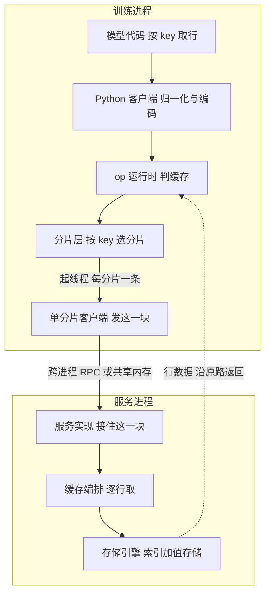

这一页回答：一次读或写，跨了几次进程、几次线程。进程只有一次；线程只在分片那一处复制，写路径还多一个提交线程，其余全是同进程的普通调用。

## 它是什么

举例：默认配置两个分片，一次前向要读 8 万行，于是分片层复制出两条线程各发一半，只有这两条线程会碰到网络。反向传播交回同样多的梯度碎片时，客户端先把它们并成每张表一次请求，再交给另一个线程去提交——训练主线程不必等它。

一次读写跨了哪些进程和线程？

读图：上半边五块都在训练进程里，箭头是普通函数调用；从分片层到单分片客户端那一根换了线程，从单分片客户端到服务实现那一根换了进程。这两根是本章唯一的两处边界，剩下的都在原地完成。回程虚线不是新请求，是同一批行数据被搬回来。

## 它为什么存在

这层抽象存在的理由是后端可替换。同一个 `EmbRead` 调用，下面可能是 gRPC、bRPC、RDMA 或共享内存；没有 `CommonOp` 这层多态，每个调用点都要知道后端是谁。有了它，模型代码只认「按 key 取行」，后端选择推迟到配置解析那一刻。

代价也具体：后端的替换是进程级的，不是按表选。因为进程里只有一个 op 运行时、一份连接，所以不存在「这张表走 RDMA、那张表走 gRPC」。一次调用的线程数也只由分片数决定——两个分片就两条线程，跟这次带上几张表无关。

## 它和谁接

上游是第 3、4 块的两条路径，它们都从图顶端的模型代码出发；下游是第 03 章（传输实现细节）和第 05 章（存储引擎内部）。本块只负责中间那段：谁持有谁、跨层传什么。

十几个模型模块为什么只开一条连接？

读图：左边可以有很多个模型模块，从 Python 客户端开始每层只剩一个对象，到单分片客户端再按分片数复制。真正持有连接的是最右那层，所以「一条连接」严格说是「一个后端、每个分片一条」。换后端会把右侧整段拆掉重建，因此不能在请求进行中换。

## 代码位置

要改代码时再看这里。跨层传递的数据结构，前五个过边界，后四个是运行时状态：

| 结构 | 位置 | 关键不变量 |
| --- | --- | --- |
| `RecTensor` | `src/base/tensor.h#RecTensor` | 纯借用视图，析构不释放 `data_ptr`；dtype 只有 `UINT64` / `FLOAT32` 等枚举，无 device 概念 |
| `EmbeddingTableConfig` | `src/ps/base/base_client.h#EmbeddingTableConfig` | `{num_embeddings, embedding_dim, table_id}`，`Serialize()` 成 JSON 走 RPC |
| `ParameterCompressItem` / `ParameterPack` | `src/ps/base/parameters.h` | `#pragma pack(1)` 的 `{key, dim, float embedding[0]}`，尾随变长行；RPC 上整块 flat 编码 |
| `KVEngineComposite` 配置 | `src/storage/kv_engine/base_kv.h` 顶部注释 + `engine_composite.h` | 必须嵌套 `index` / `value`；`index.type`、`value.type` 用 `j.at(...)` 强取，缺失即抛 |
| tag 键空间 | `src/optimizer/sparse_tensor.h#MakeTensorTag` | 高 8 位是 tag = `table_id * tensors_per_table + role`；超过 255 抛异常；Python 侧 `_KEY_TAG_SHIFT = 56` 与之对齐 |
| `SparseTensor` | `src/optimizer/sparse_tensor.h#SparseTensor` | 一个逻辑张量 = `(key, tag)` 拼接后的 key 空间；优化器只经它（`#ApplySgdUpdateFlat` 等）的 flat 批处理接口读写存储 |
| `CacheLookupActions` / `CacheUpdateActions` | `src/framework/cache/cache_aware_op.h` | cache 只通过回调与运行时交互；传输完成必须先于 cache 维护，失败一律清空 |
| `LocalShmSlotHeader` / `LocalShmControlBlock` | `src/ps/local_shm/local_shm_protocol.h` | slot 状态机 `kFree → kWriting → kReady → kRunning → kDone/kError`；`server_epoch` 不匹配返回 `kEpochMismatch` |
| `PSClientCreateOptions` | `src/ps/client_options.h` | `type ∈ {kGrpc, kBrpc, kRdma, kLocalShm}` + `transport_config` + `raw_config`，是 `CreatePSClient` 的唯一输入 |

跨层硬约束，都能在代码里直接验证：

- key 必须是 `int64` / `uint64` 一维连续；values/grads 必须是 `float32` 二维连续且行数等于 key 数（`CheckKeys` / `CheckRows`、`validate_keys` / `validate_embeddings`）。
- `pull_into` 额外要求目标是 CPU、`float32`、连续、`requires_grad == False`、形状完全匹配。
- 服务端建表是"注册 tag + 形状"，不写数据：`CachePS::InitTable` 只登记 `table_configs_` 并调 `optimizer_->Init`；真正写入由 Python 的 `init_data` 调 `emb_write` 完成。
- GPU cache 保留两个哨兵 key：`int64` 的 `max` 与 `max - 1`（`_reject_gpu_cache_reserved_ids`）；该检查对 CUDA 张量默认跳过，只有设 `RECSTORE_VALIDATE_GPU_CACHE_KEYS=1` 才生效。

服务端入口与存储内部：

- 三个服务入口：`ps_server` 分发 GRPC/BRPC，`petps_server` 走 RDMA 自己的槽位协议，`local_shm_ps_server` 轮询共享内存槽位。
- 存储层再分三段：索引（`DRAM_PET_HASH`、`DRAM_EXTENDIBLE_HASH`、`SSD_*`）、值存储（`DRAM`、`SSD`、`TIERED`）、分配器（`src/memory/allocators/`）。
- 优化器（`SGD`、`RowWiseAdaGrad`、`AdamW`）也在服务进程里，但读路径不经过它。

## 交付一句

第 2 块到此为止：链路有哪几段、每段的持有关系、跨段传什么，都交代完了。下一块接读路径，看一条真实请求怎么从第一段走到最后一段。
