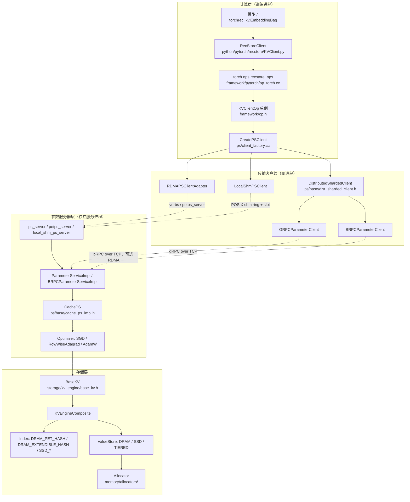

## 它是什么

一次 embedding 读写穿过三层。计算层在训练进程里，内部还分两段：前面的模型与 Python 客户端，后面的 op 运行时与传输客户端。参数服务器层在独立的服务进程里，由服务实现接住请求、交给缓存编排。存储层就在同一个服务进程里，是真正存放行的引擎。

三段之间有两次交接，但只有一次跨进程：计算层内部是同进程的函数调用；传输客户端到服务实现是 RPC 或共享内存，这是本章唯一真正的"另一个进程"；服务实现到存储引擎又是同进程调用，只是类型上过了一层抽象。读代码的直觉按这个来：想看协议去传输客户端与服务实现，想看算法去缓存编排与存储引擎。

图里有一条容易忽略的关系：`CreatePSClient` 之后分叉出四类客户端，但同一时刻只有一个在生效，因为 op 运行时里只有一个进程级单例持有它。Python 侧可以创建多个客户端对象、多个模型模块，它们最后共用这一个连接。

## 它为什么存在

这层抽象存在的理由是后端可替换。同一个 `EmbRead` 调用，下面可能是 gRPC、bRPC、RDMA 或共享内存；没有 `CommonOp` 这层，每个调用点都要知道后端是谁。有了它，模型代码只认"按 key 取行"，后端选择推迟到配置解析的那一刻。

## 它和谁接

上游是第 3、4 块的两条路径，它们都从这张图的左上角出发；下游是第 03 章（传输实现细节）和第 05 章（存储引擎内部）。本块负责中间那段：谁持有谁，跨层传什么。

## 代码位置

跨层传递的数据结构，前五个"过边界"，后四个是运行时状态：

| 结构 | 位置 | 关键不变量 |
| --- | --- | --- |
| `RecTensor` | `src/base/tensor.h#RecTensor` | 纯借用视图，析构不释放 `data_ptr`；dtype 只有 `UINT64` / `FLOAT32` 等枚举，无 device 概念 |
| `EmbeddingTableConfig` | `src/ps/base/base_client.h#EmbeddingTableConfig` | `{num_embeddings, embedding_dim, table_id}`，`Serialize()` 成 JSON 走 RPC |
| `ParameterCompressItem` / `ParameterPack` | `src/ps/base/parameters.h` | `#pragma pack(1)` 的 `{key, dim, float embedding[0]}`，尾随变长行；RPC 上整块 flat 编码 |
| `KVEngineComposite` 配置 | `src/storage/kv_engine/base_kv.h` 顶部注释 + `engine_composite.h` | 必须嵌套 `index` / `value`；`index.type`、`value.type` 用 `j.at(...)` 强取，缺失即抛 |
| tag 键空间 | `src/optimizer/sparse_tensor.h#MakeTensorTag` | 高 8 位是 tag = `table_id * tensors_per_table + role`；超过 255 抛异常；Python 侧 `_KEY_TAG_SHIFT = 56` 与之对齐 |
| `SparseTensor` | `src/optimizer/sparse_tensor.h#SparseTensor` | 一个逻辑张量 = `(key, tag)` 拼接后的 key 空间；优化器只经它（`#ApplySgdUpdateFlat` 等）的 flat 批处理接口读写存储 |
| `CacheLookupActions` / `CacheUpdateActions` | `src/framework/cache/cache_aware_op.h` | cache 只通过回调与运行时交互；传输完成必须先于 cache 维护，失败一律清空 |
| `LocalShmSlotHeader` / `LocalShmControlBlock` | `src/ps/local_shm/local_shm_protocol.h` | slot 状态机 `kFree → kWriting → kReady → kRunning → kDone/kError`；`server_epoch` 不匹配返回 `kEpochMismatch` |
| `PSClientCreateOptions` | `src/ps/client_options.h` | `type ∈ {kGrpc, kBrpc, kRdma, kLocalShm}` + `transport_config` + `raw_config`，是 `CreatePSClient` 的唯一输入 |

跨层硬约束，都能在代码里直接验证：

- key 必须是 `int64` / `uint64` 一维连续；values/grads 必须是 `float32` 二维连续且行数等于 key 数（`CheckKeys` / `CheckRows`、`validate_keys` / `validate_embeddings`）。
- `pull_into` 额外要求目标是 CPU、`float32`、连续、`requires_grad == False`、形状完全匹配。
- 服务端建表是"注册 tag + 形状"，不写数据：`CachePS::InitTable` 只登记 `table_configs_` 并调 `optimizer_->Init`；真正写入由 Python 的 `init_data` 调 `emb_write` 完成。
- GPU cache 保留两个哨兵 key：`int64` 的 `max` 与 `max - 1`（`_reject_gpu_cache_reserved_ids`）；该检查对 CUDA 张量默认跳过，只有设 `RECSTORE_VALIDATE_GPU_CACHE_KEYS=1` 才生效。

## 交付一句

第 2 块到此为止：链路有哪几段、每段的持有关系、跨段传什么，都交代完了。下一块接读路径，看一条真实请求怎么从第一段走到最后一段。
