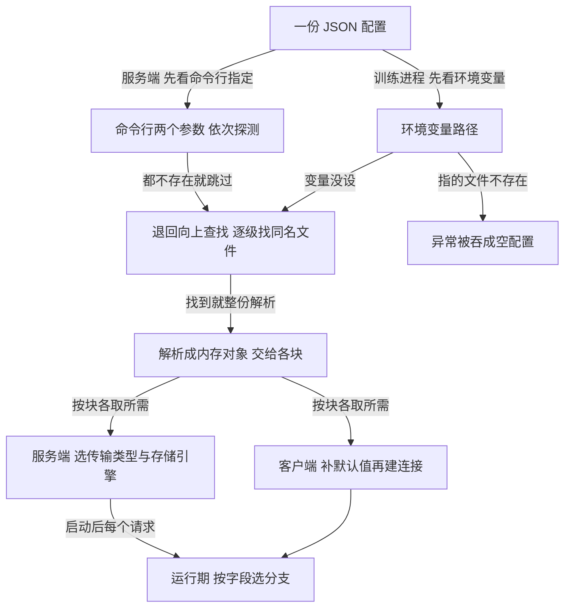

这页是查表用的：一份 JSON 配置、一批环境变量、几个 C++ gflags 决定运行时行为。下面先画配置从文件到生效的走法，再把字段按块摊成表。

## 它是什么

没有统一的配置对象：服务端和训练进程读同一份 JSON，但读文件的路径不同，缺字段时的脾气也不同——有的直接抛，有的静默回退常量，有的先拿上级块的值复制一份。举例，同一份配置里传输类型缺省走 gRPC、端口缺省 15000、共享内存区名缺省 recstore_local_ps，三条默认值分别写在三处。

上面两层是两条读文件路径，其余是读完之后谁在用。决定用哪个文件这件事全部发生在进程启动、第一行业务逻辑之前；中间那个节点之后，热路径上的请求不再读盘，只有重建客户端的那两个入口会重新读一次文件。最后一个节点才是运行时的：字段在启动时被取一次，之后每个请求照着那个值选分支。

## 它为什么存在

默认值分散在三处：JSON schema 的缺省、C++ 里的短期缺省、gflags 的初值。三者不一致时，表现是配置写了但没生效，而且多半不报错——只有必填字段缺失才失败，可选字段一律静默回退。把归属摊开，省掉对照源码猜的时间。

## 它和谁接

上游是第 5 块编出来的二进制；下游是第 3、4 块里按配置选分支的调用点：传输类型决定建哪个单分片客户端，分片数决定路由，存储引擎类型决定整条存储栈。第 02 章会从计算层角度再列一遍它真正读取的字段。

## 代码位置

要改代码时再看这里。

### 查找顺序

服务端入口在 `src/ps/ps_server.cpp#main`，它只用三个来源，前两个先探测文件是否存在：

| 顺序 | 来源 | 不存在时 |
| --- | --- | --- |
| 1 | `--config_path` | 文件不存在则忽略，看下一项 |
| 2 | `--brpc_config_path` | 同样先探测存在性 |
| 3 | `base::ResolveRecStoreConfigPath()` | 从 CWD 逐级向上找 `recstore_config.json`，再退回仓库根同名文件，都没有则报错、退出码 1 |

客户端按另一个顺序：

| 项 | 说明 |
| --- | --- |
| 入口 | `GetGlobalConfig()` |
| 环境变量 | `RECSTORE_CONFIG`，优先级高于目录搜索；指向的文件若不存在会抛，随后被吞成空配置（见风险 3） |
| 目录搜索 | 与 `ResolveRecStoreConfigPath` 共用同一套 |
| 不是服务端来源 | `RECSTORE_CONFIG` 只影响客户端与 Python/测试启动脚本（脚本把它转成 `--config_path`） |

### 按块归属（只列真正生效的字段，默认值取自代码；完整字段见 `docs/config.md`）

| 块 | 谁读 | 字段与默认 |
| --- | --- | --- |
| `cache_ps` | 服务端 + 客户端路由 | `ps_type` 缺省 `GRPC`（仅 `GRPC`/`BRPC`，其他值 `return 2`）；`num_threads` 无默认、缺失即抛；`num_shards` 缺省 1；`servers` 见下；`optimizer.type=SGD`、`learning_rate=0.01`；`max_batch_keys_size` 已废弃，出现只打 `WARNING` 并忽略 |
| `distributed_client` | 计算层客户端 | 缺失字段先从 `cache_ps` 复制；`num_shards` 缺省取 `servers.size()`；`hash_method=city_hash`（`simple_mod` 时用 `key % num_shards`）；`max_keys_per_request=500` |
| `client` | 单分片客户端 | `host=127.0.0.1`、`port=15000`、`shard=0`；只在 `cache_ps.servers` 与 `distributed_client.servers` 都缺失时生效 |
| `local_shm` | shm 客户端 | `region_name=recstore_local_ps`、`slot_count=64`、`slot_buffer_bytes=8 MiB`、`client_timeout_ms=30000` |
| `base_kv_config` | `CachePS` → `ResolveEngine` → `Factory<BaseKV>` | `engine_type` 缺省 `KVEngineComposite`；`capacity` 无默认；`index.type`/`value.type` 用 `.at` 强取 |
| `value` | `KVEngineComposite` | `type` 无默认；`default_value_size_hint` 代码缺省 0；`dram_allocator.type`/`ssd_allocator.type` 经 `NormalizeAllocatorType` 归类 |
| `value.tiering` | `TIERED_VALUE_STORE` | `cache_policy` 缺省 `none`，接受 `none`/空、`lru`、`clock`、`adaptive`；`cache_budget_ratio=0.05` ∈ (0,1]（仅 LRU）；`cache_shards=16` ∈ [1,4096]；`promote_min_misses=2` ≥ 1；`expected_dram_bytes=0`；`retain_backing_copies=true`；CLOCK 另有 `clock_{frequency_admission,cost_aware,async_exchange}` 与两个队列上限；`dram_keys_path` 与 CLOCK 互斥，`online_admission=false`，`async_admission=false`（后者要求前者，且要求名单非空、plain SSD 布局）；非法值抛 `std::invalid_argument` |
| `observability` | `report()` | `sinks` 列表（`remote`/`csv`/`jsonl`/`glog`/`none`，缺省只开 `glog`）；`remote.endpoint/timeout_ms/queue_max`、`csv.path/flush_every_n`、`jsonl.path/flush_every_n`；旧的 `report_API` 仍生效但被它覆盖；Python 侧经 `recstore.telemetry.emit()` 进同一批 sink |

### 单分片监听地址（`95616eef`）

| 情形 | 行为 |
| --- | --- |
| 有 `servers` | 服务端不再硬编码 `0.0.0.0:15000`：单分片分支优先取 `cache_ps.servers` 中 `shard == local_shard_id` 的那一项的 `host`/`port` |
| 分片号从哪来 | `local_shard_id` 来自 `--grpc_local_shard_id` / `--local_shard_id`（缺省 `-1`，此时按 shard 0 找） |
| `servers` 整个缺失 | 回退 gRPC 的 `0.0.0.0:15000` 或 bRPC 的 `0.0.0.0:<--brpc_server_port>` 并打 `WARNING` |
| 有 `servers` 但缺该 shard，或 `host`/`port` 类型不对 | 抛异常并 `LOG(FATAL)` |
| checkpoint | gRPC 解析出的 shard id 还用于 checkpoint 元数据 |
| 客户端 | 在同一份配置下也会优先用 `cache_ps.servers`（`ResolveFrameworkDistributedClientConfig` 把缺省字段复制过去），所以两端看到的是同一组端点 |

容易被忽略的两个 C++ gflags：

| gflag 定义 | 位置与用途 |
| --- | --- |
| `FLAGS_value_size = 128` | `src/ps/base/config.cc`，RDMA 用它推 embedding_dim |
| `FLAGS_max_kv_num_per_request = 300` | RDMA 路径的单请求上限 |

### 环境变量按层归类

| 变量 | 作用 | 读取位置 |
| --- | --- | --- |
| `RECSTORE_CONFIG` | 指定配置文件，优先级高于目录搜索；**仅客户端/脚本** | `op_runtime_support.cc`、`petps_client.cc`、Python 与测试启动脚本 |
| `RECSTORE_BRPC_USE_RDMA` / `_RDMA_DEVICE` / `_TIMEOUT_MS` | bRPC 可选 RDMA 数据面与超时 | `brpc_ps_client.cpp` / `brpc_ps_server.cpp` |
| `RECSTORE_RDMA_TRANSPORT_MODE` / `_GET_RESPONSE_MODE` / `_ADAPTER_PROFILE` / `_RC_NAMESPACE` / `_CONTROL_PLANE_HOST` / `_PORT` / `_TIMEOUT_MS` | RDMA 传输模式、剖析、控制面端点与命名空间 | `rdma_ps_client_adapter.cc` |
| `RECSTORE_LOCAL_SHM_STAGE_REPORT` / `_READY_QUEUE_INDEX` | shm 阶段指标、就绪队列选择（缺省按 `LOCAL_RANK`/`RANK`） | `local_shm_stage_report.h`、`local_shm_client.cpp` |
| `RECSTORE_BIND_CORE_DISABLE` / `_OFFSET`、`RECSTORE_REPORT_SINKS` / `_MODE` / `_LOCAL_SINK` / `_JSONL_PATH` / `_FLUSH_EVERY_N` / `_CSV_PATH` / `_CSV_FLUSH_EVERY_N`、`RECSTORE_RUN_ID` / `RANK` / `LOCAL_RANK` / `RECSTORE_SHARD_ID` | 关线程绑核 / 起始核偏移；上报 sink 与环境变量覆盖；写入 CSV 与 `MetricSink` 的维度字段 | `src/base/bind_core.cc`、`src/base/report/report_client.cpp` |
| `RECSTORE_SPARSE_COMMIT_PROFILE` / `RECSTORE_PS_OWNER_GPU` | 稀疏提交剖析 / GPU owner 合并梯度流水 | `src/ps/base/sparse_gradient_commit.h`、`src/python/pytorch/recstore/ps_pipeline/owner.py` |
| `RECSTORE_DEFER_OPS_LOAD` / `RECSTORE_DEBUG` / `RECSTORE_DEPS_PREFIX` / `CPUPROFILE` | 延迟加载扩展 / 打印加载路径 / 构建期依赖前缀 / `ps_server` CPU profile | `recstore/__init__.py`、顶层 `CMakeLists.txt`、`ps_server.cpp` |

## 交付一句

第 6 块到此为止：文件怎么找、字段谁读、默认值归谁，都在表里。术语定义见章末附录。
