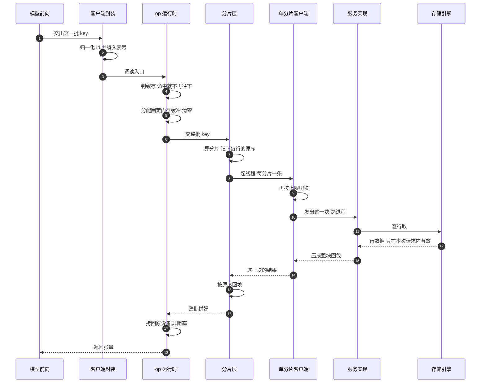
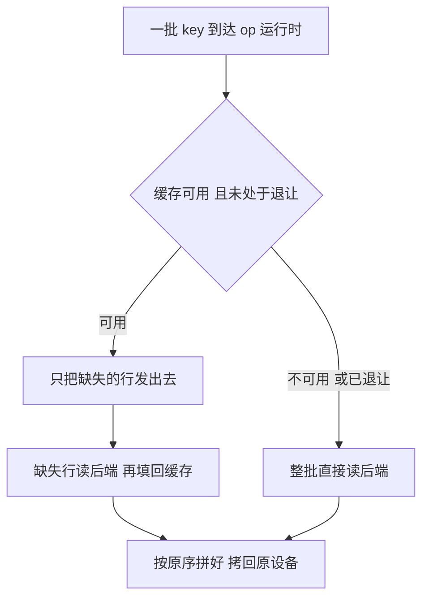

这一页回答：一次前向查表，从一张 key 张量到存储里的一行，中间谁在做事、哪一步换了线程、哪一步真的出了进程。两处关键分叉——走哪条读策略、发给哪个分片——都在 Python 侧选，C++ 只提供原语，所以加日志先加在客户端。

## 它是什么

举例：一个 batch 4096 条样本、每条 20 个特征，前向要找约 8 万行；默认两个分片、单次上限 500 行，于是每个分片摊到四万行左右，还要再切成八十多块。真正跨进程的是一百多块，不是 8 万次。

一次读从 Python 到存储，按什么顺序发生？

读图：第 1 到 7 步都在训练进程的调用线程里；标着「起线程」那一步，分片层按非空分片数复制线程，一块 key 只走其中一条。标着「跨进程」那一步是唯一出进程的地方，服务进程里没有二次派发——接住请求的线程自己把行取出来、压成一块回包。最后几步也在客户端完成：按发出去时记下的原序把行放回原位，再整体拷回原设备。

## 它为什么存在

读是训练循环里最频繁的操作，设计围绕三件事：不要把 key 逐条发出去、不要把结果逐条拷回来、不要在没命中缓存时把主线程卡死。[推断] 代码里没有对应的设计说明。

成本可以这样看：8 万行合成一百多块，网络往返从 8 万次降到一百多次；回包是一整块连续内存，拷回显存一次完成，开销按字节算而不是按行算。理解这些成本，才知道为什么某些「看起来该在 C++ 里」的逻辑其实在 Python。

这一批 key 走缓存还是直读，谁决定？

读图：判断全在客户端，服务端不参与。先看缓存能不能用——编译开关打开，且这张卡上已经按这个维度启用、key 就在显存里；再看这批是不是大到不值得查缓存：超过 1024 行且命中率不到 5%。退让会粘住：一旦整批直读，后面的大请求都不再查缓存，要等某一批回落到 1024 行以下才复位。

## 它和谁接

上游是第 2 块的 op 入口，下游是[第 05 章](../ch05/)的存储引擎读接口，也就是 `BaseKV::BatchGet`；本章只讲到「进入存储层」为止。失败时客户端同时看传输完成和每条 RPC 的状态，任何一条失败就往上返错，不把清零的缓冲当成功交回（deadline 与预取归[第 03 章](../ch03/)）。

## 代码位置

要改代码时再看这里。按阶段对照：

| 阶段 | 步骤 | 代码位置 |
| --- | --- | --- |
| 发起 | 表句柄取行、单例客户端、id 归一化与 tag 编码 | `src/python/pytorch/recstore/DistTensor.py#DistTensor.__getitem__`、`KVClient.py#RecStoreClient.__new__`、`#_normalize_ids`、`#_encode_ids` |
| 发起 | op 注册与绑定、dtype/shape 校验、pinned 缓冲 | `src/framework/pytorch/op_torch.cc#TORCH_LIBRARY(recstore_ops, m)`、`op_base.cc#emb_read_torch`、`cache/tensor_adapter.cc#CachedReadTorch`、`#CheckKeys` |
| 分流 | cache-aware 查表与 bypass | `src/framework/cache/cache_aware_op.h#CacheAwareOp::Lookup` |
| 分流 | CUDA→pinned staging、借用视图 | `src/framework/pytorch/op_internal.h#StageCudaTensorToPinnedCpu`、`#ToRecTensor` |
| 分流 | 单例获取、后端下转型、`EmbRead` 清零与转发 | `src/framework/op.cc#GetKVClientOp`、`#GetConcreteKVClientOp`、`#KVClientOp::EmbRead` |
| 扇出 | 分片路由与分块 | `src/ps/base/dist_sharded_client.h#GetShardId`、`#PartitionKeys`、`#GetParameter` |
| 扇出 | 单分片 RPC 发起 | `src/ps/grpc/grpc_ps_client.cpp#GRPCParameterClient::GetParameter`、`src/ps/brpc/brpc_ps_client.cpp#BRPCParameterClient::GetParameter` |
| 服务端 | 服务实现与缓存编排 | `src/ps/grpc/grpc_ps_server.cpp#ParameterServiceImpl::GetParameter`、`src/ps/base/cache_ps_impl.h#CachePS::GetParameterRun2Completion` |
| 回收 | 行位置回填与回设备 | `src/ps/base/dist_sharded_client.h#ScatterEmbeddingRows`、`src/framework/pytorch/cache/tensor_adapter.cc#CachedReadTorch` |

上限与默认值：

| 在哪一层切 | 上限 | 默认值 |
| --- | --- | --- |
| 分片层按分片切块 | `max_keys_per_request` | 500 |
| gRPC 单分片内部再切 | `MAX_PARAMETER_BATCH` | 2000 |
| bRPC 单分片内部再切 | `MAX_PARAMETER_BATCH_BRPC` | 65536 |
| gRPC 每分片建几个 stub | `FLAGS_get_parameter_threads` | 4，但读路径只用第一个，靠异步流水线并发 |

形态与所有权：

| 东西 | 形态 | 谁持有、活多久 |
| --- | --- | --- |
| `ids` | 上层 `[N] int64`，C++ 视图 `[N] uint64` | 调用方；编码表号时另出一个张量 |
| `values` | `[N, D] float32` | CPU 缓冲由 PyTorch 分配器持有，跨层只传借用指针 |
| `ParameterPack` | 指向 `BatchGet` 返回的行内存或该线程的 thread-local 读缓冲 | 只在本次请求内有效 |

调用形状按阶段记一遍——左边这些符号就是 grep 时该敲的字符串，后边一句说它在链上的位置和职责：

**发起**

- 入口有两条：表的 `DistTensor.__getitem__`，或者 embedding 模块的 `forward`；两条最后都落到 `RecStoreClient.pull(name, ids)`，`name` 选表、`ids` 是这一批行号。
- id 归一化：转 `int64`、`contiguous()`，`preserve_device=False` 时搬到 CPU；`pull_with_gpu_cache` 保留 device，并拒绝两个哨兵 key。
- 表号编码：`tag << 56` 或进 key 高位；id 已带别的 tag 时直接抛 `RuntimeError`，不静默改写。
- 客户端是单例：`__new__` + `_initialized`，构造时绑定 `self.ops = torch.ops.recstore_ops`。
- 注册链路：`emb_read` 由 `RegisterBaseOps` 绑定到 `emb_read_torch`，再转 `CachedReadTorch(keys, dim)`，dtype/shape 校验在这一层。

**分流**

- 走缓存还是直读：分配好输出缓冲后调 `g_cache_aware_op.Lookup(rows, io, no_evict)`，第一个参数是这批的行数，`io` 是一组回调，`no_evict` 要求这些行读完后别被淘汰。
- 回调里谁是「能不能用」：`io.usable` 由 `CanUseGpuCache(keys, dim)` 判——编译开关打开之外，还要求 key 在 CUDA 上、`int64`、连续，且这张卡上这个维度启用过；假的时候只剩 `io.read_all` 一条回调可走。
- 直读回调实体：`io.read_all` 先按需把 CUDA key 搬到 pinned CPU，`ToRecTensor` 出借用视图，再 `op->EmbRead(k, v)`；`cache_aware_op.h` 里那句 `io.read_all()` 就是同一回调的调用点。
- 单例获取：`GetKVClientOp()` 用 `std::call_once` 保证进程内只造一个；`GetConcreteKVClientOp()` 再 `dynamic_pointer_cast` 成具体类型，并用 `TORCH_CHECK` 确认后端确实是 `KVClientOp`，所有带 `...Cached` 的入口都从这里进。
- `EmbRead`：先认 `hierkv` 短路，再校验 dtype/维度/行数，把输出清零，最后一句是 `ps_client_->GetParameter(keys_array, values)`——`keys_array` 是 `ConstArray<uint64_t>` 视图，`values` 直接是调用方缓冲。

**扇出**

- 多态落到 `DistributedShardedClient<ClientT>::GetParameter`：`PartitionKeys` 用 `GetShardId(key) = GetHash(key) % num_shards` 归并（`simple_mod` 时 `key % num_shards`），同时把原下标记进 `key_index_mapping_`。
- 每个非空分片起一条 `std::async`，线程内再按 `max_keys_per_request`（500）切块；gRPC 单分片内部还有一层 `MAX_PARAMETER_BATCH = 2000`。

**服务端与回收**

- 工厂键选出 `GRPCParameterServer` 或 `BRPCParameterServer`；服务实现在自己的 RPC 线程里调 `CachePS::GetParameterRun2Completion(keys, packs, 0)`，`tid` 固定传 0。
- `CachePS` 往下走 `base_kv_->BatchGet`：每行包成 `ParameterPack`，`ParameterCompressor` 压成 flat block 放进 `reply->parameter_value()`。
- 回填：`ScatterEmbeddingRows` 用 `key_index_mapping_` 把行放回原下标，CUDA 时 `values.to(device, non_blocking=true)`。
- 失败：gRPC 客户端检查传输完成与每条 RPC 的 `Status`，失败向上返回错误，不把清零缓冲当成功交回。

## 交付一句

第 3 块到此为止：读路径在「进入存储层」这一步收尾。下一块接写路径，形状与读对称，但多一个麻烦——写有两种语义。
