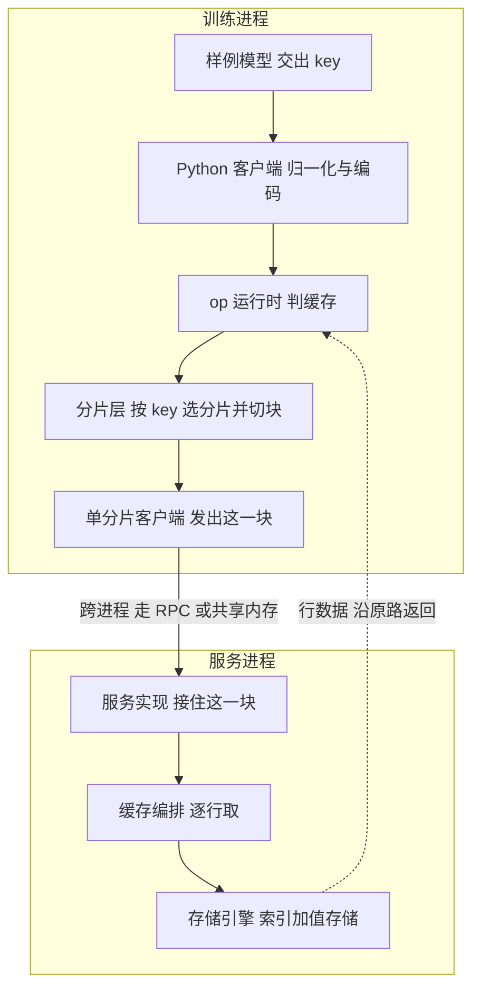
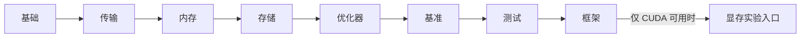

这一页回答一个很具体的问题：想改的东西在哪个目录。先看一次读写会碰到哪几块，再看这些块分别由哪个目录实现，最后才是查表。

## 它是什么

举例：一个 batch 4096 条样本、每条 20 个特征，前向一次要找约 8 万行 embedding；反向传播再把同样量级的梯度碎片交回来。这 8 万行不会一行一行地走完网络，但它们要经过的代码块是固定的八个。

一次读写会碰到哪几块？

读图：上半边五块都在训练进程里，箭头是普通函数调用；只有从单分片客户端到服务实现那一根是真的跨进程。下半边三块也在同一个进程里，从服务实现到存储引擎是本地调用，只是类型上过了一层抽象。回程虚线不是新请求，是同一批行数据被搬回来。

## 它为什么存在

读这一章的人通常带着一个具体目的：改某个后端、加一个 op，或者只想把项目编出来。目录按语言和职责切，与那八个代码块并不一一对应，所以「找模块」不能按「找层」来。举例：有人把读路径的分支选择当成 C++ 的事去找，会在框架目录里绕很久，而它其实在 Python 的策略层；反过来，想改「一批 key 怎么分片」找到模型代码上，也会白找。

构建是另一套顺序：编译入口按顺序依次加入九个目录，最后那个显存实验入口只在 CUDA 可用时才加入。

编一次二进制，先编哪块、哪些目录不在链上？

读图：箭头表示 CMake 的处理顺序，后面的目录可以直接用前面已定义的 target，反过来不行；它和运行时谁调谁无关。前八个名字对应上表里的八个一级目录，其中「传输」指的是参数服务器那个目录；最后那个显存实验入口是可选的实验可执行。链上没有的两个目录——显存工具和一个只有头文件的优化辅助目录——编不进主二进制；Python 包则由另一条打包流程单独构建。

## 它和谁接

第 2 块把这条链按进程边界重新画一遍；第 3、4 块里每个步骤都能对回这里的一个模块；第 5 块的构建入口就是代码位置里那条顺序。图上八块之外，观测、基准、测试这些目录不参与一次读写，只在验证和调优时出现。

## 代码位置

要改代码时再看这里。

顶层目录：

| 路径 | 是什么 / 给谁用 |
| --- | --- |
| `src/` | 全部 C++ 与 Python 包源码，见下节模块清单 |
| `model_zoo/`、`examples/` | 可运行样例（`criteo_kaggle/`、`rs_demo/`、`torchrec_dlrm/`、`tensorflow_dlrm/`，入口见各自 README）；`examples/` 只剩带硬编码绝对路径的遗留脚本 |
| `tools/` | Python 工具链：`benchmarks/`（PS/E2E/storage runner，含注册式性能套件 `perf/` + `perf_suite.py`）、`config/`（JSON schema 与路径解析）、`env/`、`ci/`、`format/`、`coverage/`、`test/`、`docs/`、`packaging/` |
| `dockerfiles/`、`cmake/` | 构建镜像与依赖装配（`Dockerfile.recstore`、`setup_centos7.sh` 把第三方库装到 `$RECSTORE_DEPS_PREFIX`）；CMake 查找模块 `FindGRPC.cmake`、`FindCityhash.cmake`、`common.cmake` |
| `third_party/` | 15 个 git submodule + 由脚本生成的安装前缀（后者不在仓库里） |
| `docs/`、`mkdocs.yml` | mkdocs 文档站源码与导航；`docs/config.md` 是配置字段参考 |
| `.agents/skills/`、`tmp/` | agent 操作指南（`rs-benchmark-*`、`rs-loss-aligned`）；过程区 `STATE.md`、`docs/index.md`、`journal/`、`remote/`、本讲解 |
| 根文件 | `CMakeLists.txt`（构建入口）、`VERSION`（版本唯一来源，`0.1.0+cu126`，CMake 与 `pyproject.toml` 都读它）、`pyproject.toml`（scikit-build-core，只构建 `recstore_torch_ops`）、`recstore_config.json`（默认运行配置：GRPC、2 分片、PET_HASH + DRAM value） |

`src/` 下 12 个一级目录：

| 路径 | 职责 | 关键类型 / 函数 |
| --- | --- | --- |
| `src/base` | 与框架无关的基础设施：日志、JSON、Tensor 视图、工厂、hash、位图、线程/计时/绑核、jemalloc 兼容层 | `RecTensor`、`base::Factory<T>`、`GetHash`、`base::ResolveRecStoreConfigPath` |
| `src/benchmark` | C++ 基准二进制：`ps/`、`storage/`、`mixed/`、`dataset/` | `ps_transport_benchmark`、`backend_benchmark` |
| `src/executable` | 独立可执行/实验入口；仅 `executable/uvm` 有 CMake 入口（CUDA 时构建） | `executable/uvm/intercept.cpp`、`uvm_libtorch.cc` |
| `src/framework` | 框架无关 op 运行时 + PyTorch/TF/HugeCTR 绑定 + GPU cache 适配 + BagPipe 元数据 | `CommonOp`、`KVClientOp`、`CacheAwareOp`、`TORCH_LIBRARY(recstore_ops, m)` |
| `src/gpu_memory` | GDRCopy 与设备显存映射工具（未接入构建，见风险 7） | `memory_pool.cu.cc`、`gdrapi.h` |
| `src/memory` | 共享内存文件、epoch 回收、DRAM 分配器实现 | `epoch::EpochManager`、`CONCURRENT_SLAB_MEMORY_POOL`、`PERSIST_LOOP_SLAB` |
| `src/optimization` | 只有头文件 `bagpipe/cache_metadata.h`，无独立 CMakeLists，被 `framework/pytorch/cache/bagpipe_bindings.cc` 包含 | `optimization::bagpipe::CacheMetadata` |
| `src/optimizer` | 服务端稀疏优化器与 key tag 键空间 | `Optimizer`、`SGD`、`RowWiseAdaGrad`、`AdamW`、`MakeTensorTag` |
| `src/ps` | 参数服务器全部传输与协议：`base/`（抽象、`CachePS`、单分片监听端点解析 `shard_endpoint.h`）、`proto/`、`grpc/`、`brpc/`、`rdma/`、`local_shm/`、`python_client/`（遗留） | `BasePSClient`、`DistributedShardedClient`、`CreatePSClient`、`SelectSingleShardEndpoint`、`ps_server` |
| `src/python` | `src/python/pytorch/` 是 Python 包源码，另有 CMake 版本模板 | `RecStoreClient`、`_ensure_native_loaded`、`version_info.py.in` |
| `src/storage` | KV 引擎、索引、值存储（含 CLOCK 分层 `tiered_clock_value_store.h`）、分层读缓存 `cache/`、SSD/NVM、GPU cache kernel、SSD 布局 | `BaseKV`、`KVEngineComposite`、`base::ResolveEngine`、`TieredClockValueStore`、`TieredReadCache`、`ValueStore` |
| `src/test` | C++/Python 测试与配置样本（`configs/`、`framework/`、`ps/`、`server_mgr/`、`scripts/`） | `test_kvengine.cpp`、`test_shard_endpoint.cpp`、`scripts/check_test_registration.py` |

### 构建入口的加入顺序

`src/CMakeLists.txt` 的 `add_subdirectory` 顺序：

| 顺序 | 目录 | 何时加入 |
| --- | --- | --- |
| 1 | `base` | 总是 |
| 2 | `ps` | 总是 |
| 3 | `memory` | 总是 |
| 4 | `storage` | 总是 |
| 5 | `optimizer` | 总是 |
| 6 | `benchmark` | 总是 |
| 7 | `test` | 总是 |
| 8 | `framework` | 总是 |
| 9 | `executable/uvm` | 仅 `ENABLE_CUDA` 且找到 nvcc |

`src/gpu_memory` 与 `src/optimization` **不在**这条链上。

### 最近的增删

新增入口：

- `src/ps/base/shard_endpoint.h`
- `src/storage/cache/tiered_read_cache.h`
- `src/storage/value_store/tiered_clock_value_store.h`
- `tools/benchmarks/perf/` 与 `perf_suite.py`
- `tools/benchmarks/run_tiered_cache_sweep.py`
- `src/test/scripts/check_test_registration.py`
- `src/test/test_shard_endpoint.cpp`
- `src/test/test_petkv_unsupported.cpp`
- `src/test/test_report.cpp`（不再限 Debug）
- `.github/workflows/doc-check.yml`

已删除：`src/test/test_ssd_extendible_hash.cpp`。细节归第 05、06 章。

## 交付一句

第 1 块到此为止：你现在能回答「某个东西大概在哪」。下一块接三层调用链，把这张静态地图变成一次调用穿过的层。
