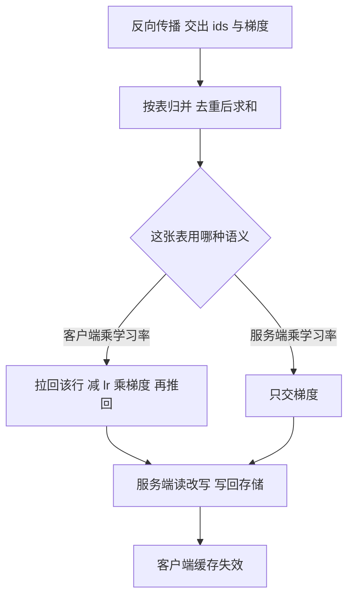

读路径回答「这行值是多少」，写路径回答「这行值改成多少」。一页把整条链走完：梯度从哪来、在客户端归并成什么、怎么过进程边界，以及同一个接口下并存的两套语义为什么必须分清楚。

## 它是什么

一次写，起点是反向传播交出的一对东西 `(ids, grads)`，终点是服务端优化器对某几行做了一次读改写。中间分五步，只有第 3 步跨进程。

图里那个分叉就是这一页的重点。两条路都从「归并后的梯度」出发，都落到同一个存储入口，唯一区别是学习率在哪一侧乘：左边在客户端乘完再推回去，右边只交梯度、由服务端优化器乘。这条分叉选错了，数值就错了，而且不会报错。

## 它为什么存在

写路径必须解决两个问题。

第一个是碎片：梯度按 batch 产生，同一个 key 可能在多个样本里各出现一次。不先按表聚合，同一个 key 会在一次请求里重复出现。

第二个是可见性：更新之后客户端可能还缓存着旧行。不主动失效，下一步 forward 读到的就是旧值，训练看起来正常，其实在学过期数据。

## 它和谁接

上游是本块的两种计算层实现：传统 `DistEmbedding` 模块，以及 `torchrec_kv.EmbeddingBag` 之类的通用模块。下游是[第 05 章](../ch05/)的优化器与存储读改写。

同样的两条语义会在[第 02 章](../ch02/write-path)再讲一遍——那一页关心的是 Python 侧的梯度归并与 BagPipe 上下文，这一页只关心一次写怎么走完。

## 代码位置

要改代码时再看这里。

### 两种语义怎么分派

| 路径 | 谁在做事 | 代码符号 |
| --- | --- | --- |
| 传统路径 | `backward` 只把归并结果追加进模块的 trace；优化器 `SparseSGD.step()` 时拉回该行、减学习率乘梯度、再赋回（`mod.weight[unique_ids] = updated`，内部走 `emb_write`），学习率在 Python 里生效 | `DistEmbedding`、`SparseSGD.step()`、`_process_dist_embedding_module`、`mod.weight[unique_ids]`、`mod._trace`、`(unique_ids, summed_grads)`、`current - lr * grads` |
| 通用模块路径 | 聚合后只交梯度，学习率由服务端优化器施加 | `_process_generic_module_with_trace`、`update_async(name, ids, grads)` |
| 混用护栏 | 同一 client、同一张表第一次用过的模式会被记住，改用另一种直接抛错 | `_record_table_update_mode`、`(client, table)`、`RuntimeError` |

### 提交的形态

| 阶段 | 做什么 | 代码符号 |
| --- | --- | --- |
| 入口 | 一次提交等于发出加等待 | `RecStoreClient.update`、`update_async`、`wait` |
| 规整输入 | ids 带表 tag 编码，梯度转成连续 `float32` 并默认搬到 CPU，生成自增句柄 | `_normalize_ids`、`_normalize_grads` |
| 分派 | RDMA 且 op 暴露异步入口就直接发，拿原生句柄；否则把 ids 与梯度暂存，等 `wait` 再提交 | `current_ps_backend() == "rdma"`、`emb_update_async`、`ids.clone()`、`grads.clone()` |
| 收尾 | 按后端两条路各自归位：`wait(handle)` 这一个入口，RDMA 走 `emb_update_wait`，staged 走 `emb_update_table` | `emb_update_wait`、`emb_update_table` |

### 进入 op 与缓存

| 阶段 | 做什么 | 代码符号 |
| --- | --- | --- |
| 校验与转换 | 检查形状是 `[N] int64` 加 `[N, D] float32`，搬到 CPU 后转成内部张量 | `emb_update_table_torch`、`CheckRows`、`ToCpuTensor`、`RecTensor` |
| 转发 | 交给唯一那个客户端 op，表名、key、梯度与缓存动作一起传下去 | `GetConcreteKVClientOp()->EmbUpdateCached(table, keys, grads, CacheActions(keys, D))` |
| 更新与失效 | 先更新，成功后按 key 失效或整表清空；抛异常时也清空，避免读到旧行 | `g_cache_aware_op.Update(rows, cache, fn)`、`EmbUpdate`、`CacheUpdateActions` |
| 落到 PS | 快路径短路后统一调参数服务器更新 | `KVClientOp::EmbUpdate`、`hierkv`、`ps_client_->UpdateParameter` |

### 扇出

写请求的扇出比读多一步：梯度先要按分片收集成连续块，只发属于该分片的行，然后才切块扇出。

| 步骤 | 做什么 | 代码符号 |
| --- | --- | --- |
| 1 | 按分片把 key 分组，用的是和读路径同一个分区函数 | `PartitionKeys` |
| 2 | 按分片收集对应的梯度行，用的是读路径记录的那份原始下标 | `GatherEmbeddingRows`、`key_index_mapping_` |
| 3 | 每片按单次上限切块，各片异步发出 | `max_keys_per_request`、`std::async` |
| 4 | 任一分片返回非 0，整体返回 -1 | `DistributedShardedClient::UpdateParameter` |

### 服务端

| 阶段 | 做什么 | 代码符号 |
| --- | --- | --- |
| 解码 | 把请求里的梯度重新解释成压缩块读取器 | `ParameterServiceImpl::UpdateParameter`、`request->gradients()`、`ParameterCompressReader` |
| 交给核心 | 按表名更新，线程号传 0 | `cache_ps_->UpdateParameter(table_name, reader, 0)` |
| 优化器 | 拼出稀疏张量后对存储做读改写，并标记 checkpoint 脏 | `optimizer_->Update(...)`、`UpdateFlat`、`SparseTensor`、`BaseKV`、`MarkCheckpointDirty()` |

索引查找、值分配、缺失行补写、SSD 回写、checkpoint 语义从这一步起归第 05 章。

### 一致性与可见性

| 场景 | 行为 | 代码符号 |
| --- | --- | --- |
| 更新成功 | 按 actions 失效对应的 key | `CacheUpdateActions` |
| 更新抛异常 | 先清空整张缓存再把异常抛出 | `CacheAwareOp::Update` |
| 推送整行 | 不挑 key，无条件清空整个缓存 | `push`、`emb_write` |
| 等待语义 | 返回的是「提交完成」，不是「值已对所有读者可见」；跨 step 可见性由服务端约束 | `wait()`、`SparseGradientCommit` |

### 按阶段对照

| 阶段 | 步骤 | 代码位置 |
| --- | --- | --- |
| 计算层 | pull-modify-push 与更新模式记录 | `src/python/pytorch/recstore/optimizer.py#_process_dist_embedding_module`、`#_record_table_update_mode`、`src/python/pytorch/recstore/DistEmb.py#_DistEmbFunction.backward` |
| 计算层 | 通用模块梯度聚合 | `src/python/pytorch/recstore/optimizer.py#_process_generic_module_with_trace` |
| 提交 | 句柄生成与 staged 队列 | `src/python/pytorch/recstore/KVClient.py#update_async`、`#wait` |
| 提交 | op 层校验与转发 | `src/framework/pytorch/op_base.cc#emb_update_table_torch`、`#CheckRows` |
| 缓存 | 更新后失效 / 清空 | `src/framework/op.cc#KVClientOp::EmbUpdateCached`、`src/framework/cache/cache_aware_op.h#CacheAwareOp::Update` |
| 扇出 | 梯度收集与分块 | `src/ps/base/dist_sharded_client.h#UpdateParameter`、`#GatherEmbeddingRows` |
| 服务端 | 读取压缩梯度 | `src/ps/grpc/grpc_ps_server.cpp#ParameterServiceImpl::UpdateParameter`、`src/ps/base/cache_ps_impl.h#CachePS::UpdateParameter` |
| 服务端 | 优化器读改写 | `src/optimizer/optimizer.h#Optimizer::Update`、`src/optimizer/sparse_tensor.h#ApplySgdUpdateFlat` |

## 交付一句

写路径到此交代完毕：读和写两条链都闭合到存储层入口，分叉只有「学习率谁乘」这一处。下一块接构建，把「这些代码从哪来」补上。
