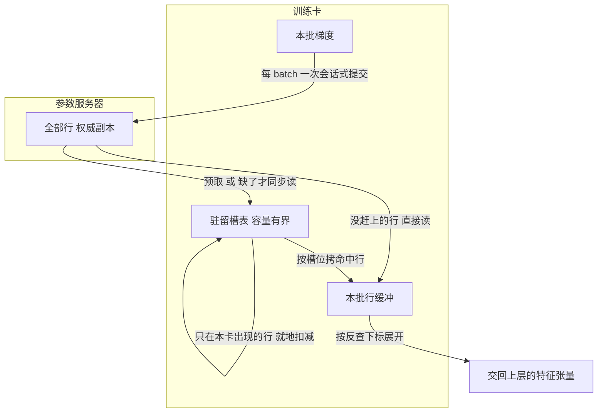
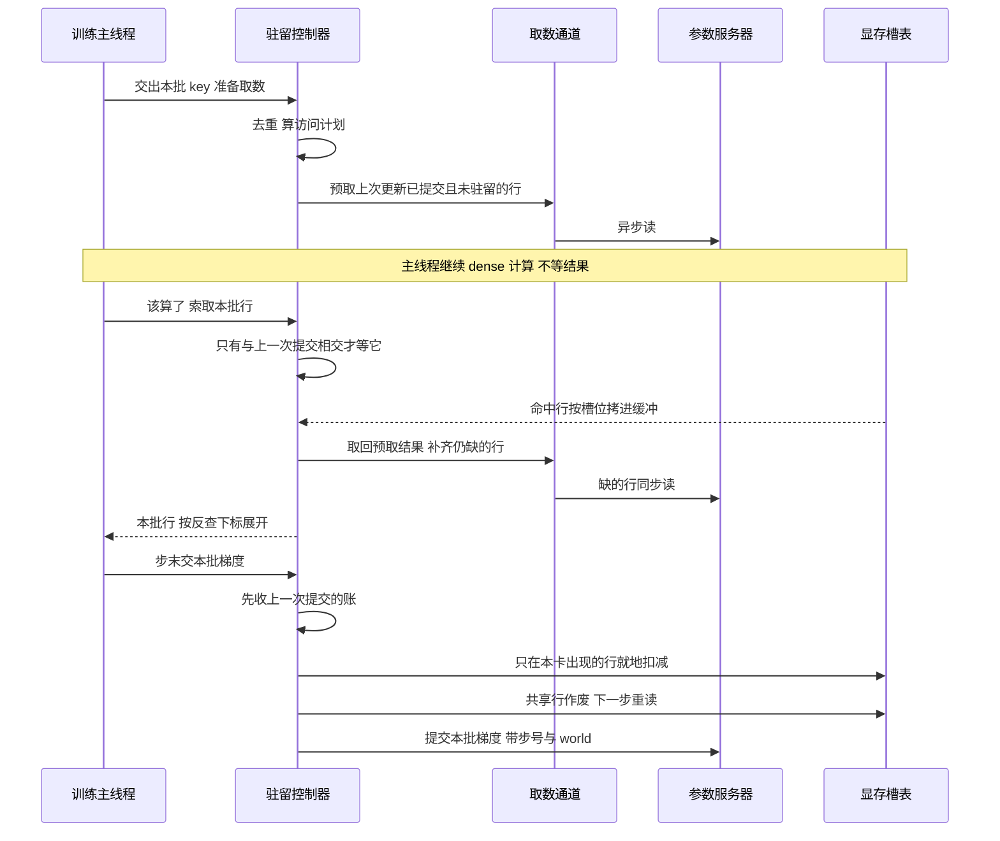
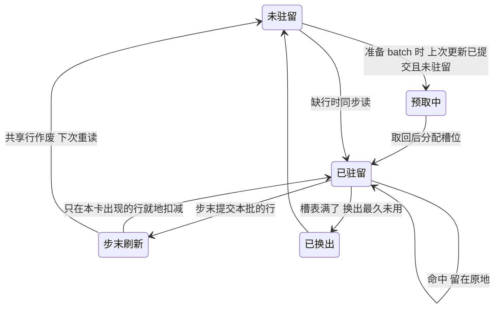

一个 batch 只碰到稀疏表里很小一段行，可这一段每步都要取。BagPipe 把这段行留在训练卡上，把取数提前到上一个 batch 还没算完的时候，同时让参数服务器继续独占所有权。这一页讲它省掉了什么、行具体存在哪里，以及两套同名实现为什么不能混着读。

## 它是什么

先看量级。举例：一个 batch 要取 4096 行，每行 128 个浮点，合起来约 2 MiB；而一张表可能有一亿行，本地只可能留其中很小一段。BagPipe 就是把这一小段留在卡上，参数服务器仍然持有全部行。

一个 batch 的行，哪些在卡上，哪些在参数服务器？



两条从参数服务器出发的箭头是真的跨进程：一条把行补进驻留槽表，一条把没赶上的行直接补进本批缓冲。往回的箭头也只有一条，梯度按 batch 汇总后一次提交。槽表上那个自环不外发，只有整行只在本卡出现、没人跟它抢写时才允许走。

同一个 batch 里，读和写各在什么时候发生？



读在第一段就发出去了，但要到主线程真的需要行时才收货，中间那段正好留给 dense 计算。写发生在步末，最后那条跨进程箭头才是提交本批梯度；提交之前那次等待只是在收上一个 batch 的结果，不发新请求。收账之后分成两拨：只在本卡出现的行就地扣减，多卡共享的行直接作废，下一步重新读。

仓库里有两套同名实现。一套是生产路径，行副本在训练卡上，淘汰时直接丢弃；另一套只在测试里用，控制在 C++ 侧的 GPU 缓存，淘汰时要把改过的行写回去。下面把它们分开写。

## 它为什么存在

全量同步取不可行：一步几千行、上千步，取数延迟会直接压在训练主线程上。可本地缓存一上来就要回答三个问题，每个答错都会读错数据——什么时候可以提前取，取早了会拿到还没提交的旧值；缓存满了丢谁，丢掉的行如果本地改过就丢了更新；多张卡都贡献过梯度的行归谁写，两张卡同时写就是后写覆盖前写。

生产路径对这三个问题给了同一套答案：只预取上次更新已经提交的 key；淘汰时直接丢弃，因为参数服务器才是权威；共享行交给参数服务器聚合，客户端只负责作废重读。测试路径答得不一样：本地先按梯度改，脏行在淘汰或关闭时回写，回写按卡分片指定唯一写者。

代价是显存和顺序。驻留字节按 `cache_capacity × 64 × embedding_dim × 4` 估：容量单位数、每单位 64 行、每行维度、每个浮点 4 字节，四项相乘。举例：默认容量单位 160 000、128 维，就是约 4.9 GiB。在飞预取最多 4 个，超出就跳过，交给同步读补。提交必须每 batch 一次、按步号有序，乱一步直接失败，不会替你重排。

一行数据在驻留里会经过哪些状态？



离开「已驻留」只有三条路：步末提交后按独占与共享分叉、槽表满了换出最久未用、以及被作废等下次重读。命中是唯一不改变状态的动作；换出之后行还在参数服务器上，所以「换出」回到的是未驻留，不是丢失。

## 它和谁接

上游是[第 3 块](./read-path)的读策略：生产路径把预取那一支换成驻留会话，key 的编码与融合方式不变。下游是[第 4 块](./write-path)的提交与[第 03 章](../ch03/)的 `SparseGradientCommit` 接口——那条接口就是「交一批 key 与梯度，换回服务端已提交到第几步」；预取占用的槽位来自[第 04 章](../ch04/)，那份容量直接限制了在飞预取的数量。

它没有替换整个读写：一个 batch 仍然是一份 key、一次提交。换掉的只是行放在哪里——从每次现取，变成先留一份。开关也是分开的，开这个读策略不会顺带打开 C++ 侧那张 GPU 缓存。

## 代码位置

要改代码时再看这里。正文只写概念，符号与路径收在下面的表里。

### 两套实现的分界

| 项 | planned | TTL / mixin |
| --- | --- | --- |
| 文件 | `bagpipe_cache/planned.py` | `bagpipe_cache/controller.py` + `prefetch.py` / `eviction.py` / `grads.py` / `comm.py` |
| 使用者 | **生产**：`plugin.py` 显式 `from .planned import`，`__init__.py` 也只导出它 | 只有 `unittest/test_bagpipe_cache.py` 直接导入（`optimizer.py` 仅在 `TYPE_CHECKING` 下引用） |
| 缓存位置 | Python 张量 `_values`（`capacity_rows = cache_capacity * 64`）+ C++ `CacheMetadata` 槽表 | C++ `framework/cache/gpu_embedding_cache`（`query_gpu_cache` / `prefill_gpu_cache_no_evict` / `apply_sgd_update_gpu_cache_best_effort`） |
| 写回 | 不回写；PS 每步拥有 SGD（sparse commit） | dirty 标记 + 淘汰/关闭时 `emb_write_values` 回写 |
| 预取闸门 | `previous_update <= committed` 且不在缓存 | `_cached_dev & (_ttl_dev >= batch_num)`，未命中才发 |
| 淘汰 | `CacheMetadata` LRU 槽表，行直接丢弃 | TTL 过期 + 容量高水位，先回写 dirty |
| 一致性护栏 | 无（不拥有 C++ cache） | `_check_gpu_cache_generation` |

因此读上游那份缓存文档要注意它的边界：

| 结论 | 依据 |
| --- | --- |
| 该文只讲 planned 的"启用 / 每步流程 / 容量"，讲的是"PS 拥有参数、淘汰丢弃干净行"，**没有**把两套实现混写 | `docs/architecture/bagpipe_cache.md` |
| 生产开这个读模式**不会**自动打开 C++ 侧那张 GPU 缓存 | `read_mode=bagpipe`、`enable_gpu_cache` |
| runner 只把容量传给它，默认兜底 `160_000`，其余缓存参数仍归通用路径 | `cache_capacity` |
| generation / no-evict / best-effort SGD 只在 TTL 与显式开启的路径里生效 | `KVClient.enable_gpu_cache()` |

### 挂载点

| 位置 | 换掉了什么 | 符号 |
| --- | --- | --- |
| 读 | 预取读策略换成驻留会话 | `BagPipeReadPath` 替掉 `PrefetchReadPath` |
| 写 | 优化器换成按 step 提交的版本，step 里直接调 `update_grads` | `BagPipeSparseSGD` 替掉 `SparseSGD` |

### planned：一次 batch 的四个动作

| 动作 | 做什么 | 入口 |
| --- | --- | --- |
| 准备 | 取融合 id、去重，留下反查下标 | 注入的 `_id_extractor`；`BagPipeReadPath.on_batch_prepared` → `BagPipePlugin.on_prepare` → `controller.enqueue(sparse_features)`；融合 id 由 `values.view(F, -1) + fused_id_prefixes[:, None]` 广播加法得到，失败回退 `convert_kjt_ids_to_fused_ids_device`，`torch.unique` 得 `(ids_dev, inverse_dev, raw_count)` 作为 ticket |
| 盘计划 | 算每个 key 被哪些卡用到、哪些行只在单卡出现、上次更新在第几步 | `_make_plan`（prescan 时由 `finalize_prescan` 一次性建好）：`active` 是各 rank unique ID 并集、`counts` 是出现该 key 的 rank 数、`exclusive = counts[local_rows] == 1`；`metadata.previous(step, unique_ids, active)` 给出上次更新步 |
| 预取 | 只发"上次更新已提交且当前未驻留"的 key | `metadata.prefetch(...)`；在飞数受 `max_inflight_prefetch = min(4, lookahead)` 限制 |
| 消费 | 依赖相交才等上个提交；命中拷行；对齐预取结果；缺行同步读；准入 | `before_lookup` → `on_consume` → `prefill_cache`：相交才 `_wait_pending()`，否则跳过并记 `bagpipe_dependency_wait_skipped`；`metadata.lookup` 命中行 `index_copy_` 到 `rows`；`wait_and_get` 后用 `searchsorted` 对齐缺失 key；仍缺的同步 `pull`；最后 `metadata.admit(unique_ids[missing])` 分配槽位并写 `_values` |
| 展开 | 按反查下标取行，按特征主序改写形状 | `lookup(sparse_features)`：`rows.index_select(0, inverse)` 展开成 `[B*F, D]` 再 reshape，返回 `KeyedTensor`；**不走 `EBC.forward`**，由 runner 直接调 `plugin._controller.lookup(...)` |

### 驻留、淘汰与会话

| 项 | 规则 | 代码里的名字 |
| --- | --- | --- |
| 容量单位 | 一个单位 64 行；容量行数等于单位数乘 64，与槽表槽位数一致 | `cache_capacity`、`_capacity_rows = cache_capacity * 64` |
| 驻留字节 | 单位数 × 64 × 维度 × 4；批次张量与 prescan 计划另占 | `bagpipe_resident_bytes = _values.numel() * 4` |
| 与 C++ 缓存的关系 | 那边的 capacity 也是 set 数，每 set 的 entry 数正好 64；两者不是同一个对象，只在"64 行/单位"上刻意对齐 | `src/storage/gpu_cache/nv_gpu_cache.hpp#SET_ASSOCIATIVITY` × `SLAB_SIZE` |
| 槽表 | key 到"槽位 + LRU 位置"，另有空闲槽表与最近更新表 | `entries_`、`free_`、`lru_`、`last_update_` |
| 命中 | 拷进本批缓冲，并把该行挪到 LRU 尾 | `Lookup` 里的 `splice` |
| 准入 | 先用空闲槽 `free_`，再用 `next_slot_` 递增发的新槽，最后换出 LRU 头；发生在读取之后，被换出的行直接丢弃，没有脏标记、没有回写 | `Admit` |
| 超大 batch | 同一个槽只保留最后一个源行，保证下游写目标唯一 | `destinations[slot] = i` |
| 会话 | 随机 63 位整数，跨 rank 广播；每 batch 恰好一次有序提交，`batch_num` 必须同时等于当前 batch 与已更新计数 | `_session`、`update_grads`（`batch_num == _current_batch == _updated`） |
| 关闭 | `shutdown(flush=True)` 先等最后提交再 `sparse_gradient_commit_close`；`shutdown(flush=False)` 用 `kind=3` 中止 | `shutdown` |

### TTL 实现与 C++ 缓存的边界

TTL 版把"驻留"做成四张按 compact id 索引的 GPU 平铺张量：

| 张量 | 记什么 |
| --- | --- |
| `_latest_dev` | 最近被 enqueue 的 batch 号 |
| `_ttl_dev` | 过期 batch 号；0 表示已过期或不在缓存 |
| `_cached_dev` | 镜像认为"在 C++ GPU cache 中" |
| `_dirty_dev` | 本地 SGD 已应用，但还没回写 PS |

索引按下面的映射压紧：表序号挪到高位，行号留在低位。位移量取最大表容量的下一个 2 的幂，避免按原始 fused id 开数组导致 OOM。

```text
compact = ((fused >> fuse_k) << _bk_shift) + (fused & ((1<<fuse_k)-1))
```

它自己的五条规则：

- 预取：命中续期到 `_latest_dev + _ttl_margin`（默认 256）；`_max_inflight_prefetch = 4`，超出则跳过，交给同步 lookup 回填。
- 淘汰：`schedule_cleanup` 在 `cleanup_interval`（8）步、容量高水位（0.9）或插入失败时置 pending；真正的 `_run_cleanup` 在 `prefill_cache` 的安全点执行，先扫 TTL 过期再按容量/失败回收，单次上限 `_max_evict_per_cleanup=4096`，剩余留到下一次。
- 回写：`_evict_entries` 对 resident 且 dirty 的行先在 eviction stream 上 `gpu_cache_lookup_flat` 读值，`event.synchronize()` 后 `emb_write_values`（逐 key invalidate），成功才清 dirty；clean 行直接 `invalidate_gpu_cache_with_mask`。写回失败保留行和 dirty，下次重试。
- 单一写者：shutdown flush 时共享行按"在排序后的 shared set 中的位置 % world"分给唯一 rank 回写，本地行由各自 rank 回写，避免两个 rank 同时 `emb_write_values`（last-writer-wins 丢增量）。
- 一致性护栏：`_check_gpu_cache_generation` 比较 `get_gpu_cache_generation()` 与构造时快照，一旦别人 `clear/reset/disable` 了 C++ cache 就直接抛错。

C++ 侧 GPU cache 自己的边界，四条：

| 边界 | 说明 | 代码位置 |
| --- | --- | --- |
| 进程级单例 | 一把 `std::mutex`；`EnableGpuCache(capacity, dim, device)` 只在 capacity/dim/device 变化时重建；`ClearGpuCache` 重建但保留 capacity/dim；`ResetGpuCache` 额外重置调用线程的 bypass 状态；generation 在 enable/disable/clear 时递增 | `framework/cache/gpu_embedding_cache.cu` |
| 与上一个操作排序 | 每个操作通过 `g_last_op` 事件与上一个操作排序；`QueryGpuCache` 会 `cudaMemcpyAsync` miss count 并 `cudaStreamSynchronize`，因此 query 有主机同步；`LookupGpuCacheAssumingHits` 与 mutation 只入队 | `g_last_op`、`QueryGpuCache` |
| 只认设备侧 key | `CanUseGpuCache` 要求 keys 是 CUDA、contiguous、1-D int64，且设备与 `dim` 匹配；这就是 `KVClient.pull`（CPU ids）永远不命中该 cache 的原因 | `CanUseGpuCache` |
| profile 计数已移除 | `cache_profile.h` 的计数器已被删除，`GetLastGpuCacheProfile()` 恒返回 0；`sharded_client.get_last_gpu_cache_profile()` 仍把它映射成 8 个 0 值字段，不要把这些 0 当作"没有 miss" | `cache_profile.h`、`sharded_client.get_last_gpu_cache_profile()` |

## 交付一句

生产路径用 planned，TTL 只被测试与显式开启的通用路径碰到。下一块接 ps_pipeline，看这套读写怎么被排成"下一步还没算完就开始取数"。
