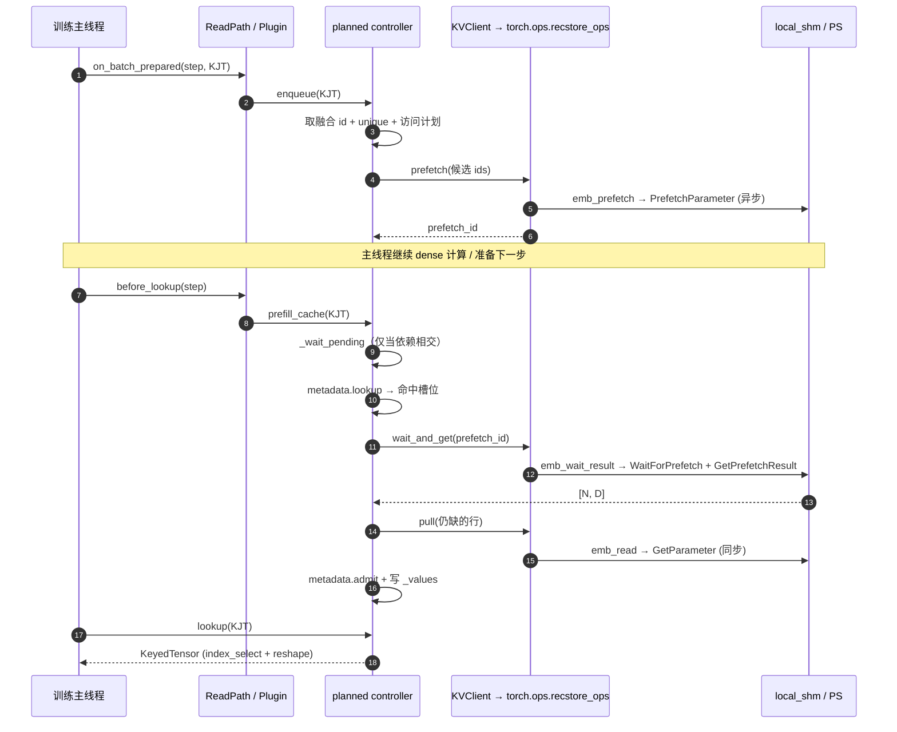
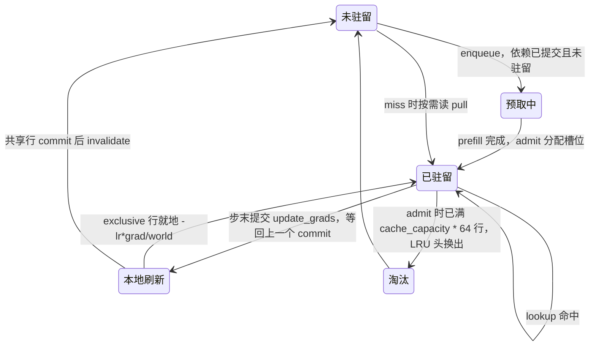

## 它是什么

BagPipe 在客户端内存里放一份有界行副本，把"每次 forward 都去 PS 取"变成"计划内命中 + 提前预取 + 缺了才同步取"，并同时接管梯度提交：每 batch 一次会话式提交，提交后按"哪些行只出现在本 rank"决定哪些行可以就地更新。仓库里有两个同名控制器，行为、缓存位置、写回策略都不同，混着读会得出错误结论。

## 它为什么存在

推荐模型的稀疏表很大，但一个 batch 真正用到的行很少：每步全量去 PS 取撑不住延迟；做本地缓存又要回答三个问题——什么时候可以预取（读到旧值的风险）、缓存满了淘汰谁（丢掉的行怎么办）、共享行谁来更新（多个 rank 都贡献了梯度）。planned 的答案是：只预取"上次更新已提交"的 key、淘汰时直接丢弃（PS 才是权威）、共享行交给 PS 聚合。TTL 的答案是另一套：本地 best-effort SGD、脏行淘汰时回写、回写按 rank 分片保证单一写者。

## 它和谁接

上游是[第 3 块](./read-path)的读路径（`BagPipeReadPath` 替掉 `PrefetchReadPath`）与[第 4 块](./write-path)的优化器（`BagPipeSparseSGD` 替掉 `SparseSGD`），下游是[第 03 章](../ch03/)的 `SparseGradientCommit` 与[第 04 章](../ch04/)的预取 slot 池。

## 代码位置

### 5.1 两套实现的分界

| 项 | planned | TTL / mixin |
| --- | --- | --- |
| 文件 | `bagpipe_cache/planned.py` | `bagpipe_cache/controller.py` + `prefetch.py` / `eviction.py` / `grads.py` / `comm.py` |
| 使用者 | **生产**：`plugin.py` 显式 `from .planned import`，`__init__.py` 也只导出它 | 只有 `unittest/test_bagpipe_cache.py` 直接导入（`optimizer.py` 仅在 `TYPE_CHECKING` 下引用） |
| 缓存位置 | Python 张量 `_values`（`capacity_rows = cache_capacity * 64`）+ C++ `CacheMetadata` 槽表 | C++ `framework/cache/gpu_embedding_cache`（`query_gpu_cache` / `prefill_gpu_cache_no_evict` / `apply_sgd_update_gpu_cache_best_effort`） |
| 写回 | 不回写；PS 每步拥有 SGD（sparse commit） | dirty 标记 + 淘汰/关闭时 `emb_write_values` 回写 |
| 预取闸门 | `previous_update <= committed` 且不在缓存 | `_cached_dev & (_ttl_dev >= batch_num)`，未命中才发 |
| 淘汰 | `CacheMetadata` LRU 槽表，行直接丢弃 | TTL 过期 + 容量高水位，先回写 dirty |
| 一致性护栏 | 无（不拥有 C++ cache） | `_check_gpu_cache_generation` |

因此读 `docs/architecture/bagpipe_cache.md` 要注意它的边界：该文已重写为 planned 的"启用 / 每步流程 / 容量"，讲的是"PS 拥有参数、淘汰丢弃干净行"，**没有**把两套实现混写。生产 `read_mode=bagpipe` 也**不会**自动 `enable_gpu_cache`；runner 只把 `cache_capacity`（默认兜底 `160_000`）传给 planned controller。C++ GPU cache 的 generation / no-evict / best-effort SGD 只在 TTL 与显式 `KVClient.enable_gpu_cache()` 路径里生效。

### 5.2 planned runtime 的读与驻留

四步读流程：

1. `BagPipeReadPath.on_batch_prepared` → `BagPipePlugin.on_prepare` → `controller.enqueue(sparse_features)`：用注入的 `_id_extractor` 取融合 ID（runner 用 `values.view(F, -1) + fused_id_prefixes[:, None]` 的广播加法，失败则回退 `convert_kjt_ids_to_fused_ids_device`），`torch.unique` 得 `(ids_dev, inverse_dev, raw_count)` 作为 ticket。
2. 访问计划：`_make_plan`（prescan 时在 `finalize_prescan` 一次性建好）给出 `active` = 各 rank 该 batch unique ID 并集、`counts` = 出现该 key 的 rank 数、`exclusive = counts[local_rows] == 1`，`metadata.previous(step, unique_ids, active)` 返回每个 key 上次被更新的 step。预取只发 `metadata.prefetch(...)` 认为"上次更新已提交且当前不在缓存"的 key，在飞数受 `max_inflight_prefetch = min(4, lookahead)` 限制。
3. `before_lookup` → `on_consume` → `prefill_cache`：上一步 PS commit 与当前 batch `previous_update` 有交集才 `_wait_pending()`，否则跳过（`bagpipe_dependency_wait_skipped`）；`metadata.lookup` 命中行 `index_copy_` 到 `rows`；预取结果 `wait_and_get` 后按 `searchsorted` 对齐缺失 key；仍缺的同步 `pull`；`metadata.admit(unique_ids[missing])` 分配槽位（LRU 淘汰）并写入 `_values`。
4. `lookup(sparse_features)`：`rows.index_select(0, inverse)` 展开成 `[B*F, D]`，按特征主序 reshape → `KeyedTensor`。**不走 `EBC.forward`**，是 runner 里 `plugin._controller.lookup(...)` 的直接调用。

驻留与淘汰的规则：

- **容量单位**：`cache_capacity` 以 64 行为单位，`_capacity_rows = cache_capacity * 64`（与 `CacheMetadata` 的 slot 数一致）。**驻留字节** = `cache_capacity × 64 × embedding_dim × 4`（`bagpipe_resident_bytes = _values.numel() * 4`），批次张量与 prescan 计划另占。C++ GPU cache 的 capacity 也是 set 数（`src/storage/gpu_cache/nv_gpu_cache.hpp#SET_ASSOCIATIVITY` × `SLAB_SIZE`，即每 set 64 个 entry），两者不是同一个对象，只在"64 行/单位"上刻意对齐。
- **槽表与准入**：`CacheMetadata` 维护 `entries_`（key → slot + LRU iterator）、`free_`、`lru_`、`last_update_`。`Lookup` 命中 `splice` 到 LRU 尾；`Admit` 优先 free slot，其次 `next_slot_`，最后淘汰 LRU 头；超大 batch 用 `destinations[slot] = i` 只保留每个 slot 的最后一个源行，保证下游 `index_copy_` 目标唯一。准入发生在读取（prefetch + demand pull）之后，被淘汰的行直接丢弃——没有 dirty 标记、没有回写，PS 才是权威。
- **会话**：`_session` 是随机 63 位整数并跨 rank 广播；`update_grads` 严格检查 `batch_num == _current_batch == _updated`，保证每 batch 恰好一次有序提交。`shutdown(flush=False)` 用 `kind=3` abort，`flush=True` 先等最后提交再 `sparse_gradient_commit_close`。

读图提示：离开"已驻留"只有三条路——命中留在原地、步末提交按 exclusive / 共享分叉、缓存满时淘汰 LRU 头；TTL 路径的差异只在 5.3 与对照表里，不在本图。

### 5.3 TTL / mixin runtime 与 C++ cache 边界

TTL 版把"驻留"做成四张按 compact id 索引的 GPU 平铺张量：`_latest_dev`（最近被 enqueue 的 batch 号）、`_ttl_dev`（过期 batch，0 表示已过期/不在缓存）、`_cached_dev`（镜像认为"在 C++ GPU cache 中"）、`_dirty_dev`（本地 SGD 已应用但未回写 PS）。compact 映射是 `compact = ((fused >> fuse_k) << _bk_shift) + (fused & ((1<<fuse_k)-1))`，`_bk_shift` 取最大表容量的下一个 2 的幂，避免按原始 fused id 开数组导致 OOM。

- 预取：命中续期到 `_latest_dev + _ttl_margin`（默认 256）；`_max_inflight_prefetch = 4`，超出则跳过，交给同步 lookup 回填。
- 淘汰：`schedule_cleanup` 在 `cleanup_interval`（8）步、容量高水位（0.9）或插入失败时置 pending；真正的 `_run_cleanup` 在 `prefill_cache` 的安全点执行，先扫 TTL 过期再按容量/失败回收，单次上限 `_max_evict_per_cleanup=4096`，剩余留到下一次。
- 回写：`_evict_entries` 对 resident 且 dirty 的行先在 eviction stream 上 `gpu_cache_lookup_flat` 读值，`event.synchronize()` 后 `emb_write_values`（逐 key invalidate），成功才清 dirty；clean 行直接 `invalidate_gpu_cache_with_mask`。写回失败保留行和 dirty，下次重试。
- 单一写者：shutdown flush 时共享行按"在排序后的 shared set 中的位置 % world"分给唯一 rank 回写，本地行由各自 rank 回写，避免两个 rank 同时 `emb_write_values`（last-writer-wins 丢增量）。
- 一致性护栏：`_check_gpu_cache_generation` 比较 `get_gpu_cache_generation()` 与构造时快照，一旦别人 `clear/reset/disable` 了 C++ cache 就直接抛错。

C++ 侧 GPU cache 自己的边界，四条：

- `gpu_embedding_cache.cu` 是**进程级单例**，一把 `std::mutex`；`EnableGpuCache(capacity, dim, device)` 改变 capacity/dim/device 才重建，`ClearGpuCache` 重建但保留 capacity/dim，`ResetGpuCache` 额外重置调用线程的 bypass 状态。generation 在 enable/disable/clear 时递增。
- 每个操作通过 `g_last_op` 事件与上一个操作排序；`QueryGpuCache` 会 `cudaMemcpyAsync` miss count 并 `cudaStreamSynchronize`，因此 query 有主机同步；`LookupGpuCacheAssumingHits` 与 mutation 只入队。
- `CanUseGpuCache` 要求 keys 是 CUDA、contiguous、1-D int64，且设备与 `dim` 匹配——这就是 `KVClient.pull`（CPU ids）永远不命中该 cache 的原因。
- `cache_profile.h` 的 profile 计数器已被移除，`GetLastGpuCacheProfile()` 恒返回 0；`sharded_client.get_last_gpu_cache_profile()` 仍把它映射成 8 个 0 值字段，不要把这些 0 当作"没有 miss"。

## 交付一句

planned 是生产路径、TTL 是测试路径、C++ cache 只被后者与通用路径触碰。下一块接 ps_pipeline，看这套读写怎么被排成"下一步还没算完就开始取数"。
