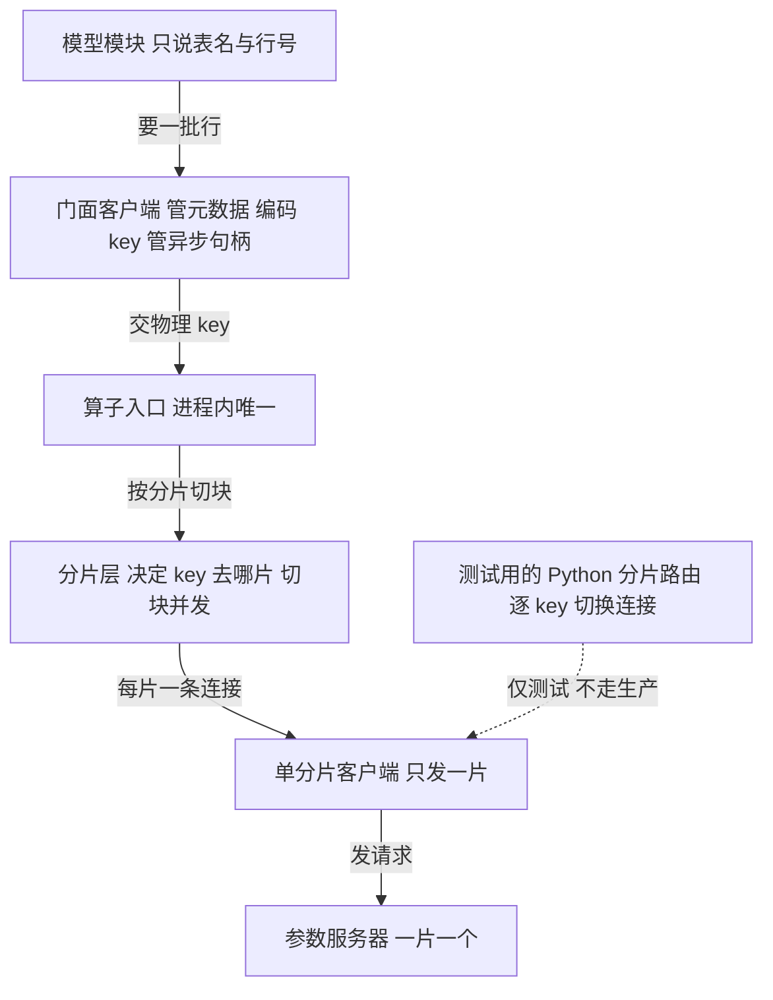

训练代码里摸到的只是一个客户端对象，但一个进程里其实叠着好几层：门面、入口、分片层、单分片连接。这一页回答每层各自管什么、key 在哪一层被改、以及多分片到底在 Python 还是在 C++。

## 它是什么

举例：40 张表、单机 8 卡、每卡 4 个分片的一个任务，一次 forward 进来 300 万条 key。模型代码只做一件事——按表名要行。剩下的转手都在本进程里，直到最后一次才出门。

第一层是门面：它记着每张表的形状与身份，把行号换成存储层认的 key，管住那些还没收尾的异步句柄，也管把表存成 checkpoint。第二层是算子入口，进程内只有一份。第三层是分片层，负责把一批 key 拆到各个分片、并发发出、再把结果拼回原序。第四层最薄：只面对一个分片发请求。一个进程里到底叠了几层，哪一层真的出门？



从上往下是四次转手：模型只认表名，门面把表名换成物理 key 并记下句柄，算子入口拿到 key 后交给分片层切块，最后由单分片客户端发出去。只有最下面那条箭头跨进程，上面几条全在训练进程里完成。虚线那条是 Python 侧的旧实现，它把 key 一条条转成 Python 整数再分组，生产路径不走它。

## 它为什么存在

门面不能是薄封装，因为有三件事必须有唯一的地方做：表身份藏在 key 里，编码规则只能有一份；模型代码不该知道后端是 RDMA 还是 gRPC；异步句柄得有人记着哪一个还欠一次收尾。任何一件散落到模型层，都会慢慢变成两套实现。那行号是怎么变成存储层只认的那个 64 位值的？


第一步在适配层做，把多张表的行号拼进同一个键空间；第二步在门面客户端做，把表身份压进最高 8 位。顺序不能反——先融合再打 tag，反过来加表序号会进位到 tag 那 8 位里。中间那 56 位是硬边界，融合后的行号越过它，就会和 tag 争同一批位。

分片放在 C++ 里也是性能决定的：C++ 扫一遍整批 key 就切好块、按块并发发出；放在 Python 里要逐条转成 Python 整数再分组，是随 key 数线性增长的主机循环，几百万条 key 就是几百万次解释器往返。代价是 Python 侧调试只能看一层壳，分片行为要去 C++ 里追。

## 它和谁接

上游是模型层的适配模块，它们给出表名与行号。下游是[第 1 块](./op-entry)的算子入口。同一个门面还被三处复用：读路径、优化器、BagPipe——一个要读、一个要交梯度、一个要驻留会话。

## 代码位置

要改代码时再看这里。

| 职责 | 入口 |
| --- | --- |
| 门面：元数据、编码、读写、异步句柄 | `src/python/pytorch/recstore/KVClient.py#RecStoreClient` |
| Python 侧多分片路由（仅测试） | `sharded_client.py#ShardedRecstoreClient` |
| 读策略协议：direct / prefetch / bagpipe | `embedding_read_path.py#build_embedding_read_path` |
| 稀疏优化器与 trace 归并 | `optimizer.py#SparseSGD`、`#BagPipeSparseSGD`（`bagpipe_cache/optimizer.py`） |
| 旧式模块与远端表句柄 | `DistEmb.py#DistEmbedding`、`DistTensor.py#DistTensor` |
| 单机多卡 ID/行/梯度交换 | `single_node_exchange.py#exchange_lookup_ids`、`#exchange_sparse_grads` |

调用关系分三层：

- 读路径调 `pull` 与 `prefetch`。
- 优化器调 `update_async`、`local_update_flat`、`sparse_gradient_commit_async`。
- 上游是 `EmbeddingBag`、`DistTensor` 这类适配模块，它们只给出表名与行号。

另几个模块不算门面的一部分，各管一件事：单机多卡的行与梯度交换、梯度归一化与 top-k、特征主序的 ticket、分片路由。

**key 的编码。** 三层叠加：

```text
fused_id   = (table_idx << fusion_k) | feature_row_id      # torchrec_kv 融合
physical   = fused_id | (table_tag << 56)                  # KVClient._encode_ids
tag        = init_embedding_table() 返回的 backend tag     # 0 是合法 tag
```

三条约束：

1. 行号只占低 56 位（`_KEY_TAG_SHIFT = 56`），`framework/common/owner_merged_plan.h` 里给 C++ 侧用的 `kLogicalLimit = 1 << 56` 是同一约定。
2. 编码是幂等的（`_encode_ids`）：全带目标标签就直接返回，带别的非零标签则抛错，全 0 时才把标签或进去。
3. GPU 缓存保留两个哨兵 key（`int64.max` 与 `int64.max - 1`），`_reject_gpu_cache_reserved_ids` 在 CUDA 编号或 `RECSTORE_VALIDATE_GPU_CACHE_KEYS=1` 时检查。

**表元数据。** 每个张量表记一份 `_tensor_meta[name]`，字段是 `shape / dtype / base_offset / tag / table_id / backend_initialized / part_policy`：前四个决定这张表怎么寻址，后两个记后端状态。

| 字段 | 含义 |
| --- | --- |
| `shape` / `dtype` | 形状与类型 |
| `base_offset` | 基址偏移 |
| `tag` / `table_id` | 标签与表号 |
| `backend_initialized` / `part_policy` | 后端是否已建表、分片策略 |

登记规则三条：

| 情形 | 规则 |
| --- | --- |
| 表号 | `_next_table_id` 单调递增发放 |
| 首次注册 | `register_tensor_meta(backend_table_id=...)` 要求 `initialize_backend=True` |
| 重复注册 | 形状、类型、基址偏移、表号四项必须完全一致，否则 `ValueError` |

**分片与设备边界。** 三条：

- 生产 runner 不构造 `ShardedRecstoreClient`：多分片路由由 C++ `DistributedShardedClient` 在 `BasePSClient` 内部完成。Python 版本只在 `src/test/model_zoo/rs_demo/test_recstore_distributed.py` 出现，不能与 native 分片同时使用。
- `ShardedRecstoreClient.emb_read` 的 `keys.tolist()` 是逐 key 主机同步；`_activate_shard` 在非 native 且非 local_shm 时调 `set_ps_config` 重建 PS 客户端。这是它的性能/正确性边界。
- 返回设备：非 cache 路径先在 pinned CPU 读再 `to(device, non_blocking=True)`；`emb_wait_result` 返回 CPU 张量（`from_blob` 持有 `RecTensor` 的 shared_ptr），`wait_and_get` 再按需 `.to(device)`。

## 交付一句

key 的形状固定了，客户端只有一个，生产路径的分片在 C++ 里。下一块接读路径，看这些 key 怎么被取回来。
