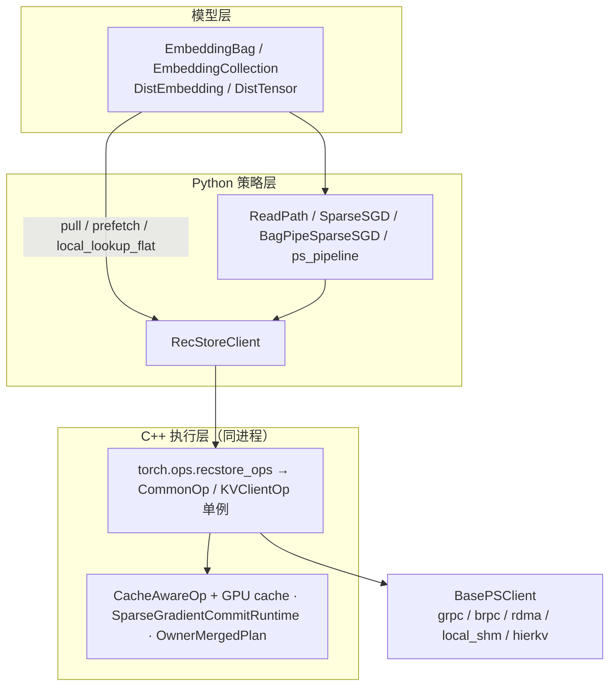

## 它是什么

计算层是"Python 策略 + C++ 执行 + 可替换后端"的三段式。模型侧的每一次读、写、预取都收敛到一个算子命名空间：只有一处 `TORCH_LIBRARY(recstore_ops, m)` 注册点，按 op family 拆成多个 `Register*Ops`。C++ 侧再把算子分派到进程内唯一的运行时对象 `KVClientOp` 上。

`KVClientOp` 是进程内单例：多个 Python client 对象、多个模型模块最终共用同一个 PS 客户端。`ShardedRecstoreClient` 不在生产路径上（[第 2 块](./client-shard)说明）。

## 它为什么存在

Python 层负责策略（走哪条读路径、要不要压缩梯度、用哪个优化器），不改 C++ 就能换；C++ 层负责执行（张量校验、pinned staging、CUDA 事件、缓存编排），放在 Python 太慢；后端层负责传输，同一个 `KVClientOp` 下面可以是 gRPC、bRPC、RDMA 或共享内存。命名空间只有一个，是因为 Torch 自定义算子按命名空间聚合；按 family 拆注册函数只是为了让文件不至于失控。

## 它和谁接

上游是[第 3 块](./read-path)、[第 4 块](./write-path)的两条链路（都从这里进 C++），下游是[第 03 章](../ch03/)的传输实现。本章只讲到 `BasePSClient` 的接口边界。

## 代码位置

| 职责 | 入口 |
| --- | --- |
| 唯一算子注册点 | `src/framework/pytorch/op_torch.cc#TORCH_LIBRARY(recstore_ops, m)` |
| op 抽象与进程内单例 | `src/framework/op.h`、`src/framework/op.cc#GetKVClientOp` |
| 配置定位与后端解析 | `src/framework/common/op_runtime_support.cc#GetGlobalConfig`、`ps_client_config_adapter.cc#ResolveFrameworkPSClientType` |
| local_shm flat 读/更新与借出 lease | `src/framework/common/local_shm_kv_client_op.cc`、`src/framework/pytorch/op_flat.cc` |
| cache-aware 执行与 GPU cache | `src/framework/cache/cache_aware_op.h`、`gpu_embedding_cache.{h,cu}`、`src/framework/pytorch/cache/*` |
| 稀疏提交、owner 计划、profile | `src/framework/common/sparse_gradient_commit_runtime.h`、`owner_merged_plan.h`、`src/framework/pytorch/op_profile.cc` |

日常路径的调用形状只有三类：同步读（`emb_read` 及 `_into` 变体）、异步预取（`emb_prefetch` + `emb_wait_result` 一对句柄）、写（`emb_write` 整行覆盖、`emb_update_table` 按梯度更新）。local_shm 另有一组 flat 变体，语义相同但绕开压缩包编码；其余是控制类：稀疏提交 v1/v4、GPU cache 的 enable/clear/query/fill、BagPipe 元数据、profile 读取。逐文件清单见章末附录。

## 交付一句

入口只有一处注册点，下面挂着一个进程内单例。下一块接客户端与分片，讲清这个单例怎么被持有，以及 key 在进 C++ 之前被改成了什么。
