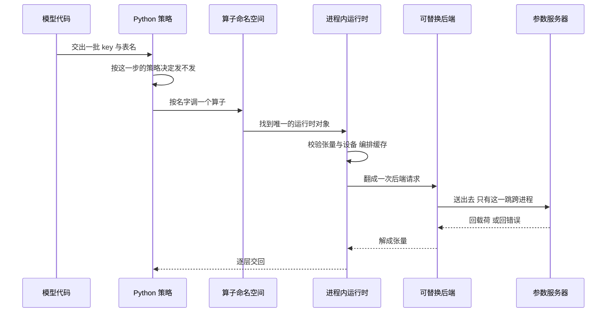
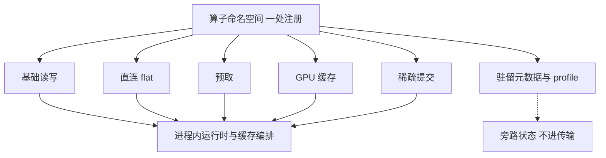

模型里的一次取行、一次写回、一次预取，到了底层都是同一个命名空间里的一个函数调用。这一页回答三件事：这次调用在进程内经过哪几层、哪一步才真的跨进程、换策略与换后端分别要动哪一层。

## 它是什么

举例：一个融合过的 batch 有 16 个特征、批大小 4096、每条样本每个特征约 120 个 id，合起来约 780 万条 key。模型侧看到的是「一次读」；网络上跑的是按块发的批量请求——单块默认上限 500 条 key，所以是上万次，而不是每条 key 一次。一次反向攒下的几十万条记录也一样，按表压成几次提交。

三段接起来：Python 决定策略，C++ 做执行，末段只管把请求送到对端。接缝只有一个——一个命名空间，按名字找实现。那么一次调用在这条链上怎么走？

从模型交出 key 到翻成一次后端请求，全在训练进程内，只是换了个函数。真正出门的只有「送出去」那一跳：运行时把请求交给参数服务器，回程走同一条连接。所以会因网络变慢、会以超时或连接错误收场的只有这一跳；上面几步失败只可能是参数或设备不对。

这个命名空间下面挂了什么？按用途分成七族，查代码时按族找文件。

前五族是热路径，落到进程内那几个执行对象上；后两族碰本地状态，不进传输路径。整张图仍没有一根线跨进程：前五族在本地跑完，出门在运行时把请求交给后端之后。

## 它为什么存在

三段分开，是因为三种东西变的速度不同：策略一个实验改一次，执行一改要重编扩展，传输只在换部署时才换。执行留在 C++ 还因为一次读要校验张量与设备、把 key 暂存到固定内存、挂事件保证搬完、再编排缓存——每 batch 做几万次，放 Python 就是解释器开销。

一个注册点也是被 Torch 逼出来的：自定义算子按命名空间聚合，两处注册会变成同名覆盖，谁先加载谁生效。按族拆的是注册函数，不是命名空间。代价是加算子要重编，Python 侧只看到签名。

| 层 | 它独自决定的事 | 改它要动什么 |
| --- | --- | --- |
| Python 策略 | 何时发起、批量多大、失败退到哪条路 | 只改 Python，不重编 |
| C++ 执行 | 校验、暂存、事件、缓存编排 | 重编扩展 |
| 可替换后端 | 请求怎么送到对端 | 换配置或换实现，上面两层不动 |

## 它和谁接

上游是[第 3 块](./read-path)的读和[第 4 块](./write-path)的写，两条链路都在这里进 C++；持有这个运行时的是[第 2 块](./client-shard)的门面客户端。下游是[第 03 章](../ch03/)的传输实现——gRPC、bRPC、RDMA、共享内存四种接在同一个运行时后面，报文细节归下一章。

## 代码位置

要改代码时再看这里。

| 职责 | 入口 |
| --- | --- |
| 唯一算子注册点 | `src/framework/pytorch/op_torch.cc#TORCH_LIBRARY(recstore_ops, m)` |
| op 抽象与进程内单例 | `src/framework/op.h`、`src/framework/op.cc#GetKVClientOp` |
| 配置定位与后端解析 | `src/framework/common/op_runtime_support.cc#GetGlobalConfig`、`ps_client_config_adapter.cc#ResolveFrameworkPSClientType` |
| local_shm flat 读/更新与借出 lease | `src/framework/common/local_shm_kv_client_op.cc`、`src/framework/pytorch/op_flat.cc` |
| cache-aware 执行与 GPU cache | `src/framework/cache/cache_aware_op.h`、`gpu_embedding_cache.{h,cu}`、`src/framework/pytorch/cache/*` |
| 稀疏提交、owner 计划、profile | `src/framework/common/sparse_gradient_commit_runtime.h`、`owner_merged_plan.h`、`src/framework/pytorch/op_profile.cc` |

**进程内单例**：多个 Python client 对象、多个模型模块最终共用同一个 PS 客户端。`ShardedRecstoreClient` 不在生产路径上（[第 2 块](./client-shard)说明）。

**注册怎么拆**：唯一的那处注册块里按族调用 `Register*Ops`，每族一个翻译单元，所以加 op 只需动对应文件。本章只讲到 `BasePSClient` 的调用边界，报文与传输见第 03 章。

**日常路径的调用形状只有三类**，各对应一组算子：

- 同步读：`emb_read` 及 `_into` 变体。
- 异步预取：`emb_prefetch` 加 `emb_wait_result`，一对句柄。
- 写：整行覆盖走 `emb_write`，按梯度更新走 `emb_update_table`。

local_shm 另有一组 flat 变体，语义相同但绕开压缩包编码；其余是控制类：稀疏提交 v1/v4、GPU cache 的 enable/clear/query/fill、BagPipe 元数据、profile 读取。逐文件清单见章末附录。

## 交付一句

入口只有一处注册点，下面挂着一个进程内单例。下一块接客户端与分片，讲清这个单例怎么被持有，以及 key 在进 C++ 之前被改成了什么。
