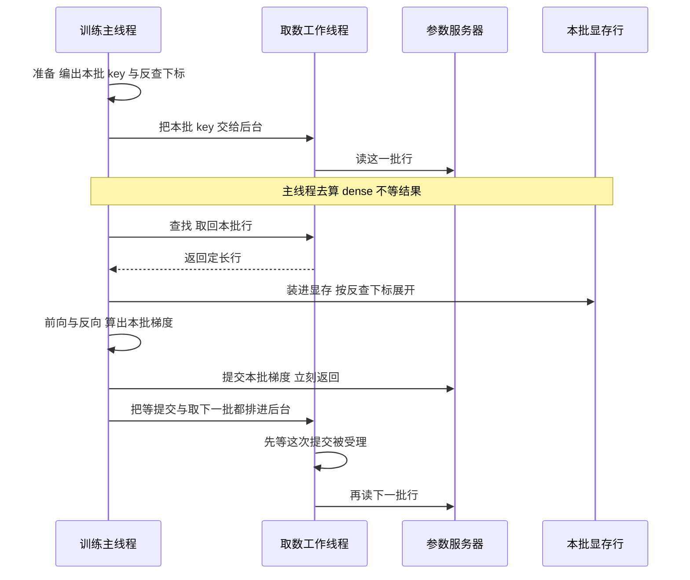
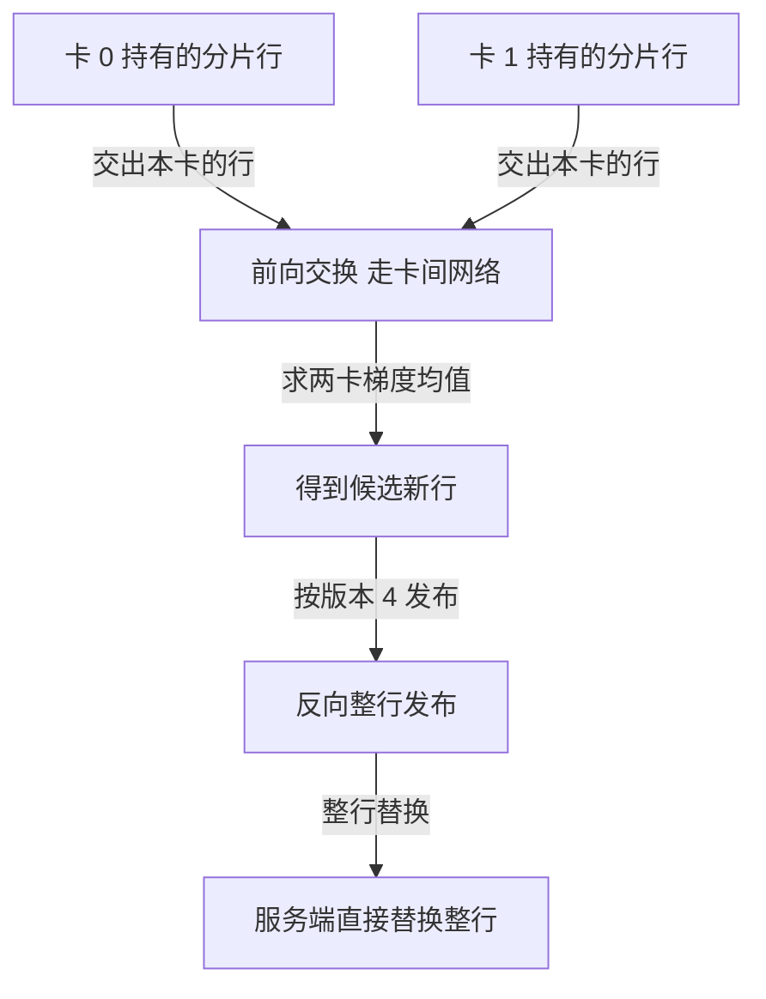

读要等 dense 算完才发，取数延迟就留在关键路径上。这一页讲两种实验性的排法：一种把取数提前一批，另一种把一行的更新留在卡上做完再整行发回去。两者都只在特定条件下成立，条件不满足直接报错，没有回退。

## 它是什么

先看一个具体批次。举例：一个 batch 4096 行，每行 128 个浮点，一次读回来约 2 MiB；如果取数比 dense 还慢——比如取数 8 ms、dense 只算 5 ms——同步等结果就是净损失。

第一种排法是 `PSPipeline`，把一步拆成三段。准备在主线程里把稀疏特征编成本批的 key、去重、留下反查下标，产出是一张 CPU 上的票据，不发请求。查找时取数已经在后台跑，主线程要行时才收货，收完装进显存并按反查下标展开。提交在步末发生，交出去立刻返回；真正等它的是后台线程，等到了才允许为下一批发取数。

准备、查找、提交这三段怎么交替？

跨进程的只有三条：后台读、主线程提交、下一批的读。准备和装显存都在训练进程里；等提交也是后台线程在自己这边等，不发新请求。尤其注意提交那一步——它一返回主线程就接着算。

流水线里还有一个正确性细节，叫依赖拆分：上一步刚改过的 key，这一批必须读到新值。准备阶段因此先只交换 key、不交换值，先把"上一步哪些 key 被改"的清单收齐，能安全读的干净行立刻读，脏行等提交落地后再补。它只在两卡、且 `total_steps` 显式给出时成立。

## 它为什么存在

默认读路径同步等结果。当 dense 计算不足以掩盖取数延迟，唯一有效的办法就是让取数提前一步发生——这是第一种排法的全部理由。

第二种排法 `GPUOwnerPipeline` 省的是另一个往返：一行只属于本卡时，读回参数服务器再更新是白跑一趟，完全可以在卡上算完，再把整行发布回去。省下来的次数等于本卡独占行的数量，代价是约束硬到近乎专用：两卡、128 维、CUDA、NCCL、显式总步数、每卡一个哈希分片、表类型只能是 0 或 1，连算数核都只认 SM80。

## 它和谁接

上游是[第 3 块](./read-path)的读路径与[第 4 块](./write-path)的优化器：它接管的是同一批 key、同一份梯度，只改发起时机与更新位置。下游是[第 03 章](../ch03/)的稀疏提交接口与[第 04 章](../ch04/)的卡间交换和预取资源。

它不替换 BagPipe：一个把行留在本地，一个把取数提前，是两条并列的实验方向。

## 代码位置

要改代码时再看这里。

| 路径 | 职责 |
| --- | --- |
| `ps_pipeline/pipeline.py` | 单步流水线：CPU ID ticket、后台线程拉取、提交后读、可选 dependency split（按"上一步哪些 key 被改"分区干净/脏行） |
| `ps_pipeline/owner.py` | rank r 拥有 city_hash 分片 r；forward 做 merged-row 交换，backward 用 v4 exact replace 发布新行 |
| `ps_pipeline/owner_exchange.py` | world-2 NCCL owner 交换：CPU plan 上传、`forward_rows`、`run` 计算候选行与状态 |
| `ps_pipeline/owner_math.py` / `.cu` | JIT 编译的 merged-gradient 算术：`g = (r0 + r1) * 0.5`，`new = old - lr * g`，严格浮点选项 |

**流水线的检查点。** 准备、查找、提交各只能前进一格：同一时刻至多一份准备好的批、一份在飞的读；查找的下标必须是下一批；提交之前这一批必须已经查过。依赖拆分把顺序倒过来——它要求先把下一批准备好，再提交当前批。

| 检查点 | 要求 | 符号 |
| --- | --- | --- |
| 准备 | 只接受一张有序的票据；同一时刻至多提前一批 | `_check_prepared_step` |
| 查找 | 步号必须紧接上一批 | `before_lookup`（`step == _current_step + 1`） |
| 提交 | 当前批必须已经查过，且只提交一次 | `submit_sparse_grad`（`_current_step == _submitted`） |
| 依赖拆分 | 先把下一批准备好，再提交当前批；两卡且总步数显式 | `_require_next_read` |
| 设备侧合并 | 打开后要求依赖拆分与 CUDA；只有批不小于 4096 行时才真走设备侧合并，否则留 CPU | `RECSTORE_PS_DEVICE_MERGE=1` |

**owner 判定。** 行归属于哪张卡由物理 key 的 CityHash64 对 2 取余决定，与存储层的编码一致。

| 项 | 规则 | 符号 |
| --- | --- | --- |
| 归属 | `owner = CityHash64(physical) % 2`：物理 key 的 CityHash64 对 2 取余 | `base/hash.h::GetHash` |
| 计划元数据 | 每行 8 列 | `OwnerMergedPlan.meta`：`[key, c0, c1, type, offset0, nvec0, offset1, nvec1]` |
| 排列 | 先按 destination 0 再按 1 排列本地 merged 行 | `permutation` |
| 前向方向 | 发送下标与收到的重排各一张表 | `forward_send_index`、`forward_reorder` |
| 行数账本 | 该卡观测到的每个来源的行数 | `rows[source]` |

**提交。** 前向用卡间交换拿到另一张卡的 merged 行，就地算出候选新行；反向把候选行交给 `sparse_owner_replace_async`，带上 `header.version=4` 整行发布，服务端直接替换，不做算术。

两卡各持一个分片时，一行怎么变成新值再发布？

只有两条箭头跨进程：交换走卡间网络，发布走参数服务器。汇合之前的数据都在各自的卡上；替换之后客户端不再为这一行重算，下一次读到的就是发布后的整行。

硬约束写成表更清楚，任一不满足都是直接 `ValueError`：

| 约束 | 要求 |
| --- | --- |
| 世界大小 | 2 |
| 维度 | `embedding_dim==128` |
| 设备 | CUDA |
| 卡间通信 | NCCL，每卡一个 city_hash 分片 |
| 总步数 | 显式给出 `total_steps` |
| 表类型 | 0 或 1 |
| 算数核 | SM80 |

没有 CPU 或其它维度的回退；中止是粘性的，一旦 `sparse_owner_replace_close` 走了 abort，后续不能重试。

## 交付一句

流水线与 owner 是两个可选的重叠方案，约束都收在上面的表和第 4 块的不变量表里。下一块接配置，把这些方案真正读到的字段列出来。
