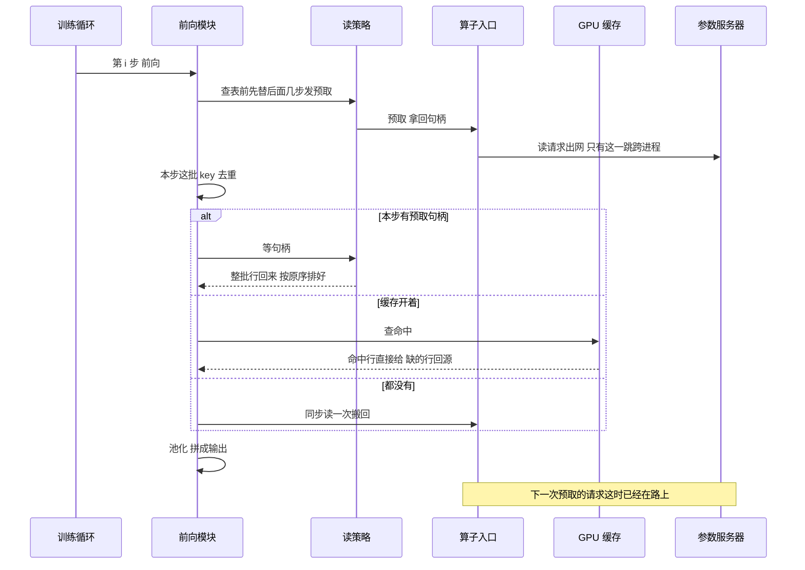
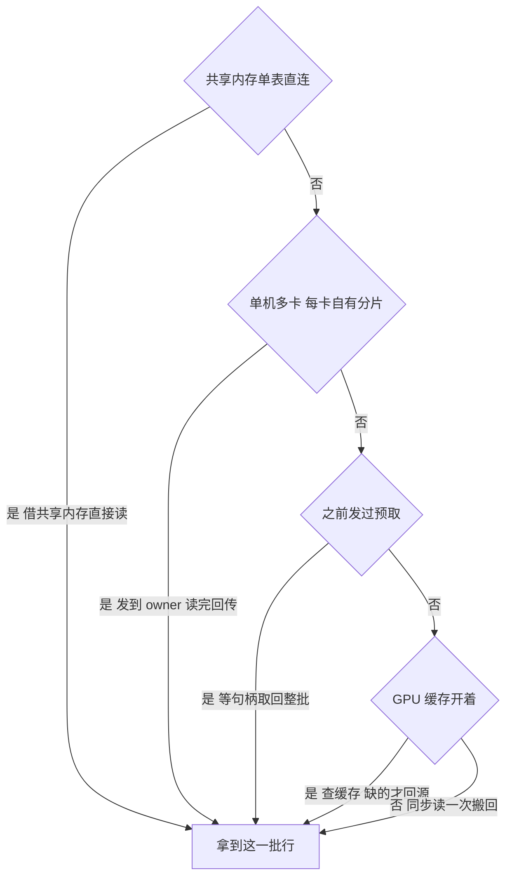

一次 forward 要取的行，可能在之前好几步就已经上路，也可能根本没出门就被缓存接住。这一页回答：读在什么时候发起、按什么顺序挑分支、结果怎么对齐回原来的位置。

## 它是什么

举例：批大小 4096、16 个特征、每条样本每个特征约 120 个 id，一个 batch 就是约 780 万条 key；去重后仍有几百万。这个量级下，逐 key 发请求是几百万次往返；每次同步等结果，dense 计算就只能排在后面空等。

所以读被拆成两半：提前发，到点收。三个决定都在 Python 侧做——什么时候发起、发起给谁、结果怎么拼回张量；C++ 只提供原语，读策略只负责调度，不碰存储。那这批行到底什么时候发出去，又在哪里收回来？

读第一段就知道省在哪：预取在第 i 步发出，要用的是后面某一步的行，所以「读请求出网」这一跳不等本步。下面三选一是本步真要用行时的收法：有句柄就等句柄，缓存开着就先查命中，都没有才同步读。等句柄几乎不等网络，查缓存只对缺的那几行回源，只有最后一条把整批网络时间压在本步，也正是要避免的那种。最后一步池化全在本地。

## 它为什么存在

读贵在两处：请求数随 key 数放大，以及等结果的那段时间 dense 计算插不进来。三件事各治一样——预取把网络挪到前面几步，融合把多特征合成一次取数，缓存把重复 key 变成零次。

分支的先后不是随手排的，看的是「这条能不能用」和「能省到什么程度」：共享内存直连要求只有一张表，单机多卡要求每卡自有分片，预取要求这一步之前发过才有句柄，缓存要求开着才查。本步会落到哪一条？

最上面的先成立就先走：前两条看部署形态，第三条看有没有提前发，第四条看缓存开没开，都不成立才落到同步读。融合预取与逐特征预取只差句柄个数，落在同一个判断里。不融合时退回逐特征同步读，可选的只剩「等预取」和「直接读」两种。

分支多的代价是结果容易对不齐。预取回来的行数一旦和去重后的 key 数不同，就按 id 合并、缺的退回同步读——行序错一条，池化出来的整个 batch 特征都跟着错。

## 它和谁接

上游是[第 2 块](./client-shard)的 key 编码：到这里拿到的已经是物理 key，读路径不再改 key。下游是[第 1 块](./op-entry)的算子入口，六个分支最后都落到同一个读原语上。BagPipe 是另一条独立的分支，驻留与预取都自己管，见[第 5 块](./bagpipe)。

## 代码位置

要改代码时再看这里。表以 `RecStoreEmbeddingBagCollection.forward` 为骨架，分支按优先级排列，最后一列是谁发起、谁等待、失败怎么表现。

| 优先级 | 分支 | 触发条件 | 谁发起 · 谁等待 · 失败表现 | 代码位置 |
| --- | --- | --- | --- | --- |
| 1 | local_shm 单表直连 | 后端是 local_shm 且只有一张表 | 调用线程借出共享内存 payload；非阻塞 H2D，lease 保留到 stream 完成；后端类型不符即抛错 | `torchrec_kv/EmbeddingBag.py#_lookup_fused_embeddings_shared_local_shm_single_table`、`op_flat.cc#local_lookup_flat_torch` |
| 2 | 单机多卡 owner 交换 | 每 rank 拥有自己的分片，需要跨卡取行 | `exchange_lookup_ids` 按 `fused_id % world` 发到 owner，owner 用 `local_lookup_flat` 读完回传；行数不匹配则重组错位，无重试 | `EmbeddingBag.py#_lookup_fused_embeddings_single_node_distributed`、`single_node_exchange.py#exchange_lookup_ids` |
| 3 | 融合预取 | 已发起 `emb_prefetch` 且句柄可用 | 发起在 `before_lookup` 之前，等待是 `wait_and_get(handle, dim, device)`；返回行数 != unique 数时按 id 合并，缺的退回 `pull` | `EmbeddingBag.py#_consume_fused_prefetch_embeddings`、`op_prefetch.cc#emb_wait_result_torch` |
| 4 | 逐特征预取 | 每个特征一个句柄 | 同上；逐句柄等待 | `embedding_read_path.py#PrefetchReadPath` |
| 5 | GPU cache 路径 | 开启 GPU cache 且 keys 在 CUDA | 调用线程；query 有主机同步；miss 回填、不淘汰 | `EmbeddingBag.py#_lookup_fused_embeddings_gpu_cache`、`pytorch/cache/cache_bindings.cc` |
| 6 | 普通 `pull` | 以上都不满足 | 调用线程同步；`emb_read` 返回时值已就绪；PS 读失败抛异常（第 03 章） | `KVClient.py#pull`、`op_base.cc#emb_read_torch` |

三条实现要记：

- 融合走 `enable_fusion`（默认 True）且本 batch 各特征 `embedding_dim` 一致；`fused_id = feature_value + (table_idx << fusion_k)`，所有特征共享 master 表（第一张表）的键空间。
- `emb_read` 的公共实现是 `CachedReadTorch`：`CacheAwareOp::Lookup` 先 query 命中数，有 miss 就 `read_missing`（staging 到 pinned CPU → `EmbRead` → 回 CUDA）→ `fill` → `scatter`，cache 不可用或整体失败就 `read_all`。`KVClient.pull` 的 id 始终在 CPU，所以**不会命中 C++ GPU cache**；只有 `pull_with_gpu_cache` / `gpu_cache_lookup_flat*` 保留 CUDA id 才走 cache。
- GPU cache 分支是 TTL/通用分支：若 `_bagpipe_current_prepared_ids` 已被 TTL prefill 设置就复用它，命中假设为真时用 `gpu_cache_lookup_flat_assuming_hits`。planned 生产路径不经过 `EBC.forward`，不会进入这里。

池化与返回分两条路。融合路径把拼接后的全部行交给一次 `F.embedding_bag(..., mode="sum")`，再按特征切分。

非融合路径逐特征池化，再用 `torch.cat` 沿特征维接起来。

两条都返回 `KeyedTensor(keys=feature_keys, values=[B, sum(dim)], length_per_key=dims)`：值是一块批大小乘总维度的张量，哪几列属于哪个特征不在 shape 里，只记在 `length_per_key` 里。

`torchrec_kv` 的三个适配模块决定这套骨架：

| 模块 | 与原生 torchrec 的关系 |
| --- | --- |
| `torchrec_kv/EmbeddingBag.py` | 替换 `EmbeddingBagCollection`：收 KJT、融合 ID、可选预取、拉行、本地池化；`record_pooled_grad` 提供不重放 autograd 的梯度记录路径。参数不在 `nn.Parameters` 里，表由 PS 持有，不能交给 DDP/分布式优化器 |
| `torchrec_kv/EmbeddingCollection.py` | 替换 `EmbeddingCollection`：逐特征 `pull` + 返回 `Dict[str, JaggedTensor]`，保留 unpooled 契约；可 `clamp_ids`；多表必须 `enable_fusion=True` |
| `torchrec_kv/fused_preload.py` | 不是 torchrec API：把第 i 张表的行预建到 master 表的 `(i << fusion_k) \| id` 键空间 |

`EmbeddingBag.py` 里的 `_RecStoreEBCFunction` 是一个自定义 autograd Function，把拉行、池化与反向的索引累加整段包在一起。它没有被任何代码引用，是遗留死代码。

实际的前向不经过它，靠 `register_hook` 拿梯度。

## 交付一句

读路径的六个分支、触发条件与失败表现都在表里。下一块接写路径，从同一次 forward 的反向开始。
