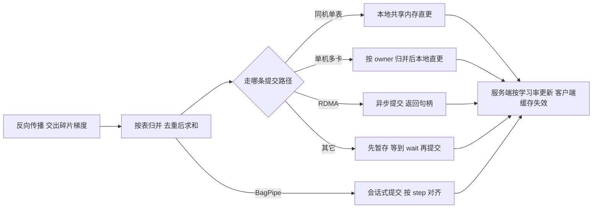
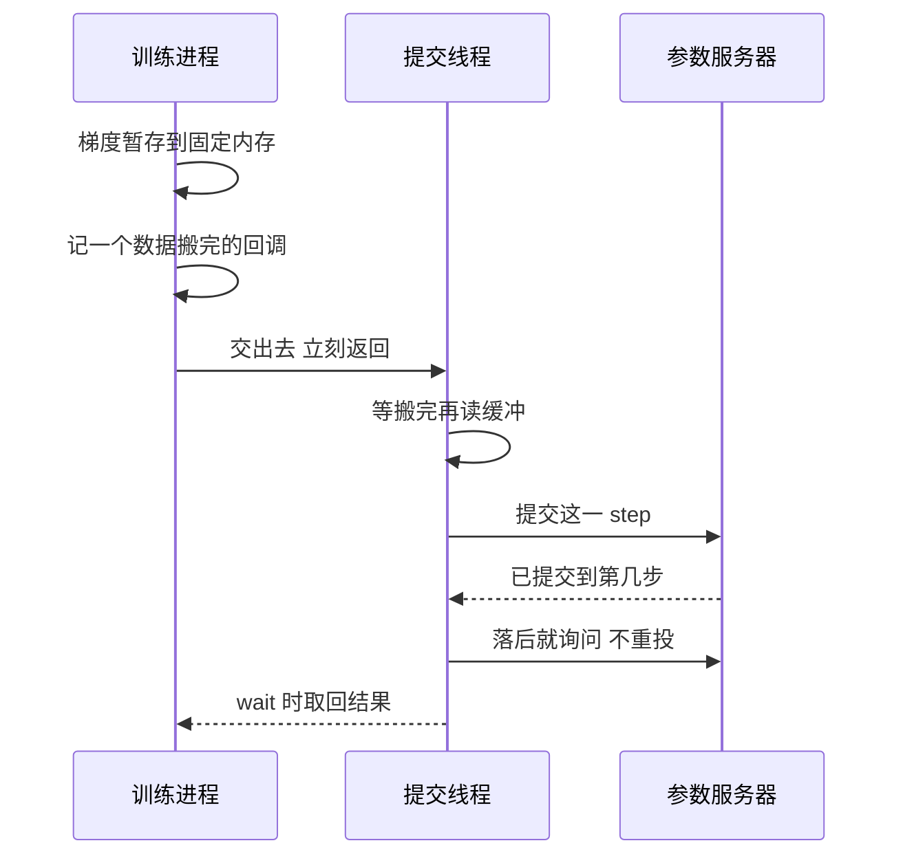

训练一步跑完，反向传播交出的是几十万条「某个 id 这次要改多少」的记录，又碎又重复。这一页讲这些碎片怎么被归并成每张表一次请求、为什么提交是异步的、以及「学习率到底谁乘」这个最容易出错的地方。

## 它是什么

写路径分三段，段与段之间传的东西是一条记录：表名、key、梯度。

1. 归并。反向传播按 batch 产生梯度，同一个 key 可能在多个样本、多个特征、多个 rank 上各出现一次。归并在客户端就把它们合成一行：去重，然后求和。
2. 选路。归并完的结果按部署形态走三条路之一：同机单表直接走共享内存；单机多卡先按 owner 归并再本地更新；其余走异步提交。BagPipe 是第四条，整条路换成会话式提交。
3. 对齐。提交不是「发出去就算完」。客户端和服务端靠一个步号对齐：服务端确认收到第几步，客户端才知道上一次提交真的生效。

图里只有两处是真的跨进程：右边那几条箭头，以及 BagPipe 那条会话。左边「归并」全在训练进程里完成；「缓存失效」也不是网络动作，它是本地的清理——更新过的行，GPU 缓存里那份已经过期了。

## 它为什么存在

**归并不能省。** 梯度天然是碎的：一次 backward 会在多个样本、多个特征、可能多个 rank 上分别产生同一个 key 的贡献。直接发出去，请求数会按样本数放大，同一个 key 在一次请求里重复出现，跨 rank 的贡献也合不到一起。[推断] 代码里只有去重与求和，没有对应的设计说明。

**异步不能省。** 提交要等两件事：梯度从 GPU 搬到主机内存搬完，以及服务端确认上一个 step。任何一件同步等，都会把训练主线程卡住。

**学习率必须只有一个施加者。** 两套实现并存：一套在客户端乘学习率（拉下来、改、推回去），一套只交梯度、由服务端优化器乘。两边都乘就是平方，两边都不乘就是不更新。所以这条边界被做成了硬失败，而不是靠文档提醒——原因见下面两处护栏。

## 它和谁接

上游是[第 3 块](./read-path)的前向传播：梯度钩子挂在它产出的输出上。下游是[第 03 章](../ch03/)的稀疏提交协议与[第 05 章](../ch05/)的服务端优化器。

BagPipe 会整体替换这条路径（[第 5 块](./bagpipe)）：它把梯度提交也塞进那个驻留会话里，按 step 走完全不同的入口。

## 代码位置

要改代码时再看这里。

### 梯度怎么产生

| 角色 | 做法 |
| --- | --- |
| 单表模块 | `_DistEmbFunction.backward` 把 `ids` 与 `grad_output` 转 CPU，`torch.unique` 加 `index_add_` 去重求和，把 `(unique_ids, grad_sum)` 追加进 `_trace` |
| 融合模块 | `RecStoreEmbeddingBagCollection` 在 `all_embeddings` 上 `register_hook`，拿到整块 `[N, D]` 梯度后直接追加 `(fused_ids, grad)` |
| 融合的另一条快路 | `record_pooled_grad` 用准备好的 `(unique_ids, inverse, raw_count)` 做 `index_add_`，不重放 `embedding_bag` 的自动求导 |
| 逐特征模块 | `RecStoreEmbeddingCollection` 逐特征挂钩子，每个特征一条 trace，融合时 key 加上 `table_idx << fusion_k` |

### 两种更新语义与护栏

| 谁乘学习率 | 模式 | 入口 |
| --- | --- | --- |
| 客户端 | 拉取—修改—推回（client pull-modify-push） | `_process_dist_embedding_module`：`weight[ids] = weight[ids] - lr * grad`，一次拉取加一次推送 |
| 服务端优化器 | 只交梯度（server-side gradient update） | `update_async`、`local_update_flat` |

两处护栏：

1. 进程内。`_record_table_update_mode` 以 `(kv_client, table)` 为键记住首次使用的模式，遇到另一种直接抛 `RuntimeError`（原文是 "would apply the learning rate inconsistently"）。同一个 client、同一张表混用两种模式，会在提交前失败。
2. 跨进程。`update_async`、`local_update_flat`、`emb_update_table` 都把客户端 `lr` 一并送到 PS，`CachePS::CheckLearningRate` 发现与优化器学习率不一致就拒绝整批更新。

两道护栏只拦得住「同一张表换了模式」。剩下的选择仍要调用方自己保证：客户端这条路径已经乘过学习率，服务端那条就不该再乘一次。

| 测试 | 覆盖什么 |
| --- | --- |
| `test_sparse_update_mode_guard.py` | 同模式重复、两种顺序的冲突、不同表互不影响、没有 trace 的模块不占用表 |
| `test_sharded_update_async_lr.py` | 学习率沿分片与异步路径的透传 |

### 优化器怎么提交

1. `SparseSGD.step` 按表名收集各模块的 `_trace`，同一张表的多条先 `cat`，再 `torch.unique` 加 `index_add_` 得到 `(unique_ids, summed_grads)`。RDMA 是例外：`direct_sgd = backend_name == "rdma"` 时不在本地去重，原样把 `all_ids/all_grads` 两个张量发出去，由后端累加——去重这一步被挪到了拥有那张表的机器上。
2. 若 `keep_ratio < 1`：要求开启融合（`_enable_fusion`），并且后端是 `grpc` / `distributed_grpc`（或 local_shm 快路径）；`select_topk_rows` 按行平方能量保留 `ceil(N * keep_ratio)` 行。`DistEmbedding` 不支持 Top-K。
3. 按模块能力选三条路之一：

| 条件 | 提交方式 |
| --- | --- |
| 同机单表（`_can_use_shared_local_shm_direct_fast_path`） | `kv_client.local_update_flat(name, ids, grads, lr)`，C++ 侧暂存后走 `LocalShmUpdateFlat` |
| `resolve_fast_path_backend()` 非空（单机多卡加 local_shm / hierkv） | `single_node_exchange` 把梯度按 owner rank 全收集、owner 侧聚合，再 `local_update_flat` |
| 其余 | `update_async(name, ids, grads, lr)`：RDMA 且 ops 提供 `emb_update_async` 时走 `EmbUpdateAsync` → `SubmitUpdateParameterAsync`，返回原生句柄，`wait` 时用 `emb_update_wait`；其它后端在 Python 侧 staged 队列存下 `(name, ids.clone(), grads.clone(), lr)`，`wait(handle)` 时才 `emb_update_table` 同步提交 |

三条路都把 `lr` 带到服务端，`0` 表示不上报。

4. `emb_update_table` → `EmbUpdateCached` → `CacheAwareOp::Update`：先 `EmbUpdate`（即 `ps_client_->UpdateParameter`，带 lr），成功后按 cache 配置 `invalidate` 或 `clear`；`EmbUpdateWithLearningRate` 是给同步路径显式传 lr 的入口。
5. BagPipe planned 不走 `update_async`：`BagPipeSparseSGD.step` 直接调 `controller.update_grads(...)`（第 5 块）。

BagPipe 的跨 rank 聚合有两种方式，开关是 `aggregation`，区别在于「跨 rank 求和发生在哪一端」：

| 方式 | 做法 | 谁提交 |
| --- | --- | --- |
| `collective` | 把本 rank 的梯度按 `active_ids` 散射进一块稠密缓冲，对这块缓冲做一次 `dist.all_reduce`，再除以 world | 只让 `active_index % world == rank` 的行提交 |
| `ps`（默认） | 本地去重后的行直接提交，请求里带 `divisor=world` | 所有本地行都提，由参数服务器跨 rank 求和后再除 |

前一种在客户端把跨 rank 的求和做完，稠密缓冲是代价、换来的是服务端只收 owner 那一份；后一种不做全局归约，只把除数交给服务端，让分摊发生在参数服务器上。选后者时同一行会被 world 个 rank 各提一次。

### 提交运行时

`SparseGradientCommitRuntime::Submit` 把已经暂存到固定内存（pinned CPU）的 `keys/grads` 交给后台线程。

线程由 `std::async` 起，调用方拿到句柄立刻返回。线程里的顺序是：等数据搬完、提交、落后就询问、等待收割。

四步：

1. 先执行 `ready()`。上层用 `RecordCudaCompletionForTensor` 生成回调，内部是 CUDA event 的 `synchronize()`，保证主机到设备的拷贝完成后，工作线程才开始读缓冲区。
2. `exchange(header, keys, grads)` 调 `ps_client_->SparseGradientCommit`，拿回 `committed_step`。
3. 若 `committed < header.step`，把 `kind` 改成 1（询问）、带空 keys 与梯度，每 100µs 轮询一次，直到追上目标 step 或 60s 超时。
4. 异常路径把 `kind=3`（中止）发给对端，保留原始异常，**不重投梯度**。工作线程由 `Wait(id)`（`future.get()`）收割。

两个版本的语义不同，判据是头里的版本号。v1 提交梯度：服务端在已有行上按除数求和、再乘学习率更新一次。v4 提交候选整行：服务端直接替换，不做算术。同一份请求重投在两种语义下结果不同，所以失败只发中止、不重投。

**稀疏提交头 `SparseGradientCommitHeader`。** 固定 56 字节，字段分三组：

| 组 | 字段 | 含义 |
| --- | --- | --- |
| 会话 | `session`、`step`、`rank`、`world` | 哪一次训练、第几步、谁发的、一共几个 rank |
| 数据 | `dim`、`rows`、`chunk`、`chunks` | 一行多宽、多少行、这是第几块、一共几块 |
| 语义 | `kind`、`learning_rate`、`divisor`、`version` | 这次是提交 / 询问 / 关闭 / 中止，学习率，聚合除数，协议版本 |

按结构体声明顺序排就是 `session / step / rank / world / dim / rows / chunk / chunks / kind / learning_rate / divisor / version`：前四个定位一次训练与发送方，中间四个定位这一块数据在整批里的位置，最后五个决定服务端怎么解释后面的字节。

分块是因为一次提交可能超过单次载荷上限，收发两端靠块号与总块数把同一 step 拼回完整一批。

`kind` 的取值：0 提交、1 询问、2 关闭、3 中止。`version` 只接受 1 或 4。

v4 另有七条硬限制：

| 限制 | 取值 |
| --- | --- |
| rank 数 | `world==2` |
| 维度 | `dim==128` |
| 聚合除数 | `divisor==1` |
| 分块数 | `chunks<=64` |
| 载荷 | 不超过 1 MiB |
| key | 严格递增 |
| 值 | 全有限 |

对应的入口只接受三个张量：

| 张量 | 类型 | 作用 |
| --- | --- | --- |
| `ids` | CPU `int64[N]` | 要替换的行 |
| `candidates` | `FP32[N,128]` | 候选整行值 |
| `status` | `int32[1]` | 非 0 直接 `TORCH_CHECK` 失败 |

入口名是 `sparse_owner_replace_async`。

### 写者与顺序的不变量

| # | 不变量 | 涉及符号 |
| --- | --- | --- |
| 1 | 进程内只有一个写者：唯一 `KVClientOp` 由 `GetKVClientOp()` 里的 `std::call_once` 建，`ps_client_` 是静态指针，重建会 `reset`，所有 Python client 共享它 | `GetKVClientOp`、`SetPSBackend`、`SetPSConfig` |
| 2 | BagPipe planned：ps 模式下只有全局只在一个 rank 出现的 key（`counts == 1`）允许本地做 `-lr * grad / world`；共享行由 PS 聚合后整行生效，客户端只失效再读 | `_dirty_dev` |
| 3 | BagPipe TTL：`_dirty_dev` 是「本地值不等于 PS 值」的唯一真相，只有脏行在淘汰时回写；shutdown 时用 `position % world` 给共享行指定唯一 rank | `_dirty_dev` |
| 4 | 缓存世代：任何外部 `clear/disable/reset` 都递增 generation，TTL 控制器在入队、预填、更新前校验，不匹配就抛错；planned 不做这个校验，因为它不拥有 C++ 缓存 | generation |
| 5 | 提交顺序：每张表要求 `step == committed + 1`；客户端的提交可以同时挂多个未完成句柄，下一次提交时回收已经完成的那些 | `SparseGradientCommitCoordinator`、`_pending`、`_commit`、`_pending_commits` |
| 6 | 流水线批次顺序：`_check_prepared_step` 只允许「当前 batch 已提交再准备下一个」，`before_lookup` 要求 `step == _current_step + 1`，`submit_sparse_grad` 要求 `_current_step == _submitted`；依赖拆分还要求 world 为 2 且 `total_steps` 显式给出 | `_check_prepared_step`、`before_lookup`、`submit_sparse_grad` |
| 7 | owner 流水线：world 为 2、每 rank 一个 city_hash 分片、`embedding_dim=128`、CUDA、NCCL、显式 `total_steps`、表类型 0 或 1；`metadata_lookahead=4`，`native_depth` 与 `successor_depth` 都必须在 `[0,1]` | `_record_compute_state` |
| 8 | 生命周期：planned 没有后台线程，`shutdown(flush=True)` 等最后一次 PS 提交再 `close` 会话，`flush=False` 走中止；TTL 有守护线程 `bagpipe-cleanup`（只排空旧队列），shutdown 还要回写脏行、排空旧队列与淘汰流；两者都清 prepared ids | `shutdown`、`kind=3`、`bagpipe-cleanup` |

还有一处收尾：`DistTensor.__del__` 对非持久表调 `delete_data`。

后者删完 Python 元数据后抛 `NotImplementedError`，而这个异常被吞掉了——所以析构不会把训练带崩。

### 缓存与可见性

提交成功只是「服务端收到了」。客户端这边还有三件事：

1. 更新成功后按 `CacheUpdateActions` 失效对应的 key；更新的是一张表的整批时也可以整表清空。
2. 更新抛异常时，`CacheAwareOp::Update` 先清空整张缓存再把异常抛出去，避免下一步读到旧行。
3. `push`（即 `emb_write`）这条路径不挑 key，无条件清空整个缓存。

`wait()` 返回的是「提交完成」，不是「值已经对所有读者可见」。跨 step 的可见性由服务端优化器与稀疏提交的 session / step 语义约束（见[第 05 章](../ch05/)）。

## 交付一句

写路径到此交代完毕：碎片梯度在客户端归并、按部署形态选一条提交路、用步号对齐、靠两处护栏保证学习率只乘一次。下一块接 BagPipe，它把读和写都套进一个驻留会话里。
