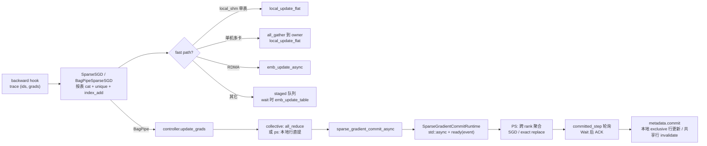

## 它是什么

写路径分三段：backward 留下 trace，优化器把 trace 归并成"每张表一次请求"，提交运行时把请求异步送出去并按 step 对齐。三段之间的衔接点是一条记录：表名、key、梯度。

## 它为什么存在

梯度天然是碎的：一次 backward 会在多个 sample、多个特征、可能多个 rank 上分别产生同一 key 的贡献。直接发出去会导致请求数爆炸、同一 key 在一次请求里重复、跨 rank 的贡献无法合成。[推断] 归并就是把这三件事在客户端解决；代码里只有去重与求和，没有对应的设计说明。提交异步，是因为它必须等 D2H 拷贝完成、又要等对端确认 step，任何一步同步都会卡住训练主线程。

## 它和谁接

上游是[第 3 块](./read-path) forward（`register_hook` 挂在它产出的 `all_embeddings` 上），下游是[第 03 章](../ch03/)的 `SparseGradientCommit` 与[第 05 章](../ch05/)的服务端聚合。BagPipe 会整体替换这条路径，见[第 5 块](./bagpipe)。

## 代码位置

### 4.1 梯度怎么产生

- `DistEmbedding`：`_DistEmbFunction.backward` 把 `ids` 与 `grad_output` 转 CPU，`torch.unique` + `index_add_` 去重求和，追加 `(unique_ids, grad_sum)` 到 `_trace`。
- `RecStoreEmbeddingBagCollection`：forward 在 `all_embeddings` 上 `register_hook`；融合路径的 hook 接收整块 `[N, D]` 梯度，直接追加 `(fused_ids, grad)`。`record_pooled_grad` 是另一条快路径：用 prepared 的 `(unique_ids, inverse, raw_count)` 做 `index_add_`，避免重放 `embedding_bag` 的 autograd。
- `RecStoreEmbeddingCollection`：逐特征 `register_hook`，每个特征一条 trace，融合时 key 加 `table_idx << fusion_k`。

### 4.2 两种更新语义与护栏

| lr 的责任方 | 模式 | 入口 |
| --- | --- |
| 客户端 | `client pull-modify-push` | `DistEmbedding` 走 `_process_dist_embedding_module`：`weight[ids] = weight[ids] - lr * grad`，一次 `pull` + 一次 `push` |
| 服务端优化器 | `server-side gradient update` | `update_async` / `local_update_flat`，客户端只交梯度 |

`_record_table_update_mode` 以 `(kv_client, table)` 为键记录首次使用的模式，遇到另一种直接 `RuntimeError`（"would apply the learning rate inconsistently"）。因此**进程内同一 client + table 的混用会在提交前失败**，不再静默地施加两次或零次 lr。这条护栏只在进程内、同一 client 对象上生效，跨进程由服务端补上第二道：`update_async` / `local_update_flat` / `emb_update_table` 现在都把客户端 `lr` 一并送到 PS，`CachePS::CheckLearningRate` 发现与优化器学习率不一致就拒绝整批更新（见第 03 章）。仍需调用方保证的是语义选择本身——`DistEmbedding` 在客户端乘 lr，服务端优化器路径不该再乘一次。`test_sparse_update_mode_guard.py` 覆盖同模式重复、两种顺序的冲突、不同表互不影响、无 trace 的 `DistEmbedding` 不占用表；`test_sharded_update_async_lr.py` 覆盖 lr 沿分片与异步路径的透传。

### 4.3 优化器怎么提交

1. `SparseSGD.step` 收集每个模块的 `_trace` 按表名分组；同一表的多条 trace 先 `cat`，再 `torch.unique` + `index_add_` 得到 `(unique_ids, summed_grads)`。RDMA 例外：`direct_sgd = backend_name == "rdma"` 时不 local 去重，原样发送 `all_ids/all_grads` 由后端累加。
2. 若 `keep_ratio < 1`：要求 `_enable_fusion`，后端是 `grpc` / `distributed_grpc`（或 local_shm 快路径）；`select_topk_rows` 按行平方能量保留 `ceil(N * keep_ratio)` 行。`DistEmbedding` 不支持 Top-K。
3. 按模块能力选提交路径：`_can_use_shared_local_shm_direct_fast_path`（同机单表 local_shm）→ `kv_client.local_update_flat(name, ids, grads, lr)`，C++ 侧 staging 后 `LocalShmUpdateFlat`；`resolve_fast_path_backend()` 非空（单机多卡 + local_shm/hierkv）→ `single_node_exchange` 把梯度按 owner rank all_gather、owner 侧再聚合，然后 `local_update_flat`；否则 `update_async(name, ids, grads, lr)`——RDMA 且 ops 提供 `emb_update_async` 时走 `EmbUpdateAsync` → `SubmitUpdateParameterAsync`，返回原生 handle，`wait` 时 `emb_update_wait`，其它后端在 Python 侧"staged"队列保存 `(name, ids.clone(), grads.clone(), lr)`，`wait(handle)` 时才 `emb_update_table` 同步提交。三条路径都把 `lr` 带到服务端，`0` 表示不上报。
4. `emb_update_table` → `EmbUpdateCached` → `CacheAwareOp::Update`：先 `EmbUpdate`（`ps_client_->UpdateParameter`，带 lr），成功后按 cache 配置 `invalidate` 或 `clear`；`EmbUpdateWithLearningRate` 是给同步路径显式传 lr 的入口。
5. BagPipe planned 不走上面的 `update_async`：`BagPipeSparseSGD.step` 直接 `controller.update_grads(...)`（第 5 块）。

`BagPipeSparseSGD` 的两条聚合方式（`aggregation`）：`collective` 把本 rank 梯度散射到 `active_ids` 稠密缓冲、`dist.all_reduce`、除以 world，只让 `active_index % world == rank` 的 owner 行提交；`ps`（默认）所有本地 unique 行直接提交，`divisor=world`，由 PS 跨 rank 求和并除以 world。

### 4.4 提交运行时

`SparseGradientCommitRuntime::Submit` 把已 staging 到 pinned CPU 的 `keys/grads` 移交给 `std::async` 工作线程：

1. 先执行 `ready()`。上层用 `RecordCudaCompletionForTensor` 生成回调，内部是 CUDA event 的 `synchronize()`，保证 D2H 拷贝完成后工作线程才读 buffer。
2. `exchange(header, keys, grads)` 调 `ps_client_->SparseGradientCommit`，返回 `committed_step`。
3. 若 `committed < header.step`，把 `kind` 改为 1（query）、传空 keys/grads，每 100µs 轮询，直到达到目标 step 或 60s 超时。
4. 异常路径把 `kind=3`（abort）发给对端，保留原始异常，**不重投梯度**。工作线程由 `Wait(id)`（`future.get()`）收割。

两个版本的语义要分清，判据是 header 里的 `version`：v1 提交梯度，服务端在已有行上按 `divisor` 求和、再乘 `lr` 施加一次更新；v4 提交候选整行，服务端直接替换，不做算术。同一份请求重投在两种语义下结果不同，所以失败只发 abort、不重投。

**稀疏提交头。** `SparseGradientCommitHeader` 固定 56 字节：`session / step / rank / world / dim / rows / chunk / chunks / kind / learning_rate / divisor / version`。`kind`：0 submit、1 query、2 close、3 abort；`version` 只接受 1 或 4。v4 额外要求 `world==2`、`dim==128`、`divisor==1`、`chunks<=64`、payload ≤ 1 MiB、key 严格递增且值全有限；`sparse_owner_replace_async` 只接受 `ids`（CPU `int64[N]`）、`candidates`（`FP32[N,128]`）、`status`（`int32[1]`），`status` 非 0 直接 `TORCH_CHECK` 失败。

### 4.5 写者与顺序的不变量

1. **进程内单写者**：`GetKVClientOp()` 用 `std::call_once` 建唯一 `KVClientOp`；`ps_client_` 是静态指针，`SetPSBackend` / `SetPSConfig` 会 `reset` 后重建，所有 Python client 实例共享它。
2. **BagPipe planned 的写者**：ps 模式下只有 `counts == 1`（全局只在一个 rank 出现）的 exclusive key 允许在该 rank 本地做 `-lr * grad / world`；共享 key 由 PS 聚合后整行生效，客户端只 invalidate 再读。
3. **BagPipe TTL 的写者**：`_dirty_dev` 是"本地值 != PS 值"的唯一真相，只有 dirty 行在淘汰时回写；shutdown flush 用 `position % world` 给共享行指定唯一 rank。
4. **GPU cache generation**：任何外部 `clear/disable/reset` 都递增 generation；TTL controller 在 enqueue / prefill / update 前校验，不匹配即抛错。planned 不做这个校验，因为它不拥有 C++ cache。
5. **提交顺序**：`SparseGradientCommitCoordinator` 要求 `step == committed + 1`；客户端每 batch 至多一个 pending commit（planned 的 `_pending`、pipeline 的 `_commit`）。
6. **PSPipeline 批次顺序**：`_check_prepared_step` 只允许"当前 batch 已提交后再准备下一个"；`before_lookup` 要求 `step == _current_step + 1`；`submit_sparse_grad` 要求 `_current_step == _submitted`；dependency split 还要求 world=2 且 `total_steps` 显式给出。
7. **owner 流水线**：world=2、每 rank 一个 city_hash 分片、`embedding_dim=128`、CUDA、NCCL、显式 `total_steps`、表类型只允许 0/1；`metadata_lookahead=4`，`_record_compute_state` 强制 `native_depth` 与 `successor_depth` 都在 `[0,1]`。
8. **生命周期**：planned controller 没有后台线程，`shutdown(flush=True)` 等最后一次 PS commit 并 `close` 会话，`flush=False` 走 `kind=3` abort；TTL controller 有 daemon `bagpipe-cleanup` 线程（只 drain 旧队列），shutdown 还要 flush dirty 行、drain 旧队列/eviction stream。两者都清 prepared ids。`DistTensor.__del__` 对非持久表调 `delete_data`，后者在删完 Python 元数据后抛 `NotImplementedError`，异常被吞掉。

## 交付一句

梯度从 trace 走到 PS 接口，顺序由 step 对齐，写者由会话与聚合方式约束。下一块接 BagPipe，它把读和写都套进一个驻留会话里。
