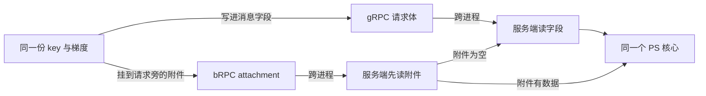

bRPC 在调用方看来和 gRPC 几乎一样，区别藏在大载荷放在哪个字段里。这一页讲同一份 key 与梯度怎么绕过 protobuf、服务端又怎么把它捞出来，顺带解释批量上限为什么能大三十多倍、checkpoint 为什么没有。

## 它是什么

举例：一次稀疏更新要把 10 万个 key 和对应的梯度送到同一个分片。走 gRPC，这得切成 50 个请求，因为单次只装 2000 个 key；走 bRPC，两个请求就够了，因为上限是 65536。装法也不一样：gRPC 把 key 的字节写进消息的字段里，bRPC 把 key 与梯度直接挂在请求旁边的附件上。

读图：左右两条并列的路送的是同一份数据，差别只在装在哪。两根标了「跨进程」的箭头是网络本身，其余都在服务端进程里：先看附件、空了再回退到字段，这个判断是本地的一次分支，不是又一趟通信。两条路最后汇进同一个核心，所以读写的语义不会因为换了传输而变。

## 它为什么存在

protobuf 的字段要序列化再反序列化，载荷越大，这次拷贝越贵。挪进附件等于让这段大数据只搬一次、不参与编解码，于是单次能带的量从 2000 抬到 65536。响应方向同理：结果块追加进响应附件写回，客户端也从附件优先读。

省下的拷贝要用两处复杂度换。一是两端都多一层「先看附件」的判断，读的一方还要校验长度。二是这条协议独立演化，缺了 checkpoint 命令——能跑训练，但搬不走完整状态。

超时与重试不在这条路径里自己管，交给通道选项：默认 5000 ms、最多重试 3 次。空载荷的处理也比 gRPC 宽松：正常与预取两条路都把它当作「这一块没有行」跳过，保持 0，不报错。

## 它和谁接

上游同样是[第 4 块](./sharding)的分片层，下游是 bRPC 服务端。

写路径上有一处和 gRPC 不同：服务端收到 Put 后逐 key 写入，而 gRPC 是整批交给核心。客户端还留了一个 `use_rdma` 开关，那是 bRPC 框架自己的传输选项，不是[第 04 章](../ch04/)那套会话式路径。

## 代码位置

要改代码时再看这里。

1. 建通道：超时与重试由 `brpc::ChannelOptions{timeout_ms, max_retry}` 承担，默认 5000 ms / 3 次。
2. 客户端准备对象：构造 `google::protobuf::Arena`，按批创建请求与响应对象。
3. 客户端装载荷：key 写入 `controllers[i].request_attachment()`。
4. 客户端发出：对每批调用 `stub.GetParameter(..., done)` 异步发出，`done` 是空回调。
5. 客户端等结果：逐个 `brpc::Join(call_id)` 等待。
6. 客户端判失败：任一 `controllers[i].Failed()` 为真，直接返回 -1。
7. 服务端取载荷：`ExtractPayloadBytes` 优先取 `request_attachment`，把 key 交给 `CachePS`。
8. 服务端写结果：结果由 `compressor.AppendToIOBuf(&cntl->response_attachment())` 写回 attachment。
9. 客户端读结果：`ExtractGetResponseReader` 同样优先读 attachment，再用 `ParameterCompressReader::Valid` 校验长度后拷贝。
10. 其余差别：Put 在服务端逐 key 调用 `PutSingleParameter`，而 gRPC 是整批。
11. 其余差别：客户端支持 `options.use_rdma`（编译期 `BRPC_WITH_RDMA`，配置 `brpc_ps_use_rdma`），这是 bRPC 自身的传输选项，不是第 04 章的 raw-verbs 路径。
12. 其余差别：空载荷的处理比 gRPC 宽松，正常与预取路径都把它当作「该块无行」跳过，保持 0，不返回错误。

## 交付一句

bRPC 路径到此交代完毕：attachment 承载大载荷、内存池复用对象、更大的批量上限，以及协议里缺失的 checkpoint。下一块讲完全不走 socket 的共享内存路径。
