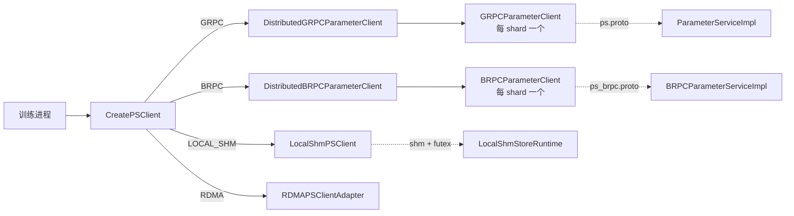

## 它是什么

训练进程只认一个客户端接口，接口后面叠着两层实现。外层是分片层，负责把一次调用摊成多个 shard 的调用再收回来；内层是单分片客户端，只跟一个 shard 说话。local_shm 没有内层，它自己就是接口实现，也没有分片层。选型发生在构造阶段：读 `cache_ps.ps_type`，四种取值对应四条实现。

选型判据：

| 判据 | 结果 | 配置键 / 机制 |
| --- | --- | --- |
| 什么都没配 | gRPC | `cache_ps.ps_type` 缺省为 `GRPC` |
| 要能做 checkpoint 存取 | 只能 gRPC | bRPC 协议缺枚举，local_shm 无控制面 |
| 单机同主机、小批量、不要控制面 | local_shm | `ps_type=LOCAL_SHM`，读 `local_shm.*` |
| 跨主机、要通用 RPC | gRPC 或 bRPC | `distributed_client.servers` |
| 大载荷、想省一次拷贝、批量上限大 | bRPC | attachment + 65536 key |
| 要内核旁路、会话式传输 | RDMA | `ps_type=RDMA`，见第 04 章 |
| 想用异步更新 | 三条都不支持 | `SubmitUpdateParameterAsync` 默认抛异常 |
| 单机部署是否也要分片层 | 要，gRPC/bRPC 自动合成 `num_shards=1` | `ResolvePSClientOptionsFromFrameworkConfig` |
| 服务端进程入口 | 只接受 `GRPC` / `BRPC` | `ps_server.cpp`，其它值 `return 2` |

## 它为什么存在

没有分片层，路由、切块、并发扇出与结果回填就得在每个调用点重写一遍；没有单分片客户端，分片层就得同时懂三种传输的细节。把两者拆开，[第 4 块](./sharding)的路由逻辑才能只写一次。单机部署也合成一个单 shard 的分片层，是为了让单机和多机走同一条代码路径，避免只在多机才暴露的拼接错误。

## 它和谁接

上游是框架侧的配置读取：环境里的嵌套配置先被拍平成类型与选项，再交给工厂。下游是[第 3 块](./protocol)的命令编码与[第 4 块](./sharding)的分片逻辑。服务端一侧，统一入口只接受 gRPC 与 bRPC；local_shm 有独立的可执行文件，不走这个入口。

## 代码位置

1. `framework/common/ps_client_config_adapter.cc#ResolveFrameworkPSClientType` 读 `cache_ps.ps_type`，大小写不敏感映射到 `PSClientType::{kGrpc,kBrpc,kRdma,kLocalShm}`，未知值抛 `std::invalid_argument`；`ResolveFrameworkDistributedClientConfig` 从 `distributed_client` 取 `servers`、`num_shards`、`hash_method`、`max_keys_per_request`，缺失时回退到 `cache_ps` 同名键，仍无 `num_shards` 时用 `servers.size()`。
2. `CreatePSClient` 按类型构造；local_shm 用 `transport_config`（即 `config["local_shm"]`），其余用整份 `raw_config`。单机且无 `servers` 时，gRPC/bRPC 合成一个单 shard 的 `distributed_client`，地址取 `client.host/port/shard`（默认 `127.0.0.1:15000`、shard 0）。
3. 服务端入口 `ps_server.cpp#main` 把 `cache_ps.ps_type` 映射到工厂键 `GRPCParameterServer` / `BRPCParameterServer`；local_shm 由独立可执行文件 `local_shm_ps_server` 启动。

## 交付一句

客户端栈与选型到此交代完毕：接口一层、分片一层、单分片一层，local_shm 跳过中间层。下一块讲这些层之间传的消息长什么样。
