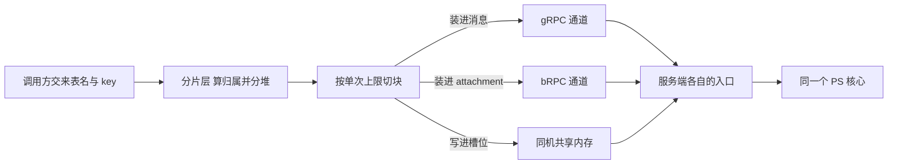

换一条传输，调用方看到的行为该不该变？这一页先把三条路径共有的那段立起来：哪些步骤在训练进程里就已经做完，哪一步一跨出去就归对端管，以及换传输时什么一定不会变。

## 它是什么

举例：一次前向传播要取 12000 个 key，集群 4 个分片，走 gRPC 时单次最多 2000 个 key。在离开进程之前，它们已经按分片分成 4 堆、每堆切成 2 块，每块都记着自己归谁；回来以后按原下标拼回一行不差的 12000 行。换 bRPC 只改每块多大、载荷装在哪，流水线形状不动。

读图：从左边到「按单次上限切块」全部发生在训练进程里，一根网线都没用到。三条标了传输名的箭头里，前两根真的跨进程、过网卡；第三根也跨进程，但两个进程在同一台机器上，只是往一块约定的内存里写。右边三个入口之后重新收成一条线，因为三种入口进去调的是同一个核心。

## 它为什么存在

三个服务端实现共享同一个核心，所以读、写、更新、建表、稀疏提交这五件事的语义在三条传输之间必须一致。不立骨架，每条路径会各自定义「缺失的 key 算不算错」「失败返回什么」，调用方只好按传输写三套判断。

骨架还规定了两处「只做一次」。形状在客户端入口校验一次，服务端不再重查；读之前把输出清零一次，于是服务端对缺失的 key 回一个维度为 0 的条目，客户端自然保留成 0 行。结果张量允许先按 0 行占位、需要时就地扩容，调用方不必提前知道会回来多少行。

## 它和谁接

上游是[第 4 块](./sharding)分好的堆与块，下游是三条具体路径。三条路径各自只需要回答「编码放在哪、并发靠什么、出错是报错还是重连」，其余问题骨架已经答完了。

还有第四条路是 RDMA。它实现同一个客户端接口，内部却是另一套会话式协议，见[第 04 章](../ch04/)。

有一处三者并不一致：传给存储侧的线程号，gRPC 与 bRPC 恒传 0，共享内存传工作线程自己的号。

## 代码位置

要改代码时再看这里。

| 角色 | 位置 |
| --- | --- |
| 服务端抽象与三个实现 | `src/ps/base/base_ps_server.h#BaseParameterServer::Init/Run`；`grpc_ps_server.cpp#ParameterServiceImpl`、`brpc_ps_server.cpp#BRPCParameterServiceImpl`、`local_shm_server.cpp#LocalShmStoreRuntime` |
| 传输无关核心 | `src/ps/base/cache_ps_impl.h#CachePS`（表、优化器、checkpoint 状态） |
| 输出张量就地扩容 | `EnsureEmbeddingOutput`：允许 `{0, dim}` 占位，调用时按需扩容 |
| 读之前清零 | Get 之前把输出 `memset` 为 0 |
| 缺失 key 怎么回 | 服务端回一个 `dim == 0` 的条目，客户端保留成 0 行 |
| 传给存储侧的线程号 | gRPC / bRPC 恒传 0，local_shm 传 worker 的 `ready_queue_id` |

存储侧的线程号三者不一致，这条差异留到风险条目收口。

## 交付一句

共同骨架到此交代完毕：一次调用一次响应、先路由后传输、超出上限就切块、入口只校验一次形状。下一块讲第一条路径 gRPC。
