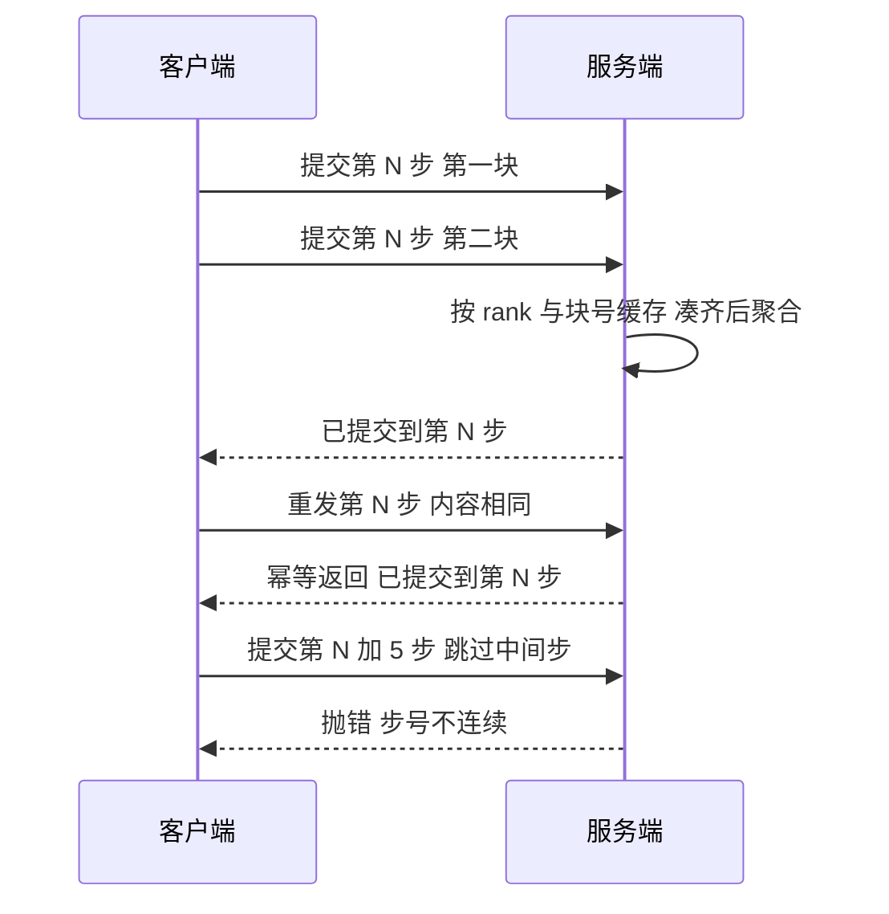

训练侧一定会断连、重启，所以这一层要先答三个问题：写序由谁定、重试会不会算两遍、重启能回到哪个点。三个答案不同，混在一段里看容易误判，下面分开讲。

## 它是什么

先看最容易被重试撞上的那一件。举例：一次反向传播在 2 个 rank 上各算出一批梯度，第 N 步要提交，客户端切成了两块；第二块的回包在路上丢了，训练框架的重试把第 N 步整批又发了一遍。

读图：横跨两个参与者的箭头都真的跨进程。中间那条自发箭头是服务端本地动作，它按 rank 与块号缓存分块、凑齐才聚合，所以到达顺序不影响结果。重发那一行就是重试：载荷与已缓存一致，服务端原样回报已提交步号，梯度不会被应用两遍；跳步的请求则当场抛错。

**写入顺序。** 多个写同时在飞时哪一版生效，三条传输都没有跨请求的屏障。gRPC 与 bRPC 靠单分片单写者加请求内顺序；local_shm 有服务端编号和槽位上的已见编号，但客户端每次都写、服务端从不读，枚举里的「编号不符」没有任何分支产出。

**重复提交。** 稀疏更新有步级去重：每张表只留一个在途步，步号必须正好是已提交步号加一；旧步重来且载荷一致就幂等返回，不一致就抛错。精确替换另有七条硬限制（见代码位置），违反后会话粘死为失败。普通更新与 Put 没有请求级去重，bRPC 的重试是传输层重试，非幂等更新有重复应用风险。

**重启恢复。** 内存表重启后清空，只能靠 checkpoint。只有 gRPC 能存能取；bRPC 与 local_shm 的入口直接打错误返回失败，协议里也没有对应枚举。gRPC 会校验参数与身份；PS 核心在有未保存更新、已有不同活跃身份、或存储里已有记录时拒绝加载。

## 它为什么存在

重试不可避免：连接会断，进程会重启。没有步级去重，一次重试就可能把同一批梯度应用两次而不报错，只让模型慢慢偏掉；没有身份约束，一次误操作就能用旧 checkpoint 覆盖新状态。代价是去重只覆盖稀疏提交这一条路，别的写要让调用方自己保证。

## 它和谁接

上游是三条传输的写路径，下游是[第 05 章](../ch05/)的存储格式与 checkpoint 记录数。它同时约束[第 02 章](../ch02/)训练循环的行为：分片写没有原子性，整批重试必须由调用方判断。

## 代码位置

要改代码时再看这里。

checkpoint 全链路与失败表现：

- `DistributedShardedClient::SaveCheckpoint/LoadCheckpoint` 并发 fan-out 到每个配置分片，路径为 `<path>/recstore-shard-<shard>.bin`（`ShardCheckpointPath`）；逐分片收集结果，失败时打印分片号与文件路径，并汇总 `failed/total`；任一失败返回 `false`。
- gRPC 服务端校验 `arg1/arg2` 各一个且非空，解析 metadata JSON，要求含 `identity` 对象与非空 `checkpoint_id`，注入本分片的 `shard_id` 后调用 `CachePS`；参数不合法返回 `INVALID_ARGUMENT`，保存/加载失败返回 `FAILED_PRECONDITION`。
- `CachePS` 的约束：save 成功后记录 `active_checkpoint_identity_` 并清除 dirty；load 在「有未保存更新（dirty）」「已有不同 active identity」「存储里已有 checkpoint 记录（非 fresh）」三种情况下抛异常；失败或异常时按 `CheckpointRecordCount()` 回填 dirty。
- bRPC 客户端 `SaveCheckpoint`/`LoadCheckpoint` 重写为打 `ERROR` 并返回 `false`，`Command(SAVE/LOAD_CHECKPOINT)` 同样显式报 unsupported；协议里仍没有对应枚举。local_shm 没有 override，走 `BasePSClient` 默认实现，也是打 `ERROR` 返回 `false`。

写入顺序与幂等性：

- 顺序没有屏障：gRPC/bRPC 依赖单写者与请求内顺序；local_shm 的 `server_epoch` 与槽位上的 `server_seen_epoch` 客户端每次都写，服务端从不读，`kEpochMismatch` 只出现在枚举里。
- `SparseGradientCommitCoordinator` 为每张表维护一个 in-flight step：要求 `step == committed + 1`；按 `(rank, chunk)` 缓存分片；固定 rank/chunk 顺序聚合，网络到达顺序不影响结果；重复提交旧 step 时，载荷与已缓存一致则幂等返回 `committed`，不一致则抛错。
- v4「exact owner replacement」另有七条硬限制：`world == 2`、`dim == 128`、`divisor == 1`、key 严格递增、值全部有限、载荷 ≤ 1 MiB、chunks ≤ 64；此外要求 key 的高 8 位已带目标表的 tag（`TAG_TYPE` 为 `uint8_t`，`KeyTagShift() == 56`；tag 由 `MakeTensorTag(table_id, role, tensors_per_table)` 生成）。失败后会话置为 sticky failed，不重试、不回退。
- 普通 `UpdateParameter` / `PutParameter` 没有请求级去重；bRPC 的 `max_retry` 是传输层重试，对非幂等更新存在重复应用风险。

写路径的落地方式与切块：

- 服务端聚合对同一 key 做累加（v1）或整行替换（v4）；`divisor != 1` 时对聚合结果整体除以 `divisor`。稀疏提交客户端默认载荷上限 256 KiB，大 step 按 `(limit - sizeof(h)) / (8 + dim*4)` 自动分 chunk；local_shm 覆盖为 `slot_buffer_bytes - 4096`。
- 三条路径的 Put 落地方式不同：bRPC 服务端逐 key 调用 `PutSingleParameter`，gRPC 服务端整批交给 `CachePS::PutParameter`（内部 `BatchPut`），local_shm 走 `PutDenseParameterBatch`。

## 交付一句

一致性与 checkpoint 到此交代完毕：一条路径能存取 checkpoint、一套 step 级去重、一批没有原子性的分片写。下一块讲这些行为由哪些配置键决定。
