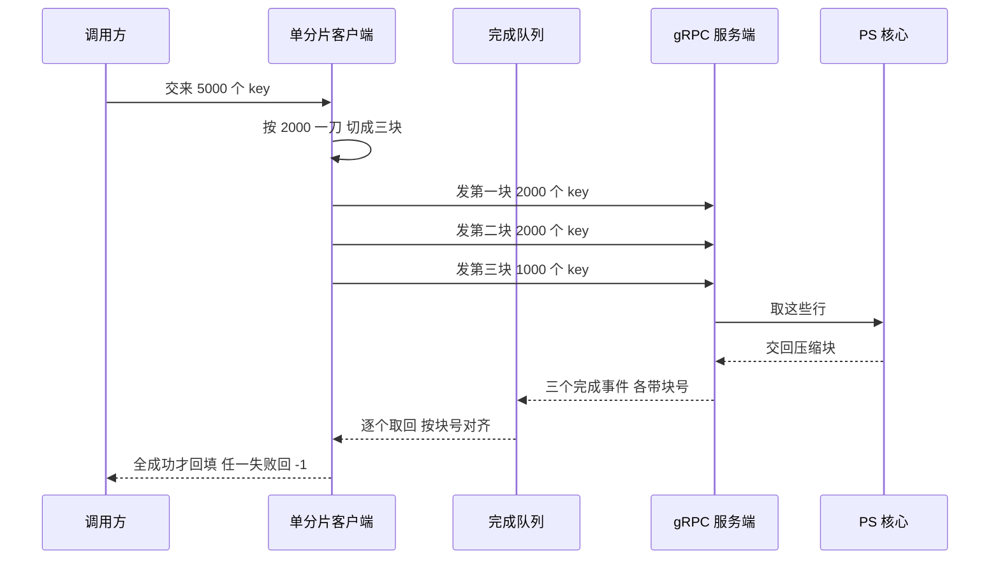
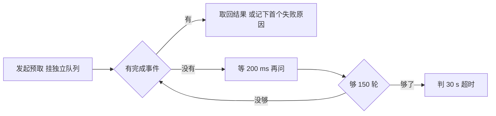

gRPC 是默认路径，也是三条网络路径里唯一能完整存取 checkpoint 的那条。这一页讲一次读被切成什么样、这些块怎么共用一条通道，以及「一批 key 里错一个、为什么整批都是 -1」。

## 它是什么

举例：调用方一次要 5000 个 key 的行。单分片客户端按 2000 切两刀，分成 2000、2000、1000 三块，几乎同时发出去，全部挂在同一条通道的同一个完成队列上；服务端每块回一段压缩块，客户端按块号把行拼回原顺序。

读图：真正跨进程的是中间三根「发 key」和回来的三根完成事件，其余全在训练进程里——切块、按块号对齐、回填。三块共用一条通道和一个完成队列，所以并发不靠多开连接，靠同时挂多少个未完成请求。

## 它为什么存在

gRPC 用 protobuf 承载载荷，实现简单、跨语言，代价是数据要按消息格式再拷一次，于是单次只取 2000 个 key。发 5000 个 key 就得接受三次拷贝和三次往返，这是它换通用性的价钱。

checkpoint 的扇出、元数据校验、身份约束也只在这里实现，所以选它的收益是完整状态能存能取。

代价的另一面是失败语义：整批一起死。任一块传输没完成，或完成了但状态不 OK，这次调用就返回 -1，不返回部分结果。非空请求收到空载荷、载荷长度或行数对不上，同样算失败；分片层看到某个分片返回非 0，便把整批判成失败。缺失的 key 不属于这类错误，它是正常结果：服务端回一个维度为 0 的条目，调用方保留成 0 行。

**预取另有一套等待。** 预取有自己的完成队列，查完成、等完成、取结果是三个分开的接口。

读图：这个环整只都在训练进程里，箭头是本地轮询；只有最上面「发起预取」那一下跨进程。失败不会被立刻抛出，先被记成「这一批永远等不到结果」，直到取结果时才浮出来。

## 它和谁接

上游是[第 4 块](./sharding)分好的块，下游是 gRPC 服务端，再往下是三条路径共用的核心。超时按用途分档：普通读写 15 s，checkpoint 600 s，读取 checkpoint 30 s，建表请求没有设置。

## 代码位置

要改代码时再看这里。

1. 客户端发请求：把 key 原始字节写入 `GetParameterRequest.keys`，每 2000 个 key 一个请求，全部挂在 `stubs_[0]` 上，用同一个 `cq_` 收完成事件（`grpc_ps_client.cpp#GRPCParameterClient::GetParameter`）。
2. 服务端收请求：`ParameterServiceImpl::GetParameter` 用 `base::ConstArray<uint64_t>(request->keys())` 直接解释字节，经 `CachePS::GetParameterRun2Completion` 取 `ParameterPack`，再用 `ParameterCompressor` 打包进 `parameter_value`。
3. 多分片怎么合：各分片的链路并行，最后由分片层 `ScatterEmbeddingRows` 统一回填。
4. 服务端写请求：Put 整批交给 `CachePS::PutParameter`（内部 `BatchPut`），与 bRPC 的逐 key 写入不同。
5. 超时按 RPC 分别设置：普通 RPC 15 s，checkpoint 600 s，`LoadCkpt` 30 s，建表请求没有设置。统一设置在 `SetRpcDeadline`。
6. 失败怎么判：每个 `ClientContext` 都带 15 s deadline。完成循环把 `ok == false`（传输未完成）与「完成但 `status.ok() == false`」分开记录，任一失败返回 -1。
7. 载荷怎么校验：非空请求收到空载荷、载荷长度或行数对不上，同样返回 -1。分片层把非 0 视为该分片失败，整批返回 -1。
8. 缺失 key 不算错误：仍返回 0 行，这是数据语义。
9. 预取怎么收：`PrefetchBatch` 自带独立完成队列；`ConsumePrefetchCompletion` 把传输失败与非 OK 状态交给 `MarkPrefetchFailed`，只记首个原因。
10. 预取等多久：`IsPrefetchDone` 把失败批次当作已完成，避免调用方空转；`WaitForPrefetch` 以 200 ms 轮询、最多 150 轮（30 s）无事件即判超时。
11. 预取取结果：`GetPrefetchResult` 遇到失败批次返回 `false`。

## 交付一句

gRPC 路径到此交代完毕：protobuf 编码、2000 key 一批、单个完成队列，以及一条「任一 RPC 失败就整批 -1」的失败路径。下一块讲把大载荷挪到 attachment 上的 bRPC。
