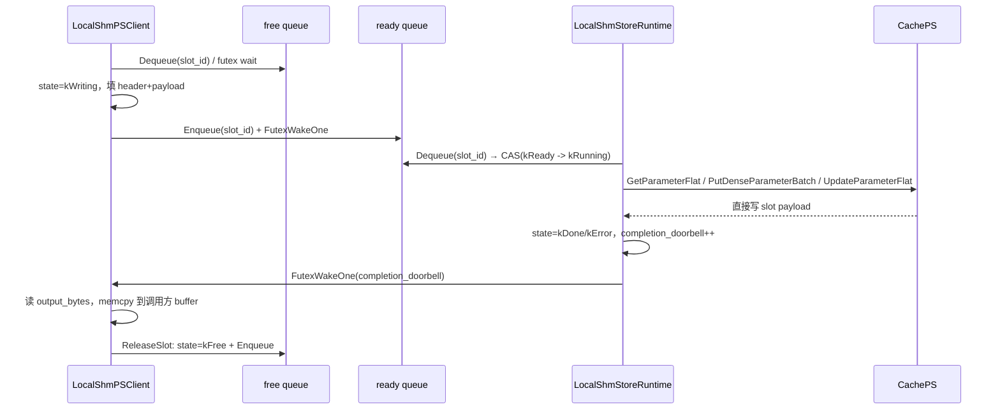

## 它是什么

local_shm 把请求放进一块进程间共享内存：客户端从空闲队列取一个槽位，把请求头和载荷写进去，再把槽位号放进就绪队列并敲一下门铃；服务端 worker 从就绪队列取槽位，直接调用 PS 核心，把结果写回同一块槽位的载荷区，再敲完成门铃；客户端醒来后把结果拷进调用方 buffer，最后把槽位还回空闲队列。

## 它为什么存在

同主机场景里，TCP 加序列化是纯开销。共享内存路径把这两样都去掉，只剩一次跨进程拷贝。代价是硬性的：只支持 Linux 同主机，且没有控制通道。

## 它和谁接

它没有分片层，客户端本身就是接口实现；服务端是独立可执行文件里的 worker。下游同样落到共享的 PS 核心，Put 走稠密批量入口。它不实现 Command，也没有 clear、reload、checkpoint。

## 代码位置

布局与同步：

- 布局固定为「控制块 → free 队列 → ready 队列 → 槽位头 → 槽位 payload」，全部按 64B 对齐，控制块的 `magic/version` 是挂接校验的一部分（`local_shm_layout.h#TotalRegionBytes`、`local_shm_region.cpp#LocalShmRegion::Attach`）。
- 队列是带序号的有界 MPMC 队列，`enqueue_pos`/`dequeue_pos` 加每格 `sequence` 做无锁发布；槽位状态机为 `kFree → kWriting → kReady → kRunning → kDone|kError → kFree`，服务端用 CAS 把 `kReady` 抢成 `kRunning`，避免重复消费。
- 同步原语是 Linux futex：客户端入队后 `FutexWakeOne(&ready_header->enqueue_pos)`；服务端空转时等待 `enqueue_pos`；客户端以 `client_timeout_ms`（默认 30000）等待 `slot.completion_doorbell`，超时把 `status_code` 置为 `kTimeout`。
- 服务端 worker 数等于 `ready_queue_count`，每个 worker 独占一个 ready queue，并把 `ready_queue_id` 作为 PS 核心的 `tid`；`cache_ps.num_threads` 会被抬到至少 `ready_queue_count`。

拷贝边界与平台限制：

- 「零拷贝」只发生在服务端这一侧：`GetParameterFlat` 直接写进槽位 payload，客户端可通过 `LocalShmFlatGetHandle::values` 拿到槽位内指针；但 `GetParameter` 仍会 `memcpy` 到调用方张量。因此它是「无 socket、无序列化的单次共享内存拷贝」，不是端到端零拷贝。
- 单机限制是硬性的：`shm_open`/`mmap`/`linux/futex.h`/`unistd.h`，只支持 Linux 同主机；CMake 没有为非 Linux 提供替代实现。

控制结构与不变量：

| 结构 | 关键字段 | 不变量 |
| --- | --- | --- |
| `LocalShmControlBlock` | `magic`, `version`, `server_epoch`, `slot_count`, `slot_buffer_bytes`, `ready_queue_count`, `next_request_id`, `fatal_status` | `magic == "RECSTORE"`, `version == 2`，挂接时校验 |
| `LocalShmQueueHeader` / `Cell` | `enqueue_pos`, `dequeue_pos`, `capacity` / `sequence`, `value` | 有界队列，满时 enqueue 返回 false；`sequence` 兼作发布/回收标志 |
| `LocalShmSlotHeader` | `state`, `opcode`, `status_code`, `client_id`, `request_id`, `key_count`, `embedding_dim`, `learning_rate`, `input_bytes`, `output_bytes`, 时间戳, `completion_doorbell` | `request_id` 与客户端 handle 匹配才接受完成；`learning_rate` 由原来的 `reserved0` 位置承载，`0` 表示不上报 |

## 交付一句

local_shm 路径到此交代完毕：槽位加队列加 futex，服务端侧单次拷贝，只支持 Linux 同主机。下一块讲三条路径共享的写序、去重与 checkpoint 边界。
