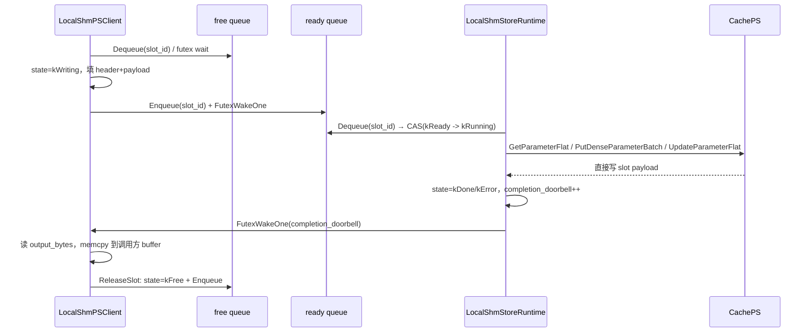

训练进程和参数服务跑在同一台机器上时，协议开销与序列化往往比计算更贵。这一块讲共享内存路径怎么用一块内存和两个队列把它去掉。读完能判断部署适不适合用它，也能在超时时知道卡在哪一步。

## 它是什么

这条路径不建连接，也不做协议编码：客户端与服务端挂到同一块共享内存上，用定长槽位交接请求和结果。

图里的一次调用按七步走：

1. 从空闲队列取一个槽位；队列空时在门上等，直到服务端还回一个。
2. 把槽位标成「写入中」，填好槽位头与载荷。
3. 把槽位号放进就绪队列，再敲一下请求门铃。
4. 服务端取走槽位，用一次原子的「比较并交换」把「就绪」改成「处理中」。
5. 服务端调用 PS 核心，把结果写回同一块槽位的载荷区。
6. 服务端标成完成或出错，敲完成门铃；客户端醒来，把结果拷进调用方的缓冲区。
7. 客户端把槽位还回空闲队列。

## 它为什么存在

同主机场景里，TCP 加序列化是纯开销。共享内存路径把这两样都去掉，只剩一次跨进程拷贝。

代价是硬性的：只支持 Linux 同主机；没有控制通道，清空、重载、checkpoint 都没有。

## 它和谁接

它没有分片层，客户端本身就是接口实现。服务端是独立可执行文件里的 worker，不走 gRPC 与 bRPC 共用的进程入口。

下游落到共享的 PS 核心：读与更新进同一个核心，Put 走稠密批量入口。它不实现命令，所以没有清空、重载、checkpoint。

## 代码位置

结构与布局：

- 区域顺序固定为「控制块 → 队列头 → 队列格 → 槽位头 → 槽位载荷」，每段按 64 字节对齐，总长度由 `local_shm_layout.h#TotalRegionBytes` 算出。
- 挂接时校验控制块的 `magic/version`，对不上就拒绝（`local_shm_region.cpp#LocalShmRegion::Attach`）。

| 结构 | 关键字段 | 不变量 |
| --- | --- | --- |
| `LocalShmControlBlock` | `magic`, `version`, `server_epoch`, `slot_count`, `slot_buffer_bytes`, `ready_queue_count`, `next_request_id`, `fatal_status` | `magic == "RECSTORE"`, `version == 2`，挂接时校验 |
| `LocalShmQueueHeader` / `Cell` | `enqueue_pos`, `dequeue_pos`, `capacity` / `sequence`, `value` | 有界队列，满时 enqueue 返回 false；`sequence` 兼作发布/回收标志 |
| `LocalShmSlotHeader` | `state`, `opcode`, `status_code`, `client_id`, `request_id`, `key_count`, `embedding_dim`, `learning_rate`, `input_bytes`, `output_bytes`, 时间戳, `completion_doorbell` | `request_id` 与客户端 handle 匹配才接受完成；`learning_rate` 由原来的 `reserved0` 位置承载，`0` 表示不上报 |

队列与同步：

- 队列是有界 MPMC 队列，靠序号无锁发布：`enqueue_pos` / `dequeue_pos` 各推进一个位置指针，每格 `sequence` 兼作发布与回收标志；满了入队返回 false。
- 槽位状态机为 `kFree → kWriting → kReady → kRunning → kDone|kError → kFree`。服务端用 CAS 把 `kReady` 抢成 `kRunning`，避免同一槽位被两个 worker 取走。
- 同步原语是 Linux futex：客户端入队后 `FutexWakeOne(&ready_header->enqueue_pos)`；服务端空转时等 `enqueue_pos`；客户端以 `client_timeout_ms`（默认 30000）等 `slot.completion_doorbell`，超时把 `status_code` 置为 `kTimeout`。
- worker 数等于 `ready_queue_count`，每个 worker 独占一个就绪队列，并把 `ready_queue_id` 作为 PS 核心的 `tid`；`cache_ps.num_threads` 会被抬到至少 `ready_queue_count`。

拷贝边界与平台限制：

- 「零拷贝」只发生在服务端这一侧：`GetParameterFlat` 直接写进槽位载荷，客户端可通过 `LocalShmFlatGetHandle::values` 拿到槽位内指针；但 `GetParameter` 仍会 `memcpy` 到调用方张量。所以它是「无 socket、无序列化的单次共享内存拷贝」，不是端到端零拷贝。
- 单机限制是硬性的：用到 `shm_open`、`mmap`、`linux/futex.h`、`unistd.h`，只支持 Linux 同主机；CMake 没有为非 Linux 提供替代实现。

## 交付一句

local_shm 路径到此交代完毕：槽位、两个队列、一次门铃，服务端侧单次拷贝，只支持 Linux 同主机。下一块讲三条路径共享的写序、去重与 checkpoint 边界。
