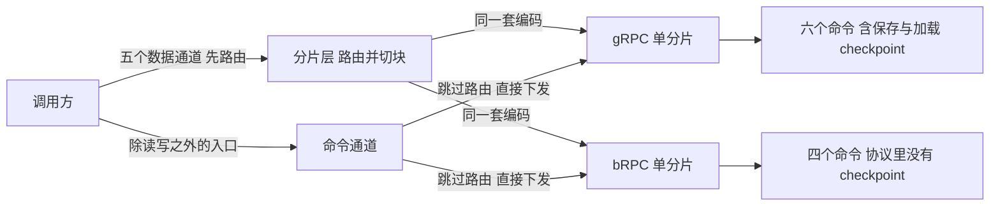

两份协议文件看起来几乎一样，能做的事却不一样。这一页并排放：哪些能力两边都有，哪一项在 bRPC 里根本不存在，以及大载荷为什么换了条路。

## 它是什么

举例：运维想给当前内存表存一份 checkpoint，调用的是同一个命令入口。gRPC 分支把路径和 metadata 传下去，服务端照做；bRPC 分支在客户端就打了错误日志返回失败——那份协议的消息定义里没有这个枚举值，代码根本没机会发出请求。

读图：调用方到分片层那一根还在训练进程里，分片层之后才跨进程。命令通道那两根跳过分片层直接到单分片客户端，同样跨进程，但少了路由与扇出这一步。最右边两个节点就是能力差：左支六个命令，右支四个，缺的正是保存与加载 checkpoint。

两份协议的消息体几乎逐字相同：同样的五个数据通道——取、整体写、更新、建表、稀疏提交，外加一个命令通道。差别只有三处：命名空间、生成方式，以及命令枚举少两个值。

取和整体写这两个调用的载荷，在 bRPC 上不走 protobuf 的 `bytes` 字段，而走 attachment：请求的 attachment 装 key，响应的 attachment 装压缩块。大消息因此绕过一次 protobuf 拷贝，代价是两边读写代码都要先试 attachment、再退回字段。

## 它为什么存在

协议是能力边界的物理位置：客户端能不能做某件事，先看枚举里有没有那个值。两份协议各自独立演化，能力不对齐是必然的，而这类缺失只有写进文档才可见——客户端编译得过、测试跑得过，等到线上要存 checkpoint 才发现对端没有这个分支。

bRPC 那两个缺失是协议级的，不是客户端忘了调用：对应入口被重写成打错误并返回失败，服务端的命令分发又对枚举外的值直接终止进程，所以不该假设多发一个未知命令会被忽略。

## 它和谁接

上游是[第 2 块](./client-stack)选定的单分片客户端，它按协议编码。下游是两个服务端实现，它们解码后统一交给 PS 核心。

命令通道不经过分片层，由接口直接下发；读写才走分片层的路由与切块。所以命令只作用在一个分片上；跨分片的 checkpoint 是分片层另外逐个分片下发的（见[第 9 块](./consistency)）。

## 代码位置

要改代码时再看这里。

| 调用 | 语义 | gRPC | bRPC |
| --- | --- | --- | --- |
| `GetParameter` | 按 key 取行，返回压缩块；缺失行以 `dim == 0` 占位 | 支持 | 支持（attachment 优先） |
| `PutParameter` | 整行覆盖；响应里的 `sucess`（proto 拼写如此）两个服务端都不设置，客户端只看 RPC 状态 | 支持 | 支持 |
| `UpdateParameter` | 按表更新梯度；结果由 `CachePS::UpdateParameter` 决定：优化器没初始化、学习率与客户端上报值不一致、按步更新越界都会让它返回 false | 支持 | 支持（梯度走 attachment） |
| `InitEmbeddingTable` | 建表，返回非负 tag；`config_payload` 是 JSON | 支持 | 支持 |
| `SparseGradientCommit` | 提交 56B 头 + 行；失败原因放 `response.error` | 支持 | 支持 |
| `Command(CLEAR_PS / RELOAD_PS / LOAD_FAKE_DATA / DUMP_FAKE_DATA)` | 清空、重载、灌/取假数据 | 支持 | 支持 |
| `Command(SAVE_CHECKPOINT / LOAD_CHECKPOINT)` | `arg1` 路径、`arg2` metadata JSON | 支持 | **协议无此枚举** |

命令枚举本身：

- 两份协议各自的枚举都叫 `PSCommand`。gRPC 侧在 `src/ps/proto/ps.proto#PSCommand`，有六个值，含 checkpoint 存取；bRPC 侧在 `src/ps/proto/ps_brpc.proto#PSCommand`，只有 `CLEAR_PS=0, RELOAD_PS=1, LOAD_FAKE_DATA=2, DUMP_FAKE_DATA=3`。
- bRPC 的缺失是协议级能力缺失，不是客户端忘了调用。
- 两个服务端的 `Command` 都以 `else { LOG(FATAL) << "invalid command"; }` 收尾，枚举外的值会让服务端进程终止。
- gRPC 的 `SparseGradientCommit` 即使业务失败也返回 `Status::OK`，原因写在 `response.error` 里；客户端检查后抛异常。

其余几条语义差异：

1. `GetParameterRequest.perf` 只用于打点；`model_name`、`GetParameterResponse.keys` 在生产路径没有消费者。
2. 协议本身没有批量上限。上限在客户端常量与配置里：gRPC 2000 key（`MAX_PARAMETER_BATCH`）、bRPC 65536（`MAX_PARAMETER_BATCH_BRPC`）、分片层按 `distributed_client.max_keys_per_request`（默认 500）二次切块。旧的 `cache_ps.max_batch_keys_size` 已被服务端 WARNING 后忽略。
3. 学习率是「客户端声明、服务端裁决」：`CachePS::CheckLearningRate` 在客户端上报值或服务端学习率任一 ≤ 0 时放行，否则要求两者差值在 `1e-6 * max(1, |server_lr|)` 内；不匹配打 `ERROR`，并让整批 `UpdateParameter` 失败。

两份协议的生成方式也不同：gRPC 一侧用服务声明来生成桩代码；bRPC 一侧多开一个通用服务选项，生成的桩类名字也带 `Stub`。这不影响能力，只影响你写客户端时 import 哪个类型。

| | gRPC | bRPC |
| --- | --- | --- |
| 生成开关 | `service` 声明 | 额外 `option cc_generic_services = true` |
| 生成的桩 | 由 `service` 生成 | `ParameterService_Stub` |

## 交付一句

协议与命令到此交代完毕：五个数据通道、一套控制枚举、以及一处协议级的能力缺失。下一块讲命令发出之前，请求怎么被分到各分片。
