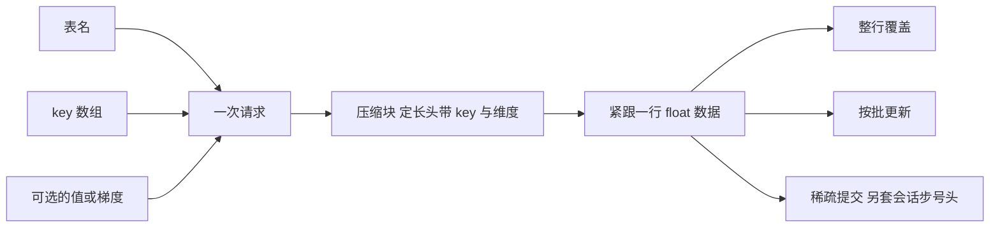

一次读写要在训练进程和参数服务器之间走一趟，两端对同一串字节的理解必须一致。这一页拆开请求：装哪几样、怎么写上线、哪些错误在发出前就被拒掉。

## 它是什么

举例：一个 batch 取 1500 个 key，表是 128 维 float，回来约 0.8 MB。这 1500 行并不各写一遍 key——请求里只有一个表名、一个 1500 长的 key 数组，以及一块按 key 顺序对齐的 float 数据。

入参就这三样。表名只在建表和更新时出现；key 是 64 位无符号整数，三条传输都当原始字节送；值或梯度是二维 float，读的时候可以写成「行数为 0、维度已知」，由后端补全。

值在线上是一行一个压缩块：定长头带 key 和维度，后面紧跟这一行 float。三种写入语义都用这个形状，接收端只需要一套解释逻辑。

读图：左边三根箭头在训练进程里把一个请求凑齐。中间两块是压缩块的两段，头定长、长度写在头里，所以接收端能逐行走下去。右边三条是这块数据发出去之后的三种用法，跨进程只发生在这一层，前两步都还在本地。

按批更新多带一个学习率，填 0 表示不报，服务端比一次、对不上就拒掉这一批。稀疏那层头是唯一做完整范围校验的载荷头，字段越界在解码阶段就抛错。

## 它为什么存在

三种语义本来可以各定一套格式，但三条传输、两个服务端实现加起来，每多一种格式就多一处要同步的打包与校验代码。压缩块把差异压到「头里写了什么」，块本身永远只有 key、维度、float 行。

稀疏更新必须把会话与步号放进头里：跨 rank 去重和按 step 排序从行数据本身推不出来。同一行在三个 rank 上各来一份，接收端判断不了它是同一步的三份贡献，还是三个不同步的更新。

建表单独走一次请求，因为行数和维度决定服务端的存储分配，也决定客户端能不能用那个占位形状；同名表重复建表而配置不一致，直接拒绝。

## 它和谁接

上游是计算层的张量与表配置（[第 02 章](../ch02/)）：形状不合法在这里就拒掉，不会拖到服务端；学习率由谁乘也在上游定（见[写路径](../ch02/write-path)）。

下游是[第 3 块](./protocol)的命令编码：压缩块进 proto 字段或 bRPC 的 attachment，56 字节头进稀疏提交的载荷字段。

## 代码位置

要改代码时再看这里。

| 结构 | 位置与要点 |
| --- | --- |
| 压缩块布局 | `src/ps/base/parameters.h#ParameterCompressItem`：`#pragma pack(1)` 的 `{uint64_t key; int dim; float embedding[0];}`，线上就是定长头加紧随其后的 `dim * 4` 字节 float 行；缺失行用 `dim == 0` 的 item 占位。 |
| 打包 | `src/ps/base/parameters.cpp#Pack<ParameterCompressItem>::CompressAppend` 生成 block。 |
| 解释 | 接收端用 `reinterpret_cast<const ParameterCompressReader*>` 直接解释，读取前必须 `Valid(payload_size)`。 |
| key 数组编码 | 三条传输都把 key 数组当原始字节传，不走 protobuf 的 `repeated` 编码。 |
| 读输出占位 | Get 的输出允许以 `{0, dim}` 的形式占位，由后端就地把形状补全。 |
| 更新学习率 | 更新请求的字段是 `UpdateParameterRequest.learning_rate`，`0` 表示不上报；服务端比对不一致时拒绝这批更新。 |
| 表配置 | `src/ps/base/base_client.h#EmbeddingTableConfig`：`{num_embeddings, embedding_dim, table_id}`，`Serialize()` 为 JSON。 |
| 建表复用 | `CachePS::InitTable` 对同名表比对配置，完全一致则复用，不一致返回 -1。 |
| 稀疏头 | `src/ps/base/sparse_gradient_commit.h#SparseGradientCommitHeader`：56 字节，静态断言保证；`kind` 为 0 submit / 1 query / 2 close / 3 abort；`version` 只接受 1 或 4；载荷总长必须严格等于 `sizeof(h) + rows * (8 + dim*4)`。 |
| 形状校验 | `src/ps/base/base_client.h#IsFloatEmbeddingValues`：value/grad 必须是 `FLOAT32` 二维 `[num_keys, dim]` 且 `dim > 0`；gRPC/bRPC 客户端在入口直接拒绝，local_shm 的 `GetParameterFlat` 校验 `keys.Size() == num_rows`。 |

## 交付一句

请求的形状到此交代完毕：三样入参、两种载荷头、一套形状校验。下一块讲这个请求由谁发出，也就是客户端栈的层次与选型规则。
