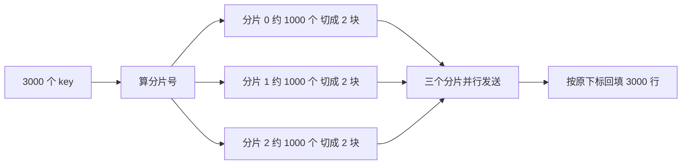

一次读带 3000 个 key，集群 3 个分片，单次调用最多 500 个 key（举例，用的都是默认量级）。这一页讲这 3000 个 key 怎么被拆开、发给谁、又怎么按原顺序还回来。

## 它是什么

拆一条批量请求要过四道手续。

1. 算归属。给每个 key 算一个分片号。默认是哈希后对分片数取余，所以同一个 key 每次都落在同一个分片。
2. 分桶。按分片号分成三堆，每堆同时记下每个 key 原来排第几。
3. 切块。哪一堆超过 500 个，就按 500 切开。举例里每堆约 1000 个，各切成 2 块。
4. 发送。每块交给负责该分片的分片客户端。读路径上三个分片同时进行；写路径按分片顺序一块一块发。

图里只有「算」「切」「发」「拼」四件事。从左边到「并行发送」之前，全部发生在训练进程里；只有那一根箭头跨出了进程。最后一步用的下标，是第 2 步顺手记下的那份，不是靠 key 再算一遍。

## 它为什么存在

两个约束逼出两级切分。

一批 key 可能横跨所有分片，不先按分片分堆，请求就会发到不持有的那个进程上。单次调用又有 key 上限，不在每个分片内部再切一刀，一块就会超限。两级是分开的两件事：第一级决定去哪，第二级决定一次带多少。

回填同样不能省。行是按分片、按块的顺序回来的，和调用方交进来的行序没有关系。不回填，第 100 行可能拿到第 1800 行的数据，梯度就写到错误的行上了。

## 它和谁接

上游是[第 2 块](./client-stack)的分片层，和[第 1 块](./request-shape)交来的 key 数组。下游是[第 5–8 块](./common-skeleton)的传输。

读写两条路在这里分开：读要求每块都和请求对得上，所以分片之间并行、片内串行；写不接受部分成功，所以整批按顺序发，任何一片失败就整体失败，已经发出去的分片也不回滚。

## 代码位置

要改代码时再看这里。

在线路由：

| 角色 | 位置 |
| --- | --- |
| 分片号怎么算 | `dist_sharded_client.h#GetShardId`：等价于 `hash(key) % num_shards`；`city_hash` 走 `GetHash(key) % num_shards_`，`simple_mod` 走 `key % num_shards_` |
| 未知方法怎么办 | 打日志后回退 `city_hash` |
| 哈希函数本体 | `src/base/hash.h#GetHash`，即 CityHash64 |
| 分片到客户端的映射 | `shard_to_client_index_`，来自配置 `servers[].shard`；请求按逻辑分片选对应的单分片客户端 |
| 离线用的另一套分区 | `shard_manager.h#ShardManager::KeyPartition` 用 `XPostoffice::NumServers()`，只被 `storage/kv_engine/load_db.h` 的离线加载路径使用，在线客户端不走它 |

服务端按分片部署：

| 角色 | 位置 |
| --- | --- |
| 是否多分片 | 判定条件是 `cache_ps.num_shards > 1`；多分片要求 `servers` 数量等于 `num_shards` |
| 多分片怎么起 | gRPC 在进程内为每个 `servers[]` 起一个线程，bRPC 为每个起一个 `brpc::Server` |
| 单分片的监听地址 | `src/ps/base/shard_endpoint.h#SelectSingleShardEndpoint`：`cache_ps.servers` 存在则取其中对应分片（默认分片 0）的 `host`/`port` |
| 没有 `servers` 时 | 回退 gRPC 的 `0.0.0.0:15000`、bRPC 的 `0.0.0.0:<brpc_server_port>` |
| `servers` 存在但缺该分片或字段非法 | 抛异常，服务端 `LOG(FATAL)` |
| checkpoint 里的分片号 | gRPC 的 `ParameterServiceImpl` 用解析出的分片号（写进 checkpoint 元数据），不再是常量 0 |
| 一个进程只起指定分片 | `-grpc_local_shard_id` / `-local_shard_id`；该值不在 `servers` 里时 `LOG(FATAL)` |

跨分片的批拆分与结果合并，按路径分开看。

Get：

1. 按分片分区，把每个 key 的原始下标记进 `key_index_mapping_`。
2. 每个分片起一次 `std::async`。
3. 分片内按 `max_keys_per_request` 串行分块发送。
4. 全部完成后用 `ScatterEmbeddingRows` 把「按分片顺序」的结果写回原行序。
5. 任一分片返回非 0，整体返回 -1。

Put / Update：

1. 先用 `GatherEmbeddingRows` 按原下标抽出每个分片的行。
2. 再按同样的 分片 → 块 顺序发送。
3. 任一分片失败即整体 -1，已发送的分片不回滚。

SparseGradientCommit：

1. 按 `shard_to_client_index_.at(GetShardId(key))` 把梯度分桶。
2. 串行调用每个分片；某分片没有行也发一个结束标记。`dist_sharded_client.h#SparseGradientCommit` 的注释原话是「Every shard receives an end marker」。
3. 返回值取所有分片的 `min(committed)`。

Prefetch：

1. 为每个分片的每个块生成子 prefetch id，并保存 `original_indices`。
2. `GetPrefetchResult` 逐块读回，按 `original_indices` 散射到原位置。

## 交付一句

路由与两级切分到此交代完毕：一段哈希决定归属，两级切分决定单次调用的大小，一份下标保证行序。下一块讲这些块送出去时共用的那套骨架。
