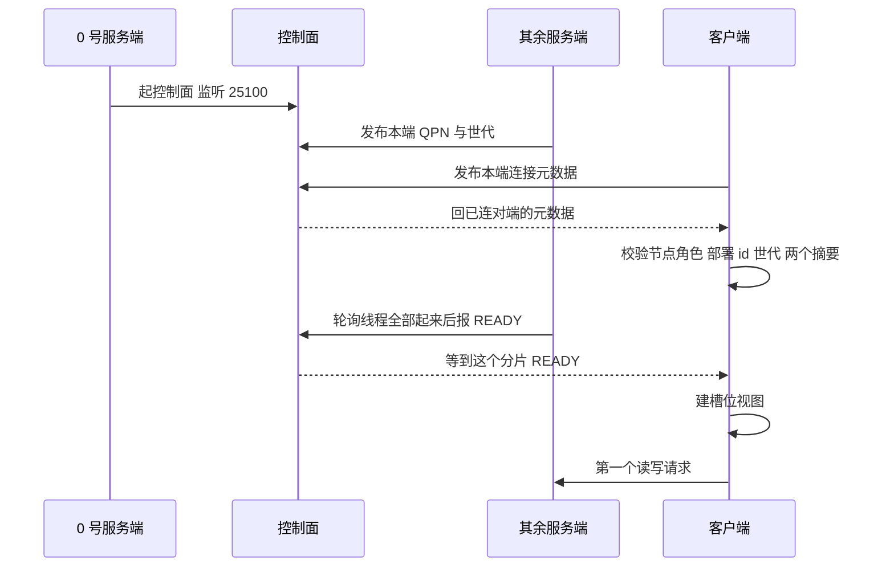

这一页回答两个问题：两端在开始传数据之前，靠什么确认彼此属于同一次部署、并且都还活着；以及进程启动时这几步谁先谁后。数据面自己不做建连，这套确认只能放在读写路径之外，于是它单独占一个服务、一条 TCP 连接。

## 它是什么

举例：一次部署 2 个服务端、16 个客户端进程，控制面只跑在 0 号服务端，默认监听 127.0.0.1 的 25100 端口。任何一个客户端要发第一个读写请求，都得先等到自己那个分片报 READY；在那之前，它连槽位视图都不建。

控制面是这三件事的唯一入口，也是全章唯一不参与读写的部件。

要确认的三件事各由一张表回答：

| 表 | 索引 | 回答什么 |
| --- | --- | --- |
| 元数据表 | 部署 id + 世代 + 发布方的节点与 lane | 对端这一侧的连接元数据是哪一版、是不是最新 |
| 就绪表 | 部署 id + 世代 + 服务端编号 | 这个分片什么时候可以接读写 |
| 健康快照 | 心跳时间 | 这个分片是正常、过期（stale）还是已死（dead） |

任意服务端或客户端进程都持有一个控制面客户端；每条连接一个 channel，连上之后复用。

从起控制面到第一个请求，谁先谁后？

读图：只有第一条是「把服务本身起来」，其余发布、拉取、报 READY 全走控制面那条 TCP，都是跨进程的；客户端校验元数据与建槽位视图是本地动作。最后一根箭头才是数据面，它必须排在 READY 之后——这就是「数据面在此之前不会发请求」的那条线。

## 它为什么存在

这三件事漏掉任何一件，数据面都不会报错，它会照写：写进上一代的槽位、写进已经退出的进程、或者写进一个已经被别人接管的地址。错误现场离原因很远，所以把关只能放在建连阶段。

反过来，控制面不在读写路径上。它抖一下只影响恢复速度，不影响稳态吞吐——这也是它可以做成一个普通 TCP 服务、不必追求性能的原因。

## 它和谁接

上游是进程启动时读到的那份部署配置。下游是[第 8 块](./lane-lifecycle)的重建握手：两端靠它交换世代号。健康探测也走这条通道，判定为死的分片会让对应 lane 变脏。

## 代码位置

要改代码时再看这里。

**配置解析。** 一个函数同时要两块配置：客户端拓扑与 RDMA 部署。少一个字段就抛 `invalid_argument`，不会带着半份配置跑起来。

| 角色 | 位置 |
| --- | --- |
| 解析入口 | `ParseResolvedRdmaDeploymentConfig` |
| 两块配置的键 | `distributed_client`、`rdma_deployment` |

| 所属块 | 配置项 | 约束 |
| --- | --- | --- |
| 客户端拓扑 | `num_shards` | 必须显式给出 |
| 客户端拓扑 | `hash_method` | 只接受 `city_hash` 或 `simple_mod` |
| 客户端拓扑 | `max_keys_per_request` | 单请求的 key 条数上限 |
| 客户端拓扑 | `servers[]` | 每个分片一条，含主机、端口与分片号；必须覆盖全部分片、不能重复 |
| RDMA 部署 | `deployment_id` | 非空 |
| RDMA 部署 | `epoch` | 大于 0 |
| RDMA 部署 | `protocol_version` | 必须等于 `kRdmaDeploymentProtocolVersion == 1` |
| RDMA 部署 | `num_clients` | 大于 0 |
| RDMA 部署 | `nodes[]` | 必须覆盖 `num_shards + num_clients` 个节点 |

节点级约束：

- 每个节点必须给出 `node_id`、`role`、`device`、`port`、`gid_index`。
- `role` 必须和 `node_id` 区间一致：server 落在 `[0, num_shards)`，client 是 `>= num_shards`。
- RoCE v2 额外强制要求 `hop_limit`、`traffic_class`、`flow_label`，且都在允许范围内。
- 编号是稠密的：`global_id < num_servers` 是 server，否则是 client；客户端 `logical_id = global_id - num_servers`。

两个摘要：

- `configuration_digest` 是整份配置按分片 / node_id 规范化排序后的 FNV-1a 十六进制摘要。
- `fabric_digest` 只对 `nodes[]` 做同样的摘要。
- 两个摘要都进入元数据校验与 READY 校验。

**启动五步**：

1. `global_id == 0` 的服务端先起控制面：`RdmaControlPlaneServer::Start()`，走 gRPC，默认 `127.0.0.1:25100`。
2. 每个服务端构造 `RcShardServerTransport`：先给每条 lane 建资源，再 `PublishAndConnect()`——发布本端 QPN 与世代，拉取所有已连对端的元数据，过一遍 `ValidateRawVerbsPeerMeta`；最后挂 receive WR。
3. 轮询线程全部起来后，只有最后一个线程触发一次 `MaybePublishServerReady`，由它调 `PublishServerReady`。心跳线程和 READY 是分开的：它只刷新已存在的 READY 记录，不会新建记录（`RecordHeartbeat` 直接 return）。
4. 客户端走 `PetPSClient::InitializeTransport`：解析同一份配置，建 `RcShardClientTransport`（同样逐 lane 建连），用 `WaitServer(shard)` 阻塞到该分片 READY，再 `OpenSlot` 建立槽位视图。
5. `InitEmbeddingTable` 发一个正常的 `kInitTable` 请求，表建出来之后才开始 GET / PUT。

**严格契约**：`ValidateRawVerbsPeerMeta` 逐字段比对节点编号、逻辑编号、节点角色、协议版本、部署 id、部署世代、两个摘要、链路层、fabric 模式、端口、gid 索引与 MTU。任何一项不一致都在建连阶段快速失败，这是「同一次部署」的硬边界。

**关键 flag**，默认值以 `rc_options.cc` 为准：

| flag | 默认 | 影响 |
| --- | --- | --- |
| `--rdma_rc_qps_per_client_per_shard` | 16 | 每 client 每分片的 lane 数（结构体默认 32，被该 flag 覆盖） |
| `--rdma_rc_slots_per_qp` | 1 | 每条 QP 的逻辑槽位数；在途上限 = 两者乘积 |
| `--rdma_rc_request_slot_bytes` / `--rdma_rc_response_slot_bytes` | 1 MiB / 1 MiB | 槽位尺寸 |
| `--rdma_rc_mtu_bytes` / `--rdma_rc_target_response_mtu` | 4096 / 200 | GET 单 RPC key 上限 = `(4096*200)/value_size` |
| `--rdma_rc_inline_bytes` | 64 | 申请 `max_inline_data`；≤ 该值的 WRITE 加 `IBV_SEND_INLINE` |
| `--rdma_wait_timeout_ms` | 60000 | 状态字等待预算 |
| `--rdma_cq_harvest_interval_ms` | 50 | 等待期收割 完成事件 的间隔（0 关闭） |
| `--rdma_health_probe_after_ms` / `_interval_ms` / `_timeout_ms` | 1000 / 1000 / 1000 | 慢路径健康探测 |
| `--rdma_heartbeat_interval_ms` / `--rdma_health_stale_ms` / `--rdma_health_dead_ms` | 1000 / 3000 / 9000 | 心跳与健康阈值 |
| `--rdma_lane_rebuild_enabled` | false | 是否允许 QP 重建自愈（两端须同时开启） |
| `--rdma_lane_rebuild_max_attempts` / `_cooldown_ms` / `_wait_ms` | 3 / 1000 / 2000 | 重建预算、冷却、握手期限 |
| `--rdma_lane_rebuild_poll_ms` / `_poll_max_ms` / `_poll_timeout_ms` | 50 / 500 / 100 | 服务端世代轮询与退避 |
| `--rdma_rc_server_get_workers` | 0 | GET 载荷卸载线程数，0 = 轮询线程内联 |
| `--rdma_rc_server_coroutines_per_thread` | 1 | 每个轮询线程的协作式扫描器数 |
| `--rdma_rc_profile_interval_ms` | 0 | 周期性 profile 输出 |

## 交付一句

控制面与部署到此交代完毕：三张表、一份严格契约、一条五步启动顺序。下一块接[第 7 块](./errors)，讲谁在检测故障、谁把 lane 标记成脏。
