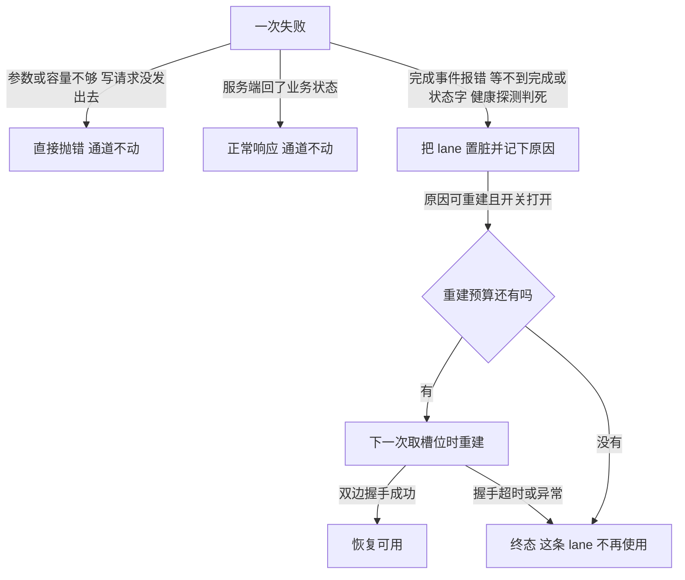

这一页回答两个问题：失败是在哪一步被发现的，以及它能不能靠重建救回来。答案决定上层看到的是「换条连接再试」，还是「这批更新已经没了」。

## 它是什么

举例：一次提交等了 60 s 也没等到状态字，这条 lane 被置脏，调用方拿到异常，而这批梯度不会自动重发。换一种：网卡报对端不再 ACK，同一条 lane 还有 3 次重建预算，2 s 内完成双边握手就能继续用；握手超时，它转终态。

一次失败要不要置脏，能不能重建？

读图：通向抛错与正常响应的两条箭头都止于调用进程，通道不动，也没有跨进程证据。真正把 lane 置脏的是第三条，它的证据来自完成事件或健康探测，也就是网卡和远端；而重建那条要和对端交换世代号，是全图唯一双向跨进程的箭头。

按检测点分七层，每层回答同样两个问题：

| 层 | 检测点 | 抛出的类型 | 是否置脏 lane | 能否靠重建恢复 |
| --- | --- | --- | --- | --- |
| 参数 / 容量 | 槽位装不下、一批装不下 | `std::runtime_error` / `std::invalid_argument` | 否 | 改参数 |
| verbs post | `ibv_post_send` 返回非 0 | `std::runtime_error`（`Write`/`WriteSg`） | **否** | 通常不能 |
| 设备层 | 完成事件 `status != SUCCESS` | `RawVerbsCompletionException` / `ShardUnreachableError` | 是 | 仅对端侧 |
| tracked WR 超时 | signaled WR 等不到完成事件 | `RcTrackedCompletionTimeout` | 是（`drain_timeout`） | 是 |
| 状态字等待超时 | 超过 `--rdma_wait_timeout_ms` | `std::runtime_error` | 是（`wait_timeout`） | 是 |
| 节点层 | `GetServerHealth` 判 `dead` | `ShardUnreachableError` | 是（`health_dead`） | 是 |
| 服务端业务 | `StatusWord::status` | 正常响应，`RpcStatus` | 否 | 由调用方决定 |

置脏只有一个入口，调用时带上原因和「可不可重建」。同一 lane 多次置脏时，「可重建」按取或算：可重建的原因不会被前面不可重建的原因盖掉。

设备层拿到的只是一个完成状态，还要再分一次类：

| 类 | 触发状态 | 含义 | `IsRawVerbsUnreachableError` |
| --- | --- | --- | --- |
| `kPeerUnreachable` | `IBV_WC_RETRY_EXC_ERR`、`IBV_WC_RNR_RETRY_EXC_ERR` | 对端不再 ACK | true |
| `kPeerRejected` | `IBV_WC_REM_INV_REQ_ERR`、`REM_ACCESS_ERR`、`REM_OP_ERR` | 对端应答但拒绝 | false |
| `kLocalError` | `LOC_LEN_QP_OP_PROT_ACCESS_RDD_VIOL` | 本地长度/权限/QP 用法错 | false |
| `kFlushed` | `IBV_WC_WR_FLUSH_ERR` | QP 已死，WR 被冲掉 | true |
| `kOther` | 其余 | 未知 | false |

五类里只有两类值得重建：对端不回 ACK，和队列已死、请求被冲掉。另外三类重建治不了——异常会保留网卡给的原始类型，不包装成「分片不可达」。

| 完成状态 | 要不要重建 | 为什么 |
| --- | --- | --- |
| 对端不再 ACK | 要 | 连接确实断了，重建能换一条 |
| 队列已死、请求被冲掉 | 要 | 同上，只能重置重来 |
| 对端应答但拒绝 | 不要 | 换条连接还是会拒，说明请求本身不合法 |
| 本地长度或权限错 | 不要 | 是调用方参数问题，重建一次错一次 |
| 其余未知 | 不要 | 没有证据说明重建有用 |

重试本身分了四层，但只有一层是真的重试：

| 层 | 机制 | 重试对象 | 默认 |
| --- | --- | --- | --- |
| 硬件 | verbs RC：`timeout=14`（≈67 ms）、`retry_cnt=7`、`rnr_retry=7`、`min_rnr_timer=12` | 单个 WQE | 恒开 |
| 传输 | 复用槽位前先 reap 上一个提交 WR 的完成事件 | 完成事件 | 恒开 |
| lane | QP 重建 + 双边世代握手 | 整条 lane | `--rdma_lane_rebuild_enabled`，默认关 |
| 请求 | **不存在** | — | — |

真重试只在硬件层：重传单个 WQE 由网卡完成，上层看不见——同一个 WQE 最多再发 `retry_cnt=7` 次，每次等 `timeout=14`（≈67 ms）。

传输层那行不是重试，是复用槽位前先把上一个提交 WR 的完成事件收干净，否则上一轮的完成事件会被当成本轮的。lane 层是重建：reset 一条 QP、重新握手，请求得由调用方重新发起。请求层没有重试。

## 它为什么存在

请求层不重试是有意的。重建后无法确定服务端执行过没有，而更新会真的改梯度——重发一次就可能乘两遍。异常对象里只带拼好的文本，没有可读的分片或 lane 字段，上层也做不到「只重试失败的那一片」。写清这条边界，比补一个看起来聪明的重试更有价值。

## 它和谁接

上游是[第 1 块](./slot-protocol)的提交等待，和[第 8 块](./lane-lifecycle)的重建判定：这一页只回答「谁检测、谁标记」。下游是调用方自己的整批重试策略。槽位的簿记在这里收尾——失败时怎么释放，决定调用方会不会读到一份从没到达的结果。

## 代码位置

要改代码时再看这里。

**置脏入口。** 只有一个函数 `PetPSClient::MarkLaneDirty(qp_index, reason, snapshot, waited_ms, rebuildable)`，参数里的 `rebuildable` 决定这条 lane 还能不能救。四类原因各报各的：

| 原因 | 上报的 `rebuildable` |
| --- | --- |
| `wait_timeout` | `rebuildable=true` |
| `health_dead` | `rebuildable=true` |
| `drain_timeout` | `rebuildable=true` |
| `cq_harvest_exception` | `rebuildable=false` |

设备层的错误不直接置脏，先由 `FailLaneOnCompletionError` 按完成状态分类，再决定。

**槽位状态回滚**：`SlotContext::busy` 与 `pending_rpcs_` 是两套簿记，失败时的处理并不对称。

- 重建后 `slot.busy = false`——QP reset 之后槽位物理上又能用了；但 `PendingRpc::failed = true`，条目还留着。原因写在 `TryRebuildLaneLocked`：删掉条目会让 `QueryRPCFinished` 返回 true、`WaitRPCFinish` 静默返回，调用方就会去解一个从没到达的响应——零填缓冲区恰好解成 `RpcStatus::kOk`。
- `RevokeRPCResource` 对 `failed` 条目跳过 `ClearRequestSlot`，因为该槽位可能已经被新请求复用，清零会破坏新请求的提交字。
- 脏 lane 上的槽位一律不归还（日志键 `revoke_skipped_dirty_lane`）：服务端可能还在读请求 载荷，或者 完成事件 还会晚到。

**其余符号。**

| 想知道什么 | 去哪看 |
| --- | --- |
| 完成状态怎么归类 | `raw_verbs_transport.h#ClassifyRawVerbsCompletionStatus`、`#IsRawVerbsUnreachableError` |
| 等待期间怎么探测健康、怎么收割完成事件 | `petps_client.cc#PetPSClient::WaitForStatusWord` |
| 慢路径探测的节流与缓存 | `control_plane.h#RdmaSlowPathProbeGate`、`petps_client.cc#MaybeProbeShardHealth` |

## 交付一句

错误分层与恢复到此交代完毕：七层错误、两类值得重建的完成状态、四层里唯一不存在的那一层。下一块接[第 8 块](./lane-lifecycle)，讲被置脏且可重建的 lane 怎么恢复。
