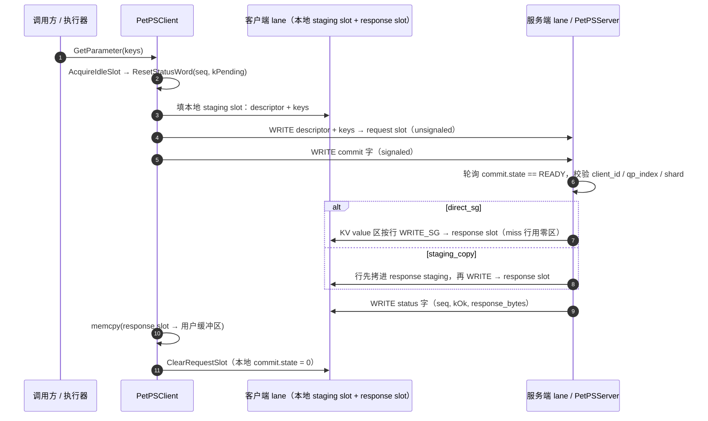

## 它是什么

一次读请求分四段：挑一个空闲 slot 并填入描述符与 key（形状见第 1 块）、服务端轮询到就绪后按响应模式取行、写回载荷与状态字、客户端拷进调用方张量并把 slot 清空。响应模式只影响第二段，其余三段是共用的；读图时只需看中间那段 `alt`。

两条边界决定了它能走多远：

1. 客户端用户缓冲区从不注册。服务端只能写进客户端 lane 的响应 slot，客户端再 `memcpy` 到调用方张量（`--rdma_rc_skip_client_copy` 只给 benchmark 用）。唯一的零拷贝旁路是 `BorrowGetResultPayload`：直接返回响应 slot 里的指针，只在「单 chunk 且位置恒等」时由 executor 采用。
2. 失败不能靠重发掩盖：slot 的簿记在失败时怎么收尾，见第 7 块。

## 它为什么存在

读是所有训练步骤里最频繁的操作，它的延迟直接决定预取能不能跟上计算。把「挑 slot、写请求、收状态」做成一条固定流水，让在途请求数等于 slot 数，从而使背压变成一个可计算的容量问题，而不是超时问题。

## 它和谁接

上游是执行器的批量提交：它按 key 上限切 chunk，每个 chunk 一个 RPC。下游是[第 5 块](./response-modes)的响应模式分支与[第 05 章](../ch05/)的存储接口。多 chunk 的装配由执行器负责，包括决定是否采用零拷贝旁路。

## 代码位置

- 客户端入口 `petps_client.cc#PetPSClient::AcquireIdleSlot`、`#WaitForStatusWord`；提交与清空在 `rc_transport.cc#RcShardClientTransport::SubmitRequest`、`#ClearRequestSlot`。
- 服务端 `petps_server.cc#PetPSServer::ProcessSlot`、`#ScanAssignedSlots`；校验在 `rdma_protocol.h#ValidateRequestDescriptor`。
- 批量与背压：`MaxGetKeysPerRpc` 在客户端把三个上限取最小值，即 `max_kv_num_per_request`、响应预算（`rdma_rc_mtu_bytes * rdma_rc_target_response_mtu / value_size`）、请求 slot 的键预算；`MaxInFlightGetRpcs = qps * slots_per_qp`，也是 `HasGetSlotCapacity` 的窗口宽度。`PrefetchParameter` 在容量不足时先 `DrainBatchSlots` 再提交。
- 分片与合并：`shard_routing.h#PartitionKey`、`#BuildChunks`、`#MergeBatchRows`、`#DecodeBatchStatus`。

## 交付一句

一次 GET 到此交代完毕：四段流水、两条边界、一套容量计算。下一块接[第 4 块](./put-update-init)，讲写方向为什么只有一次同步提交。
