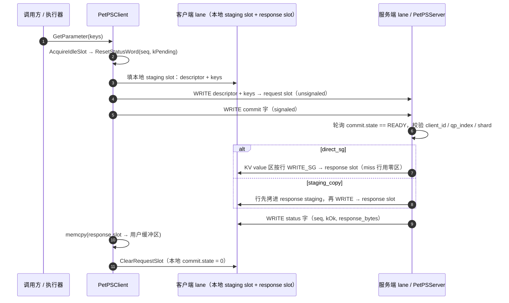

这一页把一次读请求拆成四段，一段一个动作。第二段是唯一的岔路：行能从原地搬走就一趟搬完，否则先拷到服务端缓冲区。其余三段两个出口共用，看时序图时只需要盯住中间那个分支。

## 它是什么

一次读请求走四段，两个响应模式只差第二段。

1. 客户端挑一个空闲槽位，把状态字重置为「等待」，再填入描述符与 key。
2. 客户端把描述符与 key 写进对端请求槽位，最后单独写一次带完成事件的提交字。服务端轮询到「就绪」，核对客户端编号、lane 编号与分片号。
3. 服务端取行：直接寻址时把真实行地址填进分散列表一次写回，否则先把行拷进本地缓冲区再整块写回。
4. 服务端写回状态字，带序号、状态与响应字节数。客户端看到就绪，把响应槽位拷进调用方张量，再清空提交字，槽位回到空闲。

流水能走多远，由两条边界决定。

一条是客户端的用户缓冲区从不注册。服务端写不进用户内存，只能写进这条 lane 的响应槽位，再由客户端拷进张量；基准专用开关能跳过这次拷贝，但只给 benchmark 用。零拷贝旁路只有一条，直接返回响应槽位里的指针，只在「单块、位置恒等」时由执行器采用。

另一条是失败不能靠重发掩盖：槽位簿记在失败时怎么收尾，见第 7 块。

## 它为什么存在

读是训练步骤里最频繁的操作，延迟直接决定预取能否跟上计算。固定流水让在途请求数等于槽位数，背压就成了可算的容量问题，而不是超时问题。

## 它和谁接

上游是执行器的批量提交：按 key 上限切块，每块一个 RPC。下游是[第 5 块](./response-modes)的响应模式与[第 05 章](../ch05/)的存储接口；多块装配与是否走零拷贝旁路也归执行器。

## 代码位置

- 客户端入口与等待：`petps_client.cc#PetPSClient::AcquireIdleSlot`、`#WaitForStatusWord`；零拷贝旁路 `#PetPSClient::BorrowGetResultPayload`。
- 提交与清空：`rc_transport.cc#RcShardClientTransport::SubmitRequest`、`#ClearRequestSlot`。
- 服务端：`petps_server.cc#PetPSServer::ProcessSlot`、`#ScanAssignedSlots`；校验 `rdma_protocol.h#ValidateRequestDescriptor`。
- 基准专用跳过拷贝：`--rdma_rc_skip_client_copy`（`rc_options.cc` 标注为 benchmark-only）。
- 批量上限：`MaxGetKeysPerRpc` 在客户端取三个上限的最小值，即 `max_kv_num_per_request`、响应预算（`rdma_rc_mtu_bytes * rdma_rc_target_response_mtu / value_size`）、请求槽位的键预算。
- 在途窗口：`MaxInFlightGetRpcs = qps * slots_per_qp`，也是 `HasGetSlotCapacity` 的窗口宽度；`PrefetchParameter` 在容量不足时先 `DrainBatchSlots` 再提交。
- 分片与合并：`shard_routing.h#PartitionKey`、`#BuildChunks`、`#MergeBatchRows`、`#DecodeBatchStatus`。

## 交付一句

一次 GET 到此交代完毕：四段流水、两条边界、一套容量计算。下一块接[第 4 块](./put-update-init)，讲写方向为什么只有一次同步提交。
