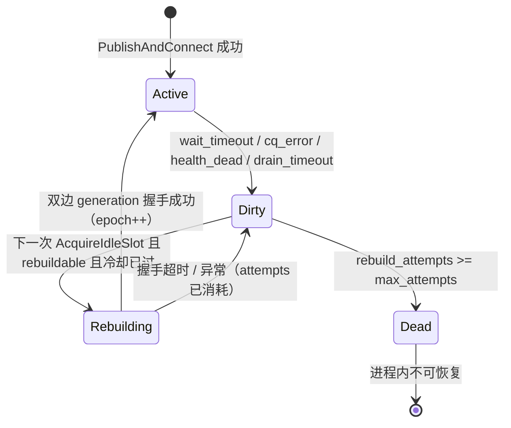

## 它是什么

一条 lane 只有四个状态量：脏（当前不可用，等待者快速失败）、可重建（这个原因能否靠重建治好）、死（终态）、世代（每次成功重建加一）。重建的触发点只有一个：下一次 `AcquireIdleSlot` 时，如果 lane 脏、`--rdma_lane_rebuild_enabled` 为真、可重建、冷却已过，就地重建。没有后台打扫线程，没有流量就不会恢复。重建预算 `--rdma_lane_rebuild_max_attempts`（3）按 lane 终身累计，成功后也不复位，耗尽即转 `dead`。

有四个不同的「世代」容易被混为一谈：

| 名字 | 归属 | 何时 +1 | 作用 |
| --- | --- | --- | --- |
| `deployment_epoch` | 配置 / 控制面 | 运维换部署 | 控制面拒绝跨 epoch 的 meta、READY、心跳 |
| `lane_generation` | 每条 lane 的 `RawVerbsTransport` | 本端重建后 `AdvanceLaneGeneration` 并重新 `Publish` | 对端据此判断「你重建了，我也要重建」 |
| `QpContext::epoch` | 客户端 lane | 重建成功 | 让旧请求的 `WaitForStatusWord` 立刻抛 `ShardUnreachableError`，而不是等一个已被复用的 slot |
| `Lane::response_epoch` | 服务端 lane | 服务端重建 | 拦住「请求已被接受、payload 还没发」的 worker，避免把旧世代的行写进新世代的 slot |

## 它为什么存在

RC 连接一旦进入错误态就无法原地恢复，只能 reset 重建。重建期间对端可能还在往里写，旧请求的完成事件也可能晚到；如果只 reset 而不区分世代，这些迟到的写会落进新连接复用的同一个 slot，被当成新请求的结果。世代号加双边握手，就是为了让「旧世代的一切」在逻辑上失效。

## 它和谁接

上游是[第 7 块](./errors)：只有被判定为可重建的错误才会把 lane 置脏。下游是[第 2 块](./connect-mr)的资源分配：重建要求该 CQ 上只有本 lane 的 QP。控制面提供元数据交换通道，让两端能看见对方的世代变化。

## 代码位置

重建握手（`RcShardClientTransport::RebuildLane`，全程持 `impl_->cq_mutex`）：

1. `RefreshPeerMeta` 先读对端当前 meta，记下 `server_baseline` 的 `lane_generation`；如果对端进程重启过，顺带拿到新的 QPN/rkey/base。
2. `RebuildQp`：`RESET`（flushes 所有在飞 WR）→ drain CQ → `INIT → RTR → RTS` → 重新挂满 1024 个 receive WR。
3. 清空 `submit_completion_pending/ready`，`memset(lane_base, 0, lane_bytes)`（旧世代的 status 不能让新请求看成完成）。
4. `AdvanceLaneGeneration` 自增并 `Publish`，让服务端看到变化。
5. 在 `--rdma_lane_rebuild_wait_ms`（默认 2000）内轮询 `RefreshPeerMeta`，只要对端 `lane_generation > server_baseline` 就算 ACK；每次 RPC 的超时用剩余预算，避免 30 s 的控制面 deadline 把数据面拖死。
6. 成功后 `TryRebuildLaneLocked` 释放该 lane 所有 slot、把该 lane 上 `pending_rpcs_` 全部标 `failed`、`epoch++`、清 `dirty/rebuildable`、`InvalidateVerdict()`。

服务端的对称路径是 `PollClientRebuildRequests` → `RebuildClientLaneIfStale`：轮询线程按 `qp_index` 归属扫描，读客户端 meta，发现 `lane_generation` 变化就 `response_epoch++`、`RebuildQp`、清响应完成标记、再自增并发布自己的 generation 作为 ACK。空闲时轮询间隔从 50 ms 指数退避到 500 ms（`MaybePollClientRebuilds`），重建成功即复位。

`num_os_clients != 1` 时两端都直接拒绝重建：服务端一条 lane 的 CQ 上挂着多个客户端进程的 QP，reset 后无法只 drain 自己的完成，drain 会丢掉别人的 CQE。这是显式设计取舍，不是遗漏。

## 交付一句

lane 生命周期到此交代完毕：四个状态量、四个世代、一次六步握手，以及一条「多客户端进程不重建」的硬限制。下一块接[第 9 块](./invariants)，把前面所有机制依赖的前提收成一张表。
