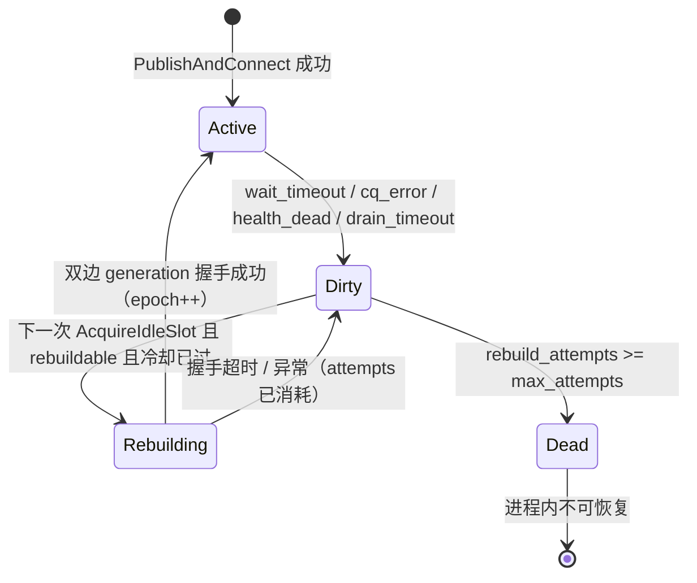

这一页讲一条连接坏掉之后怎么回来：谁触发重建、重建几次算用完、重建完成的那一刻怎么把旧连接的残留挡在外面。它还解释了一个容易混的地方：这里出现的四个「世代」，指的不是同一件事。

## 它是什么

一条 lane 只有四个状态量：

| 状态量 | 含义 |
| --- | --- |
| 脏 | 当前不可用，等待者立刻失败，不阻塞 |
| 可重建 | 这个原因能不能靠重建治好 |
| 死 | 终态，进程内不再恢复 |
| 世代 | 每成功重建一次加一 |

触发重建的地方只有一个：下一次取槽位的时候。四个条件要同时满足：

1. lane 是脏的。
2. 配置里允许重建。
3. 这个脏原因可重建。
4. 冷却时间已经过去。

没有后台打扫线程，所以没有流量就不会恢复。重建预算按 lane 终身累计，默认 3 次：成功一次也不复位，用完就转 `dead`。

此处容易混，四个世代各管一段。

| 名字 | 归属 | 何时 +1 | 作用 |
| --- | --- | --- | --- |
| `deployment_epoch` | 配置 / 控制面 | 运维换部署 | 控制面拒绝跨世代的元数据、READY、心跳 |
| `lane_generation` | 每条 lane 的 `RawVerbsTransport` | 本端重建后 `AdvanceLaneGeneration` 并重新 `Publish` | 对端据此判断「你重建了，我也要重建」 |
| `QpContext::epoch` | 客户端 lane | 重建成功 | 让旧请求的 `WaitForStatusWord` 立刻抛 `ShardUnreachableError`，而不是等一个已被复用的槽位 |
| `Lane::response_epoch` | 服务端 lane | 服务端重建 | 拦住「请求已被接受、载荷还没发」的 worker，避免把旧世代的行写进新世代的槽位 |

## 它为什么存在

RC 连接一旦进错态就没法原地恢复，只能 reset 重建。麻烦在于重建期间对端可能还在往里写，旧请求的完成事件也可能晚到。如果只 reset 而不区分世代，这些迟到的写就会落进新连接复用的同一块槽位，被当成新请求的结果。世代号加双边握手，就是让「旧世代的一切」在逻辑上作废。

## 它和谁接

上游是[第 7 块](./errors)：只有被判为可重建的错误才会把 lane 置脏。下游是[第 2 块](./connect-mr)的资源分配——重建要求该 CQ 上只挂着本 lane 的 QP。控制面提供元数据交换通道，让两端能看见对方的世代变化。

## 代码位置

**重建入口。** 客户端在下一次取槽位时做那四个条件的检查，没有后台线程来主动打扫。两个开关各管一件事：一个允许不允许重建，一个给预算上限。

| 开关 | 管什么 |
| --- | --- |
| `--rdma_lane_rebuild_enabled` | 允不允许重建，默认关 |
| `--rdma_lane_rebuild_max_attempts` | 预算上限，默认 3 次 |

**客户端握手**（`RcShardClientTransport::RebuildLane`，全程持 `impl_->cq_mutex`）：

1. `RefreshPeerMeta` 先读对端当前元数据，记下 `server_baseline` 的 `lane_generation`。对端进程重启过的话，顺带拿到新的 QPN / rkey / base。
2. `RebuildQp`：`RESET` 冲掉所有在飞 WR → drain CQ → `INIT → RTR → RTS` → 重新挂满 1024 个 receive WR。
3. 清空 `submit_completion_pending/ready`，再 `memset(lane_base, 0, lane_bytes)`——旧世代的 status 不能让新请求看成完成。
4. `AdvanceLaneGeneration` 自增并 `Publish`，让服务端看到变化。
5. 在 `--rdma_lane_rebuild_wait_ms`（默认 2000）内轮询 `RefreshPeerMeta`，只要对端满足 `lane_generation > server_baseline` 就算 ACK。每次 RPC 用剩余预算做超时，避免 30 s 的控制面 deadline 把数据面拖死。
6. 成功后 `TryRebuildLaneLocked` 收尾：释放该 lane 的所有槽位、把该 lane 上 `pending_rpcs_` 全部标 `failed`、`epoch++`、清 `dirty/rebuildable`、`InvalidateVerdict()`。

**服务端对称路径。** 服务端不主动重建，它等客户端报。轮询线程按 `qp_index` 归属扫描，读客户端元数据；发现对方的世代变了，就自增响应世代（`response_epoch++`）、重建队列对、清掉响应完成标记，再发布自己的新世代当作应答。空闲时轮询间隔从 50 ms 指数退避到 500 ms，重建成功即复位。

| 角色 | 位置 |
| --- | --- |
| 扫描与重建 | `PollClientRebuildRequests`、`RebuildClientLaneIfStale` |
| 退避轮询 | `MaybePollClientRebuilds` |
| 世代字段 | `lane_generation`、`response_epoch` |

**`num_os_clients != 1` 时两端都直接拒绝重建**：服务端一条 lane 的 CQ 上挂着多个客户端进程的 QP，reset 之后没法只 drain 自己的完成，一 drain 就丢别人的 完成事件。这是显式取舍，不是遗漏。

## 交付一句

lane 生命周期到此交代完毕：四个状态量、四个世代、一次六步握手，以及一条「多客户端进程不重建」的硬限制。下一块接[第 9 块](./invariants)，把前面所有机制依赖的前提收成一张表。
