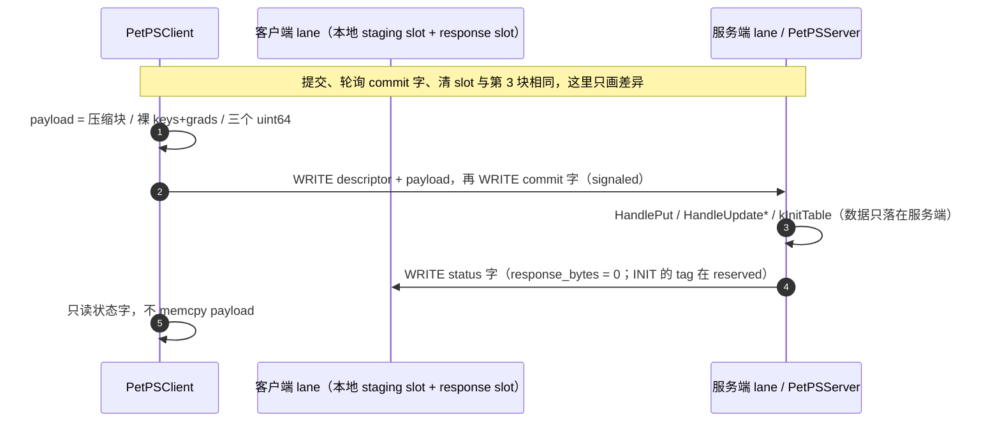

这一页讲写方向：把参数或梯度送进参数服务器的那一次请求。它借用读请求的四段流水，只在两处不同：送去的是压好头的行，回来的只有一个状态。看懂这两处差异，就明白写方向为什么天生是串行小批。

## 它是什么

写方向复用第 3 块的流水，只换载荷与响应。

1. 客户端把要写的行打包成压缩块：每行一个定长头，写明 key 与维度，后面紧跟 float 数据。
2. 客户端先写描述符与压缩块，再单独写提交字，与第 3 块完全相同。
3. 服务端按操作分派：普通写、带表名的更新、裸的「key 拼梯度」更新、建表。
4. 服务端只回一个状态字，响应字节数为 0；客户端只读它，不拷载荷。

更新分两种。带表名的把 64 字节定长表名塞进描述符；另一种是裸的「key 拼梯度」布局，长度由服务端严格校验。建表的载荷是三个整数，返回值放在状态字的保留字段里。

## 它为什么存在

写没有回退空间：一旦服务端开始应用，客户端不知道应用到了哪一行，所以写方向只做一次同步提交加一次等待，不做并发扇出。这也是背压的来源：大批按单次 key 上限循环「提交一次、等一次」，天然串行小批。

## 它和谁接

上游是调用方的写与更新调用，以及稀疏提交；下游是参数服务器核心的三种落地方式与存储引擎的原地更新。[第 7 块](./errors)会说明写请求为什么不适合在传输层重试。

## 代码位置

- 载荷：三种操作都用压缩块（`ParameterCompressor`），不是裸 float 行。
- 带表名的更新 `kUpdate`：表名放在描述符的 `table_name`（64 字节定长），服务端用 `DescriptorTableName` 还原。
- 学习率：描述符里带一个客户端优化器学习率（`learning_rate`），`0` 表示不上报；服务端与本地优化器不一致时拒绝这批更新。
- 裸更新 `kUpdateFlat`：布局是 `keys || grads`，`HandleUpdateFlat` 用 `FlatUpdatePayloadBytes` 严格校验长度。
- 建表 `kInitTable`：载荷是三个 `uint64`（`num_embeddings`、`embedding_dim`、`table_id`），返回值（tag）放在 `StatusWord::reserved`。
- 另一个入口是普通写 `HandlePut`；分派在 `petps_server.cc`。
- 串行小批：大批在 `PetPSClient` 内部按 `FLAGS_max_kv_num_per_request` 循环「一次同步提交 + 等待」，所以 PUT/UPDATE 天然是串行小批；GET 才有真正的批量并发。

## 交付一句

写方向到此交代完毕：压缩块载荷、单个状态字、串行小批、没有回退。下一块接[第 5 块](./response-modes)，讲读路径里那个决定「直接搬还是先拷贝」的开关。
