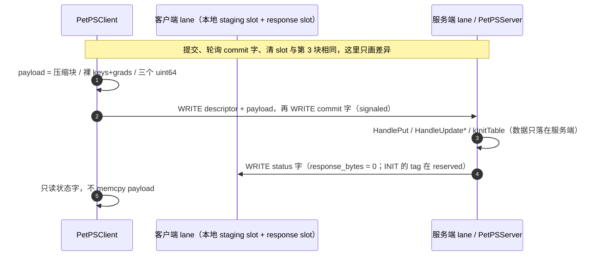

## 它是什么

写方向复用第 3 块的流水，只有载荷与响应不同：载荷是压缩块而不是裸 float 行，响应只有一个状态字，`response_bytes = 0`。更新还分两种：带表名的一种在描述符里塞 64 字节定长表名，另一种是裸的「key 拼梯度」布局，长度由服务端严格校验。建表的载荷是三个整数，返回值放在状态字的保留字段里。

## 它为什么存在

写没有回退空间：一旦服务端开始应用，客户端无法知道应用到了哪一行，所以写方向刻意做成一次同步提交加一次等待，不做并发扇出。这也是背压的来源：大 batch 在客户端内部按单次 key 上限循环「提交一次、等一次」，天然是串行小批。

## 它和谁接

上游是调用方的 Put/Update 调用与稀疏提交；下游是 PS 核心的三种落地方式与存储引擎的原地更新。[第 7 块](./errors)会说明为什么写请求不适合在传输层重试。

## 代码位置

- PUT / UPDATE 的 payload 是压缩块（`ParameterCompressor`），不是裸 float 行。`kUpdate` 额外在 descriptor 的 `table_name`（64 字节定长）里带表名，服务端用 `DescriptorTableName` 还原；descriptor 的 `learning_rate`（原 `reserved0` 位置）承载客户端优化器学习率，`0` 表示不上报，服务端与本地优化器不一致时拒绝这批更新。`kUpdateFlat` 是裸 `keys || grads` 布局，`HandleUpdateFlat` 用 `FlatUpdatePayloadBytes` 严格校验长度。
- `kInitTable` 的 payload 是三个 `uint64`（num_embeddings、embedding_dim、table_id），返回值（tag）放在 `StatusWord::reserved`。
- 大 batch 在 `PetPSClient` 内部按 `FLAGS_max_kv_num_per_request` 循环「一次同步提交 + 等待」，所以 PUT/UPDATE 天然是串行小批；GET 才有真正的批量并发。

## 交付一句

写方向到此交代完毕：压缩块载荷、单个状态字、串行小批、没有回退。下一块接[第 5 块](./response-modes)，讲读路径里那个决定「直接 scatter 还是先拷贝」的开关。
