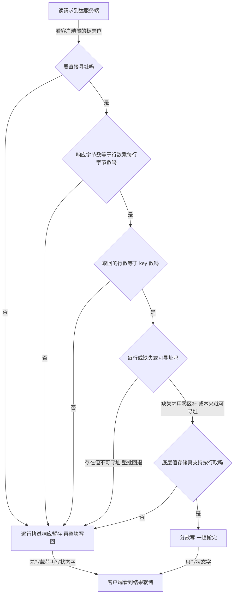

这一页回答一个问题：读请求处理完了，结果怎么回到客户端。答案只有两个出口，一个直接把行的地址发出去，一个先把行拷到服务端缓冲区再发；看懂这个分界，就能判断一条读走了哪条路，也明白那个自动选项为什么在运行时无效。

## 它是什么

举例：一次读 128 行、每行 128 个 float，响应 64 KiB。这些行多数就在同一块 DRAM 值区里，服务端把每行的真实地址填进分散写，最多 32 个地址项一条写，一趟发完；只要有一行落在 SSD 上，整批就改走拷贝。分支不是两套协议，是同一个请求上的一组标志位。

请求进来后，这一批行走哪个出口？

读图：从请求进来到「取行」的几个判断全在服务端本地，客户端只贡献了最上面那个标志位。真正的跨进程箭头在最后：两条路都把数据写进客户端的响应槽位，区别只是数据先从值区来还是先从暂存来。向下的每一条回退都汇到同一条拷贝路，因为回退是整批的，不存在「一半直接一半拷贝」。

## 它为什么存在

训练侧读的是连续的行，多数在同一块值区里，可以直接按地址发走，省一次拷贝和一段暂存。代价是四道前置检查和一个整批回退：任何一行不能直接寻址，这一批已经取回的行就白取一次。换来的是「存在的 key 绝不被填成 0」——只有确实缺失的 key 才从预先注册的零区取零。反过来，拷贝路径不会 abort，它不假设行还在原地。

## 它和谁接

上游是[第 3 块](./get)的读路径分支，下游是[第 05 章](../ch05/)的存储接口。会话式协议里没有「关掉回退」的开关：直接寻址模式下客户端总是同时置两个标志位，全仓没有只置前一个的调用点，所以「允许回退」这一位恒为真，只在服务端逻辑上有意义。

## 代码位置

要改代码时再看这里。

### 两个出口的对照

| 维度 | `direct_sg` | `staging_copy` |
| --- | --- | --- |
| 客户端置位 | `kRcFlagGetDirectSg \| kRcFlagGetAllowFallbackCopy` | 无 flag |
| 服务端入口 | `HandleGetDirectSg` → `CachePS::GetParameterDirectFixedRows` | `CachePS::GetParameterFlat` |
| 载荷来源 | KV value 区里的原始行指针 + 只读零区（miss 行） | 先拷进服务端暂存槽位 |
| 传输形态 | 多条 `WriteSg`，每条最多 32 个 SGE（`kMaxDirectSgesPerWr`） | 单次 `Write`，长度 `response_bytes` |
| 完成 | `CompleteResponseStatusOnly`（只写 StatusWord） | `CompleteResponse`（载荷 + StatusWord） |
| 失败语义 | 任何一行不可直接寻址 → 整批 abort | 不会 abort |
| 额外注册 | 服务端需要 KV value 区 MR + 零区 MR | 不需要 |

### `auto` 只活在工具层

运行时不存在 `auto`。二进制里只有一个二选一的开关，默认直接寻址；写成别的值直接 `LOG(FATAL)` 退出。环境变量入口同样只认这两个取值，其他值当场抛错。

这个自动取值只活在基准脚本里：拼命令行之前先解析成两个具体取值之一（哈希索引选先拷贝，其他选直接寻址），再把结果传给二进制。演示 CLI 走另一条路，直接给出取值，没有自动这一档。

旧文档曾把它写成运行时可选项，现在 `docs/parameter_server/rdma.md` 已澄清，只剩配置表一栏仍列着它。

- 二进制里的 flag 是 `DEFINE_string(rdma_get_response_mode, "direct_sg")`（`petps_client.cc`），取值只允许 `direct_sg` 或 `staging_copy`，其他值 `LOG(FATAL)`（`FillGetDescriptor`）。
- 环境变量入口 `RECSTORE_RDMA_GET_RESPONSE_MODE` 也明确拒绝其他值：`ApplyRdmaFlagsFromEnv` 抛 `RECSTORE_RDMA_GET_RESPONSE_MODE must be direct_sg or staging_copy`。
- `auto` 只出现在 `tools/benchmarks/run_benchmark_ps.py#resolve_rdma_get_response_mode`：它在构造命令行之前把 `auto` 解析成 `staging_copy`（当 `index_type == "DRAM_PET_HASH"`）或 `direct_sg`（其他），再以 `--rdma_get_response_mode=...` 传给二进制。
- `model_zoo/rs_demo/cli.py` 走另一条路：直接设 `RECSTORE_RDMA_GET_RESPONSE_MODE = staging_copy if index_type == DRAM_PET_HASH else direct_sg`，同样没有 `auto`。
- 前置条件 1：入口判据是 `descriptor.response_bytes == key_count * embedding_dim * 4`，且 `embedding_dim != 0`。
- 前置条件 4 的两层检查在 `KVEngineComposite::BatchGetDirectFixedRows`（`default_value_size_hint == row_bytes`）与 value store 的 `GetDirectFixedRows`（默认实现返回 false，只有 `DRAM_VALUE_STORE` 实现；`hybrid_value_store.h` 只转发了 `RDMABackingData`）。
- 直接寻址的取行与失败判定在 `CachePS::GetParameterDirectFixedRows`、`HandleGetDirectSg`（行判据 `data != nullptr && size == row_bytes`，缺失行为 `missing`）。

工具层为什么把「哈希索引」映射到先拷贝：代码里没有注释解释。一种与现状自洽的解读是，这种索引类型是唯一会被 SSD 值存储与分层值存储复用的，而这两种值存储不支持直接行寻址，选直接寻址会让每批都回退。此解释未确认，需要基准或作者说明。

| 相关位置 | 说明 |
| --- | --- |
| `tools/benchmarks/run_benchmark_ps.py#resolve_rdma_get_response_mode` | 把工具层的自动取值解析成具体模式 |
| `tools/benchmarks/batch_test/storage_runner.py`、`run_kvengine_compare.py` | 列出哪种索引类型会和哪些值存储组合 |
| `DRAM_PET_HASH`、`SSD_VALUE_STORE`、`TIERED_VALUE_STORE`、`direct_sg` | 上面那段解读里用到的名字 |

## 交付一句

响应模式到此交代完毕：同一个分支的两个出口、四条前置条件、一个只在工具层存在的 `auto`。下一块接[第 6 块](./control-plane)，讲让两端相信「处在同一次部署」的那套控制面。
