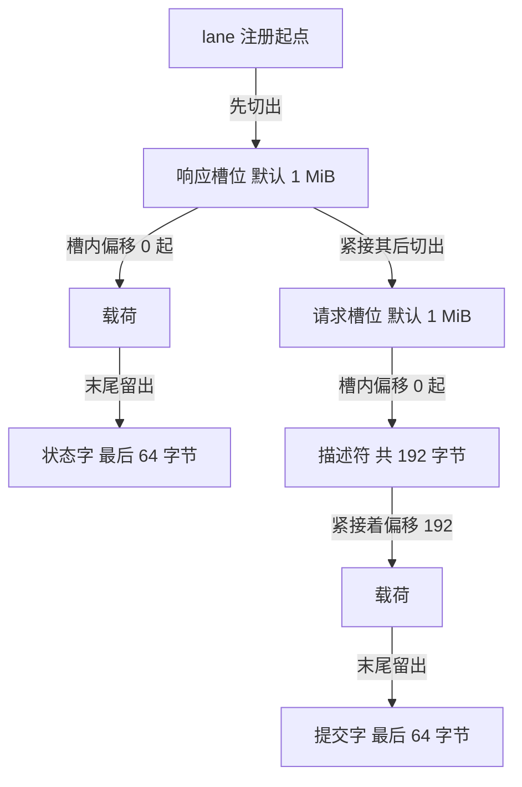
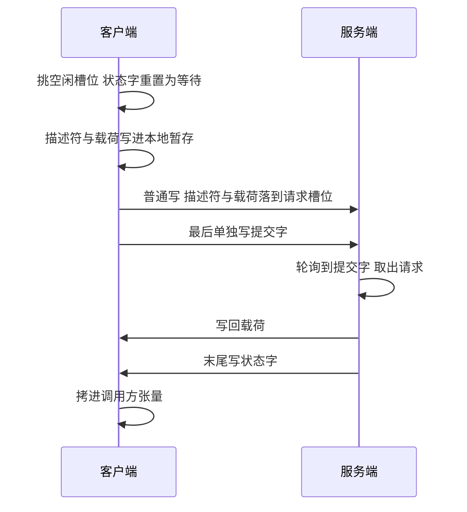

这一页讲一次请求落在对端内存的哪几个字节上，对方凭什么认为它已经到齐。答案是一块定长格子、两个固定偏移，加上两次有先后顺序的写。

## 它是什么

举例：一次读带 128 个 key、每个值 128 维，响应 64 KiB，只占一对 1 MiB 槽位里很小一块。客户端把描述符写在请求槽位最前面 192 字节，把这批 key 放在紧随其后的载荷区，最后单独写末尾 64 字节的提交字。

一条 lane 上的内存怎么切？



读图：从注册起点分出两条链，上面一条是服务端写回来的响应槽位，下面一条是客户端发出去的请求槽位，节点上标着各自的偏移。两块槽位都在客户端注册的那段内存里，所以「写响应」其实是服务端往客户端内存里写。槽位成对平移，第二对的偏移等于第一对加一个整对长度，服务端只做一次乘加。

一个请求从写到被取出，中间有几次写？



读图：中间四条箭头跨进程——客户端两次写过去，服务端两次写回来，其余四步都在本进程内。去的第一笔不带完成事件、第二笔带，所以客户端交出去就能走；服务端只认提交字，看到它时描述符与载荷必然已经落地。

## 它为什么存在

「就绪」不靠消息，靠顺序。RDMA 的写没有消息边界，只有字节落点：一串字节要成为「一个请求」，最省的办法是末尾单独写一个控制字，拿连接顺序当屏障。同一条 RC 连接上后发的写一定落在前一个之后，所以服务端不必读内存屏障，客户端也不必等回执；响应侧反过来，先载荷后状态字，看到状态字就知道载荷完整。

代价是定长：每块槽位默认 1 MiB，实际只用前面一小段，其余空着；换来寻址退化成乘加，服务端预先算好偏移，轮询只比一个整数。描述符固定 192 字节也是这个取舍——载荷永远从偏移 192 开始，服务端用常量读取。

## 它和谁接

上游是客户端的槽位分配器：挑一个空闲槽位、按偏移填内容、把状态字重置成等待。下游是服务端的扫描循环：轮询提交字，交给处理分支。槽位定长这件事在第 2 块变成「注册多大内存」，在第 3、4 块变成读写两侧的分支。

## 代码位置

要改代码时再看这里。

```text
lane_base + slot_in_qp * (resp + req)
├── response slot  [0 .. resp)
│   ├── payload            @ 0
│   └── StatusWord         @ resp - 64     (kRcSlotDone 表示 payload 已可读)
└── request staging slot
    ├── RequestDescriptor  @ 0             (192 字节, alignas(64))
    ├── payload            @ Align64(192)  (固定 192)
    └── CommitWord         @ req - 64
```

- 描述符定长：`RequestDescriptor` 固定 192 字节、64 字节对齐（`static_assert`）。载荷永远从 `Align64(sizeof(RequestDescriptor)) == 192` 开始；`payload_offset` 只被 `ValidateRequestDescriptor` 做区间检查，服务端读取时用的是固定 192，不读这个字段。
- 两个控制字：请求端 `CommitWord{seq,state}`，响应端 `StatusWord{seq,state,status,response_bytes}`，各占 64 字节。两者 `seq` 必须相等、`state == kRcSlotDone`（`StatusWordDone`）才算完成。
- 提交顺序即协议：`SubmitRequest` 先把描述符与载荷拷进本地暂存槽位，再用一次不 signaled 的写送到对端请求槽位，最后单独写提交字（signaled）。提交前 `ResetStatusWord` 把响应状态重置为 `kPending`，避免上一轮的 `kDone` 被误认。
- 序号：`seq` 是 lane 本地单调序号，`SlotContext::next_seq` 从 1 开始。服务端同时看 `commit.seq != last_seq_[slot]` 与 `commit.state == READY`；重复 seq、seq==0、仍在 `inflight_seq_` 的槽位都跳过。跨 lane 不保证顺序。
- 释放：写提交字（`ClearRequestSlot` → `commit.state = 0`）。服务端不依赖释放信号推进状态，它靠 seq 变化识别新请求。

## 交付一句

请求槽位协议到此交代完毕：192 字节描述符、紧跟其后的载荷、两个 64 字节控制字，以及靠保序换来的就绪语义。下一块接[第 2 块](./connect-mr)，讲这些偏移落在哪块注册内存上。
