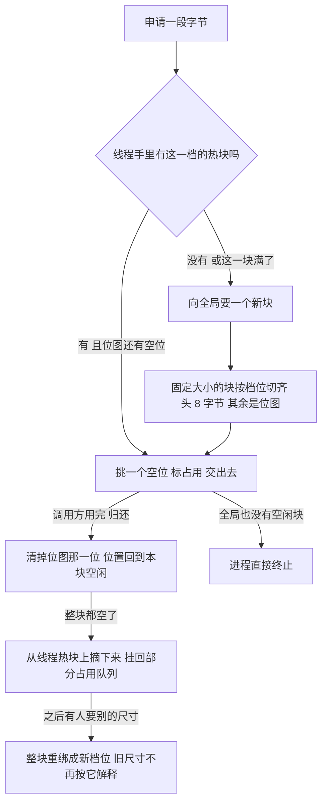

值存储手里的句柄最终要落成一段真实内存。这段内存从哪来、谁记着它有没有被占、释放之后能不能换个尺寸再给别人，都是分配器的事。这一页回答：一块内存怎么被切出去又收回、为什么回收方式决定了选型、以及配置里写的「共享内存」到底指什么。

## 它是什么

举例：一行 512 字节加上 8 字节头，落进 520 字节这一档；一个 1 MiB 的块能切出两千个左右，装一百万行就要五百来个块。这些块全在构造期向操作系统要一次，运行期只是在自己的地址空间里切来切去。

所以分配器要回答两个问题：切多大的块给这次申请，以及块回来之后能不能复用。下面这张图只跟进一次申请和一次归还。

读图：唯一一次离开用户态发生在最上面——向操作系统要内存，而且构造期就做完了，之后整张图都在一块已经映射好的地址空间里打转，没有一步跨设备。位图、热块、队列全是簿记；真正改变别人可见状态的是「标占用」和「清位」两个动作，它们各自是位图上的一次原子操作，所以不同线程可以同时切不同的块而不打架。最后那条终止边不是错误返回，是进程级失败：默认实现宁可死也不让上层拿到空指针。

四个实现都经同一层落到 mmap，取舍全在回收方式上：

| 分配器 | 结构 | 回收 | 备注 |
|--------|------|------|------|
| `CONCURRENT_SLAB_MEMORY_POOL`（默认） | 1 MiB chunk，8 字节头 + bitmap，按 slab class 绑定 | 每 slab 的 partial/active 队列 + 线程热块；空闲块可重绑 class | 全局空闲块耗尽直接 `LOG(FATAL)`；`size_classes` 只有带 sized 工厂的注册接受 |
| `PERSIST_LOOP_SLAB` | 8 字节 block 位图 + 每次分配 8 字节长度头 | 循环首次适应，从 `last_malloc_block_` 绕圈；fast free list（32 类 × 1M 项） | 单把 `base::Lock`；`FLAGS_shm_malloc_healthy_rate` 默认 0.95 |
| `PERSIST_MEMORY_POOL` | 2 MiB chunk，chunk 头 + bitmap | 按 chunk 归还；恢复时从 chunk 头重建占用 | 构造要求 `nr_chunks >= slab 类数` |
| `R2_SLAB` / `R2ShmMalloc` | r2 的 master + 每线程 arena | `alloc/dealloc` 交给 r2 | `GetMallocSize` 用 `je_malloc_usable_size`，长度带 padding |

所有实现都从一个文件对象拿地址空间。所谓「共享内存」在这里要拆开看，因为配置里的介质名和真实后端并不是一回事：

| `medium` 参数 | 实际后端 | 语义 |
|---------------|----------|------|
| `"DRAM"` | `ANONY_DRAM` | 私有匿名映射（`MAP_PRIVATE` 加 `MAP_ANONYMOUS`）；`filename` 只用于日志 |
| `"SSD"` | `FS_DAX` | 真正 `open + posix_fallocate + mmap(MAP_SHARED)` 的文件 |
| `DEV_DAX` | 已注册但选不到 | `ConfigForMedium` 里对应分支被注释掉，只有直接调 `PMMmapRegisterCenter::Register` 才走得到 |
| 其他 | `LOG(FATAL)` | 没有 `"PM"` / `"NVM"` 分支 |

所以配置写 `"DRAM"` 时要意识到：那不是一个能跟别的进程共享的段，而是带匿名私有标志的映射，进程退出就没了；只有写 `"SSD"` 才是真的打开一个文件并映射成共享。

另外，默认分配器构造时会先看同路径文件在不在，在就先删掉。

也就是说 `value.path` 如果指向一个真实文件，会被静默清理，没有任何提示。

默认分配器的构造入口先 `PathExists` 再 `Delete`：文件在就先删掉，然后重新映射一份。

对齐是两个附带的硬约束之一。默认索引和可扩展哈希的块都按 `posix_memalign(..., 64, ...)` 这个形式申请，也就是 64 字节对齐；slab 的块按页对齐。

另一个是循环分配器的偏移必须 8 字节对齐，取偏移时就断言，不对直接失败。

回收侧还有 epoch 这一层，解决「读者还握着旧指针」的问题。进程单例表有 128 个 64 字节对齐的槽，线程第一次进来时按 `pthread_self()` 哈希占位，占不到就往后找。

共享内存那份复刻在回收时先记下当前 epoch，每 1000 次回收推进一次，再按安全判定批量释放。表槽的回收函数是空实现；超过 128 个线程同时进入这条路径，会在占位时等 2 秒然后终止进程。

## 它为什么存在

值存储要求分配器给它两样东西：接近零拷贝的批读取，以及一块能被 RDMA 注册的连续区域。[推断] 通用 malloc 满足不了第二点，因为它的地址与布局都不保证稳定。

分层值存储又要在同一份配置里表达两段介质，所以分配器还必须在构造期就把容量固定下来，运行期不搬动已有块——否则句柄一旦发出去就失效了。

## 它和谁接

向上给值存储提供四类能力：分配、释放、取大小、取底层连续区域。向下落到 mmap，再往下就是页缓存和块设备。

介质映射同时决定两件事：这块内存进程退出后还在不在，以及配置里那个文件名是真文件还是纯日志标签。SSD 侧的页级与块级分配是另一套接口，见第 8 块。

## 代码位置

要改代码时再看这里。

- `src/memory/malloc.h#MallocApi`、`src/memory/allocators/concurrent_slab_memory_pool.h#ConcurrentSlabMemoryPool` — 下沉接口、默认分配器、构造删同路径文件、耗尽 FATAL。
- `src/memory/allocators/persist_loop_slab_allocator.cc#PersistLoopShmMalloc::New` — 循环首次适应。
- `src/memory/shm_file.cc#ShmFile::ConfigForMedium`、`#AnonyDramShmFile::Initialize`、`#FsDaxShmFile::Initialize` — 介质映射：DRAM 档走 `mmap(MAP_PRIVATE | MAP_ANONYMOUS)`，SSD 档才是打开文件再映射。
- `src/memory/epoch_manager.h#EpochManager`、`src/memory/malloc.h#ShmEpochRecycle` — epoch 与延迟回收。

## 交付一句

第 4 块到此为止，读者应当知道字节来自 mmap、配置里的"DRAM"其实是进程私有映射、退役带一个延迟窗口。[第 5 块](./read-path)接读路径，把这些层串成一次查询。
