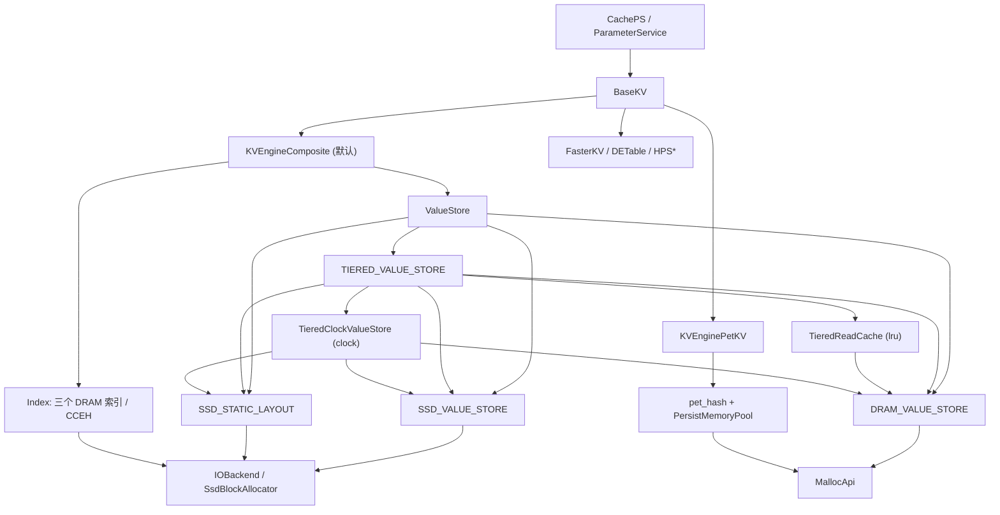

## 它是什么

引擎对外只有一套接口，内部有两种形态：拼装式把 key 到字节切成两次翻译、各自查表；整体式把一个第三方 KV 库整套接进来，自己管索引也自己管值。默认是拼装式，两次翻译都落在 DRAM。

顶层只有一个引擎名决定用哪套形态，缺省是拼装式；名字走白名单，必须与代码里的注册名逐字一致。

| `engine_type` | 实现 | 配置形态 | 注册位置 |
|---------------|------|----------|----------|
| `KVEngineComposite`（默认） | `KVEngineComposite` | 嵌套 `index` + `value` | `engine_composite.h` |
| `KVEnginePetKV` | `KVEnginePetKV` | 顶层 `path`/`capacity`/`value_size`/`value_capacity` | `engine_petkv.h` |
| `KVEngineFasterKV` | `KVEngineFasterKV` | 顶层 `capacity`/`value_size` + 可选 `fasterkv` | `external/fasterkv/fasterkv_engine.cc` |
| `KVEngineHPSHashMap` | `KVEngineHPSHashMap` | 顶层 `value_size`，无 `path` | `external/hps/hps_engine.cc` |
| `KVEngineHPSRocksDB` | `KVEngineHPSRocksDB` | 同上 + 必填 `path` | `external/hps/hps_engine.cc` |
| `KVEngineDETable` | `KVEngineDETable` | 顶层 `value_size` + `detable.library_path` | `external/detable/detable_engine.cc` |

整体替换的引擎编译期命运不同：FasterKV 与 HPS 的整个子目录受 CMake 开关（`RECSTORE_ENABLE_THIRD_PARTY_ENGINES` 及对应测试宏）控制；DETable 源码总会被编译，但要靠 `kv_engine_register.cc#IOBackendLinkGuard` 里的 `RECSTORE_ENABLE_DETABLE_ENGINE` force-link 才把静态注册带进二进制。没有注册时 `ResolveEngine` 仍会放行名字，`NewInstance` 则创建失败。静态库构建还会整单元丢弃只含注册的 `kv_engine_register.cc`，所以新增了 `RecStoreForceLinkKVEngineRegistrations()` 供可执行文件显式引用（`benchmark_kv_engine` 在工厂查表前调用）。

拼装的两次翻译各自查表：索引四种、值存储四种，具体类型与必填字段见第 2、3 块。下表只回答"能怎么拼"——"支持"指构造期不会必然失败、且仓库内有对应用法：

| index.type \ value.type | `DRAM_VALUE_STORE` | `SSD_VALUE_STORE` | `SSD_STATIC_LAYOUT` | `TIERED_VALUE_STORE` |
|--------------------------|:------------------:|:-----------------:|:-------------------:|:--------------------:|
| 三个 DRAM 索引 | 支持（默认路径） | 支持 | 需要固定行宽 + artifact | 支持 |
| `SSD` / `SSD_EXTENDIBLE_HASH` | 代码可行，测试跳过 | 测试覆盖 | 未确认 | 代码可行，测试跳过 |

约束来自各层构造函数，矩阵本身不做校验：`capacity` 是顶层必填，`DramPetHashIndex` 直接用它算表大小，漏配会在 `.at("capacity")` 抛异常；SSD 索引 + 非 SSD value 在 `test_kvengine` 里被显式跳过（注释 "invalid SSD index combo"），生产代码没有这条检查；`SSD_STATIC_LAYOUT_VALUE_STORE` 与 `TIERED_VALUE_STORE` 的 SSD 子层由 `value.ssd_layout.strategy` 选择，缺省或 `plain` → `SSD_VALUE_STORE`，`bandana`/`maxembed` → 静态布局，其他值抛异常。

默认组合（根目录 `recstore_config.json`）：`capacity=1000000`、`DRAM_PET_HASH`、`DRAM_VALUE_STORE`、`CONCURRENT_SLAB_MEMORY_POOL`、`default_value_size_hint=512`、`capacity_bytes=512000000`。

## 它为什么存在

替换需求分两种粒度：想换介质但保留哈希索引语义，只换值存储那一层；想整体换成成熟 KV 库，则连索引一起换。两级拼装让第一种需求不必碰上层，整体替换让第二种不必迁就两级的接口。代价是拼装式内部没有跨层校验，组合是否成立要靠各层构造函数自己兜。

## 它和谁接

向上的接口只有一套，参数服务器用同一组调用面对所有引擎。向下的边界是介质：拼装式的下半层要么落在进程地址空间，要么落到块设备，要么两者兼有。读路径在第 5 块，写路径在第 6 块，介质细节在第 3、4 块和第 8 块。

## 代码位置

- `src/storage/kv_engine/engine_selector.h#ResolveEngine` — 顶层引擎名解析与白名单。
- `src/storage/kv_engine/engine_composite.h#KVEngineComposite::KVEngineComposite` — 两次 `at(...).at("type")` 查表。
- `src/storage/kv_engine/kv_engine_register.cc#IOBackendLinkGuard`、`#RecStoreForceLinkKVEngineRegistrations` — force-link 入口。
- `recstore_config.json`（`cache_ps.base_kv_config`）— 默认组合与参数。

## 交付一句

第 1 块到此为止，读者应当知道"默认是 DRAM 哈希索引 + DRAM 值存储的两级拼装，其它引擎是整体替换"。[第 2 块](./index-engine)接索引层，回答 key 怎么变成句柄。
