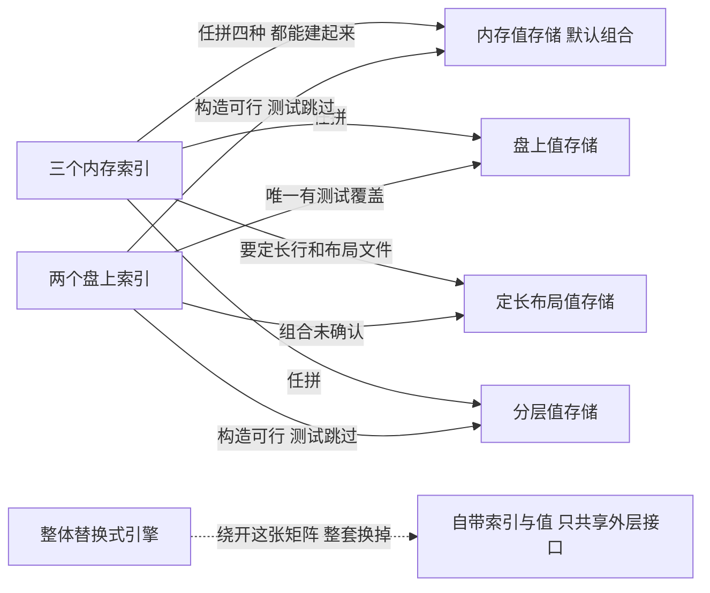

引擎对外只有一套接口，内部却是两种完全不同的形态：一种把索引和值存储拼在一起，另一种把第三方 KV 库整块接进来。这一页回答三个问题：两边各有什么可选、它们能拼成哪些组合、拼不上的组合会死在哪一步。

## 它是什么

举例：默认配置是一百万行、每行 512 字节，乘起来正好 512 MB，刚好把留给表的那段内存填满。放进这样一张表的每个 key，读一次要经过两次翻译——先由索引算出这一行在值存储里的句柄，再由值存储把句柄换成字节。

因为两次翻译各自查一张表，所以「能拼出什么」本质上是两道选择题相乘。下面这张图只回答这一件事：哪些索引能和哪些值存储摆在一起。

读图：左边两行是索引侧，右边一列是值存储侧，中间每条箭头都只表示一次构造期查表——所以整张图一条字节都不搬，全部是簿记。真正决定命运的是下面那一行：盘上索引只和盘上值存储有测试覆盖，另外三列要么只是构造上可行、要么根本没确认。跨设备只发生在选完之后：右边两列里落在盘上的组合，每次读写都要过块设备；落在内存的两列永远不出进程。最下面那条虚线是另一条路，整体替换的引擎进来就把两级结构整个绕开，不参与这张矩阵。

名字走白名单，必须与代码里的注册名逐字一致，缺省是拼装式。能在白名单里查到，不等于能造出实例：查名字只比对名单，实例化才去工厂注册表里找实现。

实例化那一步的入口叫 `NewInstance`，注册缺失时它返回空，构造函数随后报错。

| `engine_type` | 实现 | 配置形态 | 注册位置 |
|---------------|------|----------|----------|
| `KVEngineComposite`（默认） | `KVEngineComposite` | 嵌套 `index` + `value` | `engine_composite.h` |
| `KVEnginePetKV` | `KVEnginePetKV` | 顶层 `path`/`capacity`/`value_size`/`value_capacity` | `engine_petkv.h` |
| `KVEngineFasterKV` | `KVEngineFasterKV` | 顶层 `capacity`/`value_size` + 可选 `fasterkv` | `external/fasterkv/fasterkv_engine.cc` |
| `KVEngineHPSHashMap` | `KVEngineHPSHashMap` | 顶层 `value_size`，无 `path` | `external/hps/hps_engine.cc` |
| `KVEngineHPSRocksDB` | `KVEngineHPSRocksDB` | 同上 + 必填 `path` | `external/hps/hps_engine.cc` |
| `KVEngineDETable` | `KVEngineDETable` | 顶层 `value_size` + `detable.library_path` | `external/detable/detable_engine.cc` |

整体式引擎的共性是自带索引也自带值，只把外层接口留给参数服务器。PET 那条用的是自己的多分片哈希表 `pet_hash`，内存也从同一个分配接口要，分片数默认 16。

整体替换的引擎编译期命运不同，差别不在配置而在构建开关：

| 机制 | 管谁 | 不打开会怎样 |
|------|------|--------------|
| `RECSTORE_ENABLE_THIRD_PARTY_ENGINES` 及对应测试宏 | FasterKV 与 HPS 的整个子目录 | 这两个引擎的代码根本不进二进制 |
| `kv_engine_register.cc#IOBackendLinkGuard` 里的 `RECSTORE_ENABLE_DETABLE_ENGINE` | DETable 的静态注册 | DETable 源码照样编译，但注册符号会被链接器丢掉 |
| `RecStoreForceLinkKVEngineRegistrations()` | 静态库构建里的注册单元 | 只含注册的编译单元会被整单元丢弃，所以要由可执行文件主动引用一次，`benchmark_kv_engine` 就在工厂查表前调了一次 |

拼装的两次翻译各自查表：索引四种、值存储四种，具体类型与必填字段见第 2、3 块。下表只回答"能怎么拼"——"支持"指构造期不会必然失败、且仓库内有对应用法：

| index.type \ value.type | `DRAM_VALUE_STORE` | `SSD_VALUE_STORE` | `SSD_STATIC_LAYOUT` | `TIERED_VALUE_STORE` |
|--------------------------|:------------------:|:-----------------:|:-------------------:|:--------------------:|
| 三个 DRAM 索引 | 支持（默认路径） | 支持 | 需要固定行宽 + artifact | 支持 |
| `SSD` / `SSD_EXTENDIBLE_HASH` | 代码可行，测试跳过 | 测试覆盖 | 未确认 | 代码可行，测试跳过 |

矩阵自己不校验任何东西，约束散在各层构造函数里：

| 约束 | 落在哪一层 | 漏了会怎样 |
|------|------------|------------|
| 容量是顶层必填，内存哈希索引直接拿它算表大小 | 索引构造 | `DramPetHashIndex` 走到 `.at("capacity")` 抛异常 |
| 盘上索引配非盘上值存储 | 只在测试里 | `test_kvengine` 显式跳过，注释写 "invalid SSD index combo"；生产代码没有这条检查 |
| 盘上子层究竟是普通还是静态布局 | 分层值存储构造 | 由 `value.ssd_layout.strategy` 选：缺省或 `plain` → `SSD_VALUE_STORE`，`bandana`/`maxembed` → 静态布局，其他值抛异常 |
| 静态布局要固定行宽加一份布局文件 | 静态布局构造 | 尺寸与行宽不等就抛异常，`SSD_STATIC_LAYOUT_VALUE_STORE` 不接受新分配 |

默认组合就在根目录的配置文件里：

| 配置项 | 取值 |
|--------|------|
| 行数上限 | `capacity=1000000` |
| 索引 | `DRAM_PET_HASH` |
| 值存储 | `DRAM_VALUE_STORE` |
| 分配器 | `CONCURRENT_SLAB_MEMORY_POOL` |
| 行宽提示 | `default_value_size_hint=512` |
| 分配器容量 | `capacity_bytes=512000000` |

这份取值来自 `recstore_config.json` 里的 `cache_ps.base_kv_config`，也是上面那句「512 MB 填满」的来源。

## 它为什么存在

替换需求分两种粒度。想换介质但保留哈希索引的语义，只换值存储那一层；想整体换成成熟 KV 库，就连索引一起换。两级拼装让第一种需求不必碰上层，整体替换让第二种不必迁就两级的接口。

代价是拼装式内部没有跨层校验。组合成不成立，全靠各层构造函数自己兜：它认识自己的必填字段就建，不认识就抛。所以矩阵里有格子写着「代码可行，测试跳过」——能建起来，但没人验证过它跑得对。

## 它和谁接

向上的接口只有一套，参数服务器用同一组调用面对所有引擎。向下的边界是介质：拼装式的下半层要么落在进程地址空间，要么落到块设备，要么两者兼有。

选哪种组合，同时决定了后面几块的其余选择：值存储决定句柄怎么解释（第 3 块），分配器决定字节从哪来（第 4 块），读路径把这些层串成一次查询（第 5 块），写路径反过来走（第 6 块）。介质细节在第 3、4 块和第 8 块。

## 代码位置

要改代码时再看这里。

- `src/storage/kv_engine/engine_selector.h#ResolveEngine` — 顶层引擎名解析与白名单。
- `src/storage/kv_engine/engine_composite.h#KVEngineComposite::KVEngineComposite` — 两次 `at(...).at("type")` 查表。
- `src/storage/kv_engine/kv_engine_register.cc#IOBackendLinkGuard`、`#RecStoreForceLinkKVEngineRegistrations` — force-link 入口。
- `recstore_config.json`（`cache_ps.base_kv_config`）— 默认组合与参数。

## 交付一句

第 1 块到此为止，读者应当知道"默认是 DRAM 哈希索引 + DRAM 值存储的两级拼装，其它引擎是整体替换"。[第 2 块](./index-engine)接索引层，回答 key 怎么变成句柄。
