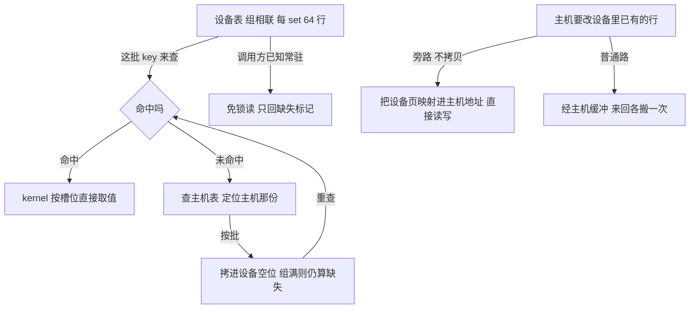

显存里那张表只负责读写，谁进谁出不由它决定。这一页回答：设备侧的表怎么组织、主机内存里为什么还留一份，以及为什么有一条路根本不拷贝。

## 它是什么

举例：一张三亿行、每行 128 个浮点数的表约 150 GB，比一张 80 GB 的卡大得多。设备上放的必然只是一个子集，剩下的部分要么留在主机内存里等着被查，要么根本不进这一层。

设备里那份子集和主机里那份是什么关系，看这张图。

读图：上半截是表族自己的做法，命中就由 kernel 直接寻址，未命中才去主机表定位那一行，再按批拷进设备表的空位；拷贝只填空位、不决定淘汰，所以表满了也不会自己腾地方，组满时这些 key 仍以缺失返回，交给上层处理。下半截是另一种可能，主机要改设备里已有的行时可以走一条把设备页映射进主机地址的旁路，写进去就是写设备内存，中间没有缓冲区；普通路则要经主机缓冲搬两次。图里省掉了淘汰，因为淘汰不在这层做。

这一族表各有取舍，接口、结构与限制摆在一起看：

| 组件 | 结构 | 用途/限制 |
|------|------|-----------|
| `gpu_cache_api` | 纯虚接口 | `Query`/`Replace`/`Update`/`Remove` + 只读扩展 `GetAssumingHits`/`Contains` + 调用方自管淘汰的 `TryInsertNoEvict`/`RemoveWithMask` |
| `gpu_cache`（`nv_gpu_cache`） | 组相联：`SET_ASSOCIATIVITY=2`、`SLAB_SIZE=32`、每组一把 mutex、`MurmurHash3_32` | 每 set 64 行，容量按 `capacity_in_set × 64` 行；`Query` 会等 miss 计数，`GetAssumingHits` 不加锁不 touch |
| `StaticHashTable` / `static_table` | 静态链地址：key 表 + slot 索引 + value 表 | `insert` 要求无重复且不超容量；`static_table` 只支持 `Query`/`Init`/`Clear` |
| `UvmTable` | 设备表 + 主机表两级 `HashBlock`，双缓冲 H2H 拷贝线程 | 设备 miss 时查主机表并批量拷贝；显存与主机内存各存一份 |
| `GPUCacheWithNoHash` | 一块连续 `cudaMalloc` 数组，构造要求 `end - start == capacity` | `UVAQuery` 按 `key * emb_dim` gather，隐含要求 key 从 0 起；无淘汰、无 miss |
| `PoolMemoryResource` / `FixedLengthMemoryResource` / `MappingDeviceMemory` | rmm 池/定长资源；GDRCopy `gdr_pin_buffer` + `gdr_map` | 定长资源明确"not thread safe"；映射预分配 `1024 * GPU_PAGE_SIZE`（GPU 页 64 KiB） |

这几处容易混在一起，分开看：

| 位置 | 是什么 |
| --- | --- |
| `src/gpu_memory/` | 整个目录不在 `src/CMakeLists.txt` 的 `add_subdirectory` 列表里，没接入构建 |
| `src/gpu_memory/gdrcopy/` | 原样收录的 NVIDIA GDRCopy，含 `LICENSE`、`src/` 与预编译 `libgdrapi.so.2.3` |
| `src/framework/cache/gpu_embedding_cache.{h,cu}` | 驻留决策、LRU 元数据、准入与失效、跨流顺序 |
| `src/python/pytorch/recstore/bagpipe_cache/` | 同一套策略在 Python 侧的控制器 |

所以图里那条旁路来自一个没进构建的组件，表族本身并不走它。

## 它为什么存在

显存访问是训练热路径：一个 kernel 里要按 key 直接寻址，所以表必须常驻设备，读的时候也不能拿锁。[推断] 设备侧也不适合做淘汰判定，它看不到整个批次、也看不到下一步要什么，接口因此把「插入但不淘汰」和「带掩码删除」单独留出来，让上层的缓存控制器统一决策。

## 它和谁接

向上被计算层的缓存控制器调用，向下使用显存分配资源与主机映射。它不参与前八块那条从 key 到字节的路，所以前面几页关于读写路径的结论不适用于它；要看驻留与失效怎么定，得去[第 02 章](../ch02/)。

## 代码位置

要改代码时再看这里。

- `src/storage/gpu_cache/gpu_cache_api.hpp#gpu_cache_api`、`src/storage/gpu_cache/nv_gpu_cache.hpp#gpu_cache` — 接口与组相联表。
- `src/storage/gpu_cache/static_hash_table.hpp#StaticHashTable`、`#static_table.hpp#static_table`、`#uvm_table.hpp#UvmTable`、`#gpu_cache_nohash.h#GPUCacheWithNoHash` — 表族。
- `src/gpu_memory/mapping_device_memory.cuh#MappingDeviceMemory`、`src/gpu_memory/gdrcopy/LICENSE`、`src/framework/cache/gpu_embedding_cache.cu`、`docs/architecture/bagpipe_cache.md` — 映射、vendored 来源与 BagPipe 分界。

## 交付一句

第 9 块到此为止，显存侧只提供表，不提供策略。九块走完，剩下的[配置总表](./appendix)、章节接口与风险清单可以按需查阅。
