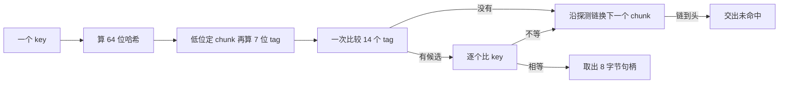

一次查找只回答一个问题：这个 key 现在指向哪里。答案是一个句柄，不是一个值；句柄怎么变成字节是下一块的事。

## 它是什么

一次平铺读带 512 个 key，每行 512 字节（举例）。索引要在这 512 个 key 上各做一次定址：命中就交出 8 字节的句柄，没命中就交出一个特殊值，让上层把这一行当缺失处理。

前四步都在同一张表里：哈希一次，定位一个 chunk，用 tag 把候选缩到几个，再逐个比 key。整条路上没有一次拷贝，只在索引自己的表里翻，最后取出的也只是 8 字节句柄，不读向量。三套 DRAM 结构只是把中间两步换成自己的做法；SSD 那一支把目录和段放在块设备上，查找中途会多出页读。

| 结构（额外配置） | 冲突处理 | 扩容 | 删除 | 并发 |
|------------------|----------|------|------|------|
| `DRAM_UNORDERED_MAP` | 标准库链地址 | 自动 rehash | `map_.erase` | 每操作 `shared_mutex` |
| `DRAM_EXTENDIBLE_HASH`（别名 `DRAM`） | 每 Block 槽位 + 分裂 | 局部/全局深度翻倍，目录扩容 | 槽位清空，不缩容 | Block CAS 锁 + 目录 CAS 锁 |
| `DRAM_PET_HASH`（必填 `capacity`） | 每 chunk 14 槽 + overflow 链 | 无运行时扩容（固定 `capacity`） | tag 置 0、key 置 -1、回退 overflow 计数 | 每 chunk 锁 + value CAS |
| `SSD_EXTENDIBLE_HASH`（别名 `SSD`，需 `index.path`、`index.io`） | 桶内线性 + cuckoo（阈值 16） | 段分裂 + 两级目录扩容 | 槽位清空 | 目录 `shared_mutex` + 每 segment `shared_mutex` |

四条实现细节决定了它们的实际脾气。

| 结构 | 细节 |
|------|------|
| `PetHash` | 是 F14 风格 chunk 表：`F14Chunk::MatchTag` 用 SSE 比较 14 个 tag，命中后再比 key；`overflow_count_` 记录探测链长度，删除时沿链回退计数。表满且 `force_insert=false` 直接 `LOG(FATAL) << "dict OOM"`，所以 `capacity` 配小是崩溃而不是降级；`capacity_ = chunk_num * 14`，90% 触发 OOM。`BatchGet` 用固定距离 16 的 `HintPrefetch`，这是它相对其它索引的主要批量优势 |
| `PetHash::Reload` | 只在 `Persistence=true` 时可用，恢复时并行扫描 chunk 重建 size 与探测链，并回调 `mallocSetValid` 让分配器重建占用位图；`PetKV` 构造时用它 |
| `ExtendibleHash` | `kBlockSize = 256` 字节、`kNumSlot = 256 / sizeof(Pair)`，`Pair` 为 key+value 两个 8 字节，所以每块只有 16 槽；`Directory` 默认 1024 项；分裂失败、别的线程正在 split 时走 `RETRY` |
| CCEH | 是两级目录，`DirectoryHeader` 指向 `DirectoryPage`，页里是 `Segment`，目录页数上限 `kMaxDirectoryPages`。`CCEH.cpp` 里原本有两个未使用的全局 `thread_local`，`pending` 与 `coros`，与 `io_uring_backend.cpp` 同名符号在静态构建下冲突，已删除；该索引没有生产构建目标，`test_cceh` 直接把 `CCEH.cpp` 编进测试可执行文件并注册进 ctest |

## 它为什么存在

索引与值存储是两套独立选择，索引侧需要自己的定址结构；默认实现选了固定容量哈希，把容量风险前移到配置阶段。这是有意的交换：固定容量去掉了运行期扩容的搬迁与锁，代价是配小了直接终止进程，现场没有补救余地。

## 它和谁接

向上接收读路径交来的 key 列表，向下交出句柄列表。索引内部的同步是各自的实现细节，拼装式引擎不在读路径上加锁（见第 5 块）。

## 代码位置

要改代码时再看这里。

- `src/storage/index/index.h#Index` — `Get`、`BatchGet`、`Put`、`Delete` 的公共形状。
- `src/storage/nvm/pet_kv/pet_hash.h#F14Chunk`、`#PetHash::GetInternal`、`#PetHash::Delete`、`#PetHash::Reload` — 默认结构的核心。
- `src/storage/index/dram/extendible_hash.cpp#ExtendibleHash::Insert`、`src/storage/index/dram/extendible_hash.h#Block` — 分裂与块内槽位。
- `src/storage/index/ssd/CCEH.h#DirectoryHeader`、`#Segment`、`#kCuckooThreshold` — 两级目录与段；`src/test/CMakeLists.txt` 的 `test_cceh` 直接编译 `CCEH.cpp`（标签 `storage;slow`、600 s、`RUN_SERIAL`）。

## 交付一句

第 2 块到此为止，索引只负责"key 对句柄"，句柄到字节的换算留给[第 3 块](./value-store)。第 3 块先看值存储，[第 4 块](./allocator)再看它背后的分配器。
