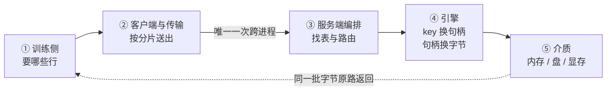

一次 embedding 查询，在存储层看来是一条固定的路线：训练侧交出一批 key，传输把它们送到参数服务器进程，服务端把 key 换成句柄、把句柄换成字节，再沿原路送回去。本章后面九块，每一块都在放大这条路线上的某一个环节。这一页先把整条路线走一遍，让你知道每一块站在哪、什么时候需要翻过去。

## 五个站

把路线按「谁手里握着这批数据」切开，只有五个站：

| 站 | 在哪 | 这一站做的事 | 交出去 |
|---|---|---|---|
| ① 训练侧 | 训练进程 | 决定这一批要哪些行 | 一维 key 列表 |
| ② 客户端与传输 | 训练进程 | 按 key 选分片、切块、发出请求 | 每个分片一份请求 |
| ③ 服务端编排 | 服务进程 | 找到表、决定走读还是更新 | 一批 key 与输出缓冲 |
| ④ 引擎 | 服务进程 | 两次翻译：key 换句柄，句柄换字节 | 一批句柄，然后是字节 |
| ⑤ 介质 | 服务进程内外 | 字节真正躺着的地方：内存、盘、显存 | 一段可读的字节 |

一句话关系：① 和 ② 在训练进程里，③④⑤ 在服务进程里，中间只跨一次进程边界；回程不是新请求，是同一批字节沿原路返回。

读图：实线是请求往下走，虚线是数据往回走。五个站里只有一条箭头跨进程，其余都是同一个进程里的普通调用。所以「存储慢」通常不是网络慢，而是 ④ 里的某一次查表、或 ⑤ 里的某一次页读慢。

## 走一遍读：默认配置下的 500 个 key

拿仓库默认配置举例：两个分片、gRPC、一百万个 key 的容量、每行提示 512 字节、内存池 512 MB。一次前向要取 500 个 key。

1. 训练侧把这 500 个 id 拼成一维 `int64` 张量。如果这张表带 tag，id 的高 8 位已经写好了表号，存储层只负责还原。
2. 客户端按 `hash(key) % 2` 把它们分成两堆，每个分片一条线程；每堆再按 `max_keys_per_request`（默认 500）切块，所以这一批正好一个请求一个分片。
3. 分片进程收到请求，`CachePS` 按表名找到元数据。读不经过优化器，直接落到引擎。
4. 引擎先做第一次翻译：500 个 key 各查一次索引，拿回 500 个 8 字节句柄；查不到的 key 得到一个特殊值，表示这一行不存在。接着做第二次翻译：每个句柄交给值存储，换出这一行的字节。
5. 字节可能来自三个地方：内存池里的槽（最快，能直接给指针）、盘上的一页（要等一次 IO）、或显存里那张表（只有训练侧显式开了 GPU 缓存才走）。
6. 回程把字节按原顺序拼成 `(500, dim)` 的张量，转成训练要的设备。行序错一条，池化出来的整个 batch 特征都跟着错，所以顺序由客户端在分片前记下的位置表保证。

这里有两个数字决定这次读的体验：行宽提示是否等于实际行字节，决定能不能整批连续读；命中落在哪一层，决定这次读是内存拷贝还是页读。

## 走一遍写：一步训练之后的 8000 个梯度

反向传播后，同一批表收到约 8000 行梯度。

1. 训练侧的稀疏优化器先把重复 key 合并，再把 key 与梯度交给客户端；这一步在 Python 侧完成，存储层看到的是已经去重的一批。
2. 服务端优化器在 key 的高 8 位拼上 tag，于是同一行在不同表、不同角色下算不同的 key。这个拼接是存储层「看不见表」的原因：表号已经被编进 key。
3. 能直接定址的行，梯度直接在内存池里减掉，不分配、不换槽；落在盘上的行要先读出来、改完再写回；缺失的行按「负学习率乘梯度」建一行新的。
4. 覆盖式写入则相反：先向值存储要一个新槽、写入字节，再让索引改指新句柄，最后把旧句柄交给退役。读者手里的旧指针因此永远指向一个不再被改写的槽。

## 这一章剩下的九块怎么排

后面九块按「从整条路线到单个环节」展开：

| 想知道 | 读哪块 |
|---|---|
| 这套两级结构能怎么拼、默认拼成什么 | [第 1 块](./composite-matrix) |
| key 怎么变成句柄，四种索引各有什么脾气 | [第 2 块](./index-engine) |
| 句柄怎么变成字节，长度由谁说了算 | [第 3 块](./value-store) |
| 字节从哪来，「共享内存」到底是什么 | [第 4 块](./allocator) |
| 一次读在引擎里怎么分流、什么时候不拷贝 | [第 5 块](./read-path) |
| 一次写为什么是换槽，旧槽何时归还 | [第 6 块](./write-path) |
| 表比内存大时，哪一半留在内存 | [第 7 块](./tiering) |
| 盘上的页怎么读写，共享内存镜像怎么恢复 | [第 8 块](./ssd-nvm) |
| 显存里那张表由谁维护 | [第 9 块](./gpu) |

只想排查一个具体毛病，可以跳着读：读到「行长度不对」去第 3 块的长度列；读到「内存池满了」去第 4 块；读到「开了 clock 变慢」去第 7 块。想顺着代码把这条路线走一遍，去[代码导读](/ch07/)。
