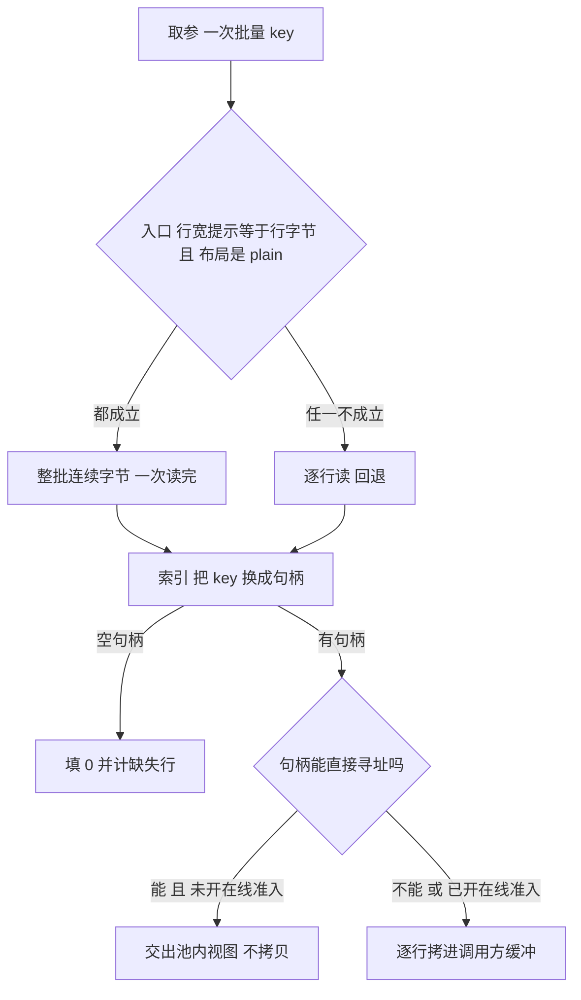

一次前向要取几千到上万行 embedding。这些字节究竟从哪一层取出来、要不要先拷一份，决定了这一步是几十微秒还是几毫秒。这一页跟着一条读请求走到底：它在哪道门前被拦下、被拦下之后退到哪条路，以及为什么"拿到指针"不能当成默认。

## 它是什么

举例：一次前向要取 12000 个 key，每行 128 维 float，合起来约 6 MB。这条请求进存储层后只有一次机会走"整批连续字节"那条快路，剩下的分流全看句柄最后落在哪一层。

读图：先看入口那道门——行宽提示等于行字节、布局是 plain，两条都成立才整批读，否则退回逐行。再往下，空句柄在索引这一层就被填成 0，值存储根本没被调用；有句柄才轮到"能不能直接寻址"。真正跨层的是最右下那一支：SSD 上的行要从盘上把字节搬进内存；池内视图和填零只在内存里做。

三种结局的差别不在"读到了什么"，而在"谁拥有那段字节"：

| 情形 | 拿到的是什么 |
| --- | --- |
| 能交出池内指针，即 DRAM 上的行 | 批量读给指向池内的视图，不拷贝；单条读按槽容量拷进字符串 |
| 交不出指针，即 SSD 行、静态布局、分层后的 SSD 句柄、CLOCK 的全部句柄 | 逐行拷进调用方缓冲，单条读则填进 `ReadResult` |
| 索引里查不到 | 单条读清空结果，批量读给空视图，平铺读显式填 0 并计缺失行 |

还有一道门在更外面：打开在线准入（`online_admission`）后，一次交换可能把这一行换到另一个介质并换掉句柄，所以整条读路径降级为拷贝，即便命中的是池内指针也照样拷进调用方缓冲；平铺快路也不再按连续字节读，退回逐行。四个"按句柄直接定位行"的入口干脆报不支持，让上层回退：

| 入口 | 在线准入打开后 |
| --- | --- |
| `BatchGetDirectFixedRows` | 直接返回 false，让上层回退 |
| `BulkLoadIndexedFloatRange` | 同上 |
| `BatchGetFlatRangeImpl` | 同上；`BatchGetFlatRangeWithMissing` 由它实现 |
| 带 `update_offset` / `update_dim` 的平铺更新 | 同上 |

## 它为什么存在

[推断] 训练侧一次要几千行，逐行拷贝会成为瓶颈，所以 DRAM 路径故意把池内指针交出去。整批读还能再快一层：配置里的默认行大小恰好等于实际行字节、布局又是 plain 时，一批可以按连续字节读出，省掉逐行拼装；非 plain 布局即使行宽匹配也要逐行校验槽容量，因为页槽里可能内嵌页头。两条快路都以"长度可信"为前提。

DRAM 值存储不存原始长度，读取时用槽容量决定这一行返回多长，而槽容量来自"这块有多大"。四种介质给出的答案并不一样：

| 介质 | 枚举值 | 这一行返回多长 |
| --- | --- | --- |
| 并发池 | `CONCURRENT_SLAB_MEMORY_POOL` | 请求前 8 字节记着原始长度，`SlotCapacity` 等于请求长度 |
| R2 池 | `R2_SLAB` | `GetMallocSize` 走 `je_malloc_usable_size`，给的是可用量，可能长于请求 |
| SSD | `SSD_VALUE_STORE` | 槽头 4 字节写实际长度，精确 |
| SSD 静态布局 | `SSD_STATIC_LAYOUT_VALUE_STORE` | 恒等于 `row_size` |

所以批量读的调用方不能假设每行都正好是 `embedding_dim` 长。只有平铺读在回退之后会逐行校验长度等于维度，不等就整次失败——长度在这里第一次被当成硬约束。

## 它和谁接

向上被参数服务器的取参调用，向下调用索引与值存储。它不加检查点互斥锁，索引内部自己同步；于是删除与读之间没有互斥——删除把句柄交给 `Retire` 之后，仍握着旧引用的读者可能读到已回收的槽，延迟回收只是缩短窗口。

锁的边界按操作分三档（名字是 `checkpoint_mu_`）：

| 操作 | 对 `checkpoint_mu_` |
| --- | --- |
| `Get`、`BatchGet`、`BatchGetFlat`、`BatchGetFlatRange*` | 完全不加 |
| `Put`、`BatchPut`、`ApplySgdUpdateFlat`、`BulkLoad` | 持共享锁 |
| `BatchDelete`、`SaveCheckpoint`、`LoadCheckpoint`、`clear` | 持独占锁 |

带区间的平铺读还能顺带报告缺失行号：行号缓冲由调用方给，容量按 64 位整数计且不小于行数；写回的行号从 0 起、按输入升序，重复 key 每次出现都记；成功时返回的计数就是写入个数，范围之外不保证被改写。基类默认返回 false，组合引擎是唯一实现，目前只有存储层测试在调。

## 代码位置

要改代码时再看这里。

### 三道门的判据

| 门 | 判据与失败行为 |
| --- | --- |
| 整批连续字节 | `BatchGetFlat` 只有同时满足 `default_value_size_hint` 等于行字节、`GetLayoutId().plain()` 为真、没开在线准入，才调 `ReadFlatFixedRows`；任一不满足退回逐行 |
| 交出池内指针 | 值存储的 `DirectPtr` 非空才给视图；非 plain 布局即使行宽匹配也要逐行校验槽容量，因为页槽里可能内嵌页头 |
| 在线准入 | `online_admission` 打开后，`Get` / `BatchGet` / `BatchGetFlat` 先取 `online_mu_` 共享锁，`DirectPtr` 命中也改成 `memcpy` 进调用方缓冲，避免交出去的指针被交换动作作废 |

### 缺失行号契约

`MissingPositionsOutput` 是调用方与被调方之间唯一的约定，写清楚了才敢让引擎直接改调用方内存：

| 字段 | 约定 |
| --- | --- |
| `positions` | 调用方提供的缓冲，写进去的是输入行号，不是 key |
| `capacity` | 按 `uint64_t` 元素计，不是字节数；`KVEngineComposite` 要求 `>= num_rows` |
| 写入顺序 | 从 0 起、按输入升序，缺失 key 的每次出现都记 |
| `count` | 成功时是写入个数，只有 `positions[0, count)` 有效，其余不保证被改写 |
| 实现范围 | 基类默认返回 false，`KVEngineComposite` 是唯一实现，还要求 `default_value_size_hint` 恰好等于行字节 |
| 调用方 | 目前只有 `test_kvengine` 在调 |

入口与实现文件：

- `src/storage/kv_engine/engine_composite.h#KVEngineComposite::BatchGetFlat` — 平铺快路径、`memset` 与 `missing_rows`。
- `src/storage/kv_engine/engine_composite.h#KVEngineComposite::BatchGetFlatRangeWithMissing`、`#BatchGetFlatRangeImpl` — 缺失行号写入。
- `src/storage/kv_engine/base_kv.h#MissingPositionsOutput` — 调用方缓冲的容量与计数契约。
- `src/storage/kv_engine/engine_composite.h#KVEngineComposite::Get`、`src/storage/value_store/value_store.h#ValueStore::ReadValue` — 单条读的指针/拷贝合并。
- `src/storage/value_store/dram_value_store.h#DramValueStore::Read` — 槽容量作为返回长度。
- `src/ps/base/cache_ps_impl.h#CachePS::GetParameterFlat` — 回退与逐行长度校验。

## 交付一句

读路径到此为止，核心是两件事：能不能不拷贝、长度谁说了算。[第 6 块](./write-path)接写路径与退役，回答新字节写在哪、旧槽何时归还。
