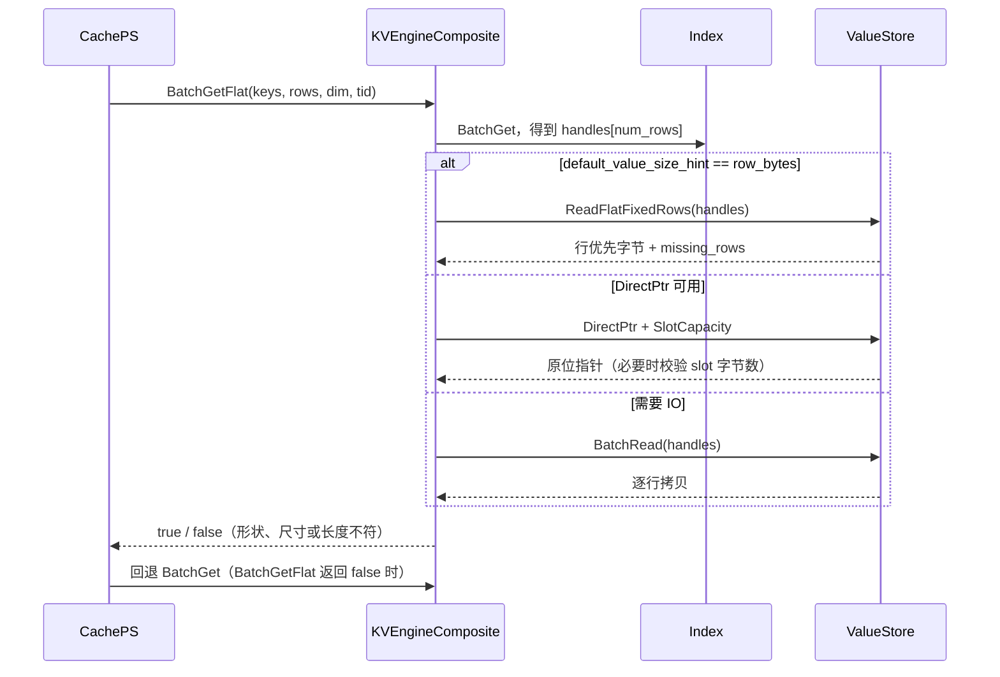

## 它是什么

读路径是一次查询的组装：索引给句柄，值存储给字节，中间决定拷贝与否。入口是 `CachePS::GetParameterFlat`，先试 `BatchGetFlat`，失败再退回 `BatchGet` 并逐行校验长度等于 embedding 维度。命中后按能否直接给出指针分三种情形：

| 情形 | 返回什么 |
|------|----------|
| 能直接给指针（DRAM 系列） | 批量读返回指向池内的视图，不拷贝；单条读按槽容量拷进字符串 |
| 不能给指针（SSD、静态布局、tiered 的 SSD 句柄、CLOCK 全部句柄） | 拷贝到调用方缓冲或 `ReadResult` |
| 未命中 | 单条读清空结果；批量读给空视图；平铺读显式填 0 并计 `missing_rows` |

`online_admission` 打开后读路径整体降级为"拷贝"：`Get` / `BatchGet` / `BatchGetFlat` 先取 `online_mu_` 共享锁，`DirectPtr` 命中也 `memcpy` 到调用方缓冲，而不是交出池内指针——一次交换可能把这行换到另一个介质并换掉句柄。四个"按句柄直接定位行"的接口直接返回 `false` 让上层回退：`BatchGetDirectFixedRows`、`BatchLoadIndexedFloatRange`、`BatchGetFlatRangeImpl`（`BatchGetFlatRangeWithMissing` 的实现）与带 `update_offset` / `update_dim` 的 flat 更新。`BatchGetFlat` 也因此不再走 `ReadFlatFixedRows` 平铺快路。

带区间的平铺读还有一条变体：`BatchGetFlatRangeWithMissing` 在返回平铺结果的同时，把未命中的输入行号写进调用方缓冲。`MissingPositionsOutput` 的语义是：`positions` 由调用方提供，`capacity` 按 `uint64_t` 元素计、且必须 `>= num_rows`；写入的行号从 0 起、按输入升序，重复 key 的每次出现都记；成功时 `count` 是写入个数，`positions[0, count)` 之外不保证被改写。基类默认返回 `false`，`KVEngineComposite` 是当前唯一实现（要求 `default_value_size_hint` 恰好等于行字节数），目前只有 `test_kvengine` 调用。

## 它为什么存在

[推断] 训练侧一次要几千行 embedding，逐行拷贝会成为瓶颈，所以 DRAM 路径故意把池内指针交出去。平铺快路径更进一步：配置里的默认行大小恰好等于实际行字节数、且值存储布局是 `plain`（`GetLayoutId().plain()`）时，整批可以按连续字节读出，省掉逐行拼装；非 plain 布局（静态页布局）即使行宽匹配也要逐行校验槽容量，因为页槽里可能内嵌页头。两条快路径都以"长度可信"为前提，这也解释了长度语义为什么危险。

## 它和谁接

向上被参数服务器的取参调用，向下调用索引与值存储。它不加检查点互斥锁，索引内部自己同步；这一点决定了"删除与读"之间没有互斥。

锁的边界：`Get` / `BatchGet` / `BatchGetFlat` / `BatchGetFlatRange*` 完全不加 `checkpoint_mu_`；`Put` / `BatchPut` / `ApplySgdUpdateFlat` / `BulkLoad` 持共享锁；`BatchDelete` / `SaveCheckpoint` / `LoadCheckpoint` / `clear` 持独占锁。所以"检查点 / 删除"与"读"之间没有互斥，删除把 handle 交给 `Retire` 后，仍持旧 handle 的读者可能读到已回收 slot（延迟回收只是缩短窗口，见风险节）。

长度语义：DRAM 值存储不存原始长度，读取时用槽容量决定这一行返回多长，而槽容量来自"这块有多大"。`CONCURRENT_SLAB_MEMORY_POOL` 在请求前 8 字节写入原始长度，`SlotCapacity` 等于请求长度，行为正确；`R2_SLAB` 的 `GetMallocSize` 用 `je_malloc_usable_size`，返回可用大小（可能大于请求），非 flat 的 `BatchGet` 可能给出比 `embedding_dim` 长的行；`SSD_VALUE_STORE` 在 slot 头写 4 字节实际长度，返回精确长度；`SSD_STATIC_LAYOUT_VALUE_STORE` 永远返回 `row_size`。

## 代码位置

- `src/storage/kv_engine/engine_composite.h#KVEngineComposite::BatchGetFlat` — 平铺快路径、`memset` 与 `missing_rows`。
- `src/storage/kv_engine/engine_composite.h#KVEngineComposite::BatchGetFlatRangeWithMissing`、`#BatchGetFlatRangeImpl` — 缺失行号写入。
- `src/storage/kv_engine/base_kv.h#MissingPositionsOutput` — 调用方缓冲的容量与计数契约。
- `src/storage/kv_engine/engine_composite.h#KVEngineComposite::Get`、`src/storage/value_store/value_store.h#ValueStore::ReadValue` — 单条读的指针/拷贝合并。
- `src/storage/value_store/dram_value_store.h#DramValueStore::Read` — 槽容量作为返回长度。
- `src/ps/base/cache_ps_impl.h#CachePS::GetParameterFlat` — 回退与逐行长度校验。

## 交付一句

第 5 块到此为止，读路径的核心是"能不能不拷贝"和"长度谁说了算"。[第 6 块](./write-path)接写路径与退役，回答新字节写在哪、旧槽何时归还。
