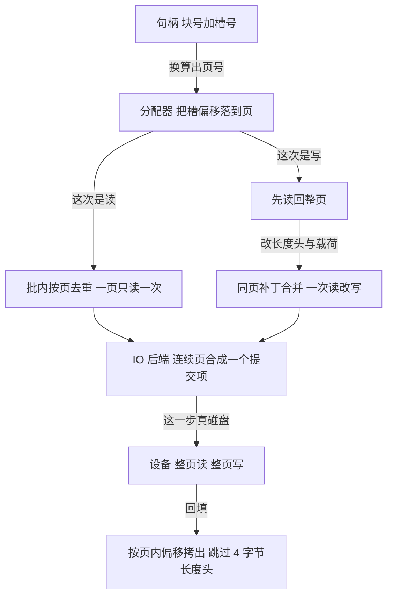
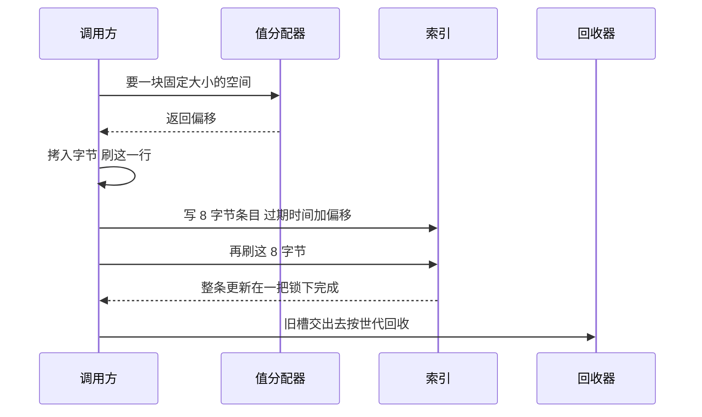

表比内存大时，行总有一部分要落到内存之外。这一页讲两条下行路：一条把冷行放进块设备的定长页，一条把索引和值区整体放进共享内存镜像。前者每次小写都要赔上一整页，后者连检查点都没有。

## 它是什么

举例：一块 64 MiB 的块按 512 字节一档切槽，能放十三万行左右；改其中一行，盘上的动作不是写 512 字节，而是把那一行所在的整页读出来、改几个字节、再整页写回去。同批里若有多行落在同一页，这一页只读一次。

一次读写要过哪几层、同页的活又并到哪里，先看这张图。

读图：先看左边的分叉，读先把同页的 key 并成一次读取，写则必须先读回整页；中间那次合并是本页重点，同批多行落在同一页时并成一个读改写，跨批次撞上同一页则直接等还在飞的那次 IO，但读完的页不会留下当缓存。全图只有标着真碰盘的那一条箭头跨到设备，往上都是内存里的簿记；写失败时刚拿到的槽会被放回去，容量不会只出不进。

另一半把索引和值区都放进可映射的共享内存，容量平均分给若干分片，默认 16 片，每片一个目录，目录下三个文件。

| 文件 | 内容 | 结构 |
|------|------|------|
| `dict` | key → `PetKVData` | `PetHash<uint64, PetKVData, true>`，大小由 `MemorySize(capacity)` 算出 |
| `value` | embedding 字节 | `PersistMemoryPool<true>`，固定 slab 等于 `value_size` |
| `valid` | 4 字节有效标记 | 仅用于判定是否需要 `Initialize` |

一次共享内存写从拿到新空间到旧槽回收，中间那两次「刷」到底做了什么，看第二张图。

读图：中间两笔是写，先往值区拷字节并刷一次，再往索引写 8 字节条目并刷第二次，整条串在一把锁下。图上写「刷」的两步在源码里都是空转：单地址那次刷函数首行就返回，区间刷只剩一条屏障指令。所以这块镜像能跨进程共享，却不能跨机器重启。

这一侧的写、删除与恢复各有一套固定顺序：

| 方面 | 做法 |
| --- | --- |
| 引擎 | `KVEnginePetKV` 把索引与值区都放进镜像 |
| 值格式 | `PetKVData` 是 8 字节打包值，低位存过期时间，高位存 8 字节对齐后的 value offset |
| 一次写 | `Update` 的顺序：`PersistMemoryPool::New` → `memcpy` → `clflushopt_range` → 写 dict entry → `DoFlush` → 旧槽交 `ShmEpochRecycle`，整条在 `modify_lock_` 下串行 |
| 一次刷 | `DoFlush()` 只对那 8 字节打包值做一次区间刷 |
| 删除 | 沿探测链每进一个 chunk 取它的 `lock_`，命中后由 `DeleteLocked` 在持锁下递减沿途 `OverflowCount` 再删条目，遇到正在迁移的 chunk 重试整条探测 |
| 恢复校验 | `dict_->Valid(file_size)` 校验 `capacity_`、`chunk_num_ * 14 == capacity_`、`MemorySize` 与遍历计数一致 |
| 恢复动作 | 通过则 `Reload` 并行重建 size / overflow 链，并对每个 value 调 `shm_malloc_->AddMallocs4Recovery`；该方法只打 "not implement"，占用位图实际靠 chunk 头里的 bitmap 恢复 |
| 批量读 | `BatchGet` 受 gflag `prefetch_method` 控制：`0` 逐 key `Get`，`1` 走 `PetMultiKV::BatchGet` 预取下一个 key 的 shard |
| 刷新与检查点 | `persistence.h#clflushopt` 首行 `return;`，`clflushopt_range` 只做 `sfence`；`PetMultiKV` 没有任何 flush 或检查点接口；`KVEnginePetKV` 显式重写 `SaveCheckpoint` / `LoadCheckpoint` / `clear()`，打 `ERROR` 说明共享内存不持久，前两者返回 `false`，`clear()` 直接不改动存储 |

## 它为什么存在

块设备那条治容量：内存装不下全部行，只能把冷行按页搬出去；代价是随机小写的写放大，写一个小 value 实际是一次整页读、两次补丁、一次整页写。所以读先按页去重，写把同页补丁合并，长度头与载荷一起提交，提交期间补丁缓冲必须一直存活。

共享内存那条治重建：索引和值区已经在镜像里，重启时靠一遍校验把索引重新装起来，不必从别处灌数据；代价是只有一份，坏了没有退路，它因此放弃检查点与清空。

跨槽的行读还会按槽边界分段，坏的 4 字节长度头带不到相邻槽去。

参数、上限与两种后端都在下表，估代价或调配置时查这里：

| 项 | 取值与做法 | 说明 |
| --- | --- | --- |
| IO 抽象 | `IOBackend` 管页号、单页读写与批量读写 | 页号分配后单调递增，一次读写一页 |
| 块大小 | `1 << 26`，即 64 MiB | 分配器按块要空间 |
| 槽头 | `kHeaderSize = 4` | 存实际长度，读时跳过 |
| 尺寸档 | `{128,256,512,1024,4096}` | 每档一个池，每池一把 `mutex`，全局空闲块表再一把 |
| 页锁条数 | 2048 | 通用分配器 `SsdSlabAllocator` 的 stripe |
| 页锁条数 | 64 | 静态布局的 stripe |
| 伙伴分配器 | `SsdBuddyAllocator` | 8 字节头存 `data_size` 与 `level`，每层一个空闲集合，`SlotCapacity` 由 level 反推 |
| 批量读上限 | `SsdValueStore::BatchRead` 一次最多 32768 条 `kMaxBatchIoEntries` | 单条 `Read` 也是一次批量页读 |
| 批量写分批 | 1024 条 | 同一个常量名，按批切开 |
| 在途窗口 | `max(queue_depth / 2, 1)` | 一个提交项可覆盖 `page_count` 页 |
| 完成收割 | `completion_poll_spins` 默认 8192，范围 0 到 1000000 | 为 0 时直接阻塞等待，不忙轮询 |
| 每线程 ring | `IoUringBackend` 用 `io_uring_queue_init(queue_cnt)` | 初始化时 `init()` 从文件大小反推 `next_page_id`，存在则 `size/PAGE_SIZE`，否则 1 |
| 另一种实现 | `SpdkBackend` 同接口 | 能不能用取决于构建 |
| 缓冲与打开 | 按页对齐，文件以 `O_DIRECT` 打开 | 所以读写都是整页 |
| 起始页号 | `page_id_offset` 只在 `IOBackend::AllocatePage` 里当起始页号 | `SsdValueStore` 从不调 `AllocatePage`，基址偏移由 `SsdSlabAllocator` 烘进块地址 |

静态布局是块设备那条路的另一种存法：key 事先排到固定页槽上，运行时只查一份描述文件，所以没有分配与释放，写也只改已有的页槽。

| 方面 | 做法 |
| --- | --- |
| 描述文件 | `Artifact` 记 `strategy`、`page_size`、`row_size`、`keys`、`copies` 与 checksum |
| 句柄 | `key + 1`，`0` 表示缺失 |
| 分配与释放 | `Alloc` 与批量分配直接抛异常，`Free` 是空实现，布局固定，不能新增 key |
| 单条读 | 只读 primary |
| 批量读 | 每轮选覆盖未完成 key 最多的页，一页可同时满足多个 key，MaxEmbed 还能命中副本页 |
| 写 | 必须 `size == row_size`，对该 key 的每个副本所在页各做一次读改写 |
| 批量写合并 | 每行与每个副本拆成 `RowPatch`，按页号排序后逐页 `memcpy`，按页锁 stripe 锁一次，写回一页；原来是同页多行各自读改写整页 |

写侧现在可计量，写放大能直接从计数器读出来：

| 计数器 | 记什么 |
| --- | --- |
| `page_writes`、`bytes_written` | 各后端在自己的页写路径里记一次，批量写记整批，单页写记一页 |
| `ResetStats` | 同时清读写两侧 |
| `layout_page_writes`、`layout_bytes_written`、`layout_payload_bytes_{read,written}` | 静态布局另记 payload 字节，于是写放大可查 |

## 它和谁接

向上被值存储与引擎调用，向下落到页级异步 IO 或共享内存文件。页分配由同一个 IO 抽象负责，所以 SSD 索引与 SSD 值存储共享一套页号空间。静态布局是例外：基址偏移在分配器里就烘进了块地址，运行期不再分配页。

## 代码位置

要改代码时再看这里。

- `src/storage/io_backend/io_backend.h#IOBackend`、`src/storage/io_backend/iouring/io_uring_backend.cpp#IoUringBackend::BatchIO`、`#IoUringBackend::BatchReadPages` — 页语义、连续页段提交、完成收割与 `completion_poll_spins`。
- `src/storage/allocator/ssd/ssd_slab_allocator.h#SsdSlabAllocator::BatchRead`、`#SsdSlabAllocator::ReadSharedPages`、`#SsdSlabAllocator::BatchWrite`、`#Free`、`#kPageLockStripes`、`src/storage/value_store/ssd_static_layout_value_store.h#SsdStaticLayoutValueStore::BatchRead`、`#LockPages`、`src/storage/ssd_layout/ssd_layout.h#Artifact` — 页去重、补丁合并、块级 tombstone、静态布局读与页锁。
- `src/storage/nvm/pet_kv/pet_kv.cc#PetKV::Update`、`#PetMultiKV`、`src/storage/nvm/pet_kv/pet_hash.h#PetHash::Delete`、`#PetHash::DeleteLocked`、`src/storage/nvm/pet_kv/persistence.h#clflushopt`、`src/storage/kv_engine/engine_petkv.h#KVEnginePetKV::SaveCheckpoint`、`#KVEnginePetKV::clear` — 共享内存写入、按 chunk 串行删除、空 flush 与显式 unsupported。

## 交付一句

第 8 块到此为止，SSD 侧的代价集中在整页读改写，PetKV 侧既不能 checkpoint 也不能 clear。[第 9 块](./gpu)接显存侧的表。
